# VERİ MADENCİLİĞİ (DATA MINING)  
**Ders Kodu:** BMSB403  
**Hazırlayan:** Ph.D. Erkan ÖZHAN  
Tekirdağ Namık Kemal Üniversitesi  
Çorlu Mühendislik Fakültesi  
Bilgisayar Mühendisliği Bölümü  
2025.v13-6  

E-posta: erkanozhan@gmail.com / eozhan@nku.edu.tr  
Tel: +90 282 250 23 84  
Ofis: Çorlu Mühendislik Fakültesi, 4. Kat B-410  
Görüşme Saatleri: Her hafta Perşembe 09:30-12:30 arası.

**Veri setleri ve kodlar:** Notta kullanılan veri setleri [`datasets/`](https://github.com/erkanozhan/datamining/tree/main/datasets), R kodları [`codes/`](https://github.com/erkanozhan/datamining/tree/main/codes) klasöründedir. Notun web sürümü: <https://erkanozhan.github.io/datamining/>

**Terimler hakkında:** Türkçe kavramların ilk geçtiği yerde parantez içinde İngilizce karşılığı verilmiştir. Gerçek Pozitif, Sahte Pozitif, Gerçek Negatif ve Sahte Negatif terimleri sırasıyla *True Positive*, *False Positive*, *True Negative* ve *False Negative* karşılığında kullanılmıştır.

---

## İçindekiler

1. [Veri Nedir?](#b1)
2. [Veri Kaynakları](#b2)
3. [Veri Kaynaklarının Gelişimi](#b3)
4. [Veri Madenciliği](#b4)
5. [Veri Madenciliği Modelleri](#b5)
6. [Veri Madenciliği, Makine Öğrenmesi ve İstatistik İlişkisi](#b6)
7. [Veri Madenciliğinin Önemi ve Uygulama Alanları](#b7)
8. [Veritabanlarında Bilgi Keşfi (KDD)](#b8)
9. [Veri Madenciliği ve KDD Arasındaki İlişki](#b9)
10. [Operasyonel Veritabanları ve Veri Ambarları](#b10)
11. [OLAP (Çevrimiçi Analitik İşleme)](#b11)
12. [OLAP Mimarisi: Küpler, Boyutlar ve Ölçüler](#b12)
13. [Karar Ağaçları](#b13)
14. [Naive Bayes Sınıflandırıcısı](#b14)
15. [Kümeleme Analizi](#b15)
16. [WEKA ile Birliktelik Kuralı Madenciliği](#b16)
17. [Metin Madenciliği](#b17)
18. [R Yazılımında Uygulamalar](#b18)
- [Kaynaklar](#kaynaklar)

---

<a id="b1"></a>

## 1. Veri Nedir? (What is Data?)
- **Dijital Veri**
- **Basılı – Fiziksel Veri**
- **Soyut Veri**

### 1.1. Veri Türleri:
- Doküman, Resim, Ses, Video, Metin, Program  
- Gazete, Dergi, Kitap, Afiş vb.  
- Tecrübeler, Hatıralar, Hayaller …

---

<a id="b2"></a>

## 2. Veri Kaynakları
- Marketler  
- Kurumlar  
- Konuşmalar  
- Hastaneler  
- Eğitim Kurumları  
- Laboratuvarlar  
- Turnikeler  
- Otoyol Geçiş Sistemleri  
- Sensörler  
- Facebook, Twitter  
- E-Mailler  
- Otomasyon Sistemleri  

---

<a id="b3"></a>

## 3. Veri Kaynaklarının Gelişimi
Otomatize edilmiş veri toplama araçları ve “olgunlaşmış” veritabanları; veri ambarlarında ve diğer bilgi depolama alanlarında devasa miktarda verinin birikmesine sebep olmuştur.  

- **Veri Üretimi:** Günümüzde her gün milyarlarca gigabayt veri üretilmektedir. Uluslararası Veri Şirketi (International Data Corporation, IDC) 2018 yılında yayımladığı raporda küresel veri miktarının 2025 yılında 175 zettabayta ulaşacağını öngörmüştür.
- **Depolama Gelişmeleri:** Depolama maliyetleri düşmeye devam ederken, bu devasa veri yığınlarını saklama kapasitemiz sürekli artmaktadır.
- **Sonuç:** Veri bolluğu içindeyiz, ancak asıl ihtiyaç duyduğumuz şey bu veriden anlamlı bilgi (knowledge) ve içgörü (insight) elde etmektir. 

Jerome Friedman:  
> “Verinin boyutu her 10 katına çıktığında, onu analiz etme biçimimizi tamamen yeniden şekillendirmek zorundayız.”  


<a id="b4"></a>

## 4. Veri Madenciliği (Data Mining)

Veri madenciliği, veri tabanı sorgularından (**database query**) farklıdır.  

### 4.1. Veritabanı Sorgusu (Geleneksel Analiz)
- "Geçen ay en çok hangi ürün satıldı?"
- "İstanbul'daki müşterilerimizin ortalama yaşı kaçtır?"
- "Son üç ayda kaç yeni müşteri kazandık?"  

### 4.2. Veri Madenciliği Analizi (Keşif ve Tahmin)
Veri madenciliği, verinin derinliklerindeki gizli örüntüleri, ilişkileri ve gelecek trendlerini ortaya çıkarmayı hedefler.

- **Birliktelik Analizi:** "Hangi ürünler genellikle birlikte satın alınır?" (Örn: Bebek bezi alan müşteriler mama ve ıslak mendil de alır mı?)
- **Tahminleme (Sınıflandırma):** "Hangi müşterilerin önümüzdeki 3 ay içinde aboneliklerini iptal etme olasılığı yüksektir?"
- **Kümeleme:** "Müşterilerimizi satın alma davranışlarına göre hangi doğal gruplara (segmentlere) ayırabiliriz?"
- **Anomali Tespiti:** "Hangi kredi kartı işlemleri sahtekârlık şüphesi taşımaktadır?"
- **Tavsiye Sistemleri:** "A ürününü satın alan bir müşteriye başka hangi ürünleri önermeliyiz?"

### 4.3. Veri Madenciliği Tanımı
Veri madenciliği, çeşitli akademik kaynaklarda farklı şekillerde tanımlanmakla birlikte, temel olarak büyük veri setleri içindeki değerli bilgiyi keşfetme sürecini ifade eder.

- **Fayyad, Piatetsky-Shapiro, & Smyth (1996)** tarafından yapılan klasik tanıma göre veri madenciliği, "veri içerisindeki **geçerli, yeni, potansiyel olarak kullanışlı** ve nihayetinde **anlaşılabilir** örüntülerin önemsiz olmayan (non-trivial) çıkarım sürecidir." Bu tanım, sürecin sadece veri işlemeyi değil, aynı zamanda keşfedilen bilginin niteliğini de vurgular.
- **Han, Kamber, & Pei (2012)** ise veri madenciliğini, "büyük miktardaki veriden ilginç örüntüleri ve bilgiyi keşfetme süreci" olarak daha geniş bir perspektiften ele alır. Bu süreç, veritabanları, veri ambarları, web ve diğer bilgi havuzlarını kapsar.
- Temel amaç, veriden öğrenen bir **model** oluşturmaktır. Bu model, veriyi özetler ve gelecekteki olayları tahmin etmek (tahminleyici model) veya verinin iç yapısını anlamak (betimleyici model) için kullanılır. Keşfedilen bu yapılar genellikle **model** veya **örüntü (pattern)** olarak adlandırılır.

---

<a id="b5"></a>

## 5. Veri Madenciliği Modelleri
Veri madenciliğinin temel amacı, verinin içindeki gizli örüntüleri ve ilişkileri keşfetmek için modeller oluşturmaktır. Bu modeller, açıkça kodlanmış kurallara dayanmak yerine, veriden otomatik olarak öğrenilir ve genellikle iki ana kategoriye ayrılır:

1.  **Tahminleyici (Predictive) Modeller:**
    - Gelecekteki veya bilinmeyen olayların sonucunu tahmin etmek için kullanılır.
    - **Örnekler:** Bir müşterinin bir ürünü satın alıp almayacağını tahmin eden **sınıflandırma** modelleri veya bir evin gelecekteki fiyatını tahmin eden **regresyon** modelleri.

2.  **Betimleyici (Descriptive) Modeller:**
    - Verideki doğal gruplamaları, ilişkileri veya aykırı durumları bulmaya odaklanır.
    - **Örnekler:** Müşterileri benzer satın alma alışkanlıklarına göre gruplayan **kümeleme** modelleri, birlikte sıkça satın alınan ürünleri belirleyen **birliktelik kuralları** veya sahtekârlık tespiti için kullanılan **anomali tespiti** modelleri.

---

<a id="b6"></a>

## 6. Veri Madenciliği, Makine Öğrenmesi ve İstatistik İlişkisi
Veri madenciliği, makine öğrenmesi ve istatistik birbiriyle yakından ilişkili, sıklıkla iç içe geçmiş alanlardır. Veri madenciliği, bu disiplinlerden gelen yöntemleri pratik problemlere uygulama sürecidir.

-   **İstatistik (Statistics):**
    -   Veri madenciliğinin teorik temelini oluşturur.
    -   Veriyi anlama, özetleme, hipotez test etme ve sonuçların güvenilirliğini ölçme gibi konulara odaklanır.
    -   Örnekleme, olasılık teorisi ve modelleme gibi klasik yöntemler sunar. Temel amacı, veriden çıkarım (inference) yapmaktır.

-   **Makine Öğrenmesi (Machine Learning):**
    -   Veri madenciliğinin algoritmik motorudur. Bilgisayar bilimi ve yapay zekanın bir alt dalıdır.
    -   Büyük veri setleri üzerinde verimli bir şekilde çalışabilen algoritmalar geliştirmeye odaklanır.
    -   Açıkça programlanmadan, veriden öğrenerek tahminler veya kararlar üreten sistemler oluşturur. Sınıflandırma, regresyon, kümeleme gibi algoritmalar bu alandan gelir. Temel amacı, tahminsel doğruluktur (predictive accuracy).

-   **Veri Madenciliği (Data Mining):**
    -   İstatistik ve makine öğrenmesi tekniklerini kullanarak büyük veri yığınları içindeki **anlamlı, yeni ve potansiyel olarak faydalı** örüntüleri keşfetme sürecidir.
    -   Odak noktası, keşfedilen bilgiyi pratik ve işlevsel bir içgörüye dönüştürmektir.
    -   Genellikle "Veritabanlarında Bilgi Keşfi" (Knowledge Discovery in Databases - KDD) sürecinin bir adımı olarak kabul edilir.

**Özetle:**
-   **İstatistik** "Neden?" sorusuna odaklanarak verinin altındaki yapıyı ve güvenilirliği anlamaya çalışır.
-   **Makine Öğrenmesi** "Nasıl?" sorusuna odaklanarak veriden öğrenen ve doğru tahminler yapan algoritmalar geliştirir.
-   **Veri Madenciliği** ise bu araçları kullanarak "Ne?" sorusuna cevap arar: "Veride hangi gizli ve değerli örüntüler var?" 

---

<a id="b7"></a>

## 7. Veri Madenciliğinin Önemi ve Uygulama Alanları

Veri madenciliği, ham veriyi iş zekasına, bilimsel keşiflere ve stratejik karar alma süreçlerine dönüştüren kritik bir disiplindir. Önemi, sadece büyük veri yığınlarını analiz etme kapasitesinden değil, aynı zamanda bu verilerden daha önce bilinmeyen, eyleme geçirilebilir ve değerli bilgiler çıkarma yeteneğinden kaynaklanır. Bu süreç, çeşitli sektörlerde devrim yaratmıştır:

-   **İşletme ve Pazarlama:**
    -   **Müşteri Segmentasyonu:** Müşterileri demografik bilgilere, satın alma alışkanlıklarına veya davranışlarına göre gruplayarak hedefli pazarlama stratejileri geliştirilir.
    -   **Pazar Sepeti Analizi (Birliktelik Kuralları):** Hangi ürünlerin birlikte satın alındığını tespit ederek raf düzenlemeleri, çapraz satış (cross-selling) ve promosyon kampanyaları optimize edilir.
    -   **Müşteri Kaybı (Churn) Analizi:** Bir hizmeti terk etme olasılığı yüksek olan müşterileri önceden belirleyerek onları elde tutmaya yönelik proaktif adımlar atılır.

-   **Finans ve Bankacılık:**
    -   **Sahtekârlık Tespiti (Fraud Detection):** Kredi kartı işlemlerindeki veya sigorta taleplerindeki anormal ve şüpheli örüntüleri tespit ederek finansal kayıplar önlenir.
    -   **Kredi Riski Değerlendirmesi:** Başvuru sahiplerinin kredi geçmişini ve diğer özelliklerini analiz ederek geri ödeme olasılıklarını tahmin eder ve kredi kararlarını destekler.

-   **Sağlık ve Biyoinformatik:**
    -   **Hastalık Teşhisi ve Tahmini:** Tıbbi verileri (görüntüler, laboratuvar sonuçları, hasta geçmişi) analiz ederek hastalıkların erken teşhisine yardımcı olur ve tedavi sonuçlarını tahmin eder.
    -   **Genomik Veri Analizi:** Gen dizilimlerindeki örüntüleri keşfederek genetik hastalıklara yatkınlığı belirler ve kişiselleştirilmiş tıp uygulamalarına zemin hazırlar.

-   **Web ve E-Ticaret:**
    -   **Tavsiye Sistemleri (Recommendation Systems):** Kullanıcıların geçmiş davranışlarına dayanarak onlara ilgi duyabilecekleri ürün, film veya içerikleri önerir, böylece kullanıcı deneyimini ve satışları artırır.
    -   **Web Kullanım Madenciliği:** Web sitesi ziyaretçilerinin gezinme yollarını analiz ederek site tasarımını ve kullanıcı arayüzünü iyileştirir.

Bu uygulamalar, veri madenciliğinin sadece teorik bir alan olmadığını, aynı zamanda kuruluşların daha akıllı kararlar almasını, verimliliği artırmasını ve rekabet avantajı elde etmesini sağlayan güçlü bir pratik araç olduğunu göstermektedir.

<a id="b8"></a>

## 8. Veritabanlarında Bilgi Keşfi (Knowledge Discovery in Databases - KDD)

Veritabanlarında Bilgi Keşfi (KDD), ham veri yığınları içerisinden **geçerli, yeni, potansiyel olarak faydalı ve nihayetinde anlaşılabilir** örüntüleri bulmaya yönelik **önemsiz olmayan (non-trivial)** ve bütünsel bir süreçtir. KDD, veri madenciliğini de içeren çok adımlı bir metodoloji olarak kabul edilir ve veriden bilgiye giden yol haritasını çizer.

### 8.1. KDD Sürecinin Adımları
KDD süreci, genellikle aşağıdaki ardışık adımlardan oluşur:

1.  **Veri Seçimi (Selection):** Analiz hedefine uygun olarak, ilgili veri kaynaklarından (veritabanları, veri ambarları vb.) bir hedef veri kümesi oluşturulur.
2.  **Ön İşleme (Preprocessing):** Veri kalitesini artırmak için en kritik adımlardan biridir. Bu aşamada gürültülü veriler temizlenir, eksik değerler yönetilir ve tutarsızlıklar giderilir.
3.  **Dönüşüm (Transformation):** Veri, madencilik algoritmalarının uygulanmasına uygun hale getirmek için dönüştürülür. Bu, boyut indirgeme, öznitelik mühendisliği (feature engineering) ve normalizasyon gibi teknikleri içerebilir.
4.  **Veri Madenciliği (Data Mining):** Sürecin çekirdek adımıdır. Belirli bir amaç doğrultusunda (örn. sınıflandırma, kümeleme) akıllı algoritmalar kullanılarak veri içerisindeki örüntüler sistematik olarak çıkarılır.
5.  **Yorumlama ve Değerlendirme (Interpretation & Evaluation):** Keşfedilen örüntülerin ve modellerin, başlangıçtaki hedeflerle ne kadar uyumlu olduğu değerlendirilir. Anlamlı bulunan bilgiler görselleştirilerek veya raporlanarak karar vericiler için eyleme geçirilebilir bilgiye dönüştürülür.

### 8.2. Keşfedilen Bilginin Nitelikleri
KDD sürecinin nihai hedefi, sadece herhangi bir örüntü bulmak değil, aşağıdaki niteliklere sahip olan **bilgiyi** ortaya çıkarmaktır:

-   **Örtük (Implicit):** Basit sorgularla veya geleneksel analiz yöntemleriyle kolayca bulunamayan, verinin derinliklerinde saklı olan.
-   **Geçerli (Valid):** Sadece analiz edilen veri setinde değil, yeni veriler üzerinde de belirli bir güvenilirlik derecesiyle genellenebilir olan.
-   **Yeni ve Özgün (Novel):** Daha önceden bilinmeyen, şaşırtıcı ve beklentilerin ötesinde olan.
-   **Potansiyel Olarak Faydalı (Potentially Useful):** Stratejik bir avantaj sağlayan, karar alma süreçlerini iyileştiren veya bir hedefe ulaşmak için eyleme geçirilebilen.
-   **Anlaşılabilir (Understandable):** Alan uzmanları veya son kullanıcılar tarafından kolayca yorumlanabilen ve anlamlandırılabilen.

---
<a id="b9"></a>

## 9. Veri Madenciliği ve KDD Arasındaki İlişki

Veri madenciliği, sıklıkla KDD süreciyle eş anlamlı olarak kullanılsa da, metodolojik olarak KDD'nin yalnızca bir adımıdır; ancak en merkezi adımıdır. KDD, veriden bilgiye ulaşmayı hedefleyen bütünsel bir metodoloji iken, veri madenciliği bu sürecin içerisinde belirli algoritmalar kullanarak örüntülerin fiilen çıkarıldığı analitik aşamayı temsil eder. Kısacası, KDD "bilgi keşfi"nin stratejik yol haritasını çizerken, veri madenciliği bu haritadaki en önemli "keşif" eylemidir.

### 9.1. Geleneksel Yöntemlerin Rolü
Uygulamada, bir KDD projesinde harcanan zaman ve eforun büyük bir kısmı—genellikle %80'e varan bir oranı—veri madenciliği adımından önceki hazırlık aşamalarına (veri seçimi, ön işleme ve dönüşüm) ayrılır. Bunun temel nedeni, gerçek dünya verilerinin genellikle "kirli" (eksik, gürültülü, tutarsız) olmasıdır. Veri madenciliği algoritmalarının başarısı, doğrudan girdi verisinin kalitesine bağlıdır. "Çöp girer, çöp çıkar" (Garbage In, Garbage Out) prensibi, bu aşamanın kritik önemini vurgular.

KDD sürecinin başlangıcında, genellikle standart veritabanı sorgulama dilleri (SQL) ve Çevrimiçi Analitik İşleme (OLAP) araçları ile bir ön analiz yapılır. Bu araçlar, veritabanında açıkça var olan bilgileri özetlemek, filtrelemek ve raporlamak için son derece güçlüdür. Ancak bu geleneksel yöntemler, verinin derinliklerindeki örtük, daha önce bilinmeyen ve tahmine dayalı ilişkileri ortaya çıkarmada yetersiz kalır. İşte bu noktada veri madenciliği devreye girer ve SQL'in cevaplayamadığı sorulara odaklanır:

-   **Birliktelik Analizi:** "Hangi ürünler genellikle birlikte satın alınır?" (SQL ile bu soruyu sormak için önce hangi ürünleri karşılaştıracağınızı bilmeniz gerekir; veri madenciliği ise bu ilişkileri otomatik olarak keşfeder.)
-   **Sınıflandırma ve Tahmin:** "Bir müşterinin kredi başvurusunun riskli olup olmadığını hangi özelliklere bakarak tahmin edebilirim?" (Bu, geleceğe yönelik bir tahmin gerektirir ve veriden öğrenen bir model oluşturulmasını zorunlu kılar.)

Özetle, SQL ve OLAP mevcut veriyi "sorgularken", veri madenciliği verinin kendisine "soru sormasını" sağlayarak gizli içgörüleri ve geleceğe yönelik modelleri keşfeder.

<a id="b10"></a>

## 10. Operasyonel Veritabanları ve Veri Ambarları

Veri analizi ve karar destek sistemleri bağlamında, operasyonel veritabanları ile veri ambarları arasında temel mimari ve amaç farklılıkları bulunmaktadır.

### 10.1. Operasyonel Veritabanı Sistemleri (OLTP)
Operasyonel sistemler, bir kuruluşun günlük işlemlerini yürütmek için tasarlanmış **Çevrimiçi İşlem Gerçekleştirme (Online Transaction Processing - OLTP)** sistemleridir.

-   **Temel Amaç:** Günlük ticari işlemleri (ekleme, silme, güncelleme) hızlı ve tutarlı bir şekilde kaydetmek ve yönetmektir.
-   **Veri Yapısı:** Veri bütünlüğünü sağlamak ve tekrarı önlemek amacıyla genellikle yüksek derecede normalize edilmiş (Üçüncü Normal Form - 3NF) ilişkisel tablolardan oluşur.
-   **Kullanıcılar:** Genellikle son kullanıcılar, kasiyerler veya veri giriş operatörleridir.
-   **Odak Noktası:** Anlık, güncel veriler üzerindedir. Örneğin, bir bankacılık sistemindeki anlık bakiye veya bir e-ticaret sitesindeki mevcut stok durumu.

### 10.2. Veri Ambarları (Data Warehouses - DW)
Veri ambarı, farklı operasyonel kaynaklardan toplanan verilerin analiz ve karar destek amacıyla bütünleştirildiği merkezi bir depodur. Bu sistemler **Çevrimiçi Analitik İşleme (Online Analytical Processing - OLAP)** için optimize edilmiştir.

**Tanım (W. H. Inmon):** Veri ambarı; stratejik karar almayı desteklemek amacıyla tasarlanmış, **konu odaklı (subject-oriented)**, **bütünleşik (integrated)**, **zamana göre değişen (time-variant)** ve **kalıcı (non-volatile)** bir veri koleksiyonudur.

-   **Konu Odaklı:** Veriler, "müşteri," "ürün," "satış" gibi analitik konular etrafında organize edilir.
-   **Bütünleşik:** Farklı kaynaklardan (örn. satış veritabanı, pazarlama Müşteri İlişkileri Yönetimi (Customer Relationship Management - CRM)) gelen veriler, tutarlı bir formatta birleştirilir ve standartlaştırılır.
-   **Zamana Göre Değişen:** Veriler, tarihsel bir perspektif sunacak şekilde (örn. son 5 yılın satış verileri) saklanır. Bu, trend analizini mümkün kılar.
-   **Kalıcı:** Veri ambarına yüklenen veriler genellikle değiştirilmez veya silinmez. Sadece periyodik olarak yeni veriler eklenir.

### 10.3. OLTP ve Veri Ambarı Karşılaştırması

| Özellik | OLTP Sistemleri (Operasyonel Veritabanı) | Veri Ambarı (OLAP için) |
| :--- | :--- | :--- |
| **Ana Amaç** | Günlük işlemleri yürütme | Stratejik karar verme ve analiz |
| **Veri İçeriği** | Anlık, güncel ve detaylı veri | Tarihsel, özetlenmiş ve birleştirilmiş veri |
| **Veri Yapısı** | Yüksek derecede normalize (örn. 3NF) | Denormalize, çok boyutlu (örn. Yıldız, Kar Tanesi) |
| **Odak** | İşlem (Transaction) odaklı | Analiz (Query) odaklı |
| **Erişim Türü** | Sık okuma/yazma işlemleri | Yoğunlukla okuma, karmaşık sorgular |
| **Kullanıcılar** | Veri giriş operatörleri, son kullanıcılar | Bilgi çalışanları, analistler, yöneticiler |

### 10.4. Veri Ambarı Mimarisi ve ETL Süreci

Veri ambarları, çeşitli kaynaklardan veri toplayan ve bu veriyi analize uygun hale getiren bir **Ayıklama, Dönüştürme, Yükleme (Extract, Transform, Load - ETL)** süreci üzerine kuruludur.

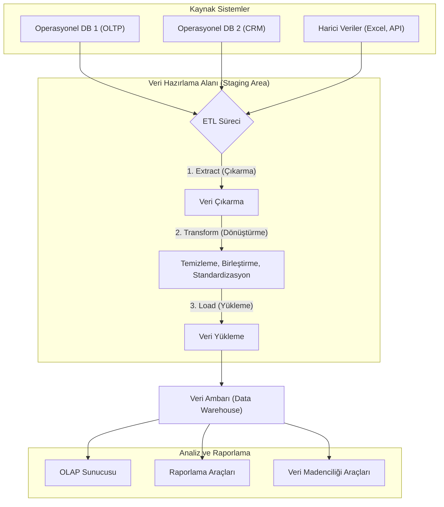

1.  **Çıkarma (Extract):** Farklı operasyonel veritabanları ve harici kaynaklardan (örn. Uygulama Programlama Arayüzü - Application Programming Interface - API) ilgili veriler çekilir.
2.  **Dönüştürme (Transform):** Veriler temizlenir (eksik değerler doldurulur, tutarsızlıklar giderilir), birleştirilir ve veri ambarının standart şemasına uygun hale getirilir.
3.  **Yükleme (Load):** Dönüştürülmüş ve hazır hale getirilmiş veri, analiz edilmek üzere veri ambarına yüklenir.


### 10.5. Meta Veri (Metadata)

**Tanım:** En basit tanımıyla meta veri, **"veri hakkında veri"** demektir. Veri ambarındaki verinin ne anlama geldiğini, nereden geldiğini, nasıl yapılandırıldığını ve nasıl kullanılacağını açıklayan bir tür "veri sözlüğü" veya "kullanım kılavuzu"dur. Ham veriye bağlam ve anlam kazandırır.

Meta veri, aşağıdaki gibi sorulara yanıt verir:
-   Bu verinin adı nedir? (`Satis_Miktari`)
-   Veri türü nedir? (Sayısal, metin, tarih vb.)
-   Hangi tablodan veya sistemden geliyor? (Kaynak)
-   En son ne zaman güncellendi?
-   Hesaplanmış bir alan ise formülü nedir?

**Örnek:**
Bir satış tablosunda `150` şeklinde bir değer olduğunu düşünelim. Bu değer tek başına bir anlam ifade etmez. Ancak meta verisi ile birlikte anlam kazanır:

-   **Veri (Data):** `150`
-   **Meta Veri (Metadata):**
    -   **Öznitelik Adı:** `Satis_Adedi`
    -   **Açıklama:** "Tek bir işlemde satılan ürün sayısı"
    -   **Veri Tipi:** `Tamsayı (Integer)`
    -   **Kaynak Tablo:** `Gunluk_Satislar`
    -   **Geçerli Aralık:** `1 - 500`

Bu meta veri sayesinde `150` değerinin, `Gunluk_Satislar` tablosundaki bir satış işleminde 150 adet ürün satıldığını ifade eden bir tamsayı olduğunu anlarız. Meta veri olmadan, veri yığınları anlamsız sayılardan ibaret kalır.

### 10.6. Veri Ambarı Şemaları: Veriyi Anlamlandırma Sanatı

Veri ambarında veriler, analiz sorgularını hızlı ve verimli bir şekilde çalıştıracak şekilde özel yapılarla organize edilir. Bu yapılara **şema** denir. En yaygın kullanılan üç şema türü Yıldız, Kar Tanesi ve Galaksi (Fact Constellation) şemalarıdır.

#### 10.6.1. Yıldız Şeması (Star Schema)

En basit ve en yaygın kullanılan veri ambarı şemasıdır. Adını, yapısının bir yıldıza benzemesinden alır: merkezde bir **olgu (fact) tablosu** ve bu tabloya doğrudan bağlı olan **boyut (dimension) tabloları** bulunur.

-   **Olgu Tablosu (Fact Table):** İşletmenin sayısal ölçümlerini (satış adedi, gelir, maliyet gibi) ve boyut tablolarına ait yabancı anahtarları (foreign keys) içerir. İş süreçlerinden ölçülen nicel verileri (sayısal değerleri, metrikleri) tutan tablodur.
-   **Boyut Tabloları (Dimension Tables):** Olgu tablosundaki verilere bağlam kazandıran tanımlayıcı bilgileri (ürün adı, müşteri bilgisi, tarih detayları gibi) içerir. Boyut tabloları **denormalize** edilmiştir, yani ilgili tüm bilgiler tek bir tabloda toplanır.

**Avantajları:**
-   **Basitlik:** Anlaşılması ve sorgulanması kolaydır.
-   **Performans:** Daha az `JOIN` işlemi gerektirdiği için sorgular genellikle çok hızlı çalışır.

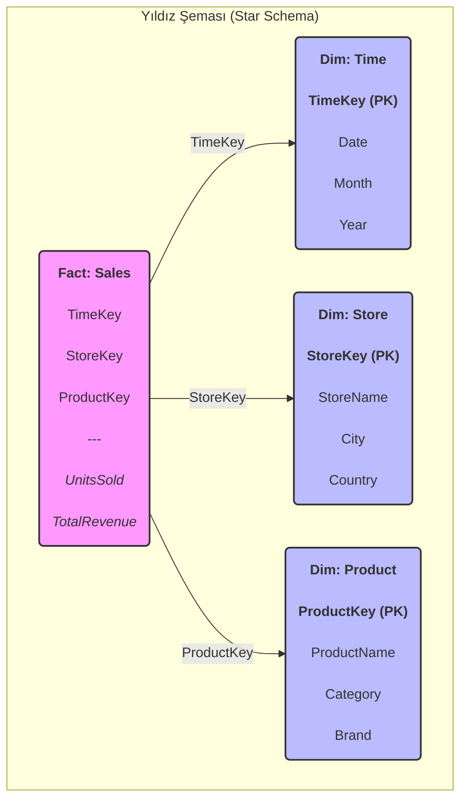

#### 10.6.2. Kar Tanesi Şeması (Snowflake Schema)

Yıldız şemasının bir uzantısıdır. Temel fark, boyut tablolarının **normalize** edilmiş olmasıdır. Yani, bir boyut tablosu, veri tekrarını azaltmak için daha küçük ve ilişkili birden fazla tabloya bölünür. Bu yapı, bir kar tanesinin dallanmış kristal yapısına benzediği için bu adı almıştır.

**Avantajları:**
-   **Veri Bütünlüğü:** Normalizasyon sayesinde veri tekrarı azalır ve depolama alanı daha verimli kullanılır.
-   **Bakım Kolaylığı:** Hiyerarşik yapıların yönetimi daha kolaydır (örn. Ürün -> Kategori -> Departman).

**Dezavantajları:**
-   **Sorgu Karmaşıklığı:** Daha fazla tablo olduğu için sorgular daha fazla `JOIN` işlemi gerektirir, bu da performansı düşürebilir.

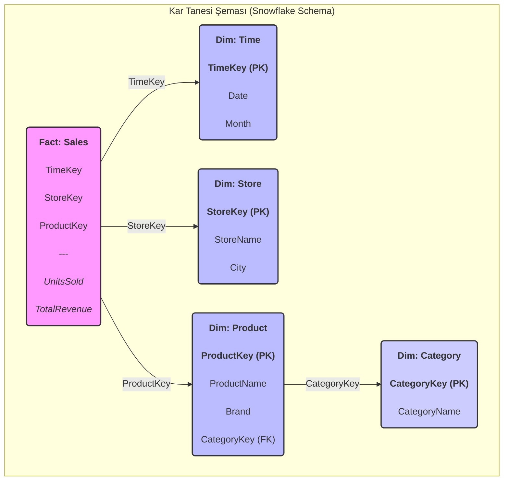

#### 10.6.3. Galaksi Şeması / Fact Constellation Şeması

İki veya daha fazla olgu tablosunun, ortak boyut tablolarını paylaştığı daha karmaşık bir yapıdır. Bu şema, birbiriyle ilişkili farklı iş süreçlerini (örneğin, satış ve sevkiyat) tek bir modelde analiz etmek için kullanılır. Yapı, birden fazla yıldızın bir araya gelerek bir galaksi oluşturmasına benzetilir.

**Avantajları:**
-   **Esneklik:** Farklı iş süreçleri arasında entegre analiz yapma imkânı sunar.
-   **Yeniden Kullanılabilirlik:** Boyut tabloları birden fazla olgu tablosu tarafından paylaşıldığı için tutarlılık ve verimlilik artar.

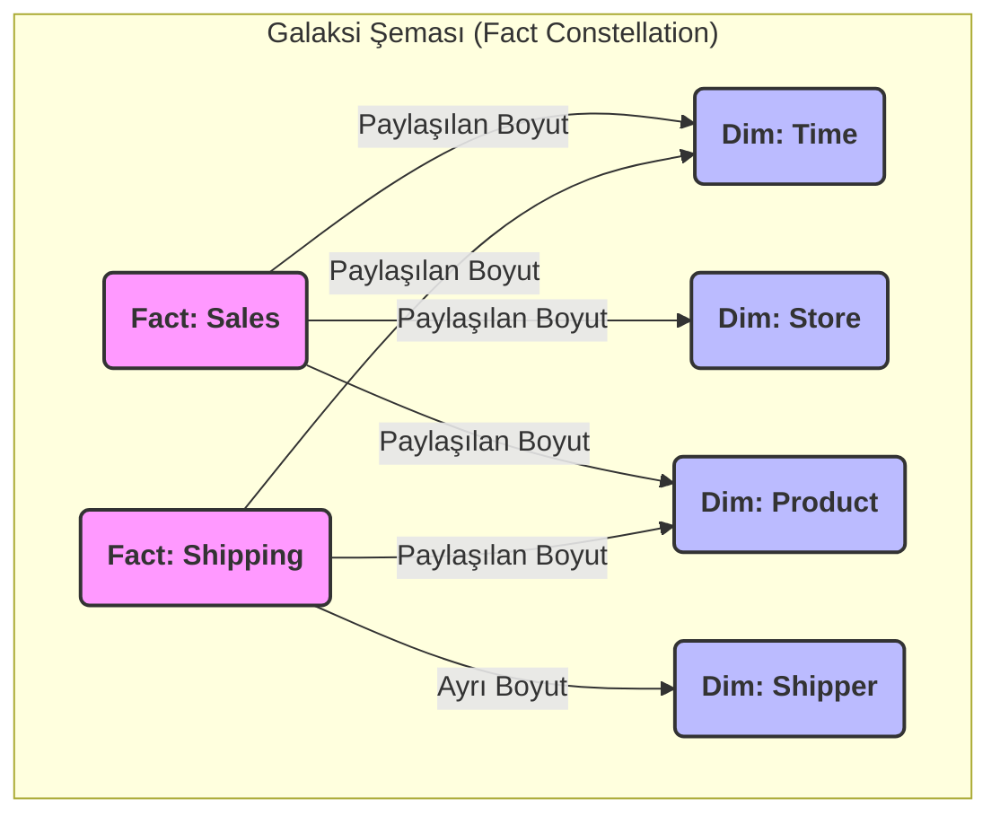

### 10.7. Şema Karşılaştırması

| Özellik | Yıldız Şeması (Star) | Kar Tanesi Şeması (Snowflake) | Galaksi Şeması (Fact Constellation) |
| :--- | :--- | :--- | :--- |
| **Yapı** | Merkezi bir olgu tablosu, etrafında boyut tabloları | Yıldız şemasının normalize edilmiş hali | Birden fazla olgu tablosu, paylaşılan boyutlar |
| **Normalizasyon** | Boyutlar denormalize (tek tablo) | Boyutlar normalize (çoklu tablo) | Boyutlar genellikle denormalize |
| **Sorgu Performansı** | Yüksek (az `JOIN`) | Daha Düşük (çok `JOIN`) | Değişken (sorguya bağlı) |
| **Veri Bütünlüğü** | Daha düşük (veri tekrarı olabilir) | Yüksek (veri tekrarı az) | Yüksek (paylaşılan boyutlar sayesinde) |
| **Kullanım Alanı** | Çoğu veri ambarı ve veri pazarı (data mart) | Karmaşık hiyerarşilere sahip veri modelleri | Birbiriyle ilişkili birden fazla iş sürecinin analizi |

### 10.8. Veri Pazarı (Data Mart)
Veri pazarı, kurumsal bir veri ambarının belirli bir departmana (örneğin Satış, Pazarlama) veya iş koluna odaklanmış daha küçük bir alt kümesidir. Amacı, belirli bir kullanıcı grubunun ihtiyaç duyduğu veriye daha hızlı ve kolay erişim sağlamaktır. Veri ambarının tamamı yerine sadece ilgili veri setini içerdiği için daha yönetilebilir, daha hızlı kurulabilir ve daha düşük maliyetlidir. Verilerini merkezi bir veri ambarından veya doğrudan operasyonel kaynaklardan alabilir.  

---
<a id="b11"></a>

## 11. OLAP (Çevrimiçi Analitik İşleme - Online Analytical Processing)

OLAP, büyük veri ambarlarındaki verilerin, iş analistleri ve yöneticiler tarafından hızlı, tutarlı ve etkileşimli bir şekilde çok boyutlu olarak analiz edilmesini sağlayan bir teknolojidir. Geleneksel veritabanı sorguları (OLTP sistemlerinde olduğu gibi) veriyi genellikle iki boyutlu (satırlar ve sütunlar) bir yapıda sunarken, iş dünyasındaki sorular genellikle çok daha fazla boyuta sahiptir ("Geçen çeyrekte, Avrupa bölgesindeki hangi mağazalarda, hangi ürün kategorisi en çok kâr getirdi?"). OLAP, bu tür karmaşık ve çok boyutlu analitik sorguları saniyeler içinde yanıtlamak için tasarlanmıştır.

### 11.1. OLAP Küpü ve Temel Operasyonlar

OLAP'ın temelinde **Veri Küpü (Data Cube)** adı verilen çok boyutlu bir veri yapısı bulunur. Bu küp, analiz edilmek istenen sayısal verileri (**ölçüler - measures**, örn. satış miktarı, kâr) ve bu verilerin analiz edileceği farklı bakış açılarını (**boyutlar - dimensions**, örn. zaman, coğrafya, ürün) bir araya getirir. Kullanıcılar, bu küp üzerinde çeşitli operasyonlar gerçekleştirerek veriyi farklı açılardan inceleyebilir, özetleyebilir veya detaylandırabilir.

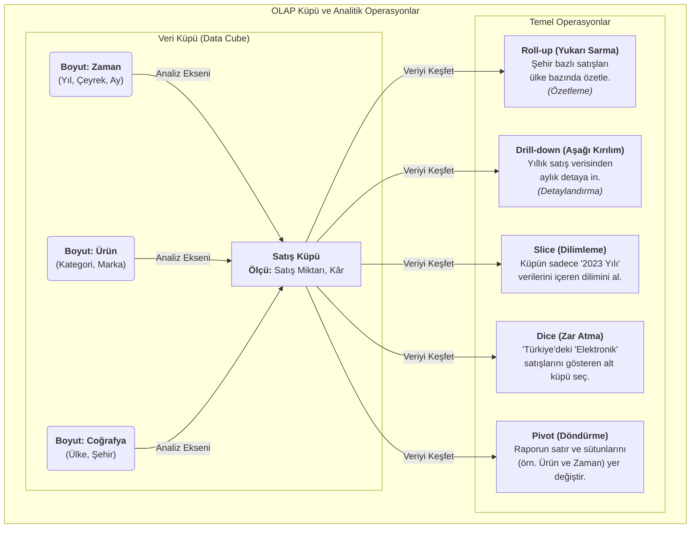

-   **Roll-up (Yukarı Sarma):** Veriyi bir boyut hiyerarşisi boyunca yukarı doğru özetler. Örneğin, şehir bazındaki satış verilerini toplayarak ülke bazında bir özet oluşturur.
-   **Drill-down (Aşağı Kırılım):** Özetlenmiş veriden daha detaylı seviyelere inmeyi sağlar. Örneğin, yıllık satış rakamlarından çeyrek veya ay bazındaki detaylara ulaşmak.
-   **Slice (Dilimleme):** Küpten tek bir boyut değeri seçerek iki boyutlu bir "dilim" alır. Örneğin, `Zaman = '2023'` dilimini alarak sadece o yıla ait satışları inceler.
-   **Dice (Zar Atma):** Birden fazla boyut üzerinde seçim yaparak daha küçük bir alt küp oluşturur. Örneğin, `Coğrafya = 'Türkiye'` VE `Ürün Kategorisi = 'Elektronik'` olan verileri seçer.
-   **Pivot (Döndürme):** Veri küpünün eksenlerini döndürerek veriye farklı bir perspektiften bakmayı sağlar. Örneğin, satırlarda ürünleri, sütunlarda zamanı gösteren bir raporu, satırlarda zamanı, sütunlarda ürünleri gösterecek şekilde değiştirir.

### 11.2. OLAP'ın Temel Özellikleri ve Mimarisi

OLAP sistemleri, ham veriyi anlamlı iş bilgisine dönüştürmek için tasarlanmış güçlü analitik motorlardır. Başarıları, aşağıdaki temel özelliklere ve mimari bileşenlere dayanır:

-   **Çok Boyutlu Analiz (Multidimensional Analysis):** OLAP, veriyi geleneksel iki boyutlu (satır/sütun) tablolardan kurtararak, iş dünyasının doğal çok boyutlu yapısını yansıtan küplerde sunar. Bu sayede analistler, veriyi "kim, ne, nerede, ne zaman" gibi farklı iş eksenleri etrafında serbestçe inceleyebilir.
-   **Hızlı Sorgu Performansı:** OLAP sistemleri, karmaşık analitik sorgulara saniyeler içinde yanıt vermek üzere optimize edilmiştir. Bu hızı, verileri önceden hesaplayıp özetleyerek (pre-aggregation), özel indeksleme teknikleri kullanarak ve sonuçları önbelleğe alarak sağlarlar.
-   **Etkileşimli Keşif ve Raporlama:** Kullanıcıların `Roll-up`, `Drill-down` gibi operasyonlarla veri üzerinde etkileşimli olarak gezinmesine olanak tanır. Bu, statik raporlar yerine dinamik bir "keşif" süreci sunar.
-   **İş Odaklı Bakış Açısı:** Teknik veritabanı terminolojisi yerine, "Ürün Kategorisi", "Satış Bölgesi", "Toplam Gelir" gibi anlaşılır iş terimleri kullanır. Bu da teknik olmayan kullanıcıların bile sistemi kolayca kullanabilmesini sağlar.

---

<a id="b12"></a>

## 12. OLAP Mimarisi: Küpler, Boyutlar ve Ölçüler

OLAP'ın kalbinde, veriyi sezgisel ve analize uygun bir şekilde organize eden üç temel bileşen bulunur:

1.  **Veri Küpü (Data Cube):**
    -   OLAP mimarisinin temel veri yapısıdır. Fiziksel bir küp olmak zorunda değildir; daha çok, verinin çok boyutlu bir mantıksal modelidir.
    -   İşletmenin analiz etmek istediği sayısal metrikleri (ölçüleri), bu metrikleri tanımlayan ve bağlam kazandıran iş kategorileriyle (boyutlarla) birleştirir.

2.  **Boyutlar (Dimensions):**
    -   Bir ölçüye bağlam kazandıran, "kim, ne, nerede, ne zaman" gibi sorulara yanıt veren nitel (kategorik) verilerdir. Boyutlar, veriyi nasıl dilimlemek, filtrelemek ve gruplamak istediğimizi belirler.
    -   **Hiyerarşi (Hierarchy):** Boyutlar genellikle doğal bir hiyerarşiye sahiptir. Bu yapı, kullanıcıların özet veriden detaya (Drill-down) veya detaydan özete (Roll-up) kolayca geçmesini sağlar.
        -   **Örnek Zaman Hiyerarşisi:** `Yıl` → `Çeyrek` → `Ay` → `Gün`
        -   **Örnek Coğrafya Hiyerarşisi:** `Ülke` → `Bölge` → `Şehir`

3.  **Ölçüler (Measures):**
    -   Analiz edilen nicel (sayısal) değerlerdir. Genellikle olgu tablosundaki (fact table) bir sütundan türetilirler ve `SUM`, `COUNT`, `AVERAGE`, `MIN`, `MAX` gibi toplama fonksiyonları ile özetlenirler.
    -   Ölçüler, boyutlar tarafından dilimlendiğinde anlam kazanan iş metrikleridir.
        -   **Örnek Ölçüler:** `Toplam Satış Tutarı`, `Satılan Ürün Adedi`, `Ortalama Kâr Marjı`

| Bileşen | Açıklama | Örnek |
| :--- | :--- | :--- |
| **Boyut (Dimension)** | Veriye bağlam kazandıran **kategorik** bilgiler. "Nasıl bakalım?" sorusunu yanıtlar. | Zaman, Ürün, Müşteri, Coğrafya |
| **Ölçü (Measure)** | Analiz edilen **sayısal** değerler. "Ne kadar?" sorusunu yanıtlar. | Satış Miktarı, Gelir, Maliyet |
<br/>

<div style="display: flex; justify-content: space-between; gap: 2em;">
    <div style="flex: 1; text-align: justify;">
        <hr style="border: 2px solid #888888;">
        <h2 style="text-align: center;">Karar Ağaçları (Decision Trees)</h2>
        <hr style="border: 2px solid #CCCCCC;">
    </div>
</div>


<a id="b13"></a>

## 13. Karar Ağaçları (Decision Trees)

### 13.1. Karar Ağaçlarına Giriş: Sezgisel Bir Zekâ Formu

Bu bölümde, hem insan sezgisine son derece yakın hem de matematiksel olarak sağlam bir yöntem olan **karar ağaçları** (decision trees) ele alınmaktadır. Bu yöntem, veriye doğru teşhisi koymak için sistematik bir şekilde sorular soran bir uzmana benzetilebilir. Her bir soru, veri setini daha küçük ve daha homojen gruplara ayırır ve bu süreç, her bir grup için net bir sonuca ulaşana kadar devam eder. Bu hiyerarşik karar verme süreci, bir akış şeması (flowchart) formunda görselleştirilebilir, bu da onu en karmaşık modeller arasında bile en yorumlanabilir olanlardan biri yapar. İster bir müşterinin kredi riskini belirlemek (sınıflandırma) ister bir gayrimenkulün piyasa değerini tahmin etmek (regresyon) olsun, karar ağaçları bize şeffaf ve güçlü bir analitik çerçeve sunar.

### 13.2. Parametrik Olmayan Yapının Esnekliği ve Gücü

Karar ağaçlarının temelindeki felsefeyi anlamak için, onları diğer modelleme yaklaşımlarından ayıran en temel özelliğe odaklanmalıyız: **parametrik olmayan (non-parametric)** bir yapıya sahip olmaları. Bu teknik ayrım bir benzetmeyle şöyle somutlaştırılabilir:

-   **Parametrik Modeller (Önceden Belirlenmiş Kalıplar):** Lineer veya lojistik regresyon gibi modeller, veri ile hedef değişken arasındaki ilişkinin belirli bir fonksiyonel forma (örneğin, bir doğruya) uyduğunu varsayar. Bu modellerin sabit sayıda parametresi vardır (`β₀`, `β₁`, vb.) ve modelin karmaşıklığı veri miktarına bağlı değildir. Bu durum, güçlü bir **tümevarımsal önyargı (inductive bias)** yaratır: model, verinin yalnızca varsaydığı kalıba uyması durumunda başarılı olur.

-   **Karar Ağaçları (Veriden Doğan Esnek Yapı):** Karar ağaçları ise verinin altta yatan dağılımı hakkında böyle katı varsayımlarda bulunmaz. Modelin yapısı ve karmaşıklığı, sabit bir denkleme bağlı olmak yerine, doğrudan verinin kendisinden öğrenilir. Veri miktarı ve karmaşıklığı arttıkça, ağaç da bu yeni örüntüleri yakalamak için büyüyebilir ve dallanabilir. Bu esneklik, karar ağaçlarının doğrusal olmayan (non-linear) ve karmaşık etkileşimleri, önceden bir formül belirtmeye gerek kalmadan, doğal bir şekilde modellemesine olanak tanır. Kısacası, veriyi bir kalıba sokmaya çalışmak yerine, kalıbın veriden doğmasına izin verirler.

### 13.3. Karar Ağaçlarını Neden Bir Köşe Taşı Olarak Görüyoruz?

Bu yöntemin, veri bilimcileri ve analistler için neden vazgeçilmez bir araç olduğunu birkaç temel başlıkta özetleyebiliriz:

-   **Yorumlanabilirlik: "Beyaz Kutu" Modeli:** Derin öğrenme gibi birçok modern algoritmanın "kara kutu" (black-box) olarak nitelendirildiği bir çağda, karar ağaçları şeffaflıklarıyla öne çıkar. Modelin verdiği bir kararın arkasındaki mantığı, kök düğümden yaprak düğüme kadar olan yolu takip ederek `EĞER-O HALDE` (IF-THEN) kuralları şeklinde net bir biçimde açıklayabiliriz. Bu özellik, finansal risk modellemesi veya tıbbi teşhis gibi, alınan kararların gerekçelendirilmesinin zorunlu olduğu alanlarda hayati önem taşır.

-   **Minimum Veri Ön İşleme Gereksinimi:** Karar ağaçları, pratik uygulamalarda büyük bir avantaj sunar. Ağaç yapısı, özelliklerin büyüklüğüne değil, sıralamasına dayalı bölme kararları verdiği için, verilerin normalleştirilmesi veya standartlaştırılması gibi adımlara ihtiyaç duymaz. Ayrıca, CART gibi algoritmalar, eksik değerleri yönetmek için **vekil bölmeler (surrogate splits)** gibi dahili mekanizmalara sahip olabilir, bu da veri hazırlama sürecini önemli ölçüde basitleştirir.

-   **Çok Yönlülük ve Hibrit Veri Desteği:** Gerçek dünya veri setleri nadiren tek tiptir. Karar ağaçlarının temelindeki bölme kriterleri (Gini İndeksi, Entropi vb.), hem sürekli (sayısal) hem de kategorik (nominal) özellikleri doğal bir şekilde işleyebilir. Bu, farklı veri türlerini bir arada barındıran zengin veri setleriyle, karmaşık dönüşümlere gerek kalmadan doğrudan çalışabilme imkânı tanır.

### 13.4. Karar Ağacının Yapısal Bileşenleri

Aşağıda, karar ağacının temel yapısını gösteren renkli bir diyagram yer almaktadır:

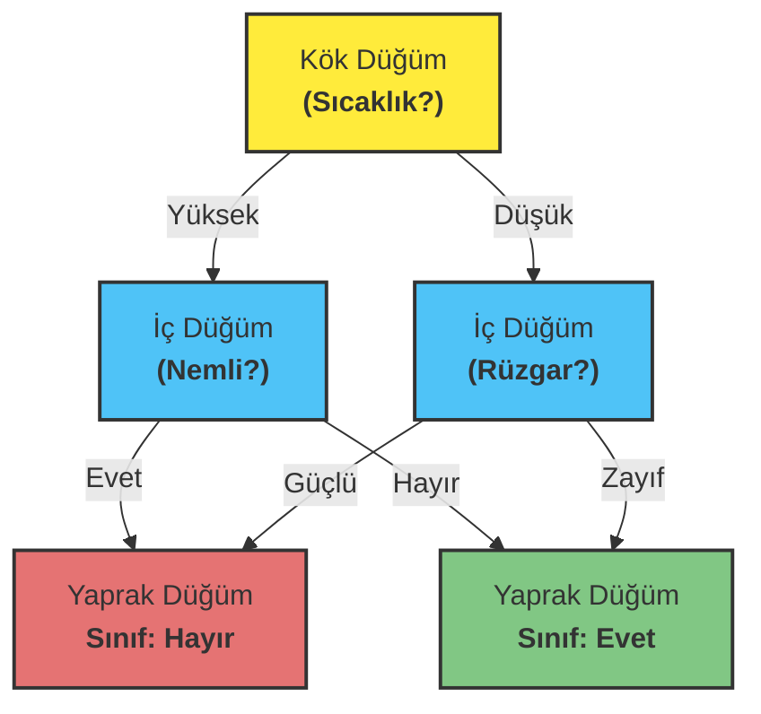

Bu diyagramda:
- **Sarı**: Kök düğüm (ilk karar noktası)
- **Mavi**: İç düğümler (ara karar noktaları)
- **Yeşil**: Pozitif sınıfı temsil eden yaprak düğüm
- **Kırmızı**: Negatif sınıfı temsil eden yaprak düğüm

#### 13.4.1. Karar Ağacının Anatomisi: Düğümler ve Dallar

Bir karar ağacı, veriye teşhis koymak için tasarlanmış organik bir yapı gibi düşünülebilir. Bu yapının her bir parçası, mantıksal bir akış şemasının bir unsurunu temsil eder. Aşağıda bu parçalar sırasıyla incelenmektedir.

**a) Kök Düğüm (Root Node): Yolculuğun Başlangıcı**
Her şeyin başladığı yerdir. Kök düğüm, tüm veri setimizi temsil eden ve analize başlarken sorduğumuz ilk, en güçlü sorudur. Bu düğüm, veri setini en anlamlı şekilde iki veya daha fazla ana dala ayıracak olan en ayırt edici özniteliği içerir.

**b) İç Düğümler (Internal Nodes): Karar Zinciri**
Kök düğümden sonra gelen her bir ara karar noktasıdır. Her iç düğüm, bir önceki adımdan kendisine ulaşan veri alt kümesi için yeni bir soru sorar. Bu düğümler, nihai bir sonuca ulaşana kadar veriyi daha küçük ve daha homojen gruplara ayırma görevini üstlenir.

**c) Yaprak Düğümler (Leaf / Terminal Nodes): Hüküm Anı**
Ağacın en uç noktalarıdır; artık daha fazla soru sorulmayan ve nihai kararın verildiği yerlerdir. Her bir yaprak düğüm, o düğüme ulaşan veri örnekleri için bir sınıf etiketi (sınıflandırma probleminde) veya bir sayısal değer (regresyon probleminde) içerir.

#### 13.4.2. Dallar (Branches): Mantığın Patikaları

Dallar, düğümler arasındaki yollardır ve her bir yol, bir karar sürecini temsil eder. Kök düğümden başlayıp bir yaprak düğüme kadar takip edilen her bir patika, aslında `EĞER-O HALDE` (IF-THEN) formatında, insan tarafından kolayca okunabilen bir kural setine karşılık gelir.

**Örnek Kural:** `EĞER` (Sıcaklık > 25°C) `VE` (Nem Oranı < %60) `O HALDE` (Dışarıda Oyna = Evet)

### 13.5. Karar Ağacı Nasıl İnşa Edilir: Özyinelemeli Bölme Sanatı

#### 13.5.1. En İyi Bölmeyi Bulmak: Açgözlü (Greedy) Yaklaşım

Bir karar ağacı inşa etmek, temelde bir **"böl ve yönet" (divide and conquer)** stratejisidir. Algoritma, her adımda veri setini daha saf alt kümelere ayıracak en iyi soruyu bulmaya çalışır. Bu sürece **özyinelemeli bölme (recursive partitioning)** adı verilir.

Bu yaklaşım "açgözlü" (greedy) olarak nitelendirilir, çünkü algoritma her bir düğümde, o an için en iyi görünen, yani saflığı en çok artıran bölmeyi seçer. Gelecekteki adımların bu karardan nasıl etkileneceğini hesaba katmaz. Bu, genellikle çok iyi sonuçlar veren verimli bir stratejidir.

**Algoritmanın Adımları:**

1.  **En İyi Özniteliği Seç:** Mevcut düğümdeki veri setini en homojen alt gruplara ayıracak özniteliği ve bölünme noktasını belirle. Bu seçim, saflık ölçütleri (Gini, Entropi vb.) kullanılarak matematiksel olarak yapılır.
2.  **Düğümü Böl:** Seçilen öznitelik ve kurala göre düğümü iki veya daha fazla dala ayırarak yeni çocuk düğümler (child nodes) oluştur.
3.  **Özyinelemeyi Uygula:** Her bir çocuk düğüm için süreci tekrarla. Bu işlem, aşağıdaki durdurma kriterlerinden biri karşılanana kadar devam eder:
    *   Düğümdeki tüm örnekler aynı sınıfa aitse (düğüm tamamen saf ise).
    *   Önceden belirlenmiş bir maksimum ağaç derinliğine ulaşılmışsa.
    *   Düğümdeki örnek sayısı, bölünmek için belirlenen minimum sayının altına düşmüşse.

#### 13.5.2. Saflık Ölçütleri: Düzensizliği Ölçme Bilimi

Peki, algoritma "en iyi" bölmenin ne olduğuna nasıl karar veriyor? Cevap, **saflık (purity)** veya onun zıttı olan **kirlilik (impurity)** kavramında yatar. Bir düğüm ne kadar safsa, içindeki örnekler o kadar homojendir (yani çoğunlukla aynı sınıfa aittir). Algoritmanın amacı, her bölme işleminden sonra ortaya çıkan çocuk düğümlerin toplam kirliliğini en aza indirmektir. Bu kirliliği ölçmek için kullandığımız iki temel matematiksel araç vardır: Gini İndeksi ve Entropi.

##### 13.5.2.1. Gini İndeksi (Gini Impurity): Yanlış Sınıflandırma Olasılığı

Gini İndeksi, oldukça sezgisel bir ölçüttür. Bir düğümdeki veri noktalarından rastgele birini seçip, bu düğümdeki sınıf dağılımına göre onu etiketlersek, ne kadar olasılıkla yanlış etiketleme yaparız? Gini İndeksi tam olarak bunu ölçer.

-   **Mükemmel Saflık (Gini = 0):** Bir düğümdeki tüm örnekler aynı sınıfa aitse, yanlış etiketleme olasılığımız sıfırdır.
-   **Maksimum Kirlilik (Gini = 0.5 - İki sınıflı durumda):** Bir düğümde örnekler sınıflara 50/50 oranında dağılmışsa, kirlilik en yüksek seviyededir.

> **Formülleri okuma rehberi.** Bu notta önemli formüllerin hemen altında aynı formülün **açıklamalı** bir kopyası vardır: Üst ve alt parantezler (︷ ︸), formülün hangi parçasının ne anlama geldiğini gösterir. **"Nasıl okunur?"** satırı ise formülün sesli okunuşudur. En sık karşılaşacağınız semboller:
>
> | Sembol | Nasıl okunur? | Anlamı |
> |---|---|---|
> | $\sum_{i=1}^{c} p_i$ | "i eşittir 1'den c'ye kadar p alt i'lerin toplamı" | $p_1 + p_2 + \dots + p_c$ |
> | $\prod_{i=1}^{n} x_i$ | "i eşittir 1'den n'ye kadar x alt i'lerin çarpımı" | $x_1 \cdot x_2 \cdots x_n$ (büyük pi burada 3.14 değil, çarpma işaretidir) |
> | $x_i$, $p_i$ | "x alt i", "p alt i" | i. değer, i. sınıfın oranı (i yalnızca bir sıra numarasıdır) |
> | $P(C \mid X)$ | "X verildiğinde C'nin olasılığı" | X'in gerçekleştiği bilinirken C'nin olasılığı; $P(X \mid C)$ ile aynı şey değildir |
> | $\log_2 p$, $\log_e p$ | "log iki tabanında p", "log e tabanında p" (doğal logaritma, ln) | 2'nin (e'nin) kaçıncı kuvveti p eder? |
> | $\arg\max_{c} f(c)$ | "f(c) değerini en büyük yapan c" | en büyük değerin kendisi değil, onu veren seçenek |
> | $\hat{C}$ | "C şapka" | tahmin edilen değer (şapka = tahmin) |
> | $\lvert a - b \rvert$ | "a eksi b'nin mutlak değeri" | farkın işaretsiz büyüklüğü |
> | $\sqrt{x}$, $x^{1/p}$ | "karekök x", "x'in p'inci dereceden kökü" | kare almanın (p'inci kuvvet almanın) tersi |
> | $\lVert x - \mu \rVert$ | "x eksi mü'nün normu" | x noktası ile $\mu$ merkezi arasındaki uzaklık |
> | $x \in C_i$ | "x, C alt i'nin elemanı" | x noktası i. kümede yer alıyor |
> | $A \rightarrow B$ | "A ise B" | kural: A varsa B de vardır |

Matematiksel olarak, `c` farklı sınıfa sahip bir düğüm için Gini İndeksi şu formülle hesaplanır:

$$
Gini = 1 - \sum_{i=1}^{c} (p_i)^2
$$

```math
\underbrace{Gini}_{\substack{\text{düğümün}\\\text{kirliliği}}} = 1 - \underbrace{\sum_{i=1}^{c} \overbrace{(p_i)^2}^{\substack{\text{i. sınıfın}\\\text{oranının karesi}}}}_{\substack{\text{c sınıfın hepsi için topla:}\\\text{doğru etiketleme olasılığı}}}
```

**Nasıl okunur?** "Gini eşittir, bir eksi, i eşittir 1'den c'ye kadar p alt i'nin karelerinin toplamı." Yani: Rastgele seçtiğimiz bir örneğe, düğümdeki sınıf oranlarına göre rastgele bir etiket verirsek etiketin doğru çıkma olasılığı $\sum (p_i)^2$'dir. Bunu 1'den çıkarınca **yanlış etiketleme olasılığı** kalır. Tenis verisinin kökünde (9 Evet, 5 Hayır): $1 - [(9/14)^2 + (5/14)^2] = 1 - [0.413 + 0.128] = 0.459$. Bu değeri aşağıdaki vaka analizinde (Adım 1) yeniden kullanacağız.

Burada `p_i`, `i` sınıfına ait örneklerin oranını temsil eder. Algoritma, bölme sonrası oluşacak çocuk düğümlerin ağırlıklı Gini ortalamasını en çok düşüren bölmeyi tercih eder. Bu düşüşe **Gini Kazancı (Gini Gain)** denir.

##### 13.5.2.2. Entropi ve Bilgi Kazancı (Information Gain)

Entropi, bilgi teorisinin babası Claude Shannon'dan ödünç aldığımız bir kavramdır ve bir sistemdeki belirsizliği veya düzensizliği ölçer. Karar ağaçları bağlamında, bir düğümdeki sınıfların ne kadar karışık olduğunun bir ölçüsüdür.

-   **Mükemmel Saflık (Entropi = 0):** Düğüm tamamen homojen ise, sonuç bellidir ve hiçbir belirsizlik yoktur.
-   **Maksimum Kirlilik (Entropi = 1 - İki sınıflı durumda):** Sınıflar eşit dağılmışsa, belirsizlik en üst düzeydedir.

Formülü şöyledir:

$$
Entropy = - \sum_{i=1}^{c} p_i \log_2(p_i)
$$

```math
\underbrace{Entropy}_{\substack{\text{düğümdeki}\\\text{belirsizlik (bit)}}} = \overbrace{-}^{\text{pozitif yapar}} \underbrace{\sum_{i=1}^{c}}_{\substack{\text{c sınıfın}\\\text{hepsi için topla}}} \overbrace{p_i}^{\substack{\text{i. sınıfın oranı}\\\text{(ağırlık)}}} \; \underbrace{\log_2(p_i)}_{\substack{\text{i. sınıfın}\\\text{"sürpriz" değeri}}}
```

**Nasıl okunur?** "Entropi eşittir eksi, i eşittir 1'den c'ye kadar p alt i çarpı log iki tabanında p alt i'lerin toplamı."

* $\log_2(p_i)$: $p_i$ 1'den küçük olduğu için bu değer **negatiftir**. Sınıf ne kadar nadirse mutlak değeri o kadar büyüktür: Nadir bir sonuç gerçekleştiğinde daha çok "şaşırırız". Taban 2 olduğu için birim **bit**'tir.
* Baştaki eksi işareti: Negatif logaritmaları pozitife çevirir.
* $\sum p_i \cdot (\dots)$: Her sınıfın sürprizini o sınıfın oranıyla ağırlıklandırıp toplar. Entropi, **ortalama sürprizdir**.
* Hiç örneği olmayan sınıf ($p_i = 0$) için $0 \cdot \log_2 0 = 0$ kabul edilir.

Tenis verisinin kökünde (9 Evet, 5 Hayır) formülün her parçası adım adım:

| Sınıf | $p_i$ | $\log_2 p_i$ (sürpriz, negatif) | $p_i \cdot \log_2 p_i$ |
|---|---|---|---|
| Evet | 9/14 = 0.6429 | −0.6374 | −0.4098 |
| Hayır | 5/14 = 0.3571 | −1.4854 | −0.5305 |
| **Toplam** | | | **−0.9403** |

Baştaki eksi işaretiyle entropi **0.940** olur. Aynı düğümün Gini değeri 0.459'du. İki ölçütün ölçeği farklıdır: İki sınıflı durumda Gini en çok 0.5, entropi en çok 1 olur.

Algoritma, Entropiyi doğrudan minimize etmek yerine, bir bölme işlemiyle ne kadar **belirsizlik azalttığını** ölçer. Bu azalmaya **Bilgi Kazancı (Information Gain)** denir ve ID3 algoritmasının temelini oluşturur. En yüksek Bilgi Kazancını sağlayan öznitelik, bölme için en iyi aday olarak seçilir.

| Özellik | Gini İndeksi | Entropi (Bilgi Kazancı ile) |
| :--- | :--- | :--- |
| **Temel Felsefe** | Yanlış sınıflandırma olasılığını en aza indirme | Belirsizliği en aza indirme (bilgiyi en üst düzeye çıkarma) |
| **Hesaplama** | Daha hızlı (karesel işlem) | Daha yavaş (logaritmik işlem) |
| **Davranış** | Genellikle en büyük sınıfı izole etmeye daha yatkındır | Sınıf dağılımındaki küçük değişikliklere daha duyarlıdır |

Pratikte, her iki metrik de genellikle çok benzer ağaçlar üretir. Gini İndeksi'nin hesaplama verimliliği, onu CART gibi algoritmalarda popüler bir varsayılan seçenek haline getirir.

##### 13.5.2.3. Kazanç Oranı (Gain Ratio): Bilgi Kazancının Tuzağına Karşı Bir Savunma

Bilgi Kazancı'nın zekice bir yaklaşım olmasına rağmen, tehlikeli bir zaafı vardır: **yüksek kardinaliteye sahip** (yani çok sayıda benzersiz değere sahip) özniteliklere karşı bir ön yargı besler. Örneğin, "Müşteri ID" veya "TC Kimlik No" gibi bir özniteliği düşünün. Her bir değer benzersiz olduğu için, bu özniteliğe göre yapılacak bir bölme, her biri tek bir örnek içeren mükemmel derecede saf yapraklar oluşturacaktır. Bilgi Kazancı bu durumu "mükemmel bir bölme" olarak görür, ancak bu aslında öğrenme değil, **ezberlemedir (overfitting)**.

C4.5 algoritmasının getirdiği çözüm olan **Kazanç Oranı (Gain Ratio)** bu noktada devreye girer. Kazanç Oranı, Bilgi Kazancını, bir bölmenin yarattığı dallanma karmaşıklığına bölerek onu cezalandırır.

$$
Gain Ratio = \frac{\text{Information Gain}}{\text{Split Information}}
$$

```math
\underbrace{\text{Gain Ratio}}_{\text{kazanç oranı}} = \frac{\overbrace{\text{Information Gain}}^{\substack{\text{bölmenin azalttığı}\\\text{belirsizlik}}}}{\underbrace{\text{Split Information}}_{\substack{\text{bölmenin kaç parçaya}\\\text{dağıldığı (ceza)}}}}
```

**Nasıl okunur?** "Kazanç oranı eşittir, bilgi kazancı bölü bölünme bilgisi." Bilgi kazancı, bölmeden önceki entropi eksi bölmeden sonraki dalların ağırlıklı ortalama entropisidir. Bölünme bilgisi ise dallara düşen örnek oranlarının entropisidir: Dal sayısı arttıkça büyür. Örnek: Tenis verisinde "Müşteri ID" gibi her güne ayrı dal açan bir nitelik düşünün. 14 yaprağın hepsi saf olur, bilgi kazancı kökün entropisinin tamamına (0.940) eşit çıkar. Ama 14 eşit dalın bölünme bilgisi $\log_2 14 \approx 3.807$'dir; kazanç oranı 0.940 / 3.807 ≈ **0.247**'ye iner.

-   **Split Information:** Bir özniteliğin veriyi ne kadar çok parçaya böldüğünü ölçen bir metriktir. Çok fazla dala neden olan bir bölme (Müşteri ID gibi) yüksek bir Split Information değerine sahip olacak ve bu da Kazanç Oranını düşürecektir.

Bu sayede Kazanç Oranı, hem yüksek bilgi sağlayan hem de veriyi makul sayıda, anlamlı alt gruplara ayıran **dengeli** bölmeleri tercih eder. Bu, modelin genelleme yeteneğini önemli ölçüde artırır.

##### 13.5.2.4. Sınıflandırma Hatası (Classification Error)

Şimdi gelelim en sezgisel, en doğrudan ölçütümüze: Sınıflandırma Hatası. Bu metrik, son derece pratik bir soru sorar: "Eğer bir düğümdeki en popüler sınıf neyse, o düğüme düşen her veriye o etiketi yapıştırsak, ne kadar yanılırız?"

-   **Örnek:** Bir düğümde 8 "Evet" ve 2 "Hayır" kararımız varsa, en popüler sınıfımız "Evet"tir. Eğer bu düğümdeki herkese "Evet" tahmininde bulunursak, 10'da 2 kez yanılmış oluruz. Yani hata oranımız %20'dir.
-   **Amaç:** Algoritmanın amacı da, bu basit ama etkili hata oranını en aza indirecek bölmeyi bulmaktır.

#### 13.5.3. Gini İndeksi ile Adım Adım Karar Ağacı İnşası: Bir Vaka Analizi

Bu alt bölümde teorik bilgiler somut bir örnekle pekiştirilmektedir. "Bugün tenis oynanmalı mı?" sorusuna cevap arayan klasik bir veri seti üzerinde, Gini İndeksi kullanılarak bir karar ağacının adım adım nasıl inşa edildiği gösterilmektedir.

**Örnek Veri Setimiz:**

| Gün | Hava Durumu | Sıcaklık | Nem | Rüzgar | Tenis Oyna |
| :-- | :--- | :--- | :--- | :--- | :--- |
| D1 | Güneşli | Sıcak | Yüksek | Yok | Hayır |
| D2 | Güneşli | Sıcak | Yüksek | Var | Hayır |
| D3 | Bulutlu | Sıcak | Yüksek | Yok | Evet |
| D4 | Yağmurlu | Ilık | Yüksek | Yok | Evet |
| D5 | Yağmurlu | Soğuk | Normal | Yok | Evet |
| D6 | Yağmurlu | Soğuk | Normal | Var | Hayır |
| D7 | Bulutlu | Soğuk | Normal | Var | Evet |
| D8 | Güneşli | Ilık | Yüksek | Yok | Hayır |
| D9 | Güneşli | Soğuk | Normal | Yok | Evet |
| D10 | Yağmurlu | Ilık | Normal | Yok | Evet |
| D11 | Güneşli | Ilık | Normal | Var | Evet |
| D12 | Bulutlu | Ilık | Yüksek | Var | Evet |
| D13 | Bulutlu | Sıcak | Normal | Yok | Evet |
| D14 | Yağmurlu | Ilık | Yüksek | Var | Hayır |

##### 13.5.3.1. Adım 1: Kök Düğümün Kirliliğini Hesaplama (Başlangıç Noktası)

Her şeyden önce, tüm veri setimizin "kirliliğini" ölçmeliyiz. Bu, bizim referans noktamız olacak.
- Toplam Gözlem: 14
- "Evet" (Tenis Oyna): 9
- "Hayır" (Tenis Oyna): 5

Şimdi Gini formülümüzü uygulayalım:
```
Gini(Kök) = 1 - [ (9/14)² + (5/14)² ] = 1 - [ 0.413 + 0.128 ] = 0.459
```
Başlangıç kirliliğimiz 0.459. Amacımız, bu değeri en çok düşüren özniteliği bulmak.

##### 13.5.3.2. Adım 2: Her Bir Öznitelik İçin Gini Kazancını Hesaplama

Şimdi her bir özniteliği ("Hava Durumu", "Sıcaklık", "Nem", "Rüzgar") potansiyel bir bölme noktası olarak değerlendireceğiz.

**A) Öznitelik: Hava Durumu**

1.  **Hava Durumu = Güneşli:** 5 gözlem (2 Evet, 3 Hayır)
    $Gini(\text{Güneşli}) = 1 - [(\frac{2}{5})^2 + (\frac{3}{5})^2] = 0.48$
2.  **Hava Durumu = Bulutlu:** 4 gözlem (4 Evet, 0 Hayır)
    $Gini(\text{Bulutlu}) = 1 - [(\frac{4}{4})^2 + (\frac{0}{4})^2] = 0$  (tam saflık)
3.  **Hava Durumu = Yağmurlu:** 5 gözlem (3 Evet, 2 Hayır)
    $Gini(\text{Yağmurlu}) = 1 - [(\frac{3}{5})^2 + (\frac{2}{5})^2] = 0.48$

Şimdi bu özniteliğin ağırlıklı Gini ortalamasını hesaplayalım:
$Gini_{\text{Ağırlıklı}}(\text{Hava Durumu}) = (\frac{5}{14}) \times 0.48 + (\frac{4}{14}) \times 0 + (\frac{5}{14}) \times 0.48 = 0.343$

Ve son olarak, Gini Kazancı:
$Gain(\text{Hava Durumu}) = Gini(\text{Kök}) - Gini_{\text{Ağırlıklı}}(\text{Hava Durumu}) = 0.459 - 0.343 = \mathbf{0.116}$

**B) Öznitelik: Rüzgar** (Hesaplamaları diğer öznitelikler için de tekrarlıyoruz)

1.  **Rüzgar = Yok:** 8 gözlem (6 Evet, 2 Hayır)
    $Gini(\text{Yok}) = 1 - [(\frac{6}{8})^2 + (\frac{2}{8})^2] = 0.375$
2.  **Rüzgar = Var:** 6 gözlem (3 Evet, 3 Hayır)
    $Gini(\text{Var}) = 1 - [(\frac{3}{6})^2 + (\frac{3}{6})^2] = 0.5$

Ağırlıklı Gini ve Kazanç:
$Gini_{\text{Ağırlıklı}}(\text{Rüzgar}) = (\frac{8}{14}) \times 0.375 + (\frac{6}{14}) \times 0.5 = 0.428$
$Gain(\text{Rüzgar}) = 0.459 - 0.428 = \mathbf{0.031}$

(Aynı hesaplamalar "Sıcaklık" ve "Nem" için yapıldığında kazançlar sırasıyla 0.019 ve 0.092 bulunur; ikisi de Hava Durumu'nun kazancından düşüktür.)

##### 13.5.3.3. Adım 3: En İyi Bölmeyi Seçme ve İlk Dalı Oluşturma

Kazançları karşılaştıralım:
- **Gain(Hava Durumu) = 0.116** (en yüksek)
- Gain(Nem) = 0.092
- Gain(Sıcaklık) = 0.019
- Gain(Rüzgar) = 0.031

En yüksek Gini Kazancını **"Hava Durumu"** özniteliği sağladığı için ağacın kök düğümü bu öznitelik olur.

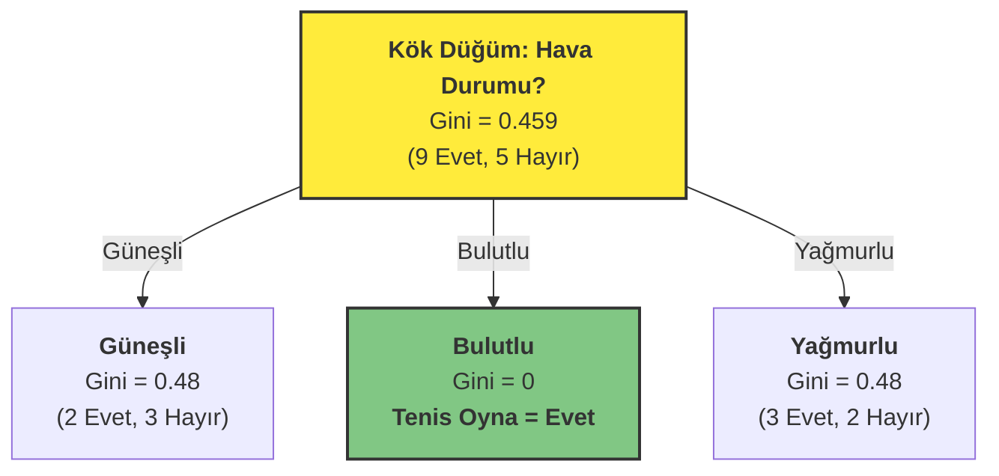

"Bulutlu" dalının saf bir yaprak düğüme dönüştüğüne dikkat edilmelidir; bu dal için başka bir soru sorulmasına gerek yoktur.

##### 13.5.3.4. Adım 4: Özyinelemeli Süreç: Alt Düğümlerin Bölünmesi

Kök düğüm belirlenmiş ve "Bulutlu" dalının doğrudan "Evet" sonucuna götürdüğü görülmüştür. Algoritmanın özyinelemeli doğası bu noktada devreye girer: Henüz saf olmayan "Güneşli" ve "Yağmurlu" dalları, her biri kendi başına yeni bir veri setiymiş gibi ele alınır. Önce "Güneşli" dalı incelenmektedir.

**Alt Problem: Hava Durumu = Güneşli**

Bu adımda yalnızca aşağıdaki 5 gözlem dikkate alınır:

| Gün | Hava Durumu | Sıcaklık | Nem | Rüzgar | Tenis Oyna |
| :-- | :--- | :--- | :--- | :--- | :--- |
| D1 | Güneşli | Sıcak | Yüksek | Yok | Hayır |
| D2 | Güneşli | Sıcak | Yüksek | Var | Hayır |
| D8 | Güneşli | Ilık | Yüksek | Yok | Hayır |
| D9 | Güneşli | Soğuk | Normal | Yok | Evet |
| D11 | Güneşli | Ilık | Normal | Var | Evet |

Bu 5 gözlemden oluşan alt veri setinin başlangıç kirliliği, daha önce hesaplandığı gibi `Gini(Güneşli) = 0.48`'dir. Amaç, bu kirliliği en çok azaltan soruyu bulmaktır. Kalan öznitelikler: Sıcaklık, Nem ve Rüzgar.

**A) Öznitelik: Nem (Güneşli günlerde)**

1.  **Nem = Yüksek:** 3 gözlem (D1, D2, D8) -> 0 Evet, 3 Hayır
    $Gini(\text{Yüksek}) = 1 - [(\frac{0}{3})^2 + (\frac{3}{3})^2] = 0$ (tam saflık)
2.  **Nem = Normal:** 2 gözlem (D9, D11) -> 2 Evet, 0 Hayır
    $Gini(\text{Normal}) = 1 - [(\frac{2}{2})^2 + (\frac{0}{2})^2] = 0$ (tam saflık)

Ağırlıklı Gini ve Kazanç:
$Gini_{\text{Ağırlıklı}}(\text{Nem}) = (\frac{3}{5}) \times 0 + (\frac{2}{5}) \times 0 = 0$
$Gain(\text{Nem}) = 0.48 - 0 = \mathbf{0.48}$

**B) Öznitelik: Rüzgar (Güneşli günlerde)**

1.  **Rüzgar = Yok:** 3 gözlem (D1, D8, D9) -> 1 Evet, 2 Hayır
    $Gini(\text{Yok}) = 1 - [(\frac{1}{3})^2 + (\frac{2}{3})^2] = 0.444$
2.  **Rüzgar = Var:** 2 gözlem (D2, D11) -> 1 Evet, 1 Hayır
    $Gini(\text{Var}) = 1 - [(\frac{1}{2})^2 + (\frac{1}{2})^2] = 0.5$

Ağırlıklı Gini ve Kazanç:
$Gini_{\text{Ağırlıklı}}(\text{Rüzgar}) = (\frac{3}{5}) \times 0.444 + (\frac{2}{5}) \times 0.5 \approx 0.467$
$Gain(\text{Rüzgar}) = 0.48 - 0.467 = \mathbf{0.013}$

**Karar Anı: "Güneşli" Dalı İçin En İyi Soru**

Kazançları karşılaştıralım:
- **Gain(Nem) = 0.48** (en yüksek)
- Gain(Sıcaklık) = 0.28
- Gain(Rüzgar) = 0.013

Görüldüğü gibi **"Nem"** özniteliği `0.48`'lik kazançla açık farkla öne çıkmaktadır. Bu sonuç, "Güneşli" günlerde tenis oynanıp oynanmayacağını en iyi açıklayan özniteliğin nem olduğunu gösterir. Ayrıca bu bölmeden sonra iki dal da tamamen saf yapraklara dönüşür.

Ağacın güncel hâli:

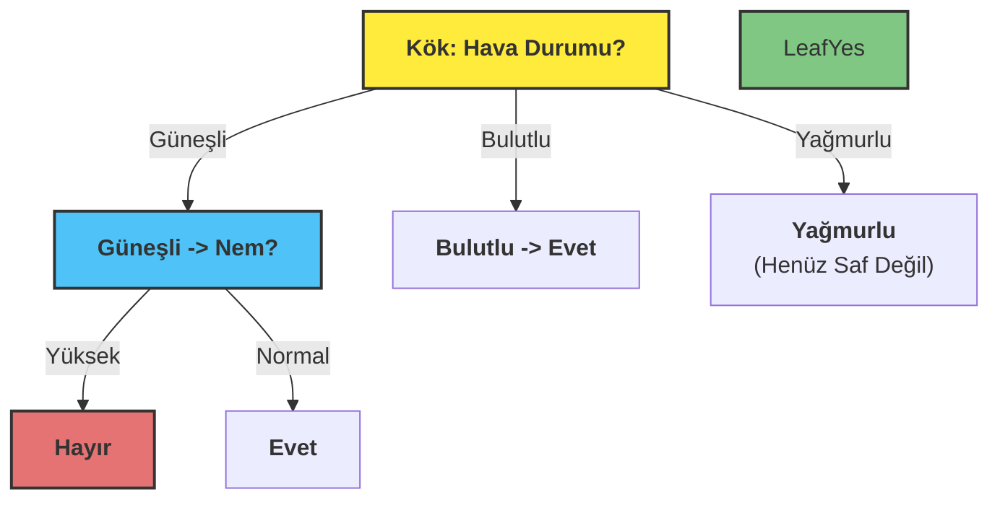

##### 13.5.3.5. Adım 5: Ağacı Tamamlama

Aynı özyinelemeli süreç "Yağmurlu" dalına (3 Evet, 2 Hayır; Gini = 0.48) uygulandığında Rüzgar özniteliğinin Gini kazancı 0.48, Sıcaklık ve Nem özniteliklerinin kazancı ise 0.013 bulunur. Dal bu nedenle Rüzgar'a göre bölünür ve nihai karar ağacı ortaya çıkar:

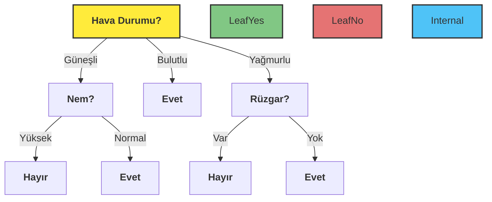
Böylece veri setindeki ilişkiler, her adımda en ayırt edici soru sorularak yorumlanabilir bir `EĞER-O HALDE` kurallar bütününe dönüştürülmüştür. Bu örnek, karar ağaçlarının hem sezgisel hem de matematiksel olarak tutarlı bir yöntem olduğunu göstermektedir.

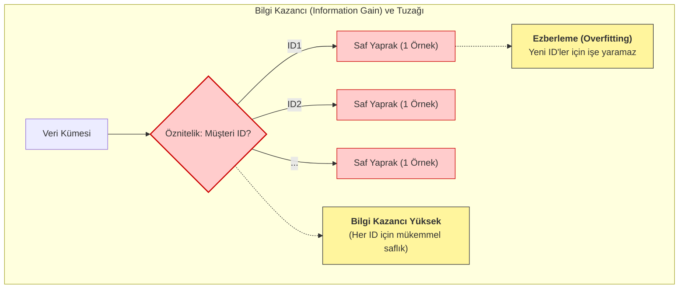

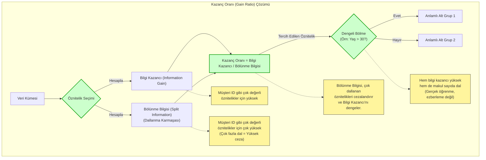

### 13.6. Durdurma Kriterleri (Stopping Criteria)

Karar ağacı inşa edilirken sorulması gereken en kritik sorulardan biri şudur: **Büyüme ne zaman durdurulmalıdır?** Ağacın sınırsız büyümesine izin verilirse ağaç, her bir veri noktasını ezberleyen ancak genelleme yeteneği zayıf olan bir öğrenciye benzer. Bu duruma **aşırı uyum (overfitting)** denir. Tersine, ağaç çok erken durdurulursa verideki önemli örüntüleri kaçıran bir model elde edilir; bu duruma da **eksik uyum (underfitting)** denir.

Bu dengeyi kurmak için ağaca bazı sınırlar, yani durdurma kriterleri konur.

#### 13.6.1. Yaygın Durdurma Parametreleri

Bu süreç, hiperparametre (hyperparameter) adı verilen kontrol ayarlarıyla yönetilir. En yaygın olanları şunlardır:

**a) Minimum Yaprak Boyutu (Minimum Leaf Size):** Bir yaprak düğümde en az kaç örnek olmalı? Bu, modelin çok özele inip tekil örnekleri ezberlemesini engeller.

**b) Minimum Bölme Boyutu (Minimum Split Size):** Bir düğümü bölmeye değer bulmamız için içinde en az kaç örnek bulunmalı?

**c) Maksimum Derinlik (Maximum Depth):** Ağaç kökten başlayarak en fazla kaç seviye derinleşebilir? Bu, modelin aşırı karmaşıklaşmasını önleyen en doğrudan yollardan biridir.

**d) Maksimum Yaprak Sayısı (Maximum Leaf Nodes):** Ağaçta en fazla kaç nihai karar noktası (yaprak) bulunabilir?

**e) Minimum Saflık Artışı (Minimum Purity Increase):** Bir bölmenin yapılabilmesi için sağlaması gereken en düşük kazançtır. Kazanç bu eşiğin altındaysa bölme yapılmaz.

#### 13.6.2. Ağacı Ne Zaman Durdurmalı

Karar ağacının ne kadar büyüyeceğine karar vermek, bir sınava nasıl çalışacağınıza karar vermeye çok benzer.

-   **Aşırı Ezber (Aşırı Uyum - Overfitting):** Sadece kitaptaki örnek soruları ve cevaplarını harfi harfine ezberlediğinizi düşünün. Sınavda aynı sorular çıkarsa 100 alırsınız. Ama öğretmen biraz farklı bir soru sorduğunda cevap veremezsiniz. Çünkü konunun mantığını öğrenmediniz, sadece ezberlediniz. Bu, ağacın çok fazla dallanıp her bir yaprağında sadece 1-2 örnek bırakması gibidir. Model, veriyi "ezberlemiş" olur.

-   **Yetersiz Çalışma (Eksik Uyum - Underfitting):** Sadece konuların başlıklarını okuduğunuzu düşünün. Konu hakkında genel bir fikriniz olur ama hiçbir detayı bilmezsiniz. Bu da ağacın hiç dallanmaması, çok genel kalması gibidir. Model, hiçbir şey öğrenememiş olur.

**Peki, en iyisi nedir?** Konunun mantığını anlamak ve her konuyla ilgili birkaç farklı örnek çözmektir. **Berry ve Linoff Kuralı** bu "ideal çalışma" seviyesi için pratik bir öneri sunar: Ağacın yapraklarında ne tek bir örnek kalacak kadar ayrıntıya inilmeli ne de yüzlerce örnek kalacak kadar genel kalınmalıdır; veri setinin büyüklüğüne göre makul sayıda örnek bırakılmalıdır. Bu kural, modelin hem öğrenmesini hem de ezberlememesini sağlamak için bir denge noktası sunar.

#### 13.6.3. Model Karmaşıklığı ve Genelleme Yeteneği

Karar ağacının büyümesini kontrol eden durdurma kriterleri, modelin **genelleme performansı** ile **karmaşıklığı** arasındaki dengeyi (Bias-Variance Tradeoff) yönetmek için kritik öneme sahiptir. Bu bağlamda, yaprak düğümlerdeki minimum örnek sayısı (`min_samples_leaf`) en etkili hiperparametrelerden biridir.

-   **Aşırı Uyum (Overfitting):** Ağacın çok derinleşmesine izin verildiğinde, yaprak düğümler aşırı saf hale gelir ve eğitim setindeki gürültüyü veya aykırı değerleri modellemeye başlar. Bu durum, modelin eğitim verisinde yüksek başarı gösterip test verisinde (görülmemiş veri) düşük performans sergilemesine neden olur. Yapraklardaki örnek sayısının çok düşük olması (örn. 1) aşırı uyumun en temel göstergelerinden biridir.

-   **Eksik Uyum (Underfitting):** Ağacın büyümesi çok erken durdurulursa, model verideki temel örüntüleri yakalayacak kadar karmaşıklaşamaz. Yaprak düğümlerin çok fazla ve heterojen örnek içermesi, modelin yetersiz öğrendiğini gösterir.

**Berry ve Linoff Kuralı**, bu dengeyi kurmak için ampirik bir başlangıç noktası sunan bir **heuristiktir (sezgisel yöntem)**. Bu kurala göre, bir yaprak düğümdeki hedef kayıt sayısının, toplam eğitim veri setinin **%0.25 ile %1.00**'i arasında olması hedeflenir.

**Örnek: Berry ve Linoff Kuralının Uygulanması**

100.000 müşteriye ait bir veri setini analiz ederek hangi müşterilerin bir ürünü satın alacağını tahmin etmeye çalıştığımızı varsayalım. Modelin ne çok ezberci (aşırı uyum) ne de çok yüzeysel (eksik uyum) olmasını istemiyoruz. Berry ve Linoff kuralını kullanarak `min_samples_leaf` (bir yaprakta olması gereken minimum örnek sayısı) için ideal başlangıç aralığını belirleyebiliriz:

-   **Alt Sınır (Ezberlemeyi Önleme):** Veri setinin %0.25'i. Bu, modelin çok fazla detaya inip gürültüyü ezberlemesini önlemek için bir "fren" görevi görür.
    -   `100.000 * 0.0025 = 250 örnek`
-   **Üst Sınır (Öğrenmeyi Sağlama):** Veri setinin %1.00'i. Bu ise modelin çok genel kalıp önemli örüntüleri kaçırmasını engeller.
    -   `100.000 * 0.01 = 1.000 örnek`

**Sonuç:** Bu durumda, `min_samples_leaf` hiperparametresini **250 ile 1.000 arasında** bir değerle başlatmak, modelin genelleme yeteneği ile öğrenme kapasitesi arasında iyi bir denge kurmak için mantıklı bir başlangıç noktasıdır.

Aşağıdaki tablo, bu parametrenin etkisini özetlemektedir:

| `min_samples_leaf` Değeri | Model Davranışı | Sonuç |
| :--- | :--- | :--- |
| **Düşük (örn. < 250)** | Çok karmaşık, gürültüyü ezberler | **Aşırı Uyum (Overfitting)** |
| **İdeal Aralık (250 - 1000)** | Dengeli, anlamlı örüntüleri öğrenir | **İyi Genelleme** |
| **Yüksek (örn. > 1000)** | Çok basit, önemli detayları kaçırır | **Eksik Uyum (Underfitting)** |

Bu kuralın mutlak bir yasa olmadığını, ancak model optimizasyon sürecinde hangi parametre aralığında arama yapılması gerektiğine dair güçlü bir başlangıç noktası sunduğunu unutmamak önemlidir. Nihai en iyi değer, genellikle çapraz doğrulama (cross-validation) gibi tekniklerle bulunur.

### 13.7. Budama (Pruning): Ağacı Basitleştirme Sanatı

Bir bahçıvanın gül fidanını budaması gibi, karar ağacı **budaması (pruning)** da benzer bir felsefeyle çalışır. Kontrolsüzce büyüyen bir fidan, enerjisini çok sayıda küçük ve zayıf güle dağıtır. Usta bir bahçıvan ise gereksiz dalları keserek fidanın gücünü daha az sayıda, ancak daha gösterişli ve sağlıklı güller yetiştirmeye odaklar.

Benzer şekilde, bir ağacın çok fazla büyümesine ve karmaşıklaşmasına izin verilirse, eğitim verisinin her detayını, hatta anlamsız gürültüleri bile ezberleyen bir "uzman" haline gelir. Bu duruma **aşırı uyum (overfitting)** denir. Bu "aşırı uzmanlaşmış" ağaç, eğitim verisinde mükemmel sonuçlar verse de, daha önce hiç görmediği yeni verilerle karşılaştığında şaşırtıcı derecede kötü performans gösterir.

Budama, ağacın genelleme yeteneğine en az katkı sağlayan, yani çok az örneğe dayanan veya tahmin gücü zayıf olan dalları kesip atma işlemidir. Sonuç, daha basit, daha sağlam ve yeni verilere karşı daha iyi tahminler yapabilen bir ağaçtır.

Bu süreç aşağıdaki diyagramda gösterilmiştir:

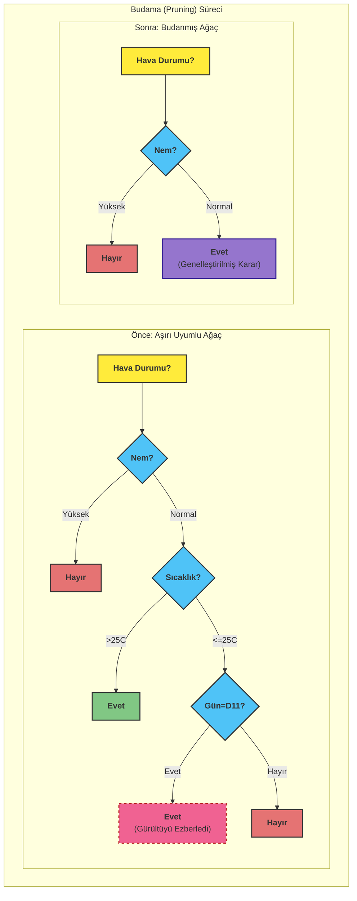

Diyagramda görüldüğü gibi:
-   **Aşırı Uyumlu Ağaç:** Model, `Gün=D11?` gibi bir soru sorarak çok fazla detaya inmiş ve sadece tek bir veri noktasına özel bir kural oluşturmuştur. Bu, öğrenme değil, ezberlemedir ve modelin genelleme yeteneğine zarar verir.
-   **Budanmış Ağaç:** Genelleme yeteneğini bozan karmaşık dal (`Sıcaklık?` ve sonrası) budanmış, yerine o dala düşen verilerin çoğunluk sınıfını temsil eden tek bir yaprak düğüm (`Evet`) konulmuştur. Ağaç artık daha basit ve daha güçlüdür.

Teknik açıdan budama, bir karar ağacının karmaşıklığını azaltmak için kullanılan bir **düzenlileştirme (regularization)** tekniğidir. Tamamen büyümüş bir ağaç, eğitim setindeki gürültüyü ve istisnaları modellediği için genellikle **yüksek varyansa (high variance)** sahiptir. Budama, modelin **yanlılığında (bias)** hafif bir artış pahasına, bu varyansı düşürerek daha dengeli bir model oluşturur. Amaç, görülmemiş veriler üzerinde en iyi performansı gösterecek, ne çok basit ne de çok karmaşık olan "altın oran"daki ağacı bulmaktır. Bu karar, genellikle bir doğrulama seti (validation set) üzerindeki performans metrikleri veya istatistiksel anlamlılık testleri ile verilir.

#### 13.7.1. Budama Türleri

##### 13.7.1.1. Ön Budama (Pre-pruning / Forward Pruning)

Ağaç oluşturulurken dalların büyümesi kontrol edilir. Belirli kriterlere uymayan bölmeler engellenir.

**Avantajları**:
- Hesaplama açısından daha verimlidir
- Gereksiz dal oluşumunu baştan engeller

**Dezavantajları**:
- Erken durdurma nedeniyle önemli dalların kaçırılması riski (horizon effect)

**Yöntemler**:
- Ki-kare testleri
- Minimum bilgi kazancı eşiği
- Çoklu karşılaştırma düzeltmeleri

##### 13.7.1.2. Son Budama (Post-pruning / Backward Pruning)

Tam bir ağaç oluşturulduktan sonra, performansı iyileştirmeyen dallar geri doğru budanır.

**Avantajları**:
- Daha iyi sonuçlar verebilir
- Horizon effect problemini önler

**Dezavantajları**:
- Hesaplama açısından daha maliyetlidir

#### 13.7.2. Budama Yöntemleri

**a) Hatalı Tahmin Oranı Minimizasyonu**: Her alt ağaç için hata oranı hesaplanır ve en düşük orana sahip olan seçilir.

**b) Doğrulama Veri Kümesi Yaklaşımı**: 
- Veri eğitim ve doğrulama kümelerine ayrılır
- Model eğitim verisiyle oluşturulur
- Performans doğrulama verisiyle değerlendirilir
- En iyi performansı gösteren alt ağaç seçilir

**c) K-Katlı Çapraz Doğrulama**:
- Veri k eşit kata (fold) bölünür (tipik olarak k=10)
- Model k-1 kat ile eğitilir, kalan kat ile test edilir
- İşlem her kat bir kez test için kullanılacak şekilde k kez tekrarlanır
- Ortalama hata hesaplanır ve en düşük hataya sahip model seçilir

### 13.8. Popüler Karar Ağacı Algoritmaları

#### 13.8.1. ID3 (Iterative Dichotomiser 3, 1986)

- Ross Quinlan tarafından geliştirilmiştir
- Entropi ve bilgi kazancı kullanır
- Sadece kategorik değişkenlerle çalışır
- Budama yapmaz (aşırı uyum riski)

#### 13.8.2. C4.5 (1993) ve C5.0

- ID3'ün geliştirilmiş versiyonudur
- Hem kategorik hem sürekli değişkenlerle çalışır
- Kazanç oranı kullanır (çok kategorili değişkenlere karşı ön yargıyı azaltır)
- Budama destekler
- Eksik değerleri işleyebilir
- C5.0, C4.5'in daha hızlı ve verimli versiyonudur

#### 13.8.3. CART (Classification and Regression Trees)

- Breiman ve arkadaşları tarafından geliştirilmiştir
- Gini indeksi kullanır
- Hem sınıflandırma hem regresyon için kullanılabilir
- Her düğümde ikili (binary) bölme yapar
- Maliyet-karmaşıklık budama kullanır

#### 13.8.4. CHAID (Chi-squared Automatic Interaction Detection)

- Ki-kare testi kullanarak istatistiksel olarak anlamlı bölmeler yapar
- Çoklu yollu bölme yapabilir (ikiden fazla dal)
- Kategorik hedef değişkenler için uygundur
- Pazarlama ve anket araştırmalarında müşteri bölümlemesi (segmentasyon) için yaygın olarak kullanılır

### 13.9. Karar Ağaçlarının Avantajları ve Dezavantajları

#### 13.9.1. Avantajlar

1. **Yorumlanabilirlik**: Karar süreçleri kolayca anlaşılabilir ve görselleştirilebilir
2. **Veri ön işleme gereksinimsizliği**: Normalizasyon veya standardizasyon gerektirmez
3. **Eksik değer toleransı**: Eksik verilerle çalışabilir
4. **Hibrit veri desteği**: Hem kategorik hem sayısal değişkenlerle çalışır
5. **Doğrusal olmayan ilişkileri yakalama**: Karmaşık etkileşimleri modelleyebilir
6. **Öznitelik seçimi**: Önemli değişkenleri otomatik olarak belirler

#### 13.9.2. Dezavantajlar

1. **Aşırı uyum eğilimi**: Karmaşık ağaçlar eğitim verilerine aşırı uyum sağlayabilir
2. **Kararsızlık**: Verideki küçük değişiklikler farklı ağaç yapılarına yol açabilir
3. **Ölçeklenebilirlik**: Çok büyük veri kümelerinde bellek ve performans sorunları yaşanabilir
4. **Sınıf dengesizliği**: Dengesiz veri kümelerinde dominant sınıfa yanlılık gösterebilir
5. **Optimal çözüm garantisi yok**: Açgözlü (greedy) algoritmalar yerel optimuma takılabilir

### 13.10. Uygulama Alanları

Karar ağaçları çeşitli alanlarda başarıyla uygulanmaktadır:

- **Tıp**: Hastalık teşhisi, risk değerlendirmesi
- **Finans**: Kredi skorlaması, risk analizi, dolandırıcılık tespiti
- **Pazarlama**: Müşteri segmentasyonu, satın alma tahmini
- **Üretim**: Kalite kontrol, hata teşhisi
- **Eğitim**: Öğrenci performans tahmini
- **Meteoroloji**: Hava durumu tahmini
- **Biyoloji**: Tür sınıflandırması, genetik analiz

### 13.11. Model Değerlendirme

Karar ağacı modelinin performansı çeşitli metriklerle değerlendirilir:

- **Doğruluk (Accuracy)**: Doğru sınıflandırılan kayıtların oranı
- **Hassasiyet (Precision)**: Pozitif tahmin edilen kayıtlar arasında gerçekten pozitif olanların oranı
- **Duyarlılık (Recall/Sensitivity)**: Gerçek pozitif kayıtlar arasında doğru tahmin edilenlerin oranı
- **F1-Skoru**: Hassasiyet ve duyarlılığın harmonik ortalaması
- **Karmaşıklık Matrisi (Confusion Matrix)**: Tahminlerin detaylı gösterimi
- **ROC Eğrisi ve AUC**: Model ayırt etme gücünün değerlendirilmesi

#### 13.11.1. Karmaşıklık Matrisi ve Temel Ölçütler

İki sınıflı bir problemde ilgilenilen sınıfa **pozitif**, diğerine **negatif** sınıf denir. Her tahmin, gerçek sınıf ile tahmin edilen sınıfın karşılaştırılmasına göre dört gruptan birine düşer:

| | **Tahmin: Pozitif** | **Tahmin: Negatif** |
| :--- | :---: | :---: |
| **Gerçek: Pozitif** | Gerçek Pozitif (GP) | Sahte Negatif (SN) |
| **Gerçek: Negatif** | Sahte Pozitif (SP) | Gerçek Negatif (GN) |

- **Gerçek Pozitif (GP):** Gerçekte pozitif olan ve pozitif tahmin edilen kayıt.
- **Sahte Negatif (SN):** Gerçekte pozitif olduğu hâlde negatif tahmin edilen kayıt (kaçırılan durum).
- **Sahte Pozitif (SP):** Gerçekte negatif olduğu hâlde pozitif tahmin edilen kayıt (yanlış alarm).
- **Gerçek Negatif (GN):** Gerçekte negatif olan ve negatif tahmin edilen kayıt.

Ölçütler bu dört sayıdan hesaplanır:

$$
\text{Doğruluk} = \frac{GP + GN}{GP + SP + SN + GN} \qquad \text{Hassasiyet} = \frac{GP}{GP + SP} \qquad \text{Duyarlılık} = \frac{GP}{GP + SN} \qquad F_1 = \frac{2 \cdot \text{Hassasiyet} \cdot \text{Duyarlılık}}{\text{Hassasiyet} + \text{Duyarlılık}}
$$

**Ne anlatıyor?** Hassasiyet ile duyarlılığın payı aynıdır (GP); fark paydadadır. Hassasiyet, modelin "pozitif" dediği kayıtlara; duyarlılık ise gerçekte pozitif olan kayıtlara bakar.

**Sayısal örnek:** Bir spam filtresi 100 e-postayı sınıflandırmış olsun. Gerçekte spam olan 60 e-postanın 40'ını yakalamış (GP = 40, SN = 20), spam olmayan 40 e-postanın 10'unu yanlışlıkla spam saymıştır (SP = 10, GN = 30).

| | Tahmin: Spam | Tahmin: Spam değil |
| :--- | :---: | :---: |
| **Gerçek: Spam** | 40 (GP) | 20 (SN) |
| **Gerçek: Spam değil** | 10 (SP) | 30 (GN) |

- Doğruluk = (40 + 30) / 100 = 0.70
- Hassasiyet = 40 / (40 + 10) = 0.80
- Duyarlılık = 40 / (40 + 20) ≈ 0.67
- F1 = 2 · 0.80 · 0.67 / (0.80 + 0.67) ≈ 0.73

Harmonik ortalama küçük olan değere daha yakındır: Ölçütlerden yalnızca birini yükseltip diğerini ihmal eden bir model yüksek F1 değeri alamaz.

### 13.12. Sonuç

Karar ağaçları, makine öğrenmesinde güçlü ve esnek bir yöntemdir. Doğru parametreler ve budama teknikleriyle kullanıldığında, karmaşık sınıflandırma ve regresyon problemlerinde yüksek performans gösterebilir. Ancak, aşırı uyum riski ve kararsızlık gibi sınırlamaları göz önünde bulundurulmalıdır. Bu nedenle pratikte genellikle topluluk (ensemble) yöntemleri (Random Forest, Gradient Boosting gibi) tercih edilir ve bu yöntemler birden fazla karar ağacını birleştirerek daha sağlam ve genellenebilir modeller oluşturur.

<a id="b14"></a>

## 14. Olasılık Temelli Tahminler: Naive Bayes Sınıflandırıcısı

Bu bölümde, elimizdeki verilerden yola çıkarak yeni kayıtlar hakkında olasılığa dayalı tahminler yapmayı sağlayan **Naive Bayes sınıflandırıcısı** ele alınmaktadır. Adındaki "naive" (saf) sözcüğü yanıltıcı olmamalıdır; yöntem basit olmasına karşın oldukça güçlüdür. Bir dedektifin elindeki ipuçlarını birleştirerek bir sonuca varması gibi çalışır.

### 14.1. Naive Bayes: Ortaya Çıkışı ve Temelleri

Kısa tarihçe:
- Temel fikir Bayes teoremiyle başlar (Thomas Bayes, 18. yüzyıl). Laplace bu fikri genelleştirdi. Makine öğrenmesi bağlamında “Naive Bayes” adı, koşullu bağımsızlık (naive = saf) varsayımından gelir; basit ama pratik bir sınıflandırma yöntemi olarak e-postada spam tespiti, metin sınıflandırma vb. alanlarda yaygın kullanıldı.

 
- Yöntemin sezgisi şöyledir: Geçmiş örneklerden her sınıf için bir "profil" çıkarılır (ör. spam ve spam olmayan e-postalar). Yeni bir örnek geldiğinde, bu örneğin her özelliğinin ilgili sınıfta görülme olasılıkları çarpılır ve en yüksek sonucu veren sınıf seçilir. Yöntem, özelliklerin sınıf bilindiğinde birbirinden bağımsız olduğunu varsayar; bu varsayım gerçek hayatta her zaman doğru değildir, ancak pek çok pratik problemde yeterince iyi sonuç verir.

#### 14.1.1. Matematiksel Temel

Temel Bayes bağıntısı:
```math
\displaystyle P(C \mid X) = \frac{P(X \mid C)\,P(C)}{P(X)}
```

```math
\underbrace{P(C \mid X)}_{\substack{\text{sonsal: X'i gördükten}\\\text{sonra C'nin olasılığı}}} = \frac{\overbrace{P(X \mid C)}^{\text{olabilirlik}}\;\overbrace{P(C)}^{\text{önsel}}}{\underbrace{P(X)}_{\substack{\text{kanıt: X'i görme olasılığı}\\\text{(tüm sınıflar için aynı)}}}}
```

**Nasıl okunur?** "X verildiğinde C'nin olasılığı eşittir, C verildiğinde X'in olasılığı çarpı C'nin olasılığı, bölü X'in olasılığı." **Dikkat:** $P(C \mid X)$ ile $P(X \mid C)$ aynı şey değildir. "Spam bir e-postada 'kazandınız' kelimesinin geçme olasılığı" ile "'kazandınız' geçen bir e-postanın spam olma olasılığı" farklı sorulardır. Bayes teoremi, birinden diğerine geçmenin yoludur.

- P(C | X): Posterior — X gözlemi verildiğinde C sınıfında olma olasılığı (aranan değer).
- P(X | C): Likelihood — eğer sınıf C doğruysa X gözlemini elde etme olasılığı.
- P(C): Prior — sınıf C'nin önsel olasılığı (veri kümesindeki frekansla tahmin edilir).
- P(X): Evidence — X gözleminin toplam olasılığı (tüm sınıflara göre normalize eder; sınıfları karşılaştırırken sabittir, genelde ihmal edilir).

```math
\displaystyle P(X \mid C) \;=\; \prod_{i=1}^{n} P(x_i \mid C)
```

```math
\underbrace{P(X \mid C)}_{\substack{\text{C sınıfında tüm özelliklerin}\\\text{birlikte görülme olasılığı}}} = \underbrace{\prod_{i=1}^{n}}_{\substack{\text{i = 1'den n'ye kadar}\\\text{hepsini çarp}}} \overbrace{P(x_i \mid C)}^{\substack{\text{C sınıfında i. özelliğin}\\\text{görülme olasılığı}}}
```

**Nasıl okunur?** "C verildiğinde X'in olasılığı eşittir, i eşittir 1'den n'ye kadar, C verildiğinde x alt i'nin olasılıklarının çarpımı." Büyük $\Pi$ ("pi") burada 3.14 sayısı değildir; $\Sigma$'nın toplama yaptığı gibi çarpma yapar. Aşağıdaki bilgisayar satın alma örneğinde "evet" sınıfı için: $P(X \mid \text{evet}) = \frac{2}{9} \cdot \frac{4}{9} \cdot \frac{6}{9} \cdot \frac{6}{9} \approx 0.044$.

- x_i: X gözleminin i'inci bileşeni (özelliği). Yani X = (x_1, ..., x_n).
- Ürün (∏): Koşullu bağımsızlık varsayımı altında

    $\displaystyle P(X\mid C)=\prod_ {i=1}^{n}P(x_i\mid C)\thinspace .$

- Hesaplama notu: Sayısal stabilite için genellikle log alınır:

    $\displaystyle \text{score}_ c=\log P(C=c)+\sum_ {i=1}^{n}\log P(x_i\mid C=c)\thinspace .$

Sınıflandırma karar kuralı (özellikle P(X) ihmal edilince):
```math
\displaystyle \hat{C} = \arg\max_{c}\; P(C=c)\,\prod_{i=1}^{n} P(x_i \mid C=c)
```

```math
\underbrace{\hat{C}}_{\substack{\text{tahmin edilen}\\\text{sınıf}}} = \underbrace{\arg\max_{c}}_{\substack{\text{değeri en büyük}\\\text{yapan c'yi seç}}}\; \overbrace{P(C=c)}^{\text{önsel}}\,\overbrace{\prod_{i=1}^{n} P(x_i \mid C=c)}^{\text{olasılıkların çarpımı}}
```

**Nasıl okunur?** "C şapka eşittir, C eşittir c'nin olasılığı çarpı i eşittir 1'den n'ye kadar C eşittir c verildiğinde x alt i'nin olasılıklarının çarpımı; bu değeri en büyük yapan c." Yani: Her sınıf için skoru hesapla, en büyük skoru veren sınıfı seç. $\arg\max$ skorun kendisini değil, **sınıfın adını** verir. Bayes formülündeki $P(X)$ paydası burada yoktur: Tüm sınıflar için aynı olduğundan sıralamayı değiştirmez. Bilgisayar örneğinde skorlar "evet" için ≈ 0.028, "hayır" için ≈ 0.0069'dur; dolayısıyla $\hat{C} = \text{evet}$.

- argmax_c: En yüksek skoru veren sınıfı seç.

Sayısal stabilite ve uygulamada yaygın form:

```math
\displaystyle \text{score}_c \;=\; \log P(C=c) \;+\; \sum_{i=1}^{n} \log P(x_i \mid C=c)
```

```math
\underbrace{\text{score}_c}_{\substack{\text{c sınıfının}\\\text{log-skoru}}} = \overbrace{\log P(C=c)}^{\text{önselin log'u}} + \underbrace{\sum_{i=1}^{n} \log P(x_i \mid C=c)}_{\substack{\text{çarpım yerine}\\\text{log'ların toplamı}}}
```

**Nasıl okunur?** "Score alt c eşittir, log C eşittir c'nin olasılığı, artı i eşittir 1'den n'ye kadar log C eşittir c verildiğinde x alt i'nin olasılığının toplamı." Yani: $\log(a \cdot b) = \log a + \log b$ olduğu için çarpım toplama dönüşür. Olasılıklar 1'den küçük olduğundan log'ları **negatiftir**; en büyük (sıfıra en yakın) skor kazanır. Bilgisayar örneğinde doğal log ile "evet" skoru ≈ −3.568, "hayır" skoru ≈ −4.982 çıkar; yine "evet" kazanır. $e^{-3.568} \approx 0.028$ olduğuna dikkat edin: Çarpımla bulunan skorun aynısıdır.

 Birden fazla küçük olasılığı (ör. pek çok kelime için P( kelime | sınıf )) birbirleriyle çarptığınızda ortaya çıkan sayı bilgisayarın ondalık gösterim aralığının çok altına düşebilir — buna "alt akış" (underflow) denir. Bu durumda çarpım sıfıra yuvarlanır ve bilgiler kaybolur. Log almak bu sorunu çözer: çarpma işlemi toplamaya dönüşür (log(a·b)=log a + log b), böylece çok küçük çarpımlar yerine makul büyüklükte sayılarla toplama yaparsınız ve sayısal kararlılığı korursunuz. Ayrıca argmax ile sınıflandırma yapıyorsanız, hangi sınıfın skoru daha büyük olduğunu bulmak için log almamız sonucu değiştirmez; çarpımların log'larını toplamak yeterlidir.

Bilgisayarlarda kayan nokta (floating-point) aritmetiği sınırlı dinamik aralığa sahiptir; örneğin 10^(-300) civarındaki değerler güvenli olsa da 10^(-1000) gibi değerler sıfıra yuvarlanır. Naive Bayes'te çok sayıda bağımsız özellik için P(X|C)=∏i P(xi|C) hesaplanırken bu durum sık meydana gelir. Log-olasılık kullanmak şöyle avantajlar sağlar:
- Sayısal kararlılık: Üstel küçüklükler yerine log'ların toplamı tutulur, alt/üst akış riski çok azalır.
- Hesaplama verimliliği: Çarpma yerine toplama yapıldığı için log işlemi ile sayısal hata birikimi azalır; argmax için P(X) (normalizasyon) atılabilir.
- İfade kolaylığı: Skor = log P(C) + Σ_i log P(x_i | C) formu hem anlaşılır hem de doğrudan uygulanır. Sürekli özelliklerde Gaussian varsayımı varsa, log-normalizasyon terimleri log'a alınınca kareli terimler ortaya çıkar ve hesaplama daha stabildir.

Normalizasyon gerektiğinde (ör. gerçek posteriyorları elde etmek isterseniz), log-sum-exp tekniği kullanılır:
log Σ_j exp(s_j) = m + log Σ_j exp(s_j − m),
burada m = max_j s_j. Bu küçük bir öteleme ile exp(·) sırasında oluşabilecek taşma/alt akışı engeller.

- Hangi log tabanını kullandığınız argmax açısından önemli değildir; genellikle doğal log (ln) tercih edilir.
- Laplace (add‑1) smoothing ile hesaplanan frekanslar da log alındıktan sonra doğrudan toplanır.
- Çift hassasiyet (double) kullanmak yardımcıdır ama binlerce özelliğin çarpımı için log yine gereklidir.

Özetle: Log-olasılık hem sayısal açıdan güvenli hem de matematiksel olarak doğal bir yaklaşımdır; Naive Bayes ve benzeri modellerde standart uygulamadır.

#### 14.1.2. Pratik Notlar ve Uygulama Ayrıntıları

- Olasılık tahmini: Kategorik özelliklerde frekans temelli (say/total). Hiç görülmeyen değerler için Laplace (add-1) smoothing kullanılır: P = (count + 1) / (N + K).
- Sürekli özellikler: Genellikle her sınıf için Gaussian (normal) dağılım varsayılır; P(x_i|C) ~ N(μ_{C,i}, σ_{C,i}^2).
- Bağımsızlık varsayımı gerçekçi değilse bile yöntem hâlâ güçlü olabilir; metin verilerinde özelliklerin (kelime varlığı) kısmi bağımsızlığı nedeniyle özellikle etkilidir.
- Dezavantajlar: Çok güçlü bağımlılıklar varsa performans düşer; özellik seçimi veya birleştirme gerekebilir.
- Performans ölçümü: Çapraz doğrulama, doğruluk, hassasiyet/duyarlılık, F1 gibi metriklerle değerlendirilir.

Sonuç olarak Naive Bayes, yorumlaması kolay, hızlı ve az veriyle çalışabilen bir yöntemdir. Dikkat edilmesi gereken ana nokta, bağımsızlık varsayımının güçlü bir varsayım olduğudur; uygulamada bunu akılda tutup gerekirse özellik mühendisliği ve smoothing yöntemleri kullanılır.

### 14.2. Örnek Uygulama: Bilgisayar Satın Alma Tahmini

Bir bilgisayar mağazasının elinde geçmiş müşterilerine ait bir tablo bulunmaktadır. Bu tabloda müşterilerin yaşı, geliri, öğrenci olup olmadığı ve kredibilitesi ile bilgisayar alıp almadıkları (`evet` ya da `hayır`) yer almaktadır.

#### 14.2.1. Örnek 1: Bilgisayar Satın Alma Veri Seti

Veri dosyası: [`datasets/2-Bilgisayaralimi-naivebayes-nominal.csv`](https://github.com/erkanozhan/datamining/blob/main/datasets/2-Bilgisayaralimi-naivebayes-nominal.csv)

| yas | gelir | ogrencimi | kredibilite | bilgisayar_alimi |
| :--- | :--- | :--- | :--- | :--- |
| genc | yuksek | hayir | kotu | hayir |
| genc | yuksek | hayir | iyi | hayir |
| orta_yasli | yuksek | hayir | kotu | evet |
| yasli | orta | hayir | kotu | evet |
| yasli | dusuk | evet | kotu | evet |
| yasli | dusuk | evet | iyi | hayir |
| orta_yasli | dusuk | evet | iyi | evet |
| genc | orta | hayir | kotu | hayir |
| genc | dusuk | evet | kotu | evet |
| yasli | orta | evet | kotu | evet |
| genc | orta | evet | iyi | evet |
| orta_yasli | orta | hayir | iyi | evet |
| orta_yasli | yuksek | evet | kotu | evet |
| yasli | orta | hayir | iyi | hayir |

---

Bu tablo, bir mağazanın geçmiş müşteri kayıtlarını içermektedir. Her satır mağazaya gelmiş farklı bir kişiyi temsil eder; sütunlar ise o kişiye ait bilinen özellikleri ve kişinin bilgisayar alıp almadığını gösterir. `bilgisayar_alimi` sütunu "sonuç" ya da "hedef" sütunudur. Amaç, diğer sütunlardaki bilgilere bakarak bu sütunu tahmin etmektir. Aşağıdaki olasılık hesaplamalarının tamamı, bu tablodaki "evet" ve "hayır"ların, "genç" ve "yaşlı"ların sayılmasıyla yapılır. Bu tablo, algoritmanın deneyim kazandığı bir ders kitabı işlevi görür.


**Görev:** Mağazaya özellikleri aşağıda verilen yeni bir müşteri gelmiştir:
*   **Yaş:** Genç
*   **Gelir:** Orta
*   **Öğrenci mi?:** Evet
*   **Kredibilite:** Kötü

Soru şudur: **Bu yeni müşteri bilgisayar satın alır mı, almaz mı?**

Naive Bayes bu soruyu olasılık hesabıyla yanıtlar. Yeni müşterinin dört özelliği (yaş = genç, gelir = orta, öğrenci = evet, kredibilite = kötü) için veriden elde edilen olasılıklar şunlardır:

- Önsel olasılıklar:
    - P(evet) = 9/14 ≈ 0.643
    - P(hayır) = 5/14 ≈ 0.357

- Koşullu olasılıklar:
    - Yaş = genç:
        - P(genç | evet) = 2/9 ≈ 0.222
        - P(genç | hayır) = 3/5 = 0.600
    - Gelir = orta:
        - P(orta | evet) = 4/9 ≈ 0.444
        - P(orta | hayır) = 2/5 = 0.400
    - Öğrenci = evet:
        - P(öğrenci | evet) = 6/9 = 0.667
        - P(öğrenci | hayır) = 1/5 = 0.200
    - Kredi = kötü:
        - P(kötü | evet) = 6/9 = 0.667
        - P(kötü | hayır) = 2/5 = 0.400

Bu olasılıklar Naive Bayes yaklaşımıyla birleştirilir. Her sınıf için puan (score) = P(sınıf) × Π P(özellik | sınıf).

- "evet" sınıfı:
    - Score = (9/14) × (2/9) × (4/9) × (6/9) × (6/9)
    - Yaklaşık = 0.643 × 0.222 × 0.444 × 0.667 × 0.667 ≈ 0.028

- "hayır" sınıfı:
    - Score = (5/14) × (3/5) × (2/5) × (1/5) × (2/5)
    - Yaklaşık = 0.357 × 0.600 × 0.400 × 0.200 × 0.400 ≈ 0.0069

**Karar Anı:**
"evet" sınıfının skoru (**0.028**), "hayır" sınıfının skorundan (**0.0069**) yaklaşık dört kat büyüktür. Bu nedenle Naive Bayes, eldeki tüm özellikleri birlikte değerlendirerek yeni müşterinin **bilgisayar alma olasılığının daha yüksek** olduğuna karar verir. İki skor, toplamlarına bölünerek olasılığa dönüştürülürse P(evet | X) = 0.0282 / (0.0282 + 0.0069) ≈ 0.80 bulunur.

- Bu hesaplama, özelliklerin sınıf verildiğinde koşullu bağımsız olduğunu varsayar; gerçek hayatta tam doğru olmayabilir ama çoğu durumda işe yarar.
- Birden çok özellik olduğunda çarpımlar çok küçük değerlere düşebilir; uygulamada log-olasılık kullanılır:
    - score_c = log P(c) + Σ log P(x_i | c); büyük olan skoru seçmek yeterlidir.

---

Naive Bayes sınıflandırıcısı, temelini olasılık teorisindeki **Bayes Teoremi**'nden alır. Teorem bize, bir hipotezin olasılığını yeni kanıtlar ışığında nasıl güncelleyeceğimizi söyler. Formülümüz şöyledir:

$P(C\mid X)=\dfrac{P(X\mid C)\thinspace P(C)}{P(X)}$

Bu formüldeki terimleri bizim örneğimize uyarlayalım:
*   `C`: Sınıf (yani `bilgisayar_alimi=evet` veya `bilgisayar_alimi=hayır`).
*   `X`: Gözlemlenen veri, yani yeni müşterinin özellikleri `(genç, orta, evet, kötü)`.
*   `P(C|X)`: **Sonsal Olasılık (Posterior Probability):** Aradığımız şey budur. `X` verisi verildiğinde bu verinin `C` sınıfına ait olma olasılığı.
*   `P(C)`: **Önsel Olasılık (Prior Probability):** Herhangi bir veri görmeden önce `C` sınıfının genel olasılığı. (Yukarıda hesaplanan 9/14 ve 5/14 değerleri).
*   `P(X|C)`: **Olabilirlik (Likelihood):** `C` sınıfı doğruysa, `X` verisini gözlemleme olasılığımız.
*   `P(X)`: **Kanıt Olasılığı (Evidence):** `X` verisini gözlemlemenin genel olasılığı. Bu değer, tüm sınıflar için sabittir, bu yüzden sınıflandırma yaparken karşılaştırma amacıyla genellikle ihmal edilebilir. Bizim için önemli olan `P(X|C) * P(C)` çarpımını maksimize etmektir.
  
#### 14.2.2. Örnek 2: Bilgisayar Riski Tahmini

Gerçek dünyada veri madenciliği algoritmaları on binlerce, hatta milyonlarca kayıtla beslenir. Veri kelimesinin İngilizcesi olan *data*, Latince *datum* (verilen şey, bilinen gerçek) kelimesinin çoğuludur. Sisteme ne kadar çok ve tutarlı "bilinen gerçek" verilirse modelin belirsizliği o oranda azalır.

Aşağıdaki tablo, 20 bilgisayar kullanıcısının mesleğini, işletim sistemini, antivirüs kullanıp kullanmadığını, yaş grubunu, tarayıcısını ve bilgisayarının güvenlik riskini içermektedir. Tabloda, şirket bilgisayarlarında genellikle antivirüs kullanıldığı ve güvenlik bilinci düşük kullanıcıların eski tip tarayıcılarla daha çok risk taşıdığı gibi durumlar yer almaktadır. Veri dosyası: [`datasets/Bilgisayar_Risk_NaiveBayes.csv`](https://github.com/erkanozhan/datamining/blob/main/datasets/Bilgisayar_Risk_NaiveBayes.csv)

| meslek | isl sistemi | Antivirüs Kullanıyor? | Yaş | Browser | Risk |
| :--- | :--- | :--- | :--- | :--- | :--- |
| ogrenci | win | Evet | Genc | IE | Yuksek |
| ev | win | Hayir | Orta | Chrome | Yuksek |
| sirket | mac | Evet | Yasli | Safari | Dusuk |
| ev | mac | Hayir | Orta | Safari | Dusuk |
| ogrenci | mac | Hayir | Genc | Firefox | Yuksek |
| ogrenci | Linux | Hayir | Genc | Firefox | Dusuk |
| sirket | win | Evet | Genc | Chrome | Dusuk |
| sirket | win | Hayir | Yasli | IE | Yuksek |
| ogrenci | win | Evet | Orta | IE | Dusuk |
| sirket | win | Evet | Orta | Chrome | Dusuk |
| ev | Linux | Hayir | Genc | Chrome | Dusuk |
| ogrenci | mac | Evet | Genc | Safari | Dusuk |
| ev | win | Hayir | Yasli | IE | Yuksek |
| sirket | mac | Evet | Orta | Safari | Dusuk |
| ogrenci | win | Hayir | Genc | Chrome | Yuksek |
| ev | win | Evet | Orta | Firefox | Dusuk |
| sirket | Linux | Evet | Yasli | Firefox | Dusuk |
| ogrenci | Linux | Evet | Orta | Chrome | Dusuk |
| ev | mac | Hayir | Yasli | Safari | Dusuk |
| ev | win | Hayir | Orta | IE | Yuksek |

Sınıflandırılacak yeni kayıt ($X$) şudur:
$X = \lbrace \text{meslek: ogrenci, isl sistemi: win, Antivirüs: Hayir, Yaş: Orta, Browser: IE}\rbrace$

Naive Bayes algoritmasının adımları bu veri seti için sırasıyla uygulanmaktadır.

##### 14.2.2.1. Önsel Olasılıkların (Prior Probabilities) Hesaplanması

Tabloda toplam 20 kayıt bulunmaktadır.
* Risk seviyesi "Yüksek" olan kayıt sayısı: 7
* Risk seviyesi "Düşük" olan kayıt sayısı: 13

Bu durumda önsel olasılıklar şöyledir:
$$P(\text{Yüksek}) = \frac{7}{20}$$

$$P(\text{Düşük}) = \frac{13}{20}$$

##### 14.2.2.2. Koşullu Olasılıkların (Likelihood) Hesaplanması

$X$ kaydındaki değerlerin yüksek ve düşük risk gruplarındaki dağılımları sayılır.

**Riskin "Yüksek" Olduğu Durumlar İçin (Toplam 7 kayıt):**
* Yüksek riskli kayıtlarda mesleği öğrenci olanların olasılığı: $P(\text{ogrenci} | \text{Yüksek}) = \frac{3}{7}$
* Yüksek riskli kayıtlarda Windows kullananların olasılığı: $P(\text{win} | \text{Yüksek}) = \frac{6}{7}$
* Yüksek riskli kayıtlarda Antivirüs kullanmayanların (Hayir) olasılığı: $P(\text{Hayir} | \text{Yüksek}) = \frac{6}{7}$
* Yüksek riskli kayıtlarda yaşı orta olanların olasılığı: $P(\text{Orta} | \text{Yüksek}) = \frac{2}{7}$
* Yüksek riskli kayıtlarda IE kullananların olasılığı: $P(\text{IE} | \text{Yüksek}) = \frac{4}{7}$

**Riskin "Düşük" Olduğu Durumlar İçin (Toplam 13 kayıt):**
* Düşük riskli kayıtlarda mesleği öğrenci olanların olasılığı: $P(\text{ogrenci} | \text{Düşük}) = \frac{4}{13}$
* Düşük riskli kayıtlarda Windows kullananların olasılığı: $P(\text{win} | \text{Düşük}) = \frac{4}{13}$
* Düşük riskli kayıtlarda Antivirüs kullanmayanların (Hayir) olasılığı: $P(\text{Hayir} | \text{Düşük}) = \frac{4}{13}$
* Düşük riskli kayıtlarda yaşı orta olanların olasılığı: $P(\text{Orta} | \text{Düşük}) = \frac{6}{13}$
* Düşük riskli kayıtlarda IE kullananların olasılığı: $P(\text{IE} | \text{Düşük}) = \frac{1}{13}$

##### 14.2.2.3. Sonsal Olasılıkların (Posterior Probabilities) Hesaplanması

Gözlenen özelliklerin bir araya gelmesiyle ortaya çıkan skorlar hesaplanır.

**Yüksek Sınıfı İçin Çarpım:**
$$P(X | \text{Yüksek}) \cdot P(\text{Yüksek}) = \left(\frac{3}{7}\right) \cdot \left(\frac{6}{7}\right) \cdot \left(\frac{6}{7}\right) \cdot \left(\frac{2}{7}\right) \cdot \left(\frac{4}{7}\right) \cdot \left(\frac{7}{20}\right)$$

$$P(X | \text{Yüksek}) \cdot P(\text{Yüksek}) = \frac{6048}{336140} \approx 0.01799$$

**Düşük Sınıfı İçin Çarpım:**
$$P(X | \text{Düşük}) \cdot P(\text{Düşük}) = \left(\frac{4}{13}\right) \cdot \left(\frac{4}{13}\right) \cdot \left(\frac{4}{13}\right) \cdot \left(\frac{6}{13}\right) \cdot \left(\frac{1}{13}\right) \cdot \left(\frac{13}{20}\right)$$

$$P(X | \text{Düşük}) \cdot P(\text{Düşük}) = \frac{4992}{7425860} \approx 0.00067$$

##### 14.2.2.4. Değerlendirme

Hesaplamalar sonucunda $0.01799 > 0.00067$ bulunmuştur; model $X$ kaydını **Yüksek** risk grubuna atar. Yüksek sınıfının skoru, Düşük sınıfının skorundan yaklaşık 27 kat büyüktür. Bu farkın temel nedeni, veride antivirüs kullanmamanın (Yüksek sınıfında 6/7, Düşük sınıfında 4/13), Windows kullanımının (6/7'ye karşı 4/13) ve IE tarayıcısının (4/7'ye karşı 1/13) yüksek riskle birlikte görülmesidir.

#### 14.2.3. "Naive" (Saf) Varsayım
Algoritmanın en kritik noktası, `X` vektöründeki özelliklerin (`x_1, x_2, ..., x_n`) sınıf verildiğinde **koşullu olarak bağımsız** olduğunu varsaymasıdır. Bu, `P(X|C)` terimini basitleştirmemizi sağlar:
$$P(X\mid C)=\prod_{i=1}^{n}P(x_i\mid C)$$

#### 14.2.4. Laplace Düzeltmesi (Laplace Smoothing)

Naive Bayes'in en önemli savunma mekanizmalarından biri Laplace düzeltmesidir. Modelin, "bilgisayar alır" sınıfındaki müşteriler arasında geliri düşük olan hiç kimseyi görmediği varsayılsın. Tüm özellikleri "evet" sınıfına çok uygun olan, ancak geliri düşük olan yeni bir müşteri geldiğinde `P(gelir=düşük | evet)` terimi sıfır olur. Sıfır, çarpma işleminde diğer tüm çarpanları etkisiz bırakır: Diğer kanıtlar ne kadar güçlü olursa olsun bu tek sıfır, "evet" sınıfının skorunu sıfırlar. Bu durum, modelin sınırlı deneyiminden kaynaklanan bir aşırı özgüven sorunudur.

Bu sorunu çözmek için **Laplace düzeltmesi (Laplace smoothing)** kullanılır. Yöntem basittir: Her değer, sanki daha önce en az bir kez görülmüş gibi sayılır; yani her sayıma `+1` eklenir. Böylece hiçbir olasılık sıfır olmaz. Paya 1 eklendiği için paydanın da ayarlanması gerekir: Paydaya o özelliğin farklı değer sayısı eklenir. Bu sayede model, daha önce hiç karşılaşmadığı bir duruma "imkânsız" demek yerine "düşük olasılıklı" der.

Bu yaklaşım, sadece pratik bir hile değil, aynı zamanda sağlam bir teorik temele de dayanır. Teknik olarak, **sıfır frekans problemi** olarak bilinen bu durum, olasılıkları doğrudan gözlem frekanslarından tahmin ettiğimizde ortaya çıkar. Laplace düzeltmesi, her olası sonuca küçük bir önsel olasılık atayarak bu sorunu çözer. Formül `P = (sayım + 1) / (N + K)` biçiminde ifade edilir. Burada `N` o sınıftaki toplam gözlem sayısı, `K` ise o özellikteki toplam benzersiz değer sayısıdır (örneğin, 'gelir' için 'düşük', 'orta', 'yüksek' olmak üzere K=3). Bu yöntem, modelin eğitim verisinde görmediği olaylara karşı daha esnek ve dayanıklı olmasını sağlar, yani genelleme yeteneğini artırır.

```math
\underbrace{P}_{\substack{\text{düzeltilmiş}\\\text{olasılık}}} = \frac{\overbrace{\text{sayım}}^{\substack{\text{değerin sınıfta}\\\text{görülme sayısı}}} + \overbrace{1}^{\text{sanal gözlem}}}{\underbrace{N}_{\substack{\text{sınıftaki}\\\text{gözlem sayısı}}} + \underbrace{K}_{\substack{\text{özelliğin farklı}\\\text{değer sayısı}}}}
```

**Nasıl okunur?** "P eşittir, sayım artı bir, bölü N artı K." Paydaya neden K eklenir? Özelliğin K değerinin her birine 1 sanal gözlem eklediğimiz için toplam sayım K kadar artar; böylece olasılıkların toplamı yine 1 olur. Örnek: Bilgisayar satın alma verisinde "hayır" diyen 5 müşterinin hiçbiri orta yaşlı değildir: $P(\text{orta yaşlı} \mid \text{hayır}) = 0/5 = 0$. Yaşın 3 değeri olduğundan (K = 3) düzeltilmiş olasılık $(0 + 1)/(5 + 3) = 1/8 = 0.125$ olur.

**Laplace düzeltmesinin örneğin tamamına uygulanması:** Bilgisayar satın alma örneğindeki yeni müşteri (genç, gelir = orta, öğrenci = evet, kredibilite = kötü) için tüm koşullu olasılıklar düzeltilmiş biçimde yeniden hesaplanabilir. Yaş ve gelirin 3, öğrenci ve kredibilitenin 2 farklı değeri vardır; önsel olasılıklar (9/14 ve 5/14) değiştirilmemiştir.

| Olasılık | "evet" sınıfı (N = 9) | "hayır" sınıfı (N = 5) |
| :--- | :---: | :---: |
| P(yaş = genç \| sınıf) | (2+1)/(9+3) = 3/12 | (3+1)/(5+3) = 4/8 |
| P(gelir = orta \| sınıf) | (4+1)/(9+3) = 5/12 | (2+1)/(5+3) = 3/8 |
| P(öğrenci = evet \| sınıf) | (6+1)/(9+2) = 7/11 | (1+1)/(5+2) = 2/7 |
| P(kredibilite = kötü \| sınıf) | (6+1)/(9+2) = 7/11 | (2+1)/(5+2) = 3/7 |
| **Skor** (önsel × dört olasılığın çarpımı) | ≈ 0.0271 | ≈ 0.0082 |

Düzeltme yapılmadan skorlar 0.0282 ve 0.0069 idi. Düzeltme, sıfır olmayan olasılıkları bir miktar değiştirir, ancak karar aynı kalır: Yeni müşteri yine "evet" sınıfına atanır; P(evet | X) = 0.0271 / (0.0271 + 0.0082) ≈ 0.77 olur. Düzeltmenin asıl etkisi, hiç görülmemiş tek bir değerin skoru sıfırlamasını önlemektir. WEKA'nın `NaiveBayes` sınıflandırıcısı nominal öznitelikler için bu düzeltmeyi varsayılan olarak uygular (bkz. 14.3.5).


### 14.3. WEKA ile Bir Sınıflandırma Uygulaması: Bilgisayar Riski Veri Seti

Bu uygulamada, 14.2.2'deki 20 kayıtlık bilgisayar riski veri seti WEKA'da Naive Bayes ile modellenmekte ve sonuçlar yorumlanmaktadır. Aşağıdaki çıktılar WEKA 3.8.6 ile alınmıştır.

#### 14.3.1. Veri Setini WEKA'ya Yükleme

*   **WEKA Explorer'ı Açma:** WEKA programını başlattıktan sonra "Explorer" arayüzünü seçin.
*   **Dosyayı Yükleme:** "Preprocess" sekmesinde "Open URL..." düğmesine tıklayın ve aşağıdaki adresi girin. Dosyayı bilgisayarınıza indirip "Open file..." ile de açabilirsiniz.
    `https://raw.githubusercontent.com/erkanozhan/datamining/main/datasets/Bilgisayar_Risk_NaiveBayes.csv`
*   **Kontrol:** "Current relation" bölümünde 20 kayıt (Instances: 20) ve 6 öznitelik görünür. WEKA son özniteliği (`Risk`) sınıf özniteliği olarak alır. Gerekirse sınıf özniteliği "Classify" sekmesindeki açılır listeden değiştirilebilir.

#### 14.3.2. Veri Ön İşleme (Gerekliyse)

*   **Öznitelik Tipleri:** Bu veri setindeki tüm öznitelikler nominaldir. Kategorik olduğu hâlde sayısal algılanan bir öznitelik olsaydı "Filter" bölümündeki `unsupervised > attribute > NumericToNominal` filtresiyle dönüştürülebilirdi.
*   **Eksik Değerler:** Bu veri setinde eksik değer yoktur (her öznitelik için "Missing: 0"). Eksik değer bulunsaydı `unsupervised > attribute > ReplaceMissingValues` filtresi kullanılabilirdi; bu filtre sayısal özniteliklerde eksik değerleri ortalama, nominal özniteliklerde ise mod (en sık değer) ile doldurur. WEKA'nın `NaiveBayes` sınıflandırıcısı eksik değerleri olasılık hesabında yok sayar; bu nedenle Naive Bayes için bu adım zorunlu değildir.

#### 14.3.3. Sınıflandırıcı Seçimi ve Yapılandırması: Naive Bayes

*   **"Classify" Sekmesine Geçiş:** WEKA Explorer'da "Classify" sekmesine tıklayın.
*   **Sınıflandırıcı Seçimi:** "Classifier" bölümünde "Choose" düğmesine tıklayın ve `weka.classifiers.bayes.NaiveBayes` sınıflandırıcısını seçin. (Metin verisi gibi frekans tabanlı bir veri olsaydı `NaiveBayesMultinomial` daha uygun olabilirdi; bkz. 17.2.)
*   **Sınıf Özniteliği:** Açılır listede `(Nom) Risk` özniteliğinin seçili olduğundan emin olun.

#### 14.3.4. Model Eğitimi ve Değerlendirme

*   **Test Seçenekleri:** "Test options" bölümünde **10 katlı çapraz doğrulama (10-fold cross-validation)** seçilir: `Cross-validation` seçeneğini işaretleyin ve `Folds` değerini `10` olarak bırakın. Veri 10 kata bölünür; model 9 kat ile eğitilip kalan 1 kat ile test edilir ve bu işlem her kat bir kez test için kullanılacak şekilde 10 kez tekrarlanır. 20 kayıtlık bu veri setinde her kat 2 kayıt içerir.
*   **Tekrarlanabilirlik:** Katlara bölme rastgele yapılır. WEKA'nın varsayılan rastgelelik tohumu (random seed) 1'dir ve "More options..." penceresinden değiştirilebilir; tohum sabit kaldıkça aynı sonuçlar elde edilir.
*   **Eğitimi Başlatma:** "Start" düğmesine tıklayın.

#### 14.3.5. Sonuçların Yorumlanması

"Classifier output" penceresinin ilk bölümü, tüm veriyle eğitilen modeli gösterir:

```
Naive Bayes Classifier

                         Class
Attribute               Yuksek  Dusuk
                        (0.36) (0.64)
======================================
meslek
  ogrenci                   4.0    5.0
  ev                        4.0    5.0
  sirket                    2.0    6.0
  [total]                  10.0   16.0

isl sistemi
  win                       7.0    5.0
  mac                       2.0    6.0
  Linux                     1.0    5.0
  [total]                  10.0   16.0

Antivirüs Kullanıyor?
  Evet                      2.0   10.0
  Hayir                     7.0    5.0
  [total]                   9.0   15.0

Yaş
  Genc                      4.0    5.0
  Orta                      3.0    7.0
  Yasli                     3.0    4.0
  [total]                  10.0   16.0

Browser
  IE                        5.0    2.0
  Chrome                    3.0    5.0
  Safari                    1.0    6.0
  Firefox                   2.0    4.0
  [total]                  11.0   17.0
```

Tablodaki sayılar, 14.2.4'te anlatılan Laplace düzeltmesinin WEKA tarafından uygulandığını gösterir. Örneğin Yüksek riskli 7 kaydın 6'sı Windows kullanır; tabloda bu değer 6 + 1 = **7.0**, toplam ise 7 + 3 = **10.0** olarak görünür. Dolayısıyla WEKA'nın kullandığı olasılık P(win | Yüksek) = 7/10'dur (elle hesaplanan 6/7 değil). Sınıf önsel olasılığı da aynı biçimde düzeltilmiştir: (7 + 1) / (20 + 2) ≈ 0.36.

Çıktının ikinci bölümü çapraz doğrulama sonuçlarını içerir:

```
=== Stratified cross-validation ===

Correctly Classified Instances          16               80      %
Incorrectly Classified Instances         4               20      %
Kappa statistic                          0.5604
...
Total Number of Instances               20

=== Detailed Accuracy By Class ===

                 TP Rate  FP Rate  Precision  Recall   F-Measure  MCC      ROC Area  PRC Area  Class
                 0.714    0.154    0.714      0.714    0.714      0.560    0.846     0.776     Yuksek
                 0.846    0.286    0.846      0.846    0.846      0.560    0.846     0.919     Dusuk
Weighted Avg.    0.800    0.240    0.800      0.800    0.800      0.560    0.846     0.869

=== Confusion Matrix ===

  a  b   <-- classified as
  5  2 |  a = Yuksek
  2 11 |  b = Dusuk
```

*   **Karmaşıklık Matrisi (Confusion Matrix):** WEKA çıktısında `a` ve `b` harfleri hücreleri değil **sınıfları** gösterir (`a = Yuksek`, `b = Dusuk`). Satırlar gerçek sınıfı, sütunlar tahmin edilen sınıfı verir. "Yuksek" pozitif sınıf kabul edilirse 13.11.1'deki terimlerle:
    *   **Gerçek Pozitif (GP) = 5:** Gerçekte yüksek riskli olan ve yüksek riskli tahmin edilen kayıtlar.
    *   **Sahte Negatif (SN) = 2:** Gerçekte yüksek riskli olduğu hâlde düşük riskli tahmin edilen kayıtlar (kaçırılan riskler).
    *   **Sahte Pozitif (SP) = 2:** Gerçekte düşük riskli olduğu hâlde yüksek riskli tahmin edilen kayıtlar (yanlış alarm).
    *   **Gerçek Negatif (GN) = 11:** Gerçekte düşük riskli olan ve düşük riskli tahmin edilen kayıtlar.

    Güvenlik riski gibi durumlarda sahte negatiflerin (riski kaçırmanın) maliyeti, sahte pozitiflerin (yanlış alarmın) maliyetinden genellikle daha yüksektir.
*   **Performans Ölçütleri** (Yuksek sınıfı için):
    *   **Doğruluk (Accuracy):** (GP + GN) / toplam = (5 + 11) / 20 = 0.80. Sınıf dağılımı dengesiz olduğunda yanıltıcı olabilir.
    *   **Hassasiyet (Precision):** GP / (GP + SP) = 5 / 7 ≈ 0.714. Modelin "yüksek risk" dediği kayıtların ne kadarının gerçekten yüksek riskli olduğunu gösterir.
    *   **Duyarlılık (Recall):** GP / (GP + SN) = 5 / 7 ≈ 0.714. Gerçekte yüksek riskli olan kayıtların ne kadarının yakalandığını gösterir. WEKA'daki "TP Rate" sütunu duyarlılıktır.
    *   **F1 Skoru (F-Measure):** Hassasiyet ile duyarlılığın harmonik ortalamasıdır; burada ikisi eşit olduğundan 0.714'tür.
    *   **ROC Alanı (ROC Area, AUC):** Modelin farklı eşik değerlerinde iki sınıfı ne kadar iyi ayırt ettiğini gösterir; 1'e yakın değerler daha iyi ayırt etme gücü anlamına gelir. Burada 0.846'dır.
*   **Eğitim hatası ile çapraz doğrulama farkı:** Aynı model, eğitimde kullanılan 20 kaydın kendisi üzerinde test edildiğinde 18 kaydı (%90) doğru sınıflandırmaktadır. Çapraz doğrulamada başarı %80'e düşer. Modeli eğitildiği veriyle test etmek başarıyı olduğundan yüksek gösterir; bu nedenle çapraz doğrulama tercih edilir.

#### 14.3.6. İyileştirme ve İleri Adımlar

Elde edilen sonuçlar, modelin başlangıç performansını gösterir. Daha iyi bir performans hedefleniyorsa aşağıdaki adımlar düşünülebilir:

*   **Öznitelik Mühendisliği:** Mevcut özniteliklerden yeni, daha anlamlı öznitelikler türetmek veya gereksiz öznitelikleri elemek model performansını artırabilir.
*   **Farklı Sınıflandırıcılar:** Naive Bayes basit ve hızlı bir başlangıç noktasıdır. Karar ağaçları (J48), destek vektör makineleri (SVM) veya rastgele orman (Random Forest) gibi diğer algoritmaları denemek farklı sonuçlar verebilir.
*   **Daha Fazla Veri:** 20 kayıtlık bir veri setinde her kat yalnızca 2 kayıt içerir; sonuçlar bu nedenle büyük ölçüde rastlantıya bağlıdır. Daha fazla kayıt, daha güvenilir bir değerlendirme sağlar.
*   **Veri Dengesizliği:** Pozitif sınıf negatif sınıfa göre çok daha azsa (sınıf dengesizliği), örnekleme (oversampling veya undersampling) teknikleri ya da maliyete duyarlı öğrenme (cost-sensitive learning) yöntemleri uygulanabilir.

<a id="b15"></a>

## 15. Kümeleme (Clustering) Analizi

### 15.1. Kümeleme Analizi

Bu bölümde veri madenciliğinin temel yöntemlerinden biri olan kümeleme analizi (clustering analysis) ele alınmaktadır. Konuya basit bir örnekle başlanabilir.

Bir markette çalışan bir analistten binlerce müşterinin alışveriş verilerini incelemesinin istendiği varsayılsın. Bu verilerde kimin hangi ürünü, ne zaman ve ne kadar harcayarak aldığı gibi bilgiler bulunur. Kümeleme analizi, bu karmaşık veriyi benzer özellikteki gruplara ayırmaya yardımcı olur.

#### 15.1.1. Kümeleme Nedir?

Kümeleme, eldeki veri noktalarını benzerliklerine göre gruplara ayırma işlemidir. Burada önceden belirlenmiş kategoriler yoktur; algoritma verinin kendi yapısını inceleyerek grupları kendisi bulur. Bu yönüyle sınıflandırmadan ayrılır: Sınıflandırmada hangi grupların bulunduğu önceden bilinir, kümelemede ise gruplar keşfedilir.

Bir örnekle açıklayalım: Sınıfta oturan öğrencileri boy uzunluklarına ve kilolarına göre gruplamak istesek, kümeleme algoritması muhtemelen benzer fiziksel özelliklere sahip öğrencileri aynı gruba koyacaktır. Ama biz önceden "uzun boylu", "kısa boylu" gibi etiketler vermeyiz - algoritma bu grupları kendisi oluşturur.

#### 15.1.2. Kümeleme Analizinin Kullanım Amaçları

Kümeleme analizini iki temel amaçla kullanırız:

**1. Keşifsel Amaçlar:** Verinin bize ne anlattığını anlamaya çalışırız. Örneğin, bir bankanın müşteri verilerini analiz ettiğimizde ortaya çıkan kümeler bize farklı müşteri tiplerini gösterebilir - emekliler, öğrenciler, çalışan profesyoneller gibi. Bu grupları önceden tahmin etmemiş olabiliriz ama veri bize bunları gösterir.

**2. Doğrulayıcı Amaçlar:** Bir hipotezimiz varsa, bunu test etmek için kullanırız. Mesela "müşterilerimiz üç ana gruba ayrılıyor" diye düşünüyorsak, kümeleme ile bunun doğru olup olmadığını kontrol edebiliriz.

#### 15.1.3. Kümeleme Analizine Başlamadan Önce Cevaplanması Gereken Sorular

Kümeleme yapmadan önce bazı kritik kararlar vermemiz gerekiyor. Bu kararlar sonuçlarımızı doğrudan etkiler.

**1. Ne Aradığımızı Biliyor muyuz?**

Veri analizi tamamen körlemesine yapılmaz. Hangi özelliklerin önemli olabileceğine dair bir fikrimiz olmalı. Müşteri segmentasyonu yapıyorsak, yaş ve gelir mi önemli yoksa alışveriş sıklığı mı? Bu sorunun cevabı hangi verilere odaklanacağımızı belirler.

Basit bir mantıkla düşünelim: Okuldaki öğrencileri gruplamak istiyorsak, boy ve kiloyu mu kullanacağız yoksa ders notlarını mı? Amacımız spor takımları oluşturmaksa ilki, akademik başarı grupları oluşturmaksa ikincisi mantıklı olur.

**2. Benzerliği Nasıl Ölçeceğiz?**

İki şeyin birbirine ne kadar benzediğini sayısal olarak ifade etmemiz gerekiyor. En basit yöntem Öklid uzaklığıdır - iki nokta arasındaki düz çizgi mesafesi. Ancak her durumda bu yöntem işe yaramaz.

Düşünün ki iki öğrencinin matematik ve fen notlarını karşılaştırıyorsunuz. Birinin notları (80, 85), diğerinin (75, 80). Öklid uzaklığı bu iki öğrenci arasındaki farkı hesaplar. Ama eğer metin verileriyle çalışıyorsak, mesela öğrencilerin yazdığı kompozisyonları gruplamak istiyorsak, farklı yöntemler kullanmamız gerekir.

**3. Verileri Standartlaştıracak mıyız?**

Bu, çok önemli bir noktadır. Veride yaş (0-100 arası) ve maaş (3000-50000 arası) değişkenlerinin bulunduğu varsayılsın. Matematiksel olarak maaştaki 1000 liralık bir fark, yaştaki 10 yıllık farktan çok daha büyük görünür. Bu da maaşın kümeleme üzerinde haksız bir ağırlığa sahip olmasına neden olur.

Bunu önlemek için verileri aynı ölçeğe getiririz. Mesela hepsini 0 ile 1 arasına sıkıştırırız. Böylece yaştaki 10 yıllık fark ile maaştaki 5000 liralık fark eşit ağırlıkta değerlendirilir.

**4. Kaç Küme Oluşturacağız?**

İşin belki de en zor kısmı budur. Veriyi 2'ye mi, 3'e mi, 10'a mı böleceğiz? Bunun için çeşitli istatistiksel yöntemler var.

Dirsek yöntemi (elbow method) bunlardan biridir. Farklı küme sayıları denenir ve her birinde verinin ne kadar iyi gruplandığına bakılır. Genellikle belli bir noktadan sonra iyileşme azalır; grafikte dirseğe benzeyen bu kırılma noktası uygun küme sayısı olarak seçilir (bkz. 15.5.3.3).

Ancak istatistiksel olarak "en iyi" olan her zaman pratik olarak en anlamlı olan değildir. Bazen 7 küme matematiksel olarak optimal olabilir ama iş dünyasında 3-4 küme çok daha yönetilebilir ve anlamlı olabilir.

#### 15.1.4. Başarılı Bir Kümelemenin Özellikleri

İyi bir kümeleme sonucunda:
- Aynı kümedeki elemanlar birbirine çok benzemelidir (homojenlik)
- Farklı kümelerdeki elemanlar birbirinden belirgin şekilde farklı olmalıdır (heterojenlik)

Bunu şöyle düşünebilirsiniz: Sınıftaki öğrencileri grupladığınızda, aynı gruptakiler birbirine benzemeli, farklı gruptakiler ise birbirinden ayırt edilebilir olmalı. Eğer gruplar arasında çok fazla benzerlik varsa veya grup içinde çok fazla farklılık varsa, kümelememiz başarısız demektir.

Kümeleme analizi, veri madenciliğinin temel taşlarından biridir. Doğru uygulandığında büyük veri yığınlarındaki gizli yapıları ortaya çıkarır ve değerli içgörüler sunar. Ancak kümeleme bir araçtır ve her araç gibi doğru kullanıldığında faydalıdır.

### 15.2. Benzerlik ve Uzaklık Ölçütleri (Similarity and Distance Measures)

Kümeleme analizinde (clustering analysis) en temel soru şudur: İki veri noktasının birbirine ne kadar benzediğini nasıl ölçeriz? Bu sorunun cevabı, tüm kümeleme sürecinin temelini oluşturur.

#### 15.2.1. Benzerlik ve Uzaklık Kavramları

Önce basit bir örnekle başlayalım. Sınıftaki iki arkadaşınızın birbirine ne kadar benzediğini düşünün. Neye göre karşılaştırırsınız? Boy, kilo, saç rengi, hobiler, ders notları... Her özellik için farklı bir karşılaştırma yöntemi kullanmanız gerekir. İşte veri analizinde de durum böyledir.

Kümeleme algoritmaları, veri noktalarını (data points) gruplarken aralarındaki **benzerlikleri (similarities)** veya **uzaklıkları (distances)** hesaplar. Benzerlik yüksekse aynı kümeye (cluster), düşükse farklı kümelere koyar. Ama "benzerlik" dediğimiz şey, duruma göre değişir. İki müşterinin benzer olması başka, iki kelimenin benzer olması başkadır.

#### 15.2.2. Veri Türlerine Göre Ölçüm Yöntemleri

##### 15.2.2.1. Kategorik Veriler İçin Ölçütler (Categorical Data Measures)

Kategorik veriler (categorical/nominal data), sayısal olmayan değerlerdir. Renk, cinsiyet, meslek gibi. Bunlarda büyüklük-küçüklük yoktur, sadece farklılık vardır.

**Basit Eşleşme Katsayısı (Simple Matching Coefficient - SMC):** İki kişinin kaç özelliğinin (attribute) aynı olduğuna bakarız. Mesela Ali ve Ayşe'yi karşılaştıralım:
- Şehir: İkisi de İstanbul (eşleşme var)
- Meslek: Ali öğretmen, Ayşe mühendis (eşleşme yok)
- Hobiler: İkisi de kitap okuyor (eşleşme var)

3 özellikten 2'si eşleşiyor, benzerlik = 2/3 = 0.67

**Jaccard Katsayısı (Jaccard Coefficient/Index):** Özellikle ikili veriler (binary data) veya seyrek veri setleri (sparse datasets) için kullanılır. Market sepeti analizi (market basket analysis) bunun klasik örneğidir:
- Ali: Ekmek, süt, yumurta aldı
- Ayşe: Ekmek, süt, peynir aldı

Ortak ürünler (intersection): Ekmek, süt (2 ürün)
Toplam farklı ürün (union): Ekmek, süt, yumurta, peynir (4 ürün)
Jaccard benzerliği = 2/4 = 0.5

Bu yöntem, özellikle öneri sistemlerinde (recommendation systems) kullanılır. "Bu ürünü alanlar bunları da aldı" mantığının arkasında bu hesaplamalar vardır.

#### 15.2.3. Kümeleme Analizi: Benzerliklerin Hesaplanması

Kümeleme analizinin temel adımlarından biri, veri setindeki gözlemlerin (bu örnekte müşterilerin) birbirlerine ne kadar benzediğini veya ne kadar uzak olduğunu ölçmektir. Elimizdeki veri seti, kategorik değişkenler içerdiğinden, benzerliği tespit etmek için özel bir yöntem kullanmamız gerekir. Bu derste, eşleşen özelliklerin sayılmasına dayalı basit bir yöntemi inceleyeceğiz.

Yöntemin temel prensibi şudur: İki müşteri karşılaştırılırken, her bir özellik (değişken) için tercihleri kontrol edilir. Eğer iki müşterinin bir özellik için tercihi **aynı ise 1**, **farklı ise 0** puanı verilir. İki müşteri arasındaki toplam benzerlik skoru, tüm özelliklerden aldıkları puanların toplanmasıyla bulunur. En yüksek toplam puana sahip olan çift, birbirine en çok benzeyen çift olarak kabul edilir.

##### 15.2.3.1. İncelenecek Veri Seti

Analizde, 5 müşterinin otomobil tercihlerini içeren aşağıdaki tablo kullanılmaktadır. Her hücredeki sayı ilgili seçeneğin kodudur (Model: 3 seçenek, Ülke: 2 seçenek, Renk: 4 seçenek). Kodlar yalnızca etikettir; sayısal büyüklükleri bir anlam taşımaz.

| Kişiler (Müşteri) | Model | Ülke | Renk |
| :--- | :---: | :--: | :--: |
| **1** | 2 | 2 | 3 |
| **2** | 2 | 1 | 4 |
| **3** | 1 | 1 | 2 |
| **4** | 3 | 1 | 1 |
| **5** | 3 | 2 | 3 |

Bu tabloda 5 müşteri olduğundan, ikili olarak toplam C(5,2) = 10 farklı müşteri çifti ilişkisi bulunmaktadır. Şimdi her bir çift için benzerlik skorlarını hesaplayalım.

##### 15.2.3.2. Benzerlik Skorlarının Hesaplanması (S)

Her bir `S_ij` değeri, i numaralı müşteri ile j numaralı müşteri arasındaki benzerlik skorunu ifade etmektedir.

*   **Müşteri 1 ve 2 (S₁₂):**
    *   Model: 2 vs 2 → **1** (Aynı)
    *   Ülke: 2 vs 1 → **0** (Farklı)
    *   Renk: 3 vs 4 → **0** (Farklı)
    *   **S₁₂ = 1 + 0 + 0 = 1**

*   **Müşteri 1 ve 3 (S₁₃):**
    *   Model: 2 vs 1 → **0** (Farklı)
    *   Ülke: 2 vs 1 → **0** (Farklı)
    *   Renk: 3 vs 2 → **0** (Farklı)
    *   **S₁₃ = 0 + 0 + 0 = 0**

*   **Müşteri 1 ve 4 (S₁₄):**
    *   Model: 2 vs 3 → **0** (Farklı)
    *   Ülke: 2 vs 1 → **0** (Farklı)
    *   Renk: 3 vs 1 → **0** (Farklı)
    *   **S₁₄ = 0 + 0 + 0 = 0**

*   **Müşteri 1 ve 5 (S₁₅):**
    *   Model: 2 vs 3 → **0** (Farklı)
    *   Ülke: 2 vs 2 → **1** (Aynı)
    *   Renk: 3 vs 3 → **1** (Aynı)
    *   **S₁₅ = 0 + 1 + 1 = 2**

*   **Müşteri 2 ve 3 (S₂₃):**
    *   Model: 2 vs 1 → **0** (Farklı)
    *   Ülke: 1 vs 1 → **1** (Aynı)
    *   Renk: 4 vs 2 → **0** (Farklı)
    *   **S₂₃ = 0 + 1 + 0 = 1**

*   **Müşteri 2 ve 4 (S₂₄):**
    *   Model: 2 vs 3 → **0** (Farklı)
    *   Ülke: 1 vs 1 → **1** (Aynı)
    *   Renk: 4 vs 1 → **0** (Farklı)
    *   **S₂₄ = 0 + 1 + 0 = 1**

*   **Müşteri 2 ve 5 (S₂₅):**
    *   Model: 2 vs 3 → **0** (Farklı)
    *   Ülke: 1 vs 2 → **0** (Farklı)
    *   Renk: 4 vs 3 → **0** (Farklı)
    *   **S₂₅ = 0 + 0 + 0 = 0**

*   **Müşteri 3 ve 4 (S₃₄):**
    *   Model: 1 vs 3 → **0** (Farklı)
    *   Ülke: 1 vs 1 → **1** (Aynı)
    *   Renk: 2 vs 1 → **0** (Farklı)
    *   **S₃₄ = 0 + 1 + 0 = 1**

*   **Müşteri 3 ve 5 (S₃₅):**
    *   Model: 1 vs 3 → **0** (Farklı)
    *   Ülke: 1 vs 2 → **0** (Farklı)
    *   Renk: 2 vs 3 → **0** (Farklı)
    *   **S₃₅ = 0 + 0 + 0 = 0**

*   **Müşteri 4 ve 5 (S₄₅):**
    *   Model: 3 vs 3 → **1** (Aynı)
    *   Ülke: 1 vs 2 → **0** (Farklı)
    *   Renk: 1 vs 3 → **0** (Farklı)
    *   **S₄₅ = 1 + 0 + 0 = 1**

---

Hesaplamalar sonucunda en yüksek benzerlik skorunun **S₁₅ = 2** olduğunu görüyoruz. Bu, veri setimizdeki birbirine en çok benzeyen çiftin **1. ve 5. müşteriler** olduğu anlamına gelir. Bu iki müşteri, 3 özellikten 2'sinde aynı tercihi yapmıştır.

Diğer yandan, skoru 1 olan (S₁₂, S₂₃, S₂₄, S₃₄, S₄₅) ve skoru 0 olan (S₁₃, S₁₄, S₂₅, S₃₅) çiftler de bulunmaktadır.

Bu yöntem, en benzer çifti net bir şekilde ortaya koyar. Ancak, bu skorların mutlak eşleşme sayılarını göstermesi nedeniyle bir zayıflığı vardır. Örneğin, skoru "1" olan tüm çiftler aynı derecede mi benzerdir? Bu skor, toplam özellik sayısına oranlanmadığı için (yani 1/3 gibi bir değere dönüştürülmediği için) farklı veri setleri arasında veya farklı sayıda özelliğe sahip durumlarda karşılaştırma yapmayı zorlaştırır. Bu yüzden, en çok benzeyen çifti bulmak için etkili olsa da, diğer benzerlikler hakkında derinlemesine ve göreceli yorumlar yapmak daha güçtür.

Şimdi de ağırlıklandırma yöntemini kullanarak analizi derinleştirelim.

***

#### 15.2.4. Kümeleme Analizi: Ağırlıklandırılmış Benzerlik Hesabı

Önceki yöntemde her bir özelliğe (Model, Ülke, Renk) eşit önem vermiştik. Ancak, bazı durumlarda bu yaklaşım yeterli olmayabilir. Örneğin, daha fazla seçeneği olan bir değişkendeki eşleşme, daha az seçeneği olan bir değişkendeki eşleşmeden daha anlamlı veya daha nadir bir durumu ifade ediyor olabilir.

Gözlemler arasındaki benzerliği daha net ve hassas bir şekilde ifade edebilmek için her bir özelliğe bir "ağırlık" atayabiliriz. Bu örnekte, her bir değişkenin sahip olduğu kategori (ölçek) sayısını o değişkenin ağırlığı olarak kabul edeceğiz. Bu yaklaşım, daha fazla alternatife sahip bir özellikteki eşleşmenin, benzerlik skoruna daha fazla katkı yapmasını sağlar.

##### 15.2.4.1. Ağırlıkların Belirlenmesi

*   **Model Değişkeni:** 3 farklı seçeneği var (Klasik, Spor, Aile). **Ağırlık = 3**
*   **Ülke Değişkeni:** 2 farklı seçeneği var (Japonya, Fransa). **Ağırlık = 2**
*   **Renk Değişkeni:** 4 farklı seçeneği var (Mavi, Beyaz, Kırmızı, Siyah). **Ağırlık = 4**

Hesaplama yöntemi aynı kalacak (eşleşme için 1, farklılık için 0), ancak bu sefer bulunan 0 veya 1 değerleri, ilgili değişkenin ağırlık değeri ile çarpılacaktır.

**Formül:** `Ağırlıklı Skor = (Eşleşme_Model * 3) + (Eşleşme_Ülke * 2) + (Eşleşme_Renk * 4)`

```math
\text{Ağırlıklı Skor} = \underbrace{\text{Eşleşme}_{\text{Model}}}_{\text{1 ya da 0}} \times \overbrace{3}^{\substack{\text{Model'in}\\\text{seçenek sayısı}}} + \underbrace{\text{Eşleşme}_{\text{Ülke}}}_{\text{1 ya da 0}} \times \overbrace{2}^{\substack{\text{Ülke'nin}\\\text{seçenek sayısı}}} + \underbrace{\text{Eşleşme}_{\text{Renk}}}_{\text{1 ya da 0}} \times \overbrace{4}^{\substack{\text{Renk'in}\\\text{seçenek sayısı}}}
```

**Nasıl okunur?** "Ağırlıklı skor eşittir, model eşleşmesi çarpı 3, artı ülke eşleşmesi çarpı 2, artı renk eşleşmesi çarpı 4." Yani: Eşleşen her özellik kendi ağırlığı kadar puan getirir, eşleşmeyen özellik 0 getirir. Örnek: 1. ve 5. müşteriler ülkede ve renkte eşleşir: $0 \times 3 + 1 \times 2 + 1 \times 4 = 6$.

##### 15.2.4.2. Ağırlıklandırılmış Benzerlik Skorlarının Hesaplanması

Şimdi tüm müşteri çiftleri için bu yeni yönteme göre skorları tekrar hesaplayalım.

*   **S₁₂:** (1 × 3) + (0 × 2) + (0 × 4) = 3 + 0 + 0 = **3**
*   **S₁₃:** (0 × 3) + (0 × 2) + (0 × 4) = 0 + 0 + 0 = **0**
*   **S₁₄:** (0 × 3) + (0 × 2) + (0 × 4) = 0 + 0 + 0 = **0**
*   **S₁₅:** (0 × 3) + (1 × 2) + (1 × 4) = 0 + 2 + 4 = **6**
*   **S₂₃:** (0 × 3) + (1 × 2) + (0 × 4) = 0 + 2 + 0 = **2**
*   **S₂₄:** (0 × 3) + (1 × 2) + (0 × 4) = 0 + 2 + 0 = **2**
*   **S₂₅:** (0 × 3) + (0 × 2) + (0 × 4) = 0 + 0 + 0 = **0**
*   **S₃₄:** (0 × 3) + (1 × 2) + (0 × 4) = 0 + 2 + 0 = **2**
*   **S₃₅:** (0 × 3) + (0 × 2) + (0 × 4) = 0 + 0 + 0 = **0**
*   **S₄₅:** (1 × 3) + (0 × 2) + (0 × 4) = 3 + 0 + 0 = **3**

---

##### 15.2.4.3. Sonuçların Değerlendirilmesi ve Karşılaştırılması

Yeni hesaplamalarımıza göre, **en yüksek skoru (6) alan 1. ve 5. müşteriler**, yine en çok benzeyen çift olarak öne çıkmaktadır. Ağırlıklandırma, bu çiftin benzerliğinin ne kadar güçlü olduğunu daha da belirginleştirmiştir.

Ancak daha önemli bir sonuç, önceki yöntemde ortaya çıkan belirsizliğin giderilmesidir:

*   **Ağırlıksız Yöntemde:** S₁₂, S₂₃, S₂₄, S₃₄ ve S₄₅ çiftlerinin hepsi **1** skorunu almıştı. Bu durum, bu beş çiftin hepsinin eşit derecede benzer olduğu gibi bir izlenim yaratıyordu ve aralarında bir önceliklendirme yapmak mümkün değildi.
*   **Ağırlıklı Yöntemde:** Bu durum netleşmiştir.
    *   **S₁₂** ve **S₄₅** çiftleri **3** puan almıştır. Bu çiftler, 3 seçenekli "Model" değişkeninde eşleşmiştir.
    *   **S₂₃**, **S₂₄** ve **S₃₄** çiftleri ise **2** puan almıştır. Bu çiftler ise sadece 2 seçenekli "Ülke" değişkeninde eşleşmiştir.

Bu yeni sonuçlara göre, **1. ve 2. müşteriler** ile **4. ve 5. müşterilerin** benzerliklerinin, diğer üç çifte göre daha anlamlı olduğu söylenebilir. Çünkü eşleşme sağladıkları "Model" değişkeni, "Ülke" değişkenine göre daha fazla kategori içerdiğinden, bu eşleşme daha ayırt edici kabul edilmiştir.

Kısacası, ağırlıklandırma yapmak, benzerlik ölçümlerine daha hassas bir bakış açısı kazandırmış ve gruplar arasındaki benzerlik derecelerini daha net bir şekilde ayrıştırmamızı sağlamıştır.


Önceki alt bölümde, tamamen kategorik değişkenlerden oluşan bir veri setinde gözlemler arasındaki benzerliği, basit eşleşme katsayısı gibi yöntemlerle nasıl ölçebileceğimizi incelemiştik. Bu yaklaşım, iki gözlemin belirli bir özellik için aynı kategoriye sahip olup olmadığını sayarak bir benzerlik skoru elde etmemizi sağlıyordu. Ancak, gerçek dünya veri setleri nadiren bu kadar homojen olur. Çoğu zaman **hem kategorik hem de sayısal (metrik) değişkenleri bir arada barındıran** karmaşık yapılarla karşılaşılır.

Şimdi düşünelim ki, otomobil tercihleri tablomuzdaki 'Model', 'Ülke' ve 'Renk' gibi kategorik özelliklerin yanına, 'Yıllık Gelir' veya 'Yaş' gibi sayısal bir değişken ekledik. Bu durumda, basit eşleşme katsayısı yöntemimiz yetersiz kalır. Çünkü 'Gelir' gibi sürekli bir değişken için 'aynı' veya 'farklı' demenin ötesinde, 'ne kadar farklı' olduklarını ölçmemiz gerekir. İki kişinin gelirinin 50.000 TL ile 51.000 TL olması ile 50.000 TL ile 500.000 TL olması arasındaki farkı, sadece 'farklı' diyerek göz ardı edemeyiz. Bu, benzerlik ölçümümüzün hassasiyetini ve anlamlılığını ciddi şekilde düşürür.

Bu tür karmaşık veri yapıları için, özellikle sayısal değişkenlerin farklılıklarını daha anlamlı bir şekilde değerlendirebilmek adına yeni yaklaşımlara ihtiyacımız doğar. Bu noktada, gözlemler arasındaki 'uzaklığı' veya 'farklılığı' ölçmeye odaklanan iki temel yöntem devreye girer: **Mutlak Sapmalar Yöntemi** ve **Farklar Karesi Toplamı Yöntemi**.


#### 15.2.5. Mutlak Sapmalar Yöntemi

**Mutlak Sapmalar Yöntemi**, adından da anlaşılacağı gibi, iki gözlem arasındaki her bir sayısal özelliğin farkının mutlak değerini alarak bu farkları toplar. Yani, 'A' ve 'B' gibi iki gözlemimiz ve 'X', 'Y', 'Z' gibi sayısal özelliklerimiz varsa, her bir özellik için `|A_X - B_X|`, `|A_Y - B_Y|`, `|A_Z - B_Z|` gibi mutlak farkları hesaplarız. Ardından bu mutlak farkları toplayarak iki gözlem arasındaki toplam sapmayı elde ederiz. Bu yöntem, her bir özelliğin farkını doğrudan yansıtır ve büyük farkların etkisini doğrusal bir şekilde hesaba katar. Örneğin, bir kişinin geliri 50.000, diğerinin 60.000 ise fark 10.000'dir. Başka bir çiftte 100.000 ve 110.000 ise yine fark 10.000'dir. Her iki durumda da bu 10.000'lik fark, toplam sapma skoruna eşit ağırlıkta katkıda bulunur. Bu yöntem, özellikle aykırı değerlerin (outlier) etkisini daha az hissettirmek istediğimiz durumlarda tercih edilebilir, çünkü farkları karelemek gibi bir amplifikasyon yapmaz.

#### 15.2.6. Farklar Karesi Toplamı Yöntemi

Diğer bir önemli yaklaşım ise **Farklar Karesi Toplamı Yöntemi**'dir. Bu yöntemde, her bir sayısal özelliğin farkı alındıktan sonra, bu farkın karesi hesaplanır ve ardından tüm özellikler için bu kareler toplanır. Yani, `(A_X - B_X)² + (A_Y - B_Y)² + (A_Z - B_Z)²` şeklinde bir hesaplama yaparız. Bu yöntem, aslında **Öklid uzaklığının karesi** olarak da bilinen bir ölçümdür. Kare alma işlemi, 1'den küçük farkları daha da küçültür, büyük farkları ise orantısız biçimde büyütür. Örneğin, 1 birimlik bir farkın karesi 1 iken, 10 birimlik bir farkın karesi 100 olur. Bu durum, büyük sapmaların toplam uzaklık skoruna çok daha baskın bir şekilde etki etmesine neden olur. Dolayısıyla, bu yöntem, gözlemler arasındaki belirgin farklılıkları vurgulamak istediğimizde veya aykırı değerlerin kümeleme üzerindeki etkisini artırmak istediğimizde daha uygun olabilir.

Her iki yöntem de sayısal değişkenler için uzaklık ölçümü sunar. Seçimimiz, veri setimizin özelliklerine ve analizden beklentilerimize bağlıdır. Mutlak sapmalar, farkları doğrusal olarak ele alırken, farklar karesi toplamı, büyük farklara daha fazla ağırlık vererek onları daha belirgin hale getirir. Bu yöntemler, kümeleme analizinde gözlemler arasındaki gerçek farklılıkları daha doğru bir şekilde yansıtmamızı sağlayarak, daha anlamlı küme yapıları elde etmemize olanak tanır.

#### 15.2.7. Neden farklar karesi alırız? Sadece farkları toplasak yetmez mi?

Veri analizinde, özellikle iki veri seti arasındaki "uzaklığı" veya "hatayı" ölçerken, farkların karesini almak standart bir yaklaşımdır. Peki, neden farkların mutlak değerlerini toplamakla yetinmeyip, karesini alma zahmetine giriyoruz? Bu sorunun cevabı, ölçümün hassasiyeti ve büyük hatalara verdiği önemde yatmaktadır.

Bu durumu, sunulan iki örnek üzerinden inceleyelim.

---

##### 15.2.7.1. Örnek 1

*   **Veri Setleri:** `(5, 7, 9)` ve `(1, 4, 3)`
*   **Mutlak Farklar:**
    *   `|5 - 1| = 4`
    *   `|7 - 4| = 3`
    *   `|9 - 3| = 6`
*   **Farkların Toplamı:** `4 + 3 + 6 = 13`
*   **Farkların Kareleri Toplamı:** `4² + 3² + 6² = 16 + 9 + 36 = 61`

##### 15.2.7.2. Örnek 2

*   **Veri Setleri:** `(12, 2, 4)` ve `(1, 1, 3)`
*   **Mutlak Farklar:**
    *   `|12 - 1| = 11`
    *   `|2 - 1| = 1`
    *   `|4 - 3| = 1`
*   **Farkların Toplamı:** `11 + 1 + 1 = 13`
*   **Farkların Kareleri Toplamı:** `11² + 1² + 1² = 121 + 1 + 1 = 123`

---

##### 15.2.7.3. Sonuç

Dikkat edilmesi gereken en önemli nokta, her iki örnekte de **Farkların Toplamı**'nın `13` olmasıdır. Eğer ölçütümüz sadece bu toplam olsaydı, iki durumdaki veri setlerinin birbirinden "eşit uzaklıkta" olduğu gibi yanıltıcı bir sonuca varırdık.

Ancak **Farkların Kareleri Toplamı**'na baktığımızda gerçek durum ortaya çıkar:

1.  **Birinci Örnekte Sonuç: 61**
2.  **İkinci Örnekte Sonuç: 123**

Bu sonuçlar, ikinci durumdaki veri setleri arasındaki toplam farkın, birinciye göre çok daha anlamlı ve büyük olduğunu gösterir.

##### 15.2.7.4. Neden Bu Fark Oluşuyor?

Farkların karesini almanın temel işlevi, **büyük farkları orantısal olarak daha fazla cezalandırmaktır.**

*   İkinci örnekteki `11` birimlik tek bir büyük sapma, karesi alındığında (`121`) toplam skoru neredeyse tek başına belirler. Bu, sistemin bu büyük hatayı ne kadar ciddiye aldığını gösterir.
*   Birinci örnekteki daha dengeli ve küçük farklar (`4, 3, 6`), kareleri alındığında toplam skoru daha makul bir seviyede tutar.

Kısacası, farkların karesini almak;
*   **Büyük hatalara ve aykırı değerlere karşı duyarlılığı artırır.** Birçok analizde, tek bir büyük hata, çok sayıda küçük hatadan daha sorunludur.
*   **Farkların dağılımı hakkında daha fazla bilgi sunar.** Sadece mutlak toplam, farkların nasıl dağıldığını gizlerken; kareler toplamı, büyük sapmaların varlığını hemen belli eder.
*   Negatif ve pozitif farkların birbirini götürmesini engeller ve tüm hataları pozitif bir değer olarak hesaba katar (bu özellik mutlak değer alındığında da sağlanır).

Bu sebeplerle, Öklid mesafesi, en küçük kareler yöntemi gibi istatistik ve makine öğrenmesinin temelini oluşturan birçok yöntemde, farkların karesi kullanılır.
Yukarıda tartışılan "farkların karesini almak" meselesi, aslında şimdi ele alacağımız sayısal uzaklık ölçümlerinin tam kalbinde yer alıyor. Kümeleme analizi, özünde, veri noktalarını "benzerliklerine" göre gruplama sanatıdır ve bu benzerliğin matematiksel ifadesi de genellikle "mesafe" veya "uzaklık" kavramıyla ölçülür. İki nokta birbirine ne kadar "yakınsa", o kadar benzer kabul edilir.

Bu yakınlığın ölçülmesinde, amaca ve verinin yapısına göre seçilebilecek farklı ölçütler kullanılır.

***

#### 15.2.8. Sayısal Verilerde Uzaklık Ölçümleri (Numerical/Metric Data Measures)

Kümeleme algoritmaları, veri noktaları (gözlemler) arasındaki mesafeleri hesaplayarak işe başlar. En yakın olanları aynı kümeye dahil etme eğilimindedirler. Sayısal veriler için geometrik uzaklık kavramlarını kullanırız. Bu süreçte en yaygın olarak kullanılan üç temel uzaklık ölçüsünü inceleyelim.

##### 15.2.8.1. Öklid Uzaklığı (Euclidean Distance)

Bu, hepimizin sezgisel olarak bildiği, en temel ve en yaygın kullanılan uzaklık ölçüsüdür. İki nokta arasındaki **"kuş uçuşu"** mesafeyi ifade eder. Düz bir çizgi çektiğinizde o çizginin uzunluğu ne ise, Öklid uzaklığı da odur.

Geometriden hatırlayacağınız Pisagor teoremine dayanır. İki boyutlu bir düzlemde A(x₁, y₁) ve B(x₂, y₂) noktaları arasındaki mesafe şu şekilde hesaplanır:

`Mesafe = √[(x₂ - x₁)² + (y₂ - y₁)²]`

Bu formülü, veri setimizdeki 'p' adet özelliğe (boyuta) genelleyebiliriz. A ve B gibi iki müşteri ve onların 'p' adet özelliği (örneğin yaş, gelir, harcama miktarı...) olduğunu düşünelim:

**`Öklid(A, B) = √[ (a₁ - b₁)² + (a₂ - b₂)² + ... + (aₚ - bₚ)² ]`**

```math
\underbrace{\text{Öklid}(A, B)}_{\substack{\text{A ile B arasındaki}\\\text{kuş uçuşu uzaklık}}} = \sqrt{\underbrace{(a_1 - b_1)^2}_{\substack{\text{1. özellikteki}\\\text{farkın karesi}}} + \dots + \overbrace{(a_p - b_p)^2}^{\substack{\text{p. özellikteki}\\\text{farkın karesi}}}} = \sqrt{\underbrace{\sum_{i=1}^{p}}_{\substack{\text{p özelliğin}\\\text{hepsi için topla}}} (a_i - b_i)^2}
```

**Nasıl okunur?** "A ile B'nin Öklid uzaklığı eşittir, i eşittir 1'den p'ye kadar a alt i eksi b alt i'nin karelerinin toplamının karekökü." Yani: Her özellikteki farkın karesini al, topla, karekök al. Sağdaki $\Sigma$'lı yazım, üç noktalı uzun yazımın kısaltmasıdır. Karekök, kare almayla değişen birimi geri getirir (not² → not).

Bu noktada önceki alt bölümle bağlantı kurulabilir. Formülün içindeki `(a - b)²` ifadesi, tam olarak **farkların karesidir**.

**Sayısal Örnekler:**

*   **Öğrenci Notları Örneği:** İki öğrencinin matematik ve fen notları var.
    *   Öğrenci A: Matematik 80, Fen 70
    *   Öğrenci B: Matematik 85, Fen 75
    Bu iki öğrenciyi bir koordinat sisteminde düşünün. X ekseni matematik, Y ekseni fen notu. Aralarındaki mesafeyi cetvel koyup ölçsek, Öklid uzaklığını bulmuş oluruz. Matematiksel olarak:
    `Öklid(A, B) = √[(85-80)² + (75-70)²] = √(25+25) = 7.07`

*   **2 Boyutlu Örnek:** A(1, 2) ve B(4, 6) noktaları arasındaki Öklid uzaklığı:
    `Öklid(A, B) = √[ (4 - 1)² + (6 - 2)² ]`
    `= √[ (3)² + (4)² ]`
    `= √[ 9 + 16 ]`
    `= √25 = 5`

*   **3 Boyutlu Örnek:** A(1, 2, 3) ve B(4, 6, 7) noktaları arasındaki Öklid uzaklığı:
    `Öklid(A, B) = √[ (4 - 1)² + (6 - 2)² + (7 - 3)² ]`
    `= √[ (3)² + (4)² + (4)² ]`
    `= √[ 9 + 16 + 16 ]`
    `= √41 ≈ 6.40`

*   **Neden Önemli?** Öklid uzaklığı, büyük farklara karşı oldukça hassastır. Bir özellikteki büyük bir fark, karesi alındığı için toplam mesafeyi ciddi şekilde artırır. Bu, aykırı değerlerin (outlier) kümeleme sonuçlarını önemli ölçüde etkileyebileceği anlamına gelir. Verileriniz yoğun ve küresel bir dağılıma sahipse genellikle çok iyi sonuçlar verir.

##### 15.2.8.2. Manhattan veya City-Block Uzaklığı (Manhattan Distance / City Block Distance)

İsmini, Manhattan gibi ızgara planlı bir şehirde bir yerden bir yere gitme probleminden alır. Binaların içinden geçemeyeceğiniz için, caddeler ve sokaklar boyunca yatay ve dikey olarak hareket etmek zorundasınızdır. Bu yüzden "şehir bloku" veya "taksimetre" uzaklığı olarak da bilinir.

Bu metrik, iki nokta arasındaki farkların **mutlak değerlerini** toplar.

İki boyutlu bir düzlemde A(x₁, y₁) ve B(x₂, y₂) noktaları için:

`Mesafe = |x₂ - x₁| + |y₂ - y₁|`

'p' adet özelliğe sahip A ve B müşterileri için formül şöyledir:

**`Manhattan(A, B) = |a₁ - b₁| + |a₂ - b₂| + ... + |aₚ - bₚ|`**

```math
\underbrace{\text{Manhattan}(A, B)}_{\substack{\text{sokaklar boyunca}\\\text{gidilen uzaklık}}} = \overbrace{\lvert a_1 - b_1 \rvert}^{\substack{\text{1. özellikteki}\\\text{fark (işaretsiz)}}} + \dots + \overbrace{\lvert a_p - b_p \rvert}^{\substack{\text{p. özellikteki}\\\text{fark (işaretsiz)}}} = \underbrace{\sum_{i=1}^{p} \lvert a_i - b_i \rvert}_{\substack{\text{mutlak farkların}\\\text{toplamı}}}
```

**Nasıl okunur?** "A ile B'nin Manhattan uzaklığı eşittir, i eşittir 1'den p'ye kadar a alt i eksi b alt i'nin mutlak değerlerinin toplamı." Buradaki dikey çizgiler **mutlak değerdir**: $\lvert 3 - 7 \rvert = \lvert 7 - 3 \rvert = 4$. Mutlak değer alınmasaydı pozitif ve negatif farklar birbirini götürürdü.

**Sayısal Örnekler:**

*   **Öğrenci Notları Örneği:** Aynı öğrenci örneğinde:
    *   Matematik farkı: |85-80| = 5
    *   Fen farkı: |75-70| = 5
    *   Manhattan uzaklığı = 5 + 5 = 10
    Bu iki yöntem arasındaki fark şöyle özetlenebilir: Öklid uzaklığı kuş uçuşu mesafe (as the crow flies), Manhattan uzaklığı ise sokakları takip ederek gidilen mesafedir.

*   **2 Boyutlu Örnek:** A(1, 2) ve B(4, 6) noktaları arasındaki Manhattan uzaklığı:
    `Manhattan(A, B) = |4 - 1| + |6 - 2|`
    `= 3 + 4 = 7`

*   **3 Boyutlu Örnek:** A(1, 2, 3) ve B(4, 6, 7) noktaları arasındaki Manhattan uzaklığı:
    `Manhattan(A, B) = |4 - 1| + |6 - 2| + |7 - 3|`
    `= 3 + 4 + 4 = 11`

*   **Neden Önemli?** Bu yöntem, farkların karesini almadığı için Öklid uzaklığına göre aykırı değerlere karşı **daha dayanıklıdır (robust)**. Bir özellikteki büyük bir fark, toplam mesafeyi Öklid'deki kadar dramatik bir şekilde artırmaz. Özellikle, özellikler arasındaki "köşegen" bir hareketin anlamlı olmadığı durumlarda (örneğin, bir eksen yaş, diğer eksen alışveriş adedi ise bu ikisi arasında doğrudan bir geçiş anlamsızdır) veya çok yüksek boyutlu veri setlerinde tercih edilebilir.

##### 15.2.8.3. Minkowski Uzaklığı (Minkowski Distance)

Minkowski uzaklığı, aslında bir "üst metrik" veya "genelleştirilmiş" bir formüldür. Öklid ve Manhattan uzaklıklarını özel durumlar olarak içinde barındırır.

Formülü şu şekildedir:

**`Minkowski(A, B) = [ (|a₁ - b₁|)ᵖ + (|a₂ - b₂|)ᵖ + ... + (|aₚ - bₚ|)ᵖ ]¹/ᵖ`**

```math
\underbrace{\text{Minkowski}(A, B)}_{\substack{\text{genelleştirilmiş}\\\text{uzaklık}}} = \Bigg( \underbrace{\sum_{i=1}^{n}}_{\substack{\text{n özelliğin}\\\text{hepsi için topla}}} \overbrace{\lvert a_i - b_i \rvert}^{\substack{\text{i. özellikteki fark}\\\text{(işaretsiz)}}}{}^{\,p} \Bigg)^{1/p}
```

**Nasıl okunur?** "A ile B'nin Minkowski uzaklığı eşittir, i eşittir 1'den n'ye kadar a alt i eksi b alt i'nin mutlak değerinin p'inci kuvvetlerinin toplamının p'inci dereceden kökü." **Dikkat:** Yukarıdaki formülde p iki ayrı iş görür: $a_p$'deki p özellik sayısı, üsteki p ise Minkowski parametresidir. Karışmasın diye açıklamalı sürümde özellik sayısını n ile yazdık. p = 1 için Manhattan, p = 2 için Öklid uzaklığı elde edilir.

Buradaki **'p'** parametresi, metriğin davranışını kontrol eden kilit noktadır.

*   **Eğer p = 1 ise:**
    `[ |a₁ - b₁|¹ + ... ]¹/¹ = |a₁ - b₁| + ...`
    Formül, **Manhattan Uzaklığı**'na dönüşür.

*   **Eğer p = 2 ise:**
    `[ |a₁ - b₁|² + ... ]¹/² = √[ (a₁ - b₁)² + ... ]`
    Formül, **Öklid Uzaklığı**'na dönüşür.

*   **Eğer p = ∞ ise:**
    Chebyshev uzaklığı elde edilir.

Daha ileri düzey analizlerde, probleme özgü uzaklık tanımları yapmak için kullanılır.

**Sayısal Örnek (p=3 için):**

*   **2 Boyutlu Örnek (p=3):** A(1, 2) ve B(4, 6) noktaları arasındaki Minkowski uzaklığı (p=3):
    `Minkowski(A, B) = [ (|4 - 1|)³ + (|6 - 2|)³ ]¹/³`
    `= [ (3)³ + (4)³ ]¹/³`
    `= [ 27 + 64 ]¹/³`
    `= [ 91 ]¹/³ ≈ 4.50`

*   **Neden Önemli?** Minkowski uzaklığı, bize esneklik kazandırır. `p` parametresini değiştirerek, büyük farklara ne kadar önem vereceğimizi ayarlayabiliriz. `p` değeri arttıkça, en büyük farkın toplam mesafe üzerindeki etkisi de o kadar artar. Bu, analizcinin problemine en uygun uzaklık ölçüsünü deneyerek bulmasına olanak tanır.

##### 15.2.8.4. Karma Veriler İçin Yaklaşımlar (Mixed Data Approaches)

Gerçek hayatta veriler genelde karışık tipte (mixed-type) olur. Bir müşteri verisinde hem yaş (sayısal/numerical) hem meslek (kategorik/categorical) olabilir. Bu durumda ne yapacağız?

Her öznitelik türü (attribute type) için ayrı uzaklık hesaplarız, sonra bunları birleştiririz:

*   Yaş farkı için Öklid uzaklığı kullan, normalize et (normalization) - 0-1 arası yap
*   Meslek için eşleşme var mı yok mu bak (0 veya 1)
*   İkisinin ağırlıklı ortalamasını (weighted average) al

Bu birleştirme işleminde dikkatli olmak gerekir. Bazı özellikler diğerlerinden daha önemli olabilir. Mesela kredi risk analizinde (credit risk analysis) gelir, hobilerden daha önemlidir. Bu durumda özellik ağırlıklandırması (feature weighting) yaparız.

##### 15.2.8.5. Uzaklık Ölçütü Seçiminin Önemi

Yanlış uzaklık ölçütü seçmek, tamamen yanlış sonuçlara yol açabilir. Örneğin:

*   Metin madenciliğinde (text mining) Öklid uzaklığı yerine kosinüs benzerliği (cosine similarity) kullanmak daha mantıklıdır (bkz. [17.1.3](#kosinus)).
*   Yüksek boyutlu verilerde (high-dimensional data) Manhattan uzaklığı bazen daha iyi sonuç verir.
*   Değişkenler birbiriyle ilişkiliyse (korelasyon varsa) veya ölçekleri farklıysa Mahalanobis uzaklığı tercih edilebilir. Bu uzaklık, değişkenlerin kovaryans yapısını hesaba katar ve aykırı değer (outlier) tespitinde de kullanılır; ancak aykırı değerlere karşı dayanıklı (robust) bir ölçüt değildir.

##### 15.2.8.6. Pratik Uygulamalar

Farklı uzaklık ölçütlerini çeşitli platformlarda uygulayabiliriz:

*   **R'da uygulama:**
    ```R
    dist(data, method = "euclidean")  # Öklid uzaklığı
    dist(data, method = "manhattan")  # Manhattan uzaklığı
    ```
*   **Python'da uygulama:**
    ```python
    from sklearn.metrics import pairwise_distances
    distances = pairwise_distances(data, metric='euclidean')
    ```
*   **WEKA'da:** Örneğin `SimpleKMeans` algoritmasının `distanceFunction` parametresinden `EuclideanDistance` veya `ManhattanDistance` seçilebilir.
*   **Java'da:** Kendi uzaklık fonksiyonunuzu (custom distance function) yazabilir veya Apache Commons Math kütüphanesini kullanabilirsiniz.

Pratikte, farklı uzaklık ölçütlerini deneyip sonuçları karşılaştırmak iyi bir yaklaşımdır. Hangi ölçüt daha anlamlı kümeler veriyorsa, o sizin probleminiz için daha uygundur. Veri ön işleme (data preprocessing) ve ölçeklendirme (scaling) adımlarının da uzaklık hesaplamalarını doğrudan etkilediği unutulmamalıdır.

Kümeleme analizinin kalitesi, bu temel kararlarla başlar. Verinizin yapısını anlayın, amacınızı belirleyin, sonra uygun ölçütü seçin. Varsayılan ayarları (default settings) körü körüne kullanmayın.

#### 15.2.9. Özetle

*   **Öklid (p=2):** En yaygın, sezgisel "düz çizgi" mesafesi. Aykırı değerlere duyarlıdır.
*   **Manhattan (p=1):** "Şehir blokları" mesafesi. Aykırı değerlere daha dayanıklıdır.
*   **Minkowski:** Diğer ikisini de içeren genel bir çerçeve. `p` parametresi ile esneklik sağlar.

Doğru uzaklık metriğini seçmek, kümeleme analizinin kalitesini doğrudan etkileyen kritik bir karardır ve verinin doğasına bağlıdır.



### 15.3. Veri Madenciliği ve Kümeleme Analizi: Kümeleme Yöntemleri

Kümeleme algoritmaları, temel çalışma prensiplerine göre iki ana sınıfa ayrılır: **Hiyerarşik** ve **Hiyerarşik Olmayan** yöntemler. Bu ayrım, kümeleme sürecine nasıl yaklaştıklarının en temel farklılığını yansıtır.

Aşağıdaki şema, bu sınıflandırmayı ve alt dallarını göstermektedir:
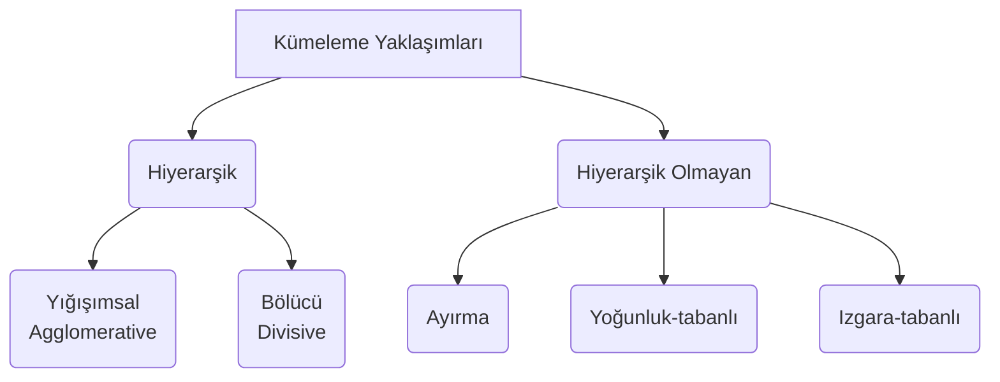

---

#### 15.3.1. Hiyerarşik Kümeleme

Bu yaklaşımın ana fikri, tek bir kümeleme sonucu üretmek yerine, bir dizi iç içe geçmiş kümeden oluşan bir **hiyerarşi** veya bir **ağaç yapısı (dendrogram)** oluşturmaktır. Başlangıçta kaç küme olması gerektiğini belirtmenize gerek yoktur. Algoritma size tüm olası küme birleşimlerini bir ağaç olarak sunar, siz de bu ağacı istediğiniz seviyeden "keserek" küme sayısını belirlersiniz.

Bu yaklaşımın iki temel stratejisi vardır:

*   **a) Yığışımsal (Agglomerative) / Birleştirici:** Bu, "aşağıdan yukarıya" (bottom-up) bir yaklaşımdır.
    1.  **Başlangıç:** Her bir veri noktası tek başına bir küme olarak kabul edilir. (N veri noktası varsa, N küme vardır.)
    2.  **İterasyon:** Her adımda, birbirine en yakın olan iki küme bulunur ve birleştirilir.
    3.  **Bitiş:** Tüm veri noktaları tek bir büyük kümede birleşene kadar bu birleştirme işlemi devam eder.

*   **b) Bölücü (Divisive):** Bu, "yukarıdan aşağıya" (top-down) bir yaklaşımdır ve daha nadir kullanılır.
    1.  **Başlangıç:** Tüm veri noktaları tek bir kümenin içindedir.
    2.  **İterasyon:** Her adımda, mevcut bir küme, içindeki noktalar birbirine en az benzeyecek şekilde ikiye bölünür.
    3.  **Bitiş:** Her veri noktası tek başına bir küme olana kadar bu bölme işlemi devam eder.

Hiyerarşik yöntemler, verinin yapısı hakkında zengin bir görsel bilgi sunar ancak büyük veri setlerinde hesaplama maliyetleri yüksek olabilir.

##### 15.3.1.1. Kümeler Arası Uzaklık: Bağlantı (Linkage) Yöntemleri

Yığışımsal algoritmanın her adımında "birbirine en yakın iki küme" birleştirilir. İki nokta arasındaki uzaklık 15.2'deki ölçütlerle hesaplanır; ancak birden fazla nokta içeren iki kümenin uzaklığı için ayrıca bir kural gerekir. Bu kurala **bağlantı (linkage)** yöntemi denir:

| Yöntem | İki küme arasındaki uzaklık | Davranış |
| :--- | :--- | :--- |
| **Tek bağlantı (single linkage)** | İki kümenin birbirine **en yakın** iki noktası arasındaki uzaklık | Zincir biçimli, uzun kümeler oluşturmaya eğilimlidir. |
| **Tam bağlantı (complete linkage)** | İki kümenin birbirine **en uzak** iki noktası arasındaki uzaklık | Küçük çaplı, toplu kümeler oluşturur. |
| **Ortalama bağlantı (average linkage)** | İki kümedeki tüm nokta çiftleri arasındaki uzaklıkların **ortalaması** | Tek ve tam bağlantı arasında bir davranış gösterir. |
| **Ward yöntemi (Ward's method)** | Birleştirmenin küme içi kareler toplamında (WCSS, bkz. 15.4.2) yol açacağı **artış** | Benzer büyüklükte, küresel kümeler oluşturur. |

**Sayısal örnek:** Bir doğru üzerindeki beş nokta A = 1, B = 2, C = 4, D = 8, E = 9 olsun (uzaklık = farkın mutlak değeri). Birleştirme sırası ve birleştirme anındaki uzaklıklar:

| Adım | Birleşen kümeler | Tek bağlantı | Tam bağlantı | Ortalama bağlantı |
| :---: | :--- | :---: | :---: | :---: |
| 1 | {A} + {B} | 1 | 1 | 1 |
| 2 | {D} + {E} | 1 | 1 | 1 |
| 3 | {A, B} + {C} | 2 (B–C) | 3 (A–C) | 2.5 ((3 + 2) / 2) |
| 4 | {A, B, C} + {D, E} | 4 (C–D) | 8 (A–E) | 6.167 (6 çiftin ortalaması: 37 / 6) |

Üç yöntemde de birleştirme sırası aynıdır, ancak birleştirme yükseklikleri farklıdır. Tek bağlantıya göre çizilen dendrogram aşağıdadır:

```
Uzaklık
   4 ┤        ┌────┴─────┐
   3 ┤        │          │
   2 ┤     ┌──┴──┐       │
   1 ┤   ┌─┴─┐   │     ┌─┴─┐
     └───────────────────────
         A   B   C     D   E
```

Dendrogram 3 yüksekliğinden yatay bir çizgiyle "kesilirse" iki küme ({A, B, C} ve {D, E}), 1.5 yüksekliğinden kesilirse üç küme ({A, B}, {C} ve {D, E}) elde edilir. Küme sayısının önceden belirtilmesi gerekmemesinin nedeni budur.

---

#### 15.3.2. Hiyerarşik Olmayan Kümeleme

Bu yaklaşımda amaç, veri setini önceden belirlenmiş **'K' adet** kümeye doğrudan bölmektir. Bir hiyerarşi oluşturulmaz; bunun yerine, veri noktaları belirli bir optimizasyon kriterine göre en uygun kümelere atanır. Genellikle hiyerarşik yöntemlerden daha hızlıdırlar ve bu nedenle büyük veri setleri için daha uygundurlar.

Bu sınıftaki bazı önemli alt başlıklar şunlardır:

*   **a) Ayırma (Partitioning) Yöntemleri:** En yaygın kullanılan yaklaşımdır. Amaç, veri setini K adet, kesişmeyen kümeye ayırmaktır. Analizcinin küme sayısı olan 'K' değerini en başta belirtmesi gerekir. En bilinen örneği **K-Means** algoritmasıdır. Bu algoritma, her kümenin bir merkez noktası (centroid) etrafında toplandığını varsayar.

*   **b) Yoğunluk Tabanlı (Density-based) Yöntemler:** Bu algoritmalar kümeleri, veri uzayında yoğun olarak bulunan bölgeler olarak tanımlar. Düşük yoğunluklu bölgeler ise bu kümeleri birbirinden ayıran sınırlar olarak görülür. Kümelerin küresel olmak zorunda olmadığını varsaydıkları için **farklı geometrik şekillerdeki kümeleri** bulabilirler. Ayrıca, herhangi bir kümeye ait olmayan "gürültü" (noise) veya "aykırı" (outlier) noktaları tespit etmede de oldukça başarılıdırlar. **DBSCAN** bu kategorinin popüler bir örneğidir.

*   **c) Izgara Tabanlı (Grid-based) Yöntemler:** Bu yöntemler, veri uzayını ızgara benzeri hücrelere böler ve tüm kümeleme işlemlerini bu hücreler üzerinde gerçekleştirir. Avantajı, işlem hızının veri noktası sayısına değil, ızgara hücrelerinin sayısına bağlı olmasıdır. Bu da onu çok büyük veri setleri için oldukça verimli kılar.

Sonuç olarak, hangi kümeleme yönteminin seçileceği; verinin yapısına, boyutuna, veri setinde gürültü olup olmamasına ve analizin nihai hedefine bağlıdır. Tek bir "en iyi" yöntem yoktur; her problemin doğası, en uygun yaklaşımın seçilmesini gerektirir.


### 15.4. Hiyerarşik Olmayan Kümeleme: K-Means Algoritması

Bu alt bölümde hiyerarşik olmayan yöntemlerin en yaygın kullanılanı olan **K-Means** algoritması incelenmektedir. Algoritmanın gücü, karmaşık bir problemi basit ve sezgisel adımlarla çözmesinden gelir.

Temel fikir şudur: Veri seti, önceden belirlenen 'k' adet kümeye ayrılmak istenmektedir. K-Means, her kümenin bir "ağırlık merkezi" veya geometrik merkezi olduğunu varsayar. Bu merkeze literatürde **centroid** denir. Bir veri noktasının kaderi basittir: Hangi centroid'e daha yakınsa, o centroid'in kümesine aittir.

Algoritmayı, bir odaya dağılmış insanları 'k' adet gruba ayırmaya çalışan bir organizatöre benzetebiliriz. Organizatörün görevi, her grubun kendi içinde mümkün olduğunca sıkı ve birbirine yakın olmasını sağlamaktır.

#### 15.4.1. Algoritmanın Çalışma Prensibi

K-Means, bu en iyi gruplamayı bulmak için yinelemeli (iterative) bir yaklaşım kullanır. Süreç, belirli bir denge durumuna ulaşana kadar kendini tekrar eden adımlardan oluşur.

1.  **Başlatma (Initialization):**
    *   İlk olarak, veriyi kaç kümeye ayırmak istediğimize karar veririz. Bu sayı 'k'dır.
    *   Ardından, veri uzayında rastgele 'k' adet nokta, başlangıç merkezleri (centroid'ler) olarak seçilir. Bu ilk merkezler, genellikle veri setinden rastgele seçilen 'k' adet noktanın kendisi olabilir. Bu, organizatörün odada rastgele 'k' noktayı "grup toplanma merkezi" olarak ilan etmesi gibidir.

2.  **Atama (Assignment):**
    *   Veri setindeki her bir nokta (odadaki her bir kişi) tek tek ele alınır.
    *   Her nokta için, kendisine en yakın olan centroid hesaplanır. "Yakınlık" ölçümü için standart olarak **Öklid uzaklığı** kullanılır.
    *   Her nokta, en yakın olduğu centroid'in kümesine dahil edilir. Bu adımın sonunda, herkes en yakın bulduğu toplanma merkezine gitmiş ve 'k' adet başlangıç kümesi oluşmuş olur.

3.  **Güncelleme (Update):**
    *   Atama adımı tamamlandıktan sonra, oluşan her bir kümenin yeni centroid'i, yani yeni ağırlık merkezi hesaplanır.
    *   Bu, o kümeye atanmış olan tüm veri noktalarının koordinatlarının aritmetik ortalaması alınarak yapılır. Algoritmanın ismindeki **"Means" (Ortalamalar)** kelimesi bu adımdan gelmektedir.
    *   Yani organizatör, her grubun tam ortasına giderek "Yeni toplanma merkezi burasıdır!" der.

4.  **Yineleme ve Yakınsama (Iteration & Convergence):**
    *   2. (Atama) ve 3. (Güncelleme) adımları, sistem bir denge durumuna ulaşana kadar tekrar edilir. İnsanlar yeni merkezlere göre tekrar en yakın grubu seçer, merkezler tekrar hesaplanır.
    *   Bu döngü ne zaman durur? Genellikle iki koşuldan biri sağlandığında:
        *   Centroid'lerin konumları bir önceki adıma göre artık hiç değişmez veya çok az değişir.
        *   Noktaların küme üyelikleri artık değişmez (kimse grup değiştirmez).
    *   Bu denge durumuna ulaşıldığında (buna **yakınsama** denir), küme merkezleri ve üyelikleri sabitlenir ve algoritma sonlanır.

Aşağıdaki diyagram, bu yinelemeli süreci görselleştirmektedir:

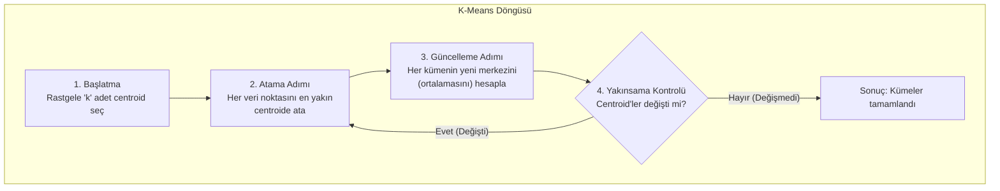

#### 15.4.2. K-Means'in Matematiksel Hedefi: WCSS'yi Minimize Etmek

K-Means'in adımları gelişigüzel değildir; algoritma net bir matematiksel hedefi izler. Algoritmanın temel amacı, oluşturduğu kümeleri kendi içlerinde olabildiğince yoğun ve birbirine yakın tutmaktır. Her bir kümenin ne kadar "dağınık" olduğunu ölçen bir maliyet fonksiyonu düşünün. K-Means, her adımda bu toplam dağınıklığı, yani hatayı azaltmaya çalışır.

Bu toplam hatanın teknik adı **Küme İçi Hata Kareleri Toplamı (Within-Cluster Sum of Squares - WCSS)**'dır. WCSS, her bir veri noktasının, ait olduğu kümenin merkezine (centroid'e) olan uzaklıklarının karesinin toplanmasıyla hesaplanır.

<p align="center">
    WCSS = &sum;<sub>i=1</sub><sup>k</sup> &sum;<sub>x &isin; C<sub>i</sub></sub> ||x - &mu;<sub>i</sub>||<sup>2</sup>
</p>

```math
\text{WCSS} = \underbrace{\sum_{i=1}^{k}}_{\substack{\text{k kümenin}\\\text{hepsi için}}} \; \underbrace{\sum_{x \in C_i}}_{\substack{\text{i. kümedeki}\\\text{her x noktası için}}} \overbrace{\lVert x - \mu_i \rVert^2}^{\substack{\text{noktanın kendi merkezine}\\\text{uzaklığının karesi}}}
```

**Nasıl okunur?** "WCSS eşittir, i eşittir 1'den k'ya kadar, C alt i'deki her x için, x eksi mü alt i'nin normunun karesinin toplamı." İç içe iki toplam vardır: İçteki toplam bir kümenin içini, dıştaki toplam ise bütün kümeleri toplar. Çift dikey çizgi (norm), iki nokta arasındaki Öklid uzaklığıdır.

Bu formüldeki bileşenleri inceleyelim:
*   $k$: Toplam küme sayısı.
*   $C_i$: $i$ numaralı küme.
*   $x$: $C_i$ kümesine ait bir veri noktası.
*   $\mu_i$: $C_i$ kümesinin centroid'i (merkezi).
*   $||x - \mu_i||^2$: $x$ noktası ile centroid $\mu_i$ arasındaki Öklid uzaklığının karesi. Bu kare alma işlemi, merkeze uzak olan noktaların hatasını daha fazla vurgular.

K-Means'in yaptığı her bir "Atama" ve "Güncelleme" adımı, bu WCSS değerini sistematik olarak düşürmeye yönelik bir hamledir. Atama adımında her nokta, kendisini WCSS'yi en çok azaltacak merkeze atar. Güncelleme adımında ise her bir centroid, kendi kümesinin yeni kütle merkezine taşınır ki bu da o küme için WCSS'yi minimize eden noktadır.

Algoritma, bu değeri daha fazla düşüremediği bir denge noktasına ulaştığında durur. Bu noktaya **yerel minimum (local minimum)** denir. Bu, algoritmanın mümkün olan en iyi çözümü bulduğunu garanti etmez; çünkü sonuç, başlangıçta centroid'lerin nereye yerleştirildiğine bağlıdır. Bu nedenle pratikte, algoritma farklı başlangıç noktalarıyla birkaç kez çalıştırılır ve en düşük WCSS değerini veren sonuç en iyi kümeleme olarak kabul edilir.

#### 15.4.3. Elle Çözülmüş Bir Örnek

Altı noktalı bir veri seti k = 2 küme ile kümelenmektedir: A(1, 1), B(2, 1), C(1, 2), D(5, 4), E(6, 5), F(4, 5). Gözle bakıldığında {A, B, C} ve {D, E, F} gruplarının oluşması beklenir. Algoritmanın kötü bir başlangıçtan nasıl toparlandığını göstermek için başlangıç merkezleri bilerek birbirine yakın seçilmiştir: m₁ = A(1, 1), m₂ = B(2, 1). Uzaklıklar Öklid uzaklığıdır.

**Tur 1, atama adımı:**

| Nokta | m₁ = (1, 1) uzaklığı | m₂ = (2, 1) uzaklığı | Atandığı küme |
| :---: | :---: | :---: | :---: |
| A(1, 1) | 0.000 | 1.000 | K₁ |
| B(2, 1) | 1.000 | 0.000 | K₂ |
| C(1, 2) | 1.000 | 1.414 | K₁ |
| D(5, 4) | 5.000 | 4.243 | K₂ |
| E(6, 5) | 6.403 | 5.657 | K₂ |
| F(4, 5) | 5.000 | 4.472 | K₂ |

**Tur 1, güncelleme adımı:** K₁ = {A, C} için m₁ = ((1 + 1)/2, (1 + 2)/2) = (1, 1.5); K₂ = {B, D, E, F} için m₂ = ((2 + 5 + 6 + 4)/4, (1 + 4 + 5 + 5)/4) = (4.25, 3.75). Başlangıç merkezleriyle WCSS = 71 iken yeni merkezlerle WCSS = 20'dir.

**Tur 2, atama adımı:**

| Nokta | m₁ = (1, 1.5) uzaklığı | m₂ = (4.25, 3.75) uzaklığı | Atandığı küme |
| :---: | :---: | :---: | :---: |
| A(1, 1) | 0.500 | 4.257 | K₁ |
| B(2, 1) | 1.118 | 3.553 | **K₁** (küme değiştirdi) |
| C(1, 2) | 0.500 | 3.691 | K₁ |
| D(5, 4) | 4.717 | 0.791 | K₂ |
| E(6, 5) | 6.103 | 2.151 | K₂ |
| F(4, 5) | 4.610 | 1.275 | K₂ |

**Tur 2, güncelleme adımı:** K₁ = {A, B, C} için m₁ = (4/3, 4/3) ≈ (1.333, 1.333); K₂ = {D, E, F} için m₂ = (5, 14/3) ≈ (5, 4.667). WCSS = 4'e düşer.

**Tur 3:** Yeni merkezlere göre hiçbir nokta küme değiştirmez; merkezler de değişmez. Algoritma yakınsamıştır. Sonuç kümeler {A, B, C} ve {D, E, F}'dir ve WCSS değeri turlar boyunca 71 → 20 → 4 biçiminde azalmıştır.


***

### 15.5. Uygulama: WEKA ile "insanlar.csv" Veri Seti Üzerinde Analiz

Bu uygulamanın amacı, kişilerin fiziksel özelliklerine (`yas`, `boy`, `kilo`, `ayak_no`) bakarak aralarında doğal gruplar olup olmadığını keşfetmek ve ardından bu grupları tanımlayan kuralları ortaya çıkarmaktır. Aşağıdaki çıktılar WEKA 3.8.6 ile alınmıştır. Veri dosyası: [`datasets/insanlar.csv`](https://github.com/erkanozhan/datamining/blob/main/datasets/insanlar.csv)

#### 15.5.1. k-Means ile Kümeleme

##### 15.5.1.1. Adım 1: Veri Setini WEKA'ya Yükleme

WEKA, yerel dosyaların yanı sıra doğrudan internet üzerindeki verilere de erişebilir.

1.  WEKA Explorer'ı başlatın.
2.  "Preprocess" sekmesinde "Open file..." yerine **"Open URL..."** düğmesine tıklayın.
3.  Açılan pencereye aşağıdaki adresi yapıştırın ve "OK" düğmesine basın:
    `https://raw.githubusercontent.com/erkanozhan/datamining/main/datasets/insanlar.csv`
4.  Veri yüklendiğinde "Current relation" bölümünde 47 kayıt (Instances: 47), "Attributes" panelinde ise `ad`, `yas`, `boy`, `kilo` ve `ayak_no` öznitelikleri görünür.

##### 15.5.1.2. Adım 2: k-Means Algoritmasını Yapılandırma ve Çalıştırma

Kümeleme, nesneler arasındaki sayısal uzaklıklara dayalı bir analizdir. `ad` özniteliği her kişi için benzersiz bir tanımlayıcı olduğundan iki kişi arasındaki uzaklığa anlamlı bir katkı sağlamaz. Bu tür tanımlayıcı öznitelikler analizden çıkarılmalıdır. WEKA'da bir özniteliği silmek yerine kümeleme algoritmasının onu **göz ardı etmesi (ignore)** sağlanabilir.

1.  "Cluster" sekmesine geçin.
2.  "Choose" düğmesiyle `weka.clusterers.SimpleKMeans` algoritmasını seçin.
3.  Algoritma adına tıklayarak ayarlarını açın ve `numClusters` değerini **3** yapın. "OK" ile kapatın.
4.  "Cluster mode" bölümünün altındaki **"Ignore attributes"** düğmesine tıklayın ve açılan pencerede `ad` özniteliğini seçin.
5.  "Start" düğmesine basın.

##### 15.5.1.3. Adım 3: Sonuçları Yorumlama

"Clusterer output" panelindeki çıktı şöyledir:

```
kMeans
======

Number of iterations: 10
Within cluster sum of squared errors: 3.7783039939072314

Initial starting points (random):

Cluster 0: 19,1.68,55,37
Cluster 1: 44,1.98,85,44
Cluster 2: 25,1.66,59,38

Missing values globally replaced with mean/mode

Final cluster centroids:
                         Cluster#
Attribute    Full Data          0          1          2
                (47.0)     (16.0)     (12.0)     (19.0)
=======================================================
yas            26.4468     28.875    30.3333    21.9474
boy             1.7498     1.6837     1.8325     1.7532
kilo           70.8085     60.625    87.4167    68.8947
ayak_no        41.2766    38.1875    44.0833    42.1053

Clustered Instances

0      16 ( 34%)
1      12 ( 26%)
2      19 ( 40%)
```

*   **Normalizasyon:** `SimpleKMeans` varsayılan olarak `EuclideanDistance` kullanır ve bu uzaklık fonksiyonu öznitelikleri hesaplamadan önce [0, 1] aralığına ölçekler. Bu sayede kilo (kg) gibi büyük değerli bir öznitelik, boy (m) gibi küçük değerli bir özniteliği bastıramaz. Çıktıdaki küçük WCSS değeri (3.778) de bu ölçeklenmiş uzaklıklarla hesaplanmıştır. Merkezler ise özgün birimlerle gösterilir.
*   **Rastgele başlangıç:** Başlangıç merkezleri (Initial starting points) rastgele seçilir. Varsayılan rastgelelik tohumu (`seed`) 10 olduğundan aynı ayarlarla her çalıştırmada aynı sonuç elde edilir; tohum değiştirildiğinde sonuç değişebilir.
*   **Küme Merkezleri (Final cluster centroids):** Her sütun bir kümenin "ortalama insan profilini" gösterir:
    *   **Küme 0 (16 kişi):** En kısa boylu (1.68 m), en hafif (60.6 kg) ve en küçük ayak numaralı (38.2) grup.
    *   **Küme 1 (12 kişi):** En uzun boylu (1.83 m), en kilolu (87.4 kg) ve en büyük ayak numaralı (44.1) grup; yaş ortalaması da en yüksektir (30.3).
    *   **Küme 2 (19 kişi):** En genç grup (21.9 yaş); boy (1.75 m) ve kilo (68.9 kg) bakımından diğer iki grubun arasındadır.

    Veri setinde cinsiyet bilgisi bulunmadığından, kümelerin cinsiyete karşılık geldiği gibi bir yorum bu veriyle doğrulanamaz.
*   **Kümelenmiş Örnekler (Clustered Instances):** En kalabalık küme, kişilerin %40'ını içeren Küme 2'dir.

#### 15.5.2. Küme Etiketlerinden Anlam Çıkarma

Kümeleme soyut "Küme 0", "Küme 1" etiketleri üretir. Bu etiketlerin hangi somut kurallarla tanımlandığını bulmak için küme etiketleri veriye eklenip bir sınıflandırma algoritmasıyla incelenebilir.

##### 15.5.2.1. Adım 1: Küme Etiketlerini Veriye Ekleme (`AddCluster`)

WEKA'daki `AddCluster` filtresi kümeleme algoritmasını çalıştırır ve her kaydın hangi kümeye atandığını gösteren **yeni bir sütunu** veri setine ekler.

1.  "Preprocess" sekmesine dönün.
2.  "Filter" bölümünde "Choose" düğmesine tıklayıp `weka.filters.unsupervised.attribute.AddCluster` filtresini seçin.
3.  Filtre adına tıklayarak ayarlarını açın: `clusterer` olarak `SimpleKMeans` seçip `numClusters` değerini **3** yapın; `ignoredAttributeIndices` alanına `ad` özniteliğinin sırası olan **1** yazın.
4.  "Apply" düğmesine basın. Veri setinin sonuna `cluster` adlı yeni bir nominal öznitelik eklenir.

**Dikkat:** `AddCluster` küme adlarını **1'den** başlatır: `cluster1`, `cluster2`, `cluster3`. "Cluster" sekmesindeki numaralandırma ise 0'dan başlar. Bu veride `cluster1` 16, `cluster2` 12, `cluster3` 19 kayıt içerir; yani `cluster1` = Küme 0, `cluster2` = Küme 1, `cluster3` = Küme 2'dir.

##### 15.5.2.2. Adım 2: Görsel Analiz

"Visualize" sekmesinde X ekseni için `boy`, Y ekseni için `kilo` seçilip noktalar `cluster` sütununa göre renklendirildiğinde, küme merkezlerine göre şu dağılım beklenir:

*   **cluster1** etiketli noktalar grafiğin sol alt bölgesinde (kısa boy, düşük kilo) toplanır.
*   **cluster2** etiketli noktalar sağ üst bölgede (uzun boy, yüksek kilo) toplanır.
*   **cluster3** etiketli noktalar bu iki grubun arasında yer alır.

Bu görsel analize dayanarak gruplar şöyle adlandırılabilir: **cluster1:** minyon yapılı bireyler; **cluster2:** iri yapılı bireyler; **cluster3:** genç ve orta ölçülerde bireyler.

##### 15.5.2.3. Adım 3: Karar Ağacı ile Kuralları Görselleştirme

1.  "Classify" sekmesine geçin.
2.  Sınıf özniteliği olarak yeni eklenen `(Nom) cluster` özniteliğinin seçili olduğundan emin olun.
3.  "Choose" düğmesiyle `weka.classifiers.trees.J48` algoritmasını seçin ve "Start" düğmesine basın.

Çıktıdaki ağaç şöyledir (ağacı grafik olarak görmek için "Result list" panelinde sonuca sağ tıklayıp **"Visualize tree"** seçilebilir):

```
J48 pruned tree
------------------

kilo <= 78
|   ayak_no <= 40: cluster1 (17.0/1.0)
|   ayak_no > 40: cluster3 (18.0)
kilo > 78: cluster2 (12.0)

Number of Leaves  : 	3

Size of the tree : 	5
```

*   **Yorum:** Kümeleri ayıran en önemli öznitelik **kilo**, ikincisi ise **ayak numarasıdır**. 78 kg'dan ağır olan 12 kişinin tamamı `cluster2`'dedir. 78 kg ve altındaki kişiler ayak numarasına göre ayrılır: Ayak numarası 40 ve altında olanlar `cluster1`'e (17 kişiden 1'i hatalı), 40'ın üzerinde olanlar `cluster3`'e atanır. Parantez içindeki (17.0/1.0) gösterimi, yaprağa düşen kayıt sayısını ve bunlardan kaçının hatalı sınıflandırıldığını belirtir. Ağaç eğitim verisindeki 47 kaydın 46'sını (%97.87) doğru sınıflandırır. Böylece kümeleme ile bulunan soyut gruplara, insan tarafından okunabilir somut tanımlar getirilmiş olur.

##### 15.5.2.4. Adım 4: Kural Tabanlı Algoritma ile Kuralları Listeleme

"Choose" ile `weka.classifiers.rules.JRip` algoritması seçilip "Start" düğmesine basıldığında aşağıdaki kural listesi elde edilir:

```
JRIP rules:
===========

(kilo >= 79) => cluster=cluster2 (12.0/0.0)
(ayak_no <= 39) => cluster=cluster1 (15.0/0.0)
 => cluster=cluster3 (20.0/1.0)

Number of Rules : 3
```

*   **Yorum:** Kurallar aynı tabloyu doğrular: 79 kg ve üzeri kişiler `cluster2`, ayak numarası 39 ve altındaki kişiler `cluster1`, geri kalan herkes `cluster3`'tür. Bu tür net kurallar, müşteri segmentasyonu gibi alanlarda doğrudan kullanılabilir.

##### 15.5.2.5. Bu Yaklaşım Ne Kazandırır?

Bu yaklaşım, **keşiften kural çıkarmaya** geçişi sağlar:

1.  **Keşif aşaması (gözetimsiz öğrenme):** K-Means ile verideki doğal gruplar bulunur.
2.  **Kural çıkarma aşaması (gözetimli öğrenme):** Küme etiketleri "doğru cevaplar" gibi kabul edilir ve bir sınıflandırma algoritması (J48, JRip) bu etiketleri tahmin edecek biçimde eğitilir.

*   **Yorumlanabilirlik:** Kümeleme grupları verir; sınıflandırma ise bu grupların **neden** oluştuğunu açıklayan net kurallar üretir.
*   **Verimlilik:** Yeni bir kayıt geldiğinde kümeleme baştan çalıştırılmadan, eğitilen sınıflandırıcıyla kaydın hangi kümeye ait olduğu tahmin edilebilir.
*   **Segmentasyon ve profilleme:** Müşteriler davranışlarına göre kümelenir, ardından her segmentin profilini (örneğin "30 yaş altı ve ayda 5'ten fazla alışveriş yapıyorsa 'sadık müşteri'dir") tanımlayan kurallar elde edilir.

> Özetle, kümeleme ile **keşfedilen** gruplar, sınıflandırma ile **tanımlanabilir ve uygulanabilir kurallara** dönüştürülür.

#### 15.5.3. Kümeleme Sonuçlarını Değerlendirme

Sınıflandırma problemlerinde elde "doğru cevaplar", yani etiketler bulunur; modelin tahminleri bu etiketlerle karşılaştırılarak doğruluk hesaplanır. Kümeleme ise **gözetimsiz öğrenme (unsupervised learning)** alanına girer; önceden tanımlanmış doğru cevaplar yoktur. Kümelemenin kalitesi iki yolla ölçülebilir: Varsa harici bir etiketle karşılaştırarak veya yalnızca kümelerin iç yapısına bakan ölçütlerle.

##### 15.5.3.1. WEKA ile Harici Etikete Göre Değerlendirme: "Classes to clusters evaluation"

Bu yöntemde kümeleme algoritması sınıf etiketini kullanmadan çalıştırılır; değerlendirme aşamasında ise oluşan kümeler sınıf etiketiyle karşılaştırılır. Kümeler etikete göre anlamlı biçimde ayrışıyorsa, kümelemenin veri içindeki gerçek bir yapıyı yakaladığı söylenebilir. `insanlar.csv` veri setinde böyle bir etiket olmadığından örnek, WEKA'nın `data` klasöründeki `iris.arff` veri setiyle verilmiştir:

1.  `iris.arff` dosyasını açın; "Cluster" sekmesinde `SimpleKMeans` algoritmasını `numClusters` = 3 ile seçin.
2.  "Cluster mode" bölümünde **"Classes to clusters evaluation"** seçeneğini işaretleyin ve listeden `(Nom) class` özniteliğini seçin. Bu modda sınıf özniteliği kümelemeye otomatik olarak dahil edilmez.
3.  "Start" düğmesine basın.

```
Final cluster centroids:
                           Cluster#
Attribute      Full Data          0          1          2
                 (150.0)     (61.0)     (50.0)     (39.0)
=========================================================
sepallength       5.8433     5.8885      5.006     6.8462
sepalwidth         3.054     2.7377      3.418     3.0821
petallength       3.7587     4.3967      1.464     5.7026
petalwidth        1.1987      1.418      0.244     2.0795

Clustered Instances

0       61 ( 41%)
1       50 ( 33%)
2       39 ( 26%)

Class attribute: class
Classes to Clusters:

  0  1  2  <-- assigned to cluster
  0 50  0 | Iris-setosa
 47  0  3 | Iris-versicolor
 14  0 36 | Iris-virginica

Cluster 0 <-- Iris-versicolor
Cluster 1 <-- Iris-setosa
Cluster 2 <-- Iris-virginica

Incorrectly clustered instances :	17.0	 11.3333 %
```

*   **Yorum:** Iris-setosa türünün 50 çiçeğinin tamamı tek bir kümede (Küme 1) toplanmıştır. Versicolor ve virginica türleri birbirine daha yakın olduğundan karışma bu iki tür arasındadır: 14 virginica çiçeği versicolor kümesine (Küme 0), 3 versicolor çiçeği virginica kümesine (Küme 2) düşmüştür. Toplam 150 çiçeğin 17'si (%11.33) "yanlış kümede" yer alır.

##### 15.5.3.2. R ile Küme Sayısının Belirlenmesi: Hazırlık

Harici bir etiket yoksa küme sayısı, kümelerin iç yapısına bakan ölçütlerle belirlenir. Aşağıdaki R kodları `factoextra`, `NbClust` ve `cluster` paketlerini kullanır (kurulum: `install.packages(c("factoextra", "NbClust"))`). Benzer kodlar [`codes/clustering.Rmd`](https://github.com/erkanozhan/datamining/blob/main/codes/clustering.Rmd) ve [`codes/Clustering_MarkDown-v3.Rmd`](https://github.com/erkanozhan/datamining/blob/main/codes/Clustering_MarkDown-v3.Rmd) dosyalarında bulunmaktadır.

```r
# Gerekli kütüphanelerin yüklenmesi
library(factoextra)
library(NbClust)
library(ggplot2)
library(cluster)

# Veri yükleme
data(iris)

# Veri ön işleme: 5. sütun olan 'Species' kategorik değişkeni çıkarılır
df <- iris[, -5]

# Standardizasyon (ortalama = 0, standart sapma = 1)
df_scaled <- scale(df)

# İlk satırların kontrolü
head(df_scaled)
```

**Analiz:** İris verisinde ölçüm birimleri aynı (cm) olsa da, varyansları eşitlemek için ölçeklendirme yapılmıştır. Bu, Öklid uzaklığının varyansı büyük olan değişken (Petal.Length) tarafından baskılanmasını engeller.

##### 15.5.3.3. Dirsek (Elbow) Yöntemi

`fviz_nbclust` fonksiyonu `method = "wss"` argümanı ile çalıştırılır:

```r
set.seed(123) # Tekrarlanabilirlik için
fviz_nbclust(df_scaled, kmeans, method = "wss") +
    geom_vline(xintercept = 3, linetype = 2) +
    labs(title = "Elbow Yöntemi (İris Veri Seti)",
         subtitle = "Toplam WCSS'in Küme Sayısına Göre Değişimi",
         x = "Küme Sayısı (k)", y = "Toplam WCSS")
```

**Bulgular ve yorum:** Grafikteki toplam WCSS değerleri k = 1, 2, 3, 4, 5 için sırasıyla 596.0, 220.9, 138.9, 113.6 ve 90.2'dir (R 4.5.1 ile alınmıştır).

*   **k = 1'den k = 2'ye geçiş:** WCSS çok keskin biçimde düşer (596.0 → 220.9). Bu düşüş, setosa türünün diğerlerinden ayrılmasından kaynaklanır.
*   **k = 3:** İkinci, daha yumuşak bir kırılma (220.9 → 138.9) görülür. Bu kırılma versicolor ve virginica ayrımına karşılık gelir.
*   **Sonuç:** Dirsek yöntemi iris verisinde kesin bir cevap vermez. En büyük kazanç k = 2'de olsa da k = 3'teki dirsek de göz ardı edilemez; her iki değer de aday olarak yorumlanır.

##### 15.5.3.4. Silhouette Yöntemi

`fviz_nbclust` fonksiyonu `method = "silhouette"` argümanı ile çalıştırılır:

```r
fviz_nbclust(df_scaled, kmeans, method = "silhouette") +
    labs(title = "Silhouette Analizi",
         subtitle = "Ortalama Silhouette Genişliği",
         x = "Küme Sayısı (k)", y = "Ortalama Silhouette Genişliği")
```

**Bulgular ve yorum:** Ortalama silhouette genişliği (average silhouette width, ASW) k = 2 için 0.582 ile en yüksek değerine ulaşır; k = 3 için 0.460, k = 4 için 0.419'dur.

Silhouette indeksi, kümelerin birbirinden ne kadar ayrık olduğunu ödüllendirir. Setosa kümesi çok ayrıktır; bu kümedeki noktaların $s(i)$ değerleri 1'e yakındır. k = 3 yapıldığında versicolor ve virginica kümeleri birbirine çok yakın olduğundan sınırdaki noktaların $s(i)$ değerleri düşer (sıfıra yaklaşır veya negatif olur) ve genel ortalama azalır. Bu nedenle silhouette yöntemi, matematiksel olarak en iyi ayrışmanın 2 küme ile (setosa ve diğerleri) sağlandığını gösterir.

##### 15.5.3.5. NbClust ile Çoğunluk Kuralı

`NbClust` fonksiyonu çok sayıda indeksi hesaplar ve her indeksin önerdiği küme sayısını oylamaya sunar. İris verisi için k aralığı 2 ile 10 arasında belirlenmiştir:

```r
set.seed(123)
nb_res <- NbClust(data = df_scaled,
                  distance = "euclidean",
                  min.nc = 2, max.nc = 10,
                  method = "kmeans",
                  index = "all")

# Sonuçların görselleştirilmesi: her küme sayısını kaç indeksin önerdiği
# (grafiksel indeksler Hubert ve D indeksi 0 olarak kodlanır)
barplot(table(nb_res$Best.nc[1, ]),
        xlab = "Önerilen küme sayısı (k)", ylab = "İndeks sayısı",
        main = "NbClust Çoğunluk Kuralı Sonuçları")
```

**Not:** Birçok kaynakta bu grafik için `fviz_nbclust(nb_res)` kullanılır. Ancak bu çağrı R 4.5.1 ve factoextra 1.0.7 ile "the condition has length > 1" hatası verir; bu nedenle yukarıda temel R'daki `barplot()` fonksiyonu kullanılmıştır.

**Bulgular ve yorum:** NbClust paketinde toplam 30 indeks bulunur; `index = "all"` seçeneği bunlardan hesaplama maliyeti yüksek dördünü (Gap, Gamma, Gplus, Tau) dışarıda bırakır ve 26 indeks hesaplar (30 indeksin tamamı için `index = "alllong"` kullanılır). Hubert ve D indeksleri grafiksel yöntemler olduğundan oylamaya katılmaz; oylama kalan 24 indeksle yapılır. Konsol çıktısının sonu şöyledir:

```
* Among all indices:
* 11 proposed 2 as the best number of clusters
* 10 proposed 3 as the best number of clusters
* 1 proposed 4 as the best number of clusters
* 1 proposed 6 as the best number of clusters
* 1 proposed 10 as the best number of clusters

                   ***** Conclusion *****

* According to the majority rule, the best number of clusters is  2
```

*   **k = 2 öneren 11 indeks:** CH, DB, Silhouette, Duda, PseudoT2, Beale, Ratkowsky, PtBiserial, McClain, Dunn, SDindex.
*   **k = 3 öneren 10 indeks:** KL, Hartigan, CCC, Scott, Marriot, TraceW, Rubin, Cindex, Ball, Frey.
*   **Diğerleri:** TrCovW k = 4, Friedman k = 6, SDbw k = 10 önermiştir.

Çoğunluk kuralına göre en iyi küme sayısı 2'dir, ancak k = 3 yalnızca bir oy farkla ikinci sıradadır. İris verisinde gerçekte üç tür bulunduğu hatırlanırsa, istatistiksel ölçütlerin yanında alan bilgisinin de küme sayısı seçiminde dikkate alınması gerektiği görülür.

<a id="b16"></a>

## 16. WEKA ile Birliktelik Kuralı Madenciliği

Birliktelik kuralı madenciliği (association rule mining), hangi ögelerin birlikte sık görüldüğünü bulmayı amaçlar. Bu bölümde küçük bir veri seti üzerinde önce sayımlar elle yapılmakta, ardından aynı analiz WEKA ile tekrarlanmaktadır. Çıktılar WEKA 3.8.6 ile alınmıştır.

### 16.1. Veri Kümesi

Beş işlem (transaction) ve bu işlemlerde yer alan ögeler aşağıdadır. Her işlem bir öge **kümesi** olduğundan bir öge bir işlemde en fazla bir kez yer alır:

| İşlem ID | Ögeler |
|----------|---------|
| T1 | M, O, N, K, E, Y |
| T2 | D, O, N, K, E, Y |
| T3 | M, A, K, E |
| T4 | M, U, C, K, Y |
| T5 | C, O, K, I, E |

### 16.2. Veriyi Anlamak

Her satır bir alışveriş sepeti veya bir işlem olarak düşünülebilir. Örneğin T1 işleminde {M, O, N, K, E, Y} ögeleri birlikte bulunur. Amaç, hangi ögelerin sıklıkla birlikte göründüğünü bulmaktır.

Birkaç örnek:
- K ögesi: T1, T2, T3, T4 ve T5'te, yani **tüm işlemlerde** görünür (5/5).
- E ögesi: T1, T2, T3 ve T5'te görünür (4/5).
- M ögesi: T1, T3 ve T4'te görünür (3/5).

### 16.3. Destek, Güven ve Temel Tanımlar

Bir $A \rightarrow B$ kuralı "A'yı içeren işlemler B'yi de içerir" anlamına gelir. A'ya kuralın **öncülü** (antecedent), B'ye **sonucu** (consequent) denir. N toplam işlem sayısı olmak üzere:

$$
\text{Destek}(A \rightarrow B) = \frac{\text{A ve B'yi birlikte içeren işlem sayısı}}{N} \qquad \text{Güven}(A \rightarrow B) = \frac{\text{A ve B'yi birlikte içeren işlem sayısı}}{\text{A'yı içeren işlem sayısı}}
$$

**Ne anlatıyor?** Destek (support), kuralın verinin ne kadarında geçerli olduğunu; güven (confidence) ise öncül görüldüğünde sonucun da görülme oranını, yani $P(B \mid A)$ değerini ölçer. Destek eşiğini geçen öge kümelerine **sık öge kümesi** (frequent itemset) denir; WEKA bunlara "large itemset" adını verir.

**Örnek:** {K, E} öge kümesi T1, T2, T3 ve T5'te bulunur; desteği 4/5 = 0.8'dir. E → K kuralının güveni 4/4 = 1'dir (E içeren 4 işlemin hepsinde K vardır). K → E kuralının güveni ise 4/5 = 0.8'dir (K içeren 5 işlemin 4'ünde E vardır). Aynı iki öge için kuralın yönü güveni değiştirir.

### 16.4. WEKA İçin Veri Formatı

WEKA'da birliktelik kuralı analizi için veri ARFF (Attribute-Relation File Format) dosyası olarak hazırlanır.

#### 16.4.1. ARFF Dosyası Oluşturma

Bir metin editörü açın ve aşağıdaki yapıyı oluşturun. Her öge (harf) tek değerli (yalnızca `1` değerini alabilen) bir nominal öznitelik olarak tanımlanır. İşlemde bulunmayan ögeler için WEKA'daki eksik değer gösterimi olan `?` (soru işareti) kullanılır.

```arff
@relation market_basket

@attribute M {1}
@attribute O {1}
@attribute N {1}
@attribute K {1}
@attribute E {1}
@attribute Y {1}
@attribute D {1}
@attribute A {1}
@attribute U {1}
@attribute C {1}
@attribute I {1}

@data
1,1,1,1,1,1,?,?,?,?,?
?,1,1,1,1,1,1,?,?,?,?
1,?,?,1,1,?,?,1,?,?,?
1,?,?,1,?,1,?,?,1,1,?
?,1,?,1,1,?,?,?,?,1,1
```

**Dikkat:** Öznitelik tanımında `?` değer listesine yazılmamalıdır. `{1, '?'}` biçiminde bir tanım, `?` karakterini ikinci bir nominal değer hâline getirir. Bu durumda WEKA'nın FPGrowth algoritması, "öge var" anlamına gelen değeri varsayılan olarak ikinci değer kabul ettiğinden (`positiveIndex = 2`) hiçbir öge bulamaz ve "No rules found!" iletisi verir.

**Veri satırlarının açıklaması:**
- İlk satır (T1): M, O, N, K, E, Y ögeleri var. D, A, U, C, I ögeleri yok.
- İkinci satır (T2): O, N, K, E, Y, D ögeleri var. M, A, U, C, I ögeleri yok.
- Üçüncü satır (T3): M, K, E, A ögeleri var. O, N, Y, D, U, C, I ögeleri yok.
- Dördüncü satır (T4): M, K, Y, U, C ögeleri var. O, N, E, D, A, I ögeleri yok.
- Beşinci satır (T5): O, K, E, C, I ögeleri var. M, N, Y, D, A, U ögeleri yok.

Bu dosyayı `market_data.arff` adıyla kaydedin.

### 16.5. WEKA'da Analiz Adımları

#### 16.5.1. Veriyi Yüklemek

WEKA'yı açın ve Explorer'ı seçin:

1. "Preprocess" sekmesinde **Open file** düğmesine tıklayın.
2. `market_data.arff` dosyasını seçin.
3. Verideki öznitelikleri inceleyin.

Her özniteliğin istatistikleri görülebilir. Örneğin E özniteliği seçildiğinde 4 işlemde 1 değerini aldığı (Missing: 1) görülür.

#### 16.5.2. Apriori Algoritmasını Çalıştırmak

Apriori, birliktelik kurallarını bulmak için kullanılan klasik bir algoritmadır.

1. **Associate** sekmesine geçin.
2. **Choose** düğmesine tıklayın ve `weka.associations.Apriori` algoritmasını seçin.
3. Algoritma adının yazılı olduğu kutuya tıklayarak parametreleri açın.

##### 16.5.2.1. Önemli Parametreler

WEKA'daki Apriori uygulamasında doğrudan "minSupport" adlı bir parametre **yoktur**. Algoritma, destek eşiğini yinelemeli olarak düşürür: `upperBoundMinSupport` değerinden başlar, her döngüde eşiği `delta` kadar azaltır ve `numRules` sayıda kural bulduğunda ya da eşik `lowerBoundMinSupport` değerine indiğinde durur.

| Parametre | Varsayılan | Anlamı |
| :--- | :---: | :--- |
| `upperBoundMinSupport` | 1.0 | Destek eşiğinin başlangıç değeri. Desteği bu değerin **üzerinde** kalan öge kümeleri de elenir; bu nedenle genellikle 1.0 bırakılır. |
| `delta` | 0.05 | Her döngüde destek eşiğinin ne kadar azaltılacağı. |
| `lowerBoundMinSupport` | 0.1 | Destek eşiğinin inebileceği en düşük değer. |
| `numRules` | 10 | Bulunması istenen kural sayısı. Bu sayıya ulaşılınca algoritma durur. |
| `metricType` | Confidence | Kuralların sıralanacağı ve eşikle karşılaştırılacağı ölçüt (Confidence, Lift, Leverage, Conviction). |
| `minMetric` | 0.9 | Seçilen ölçüt için en düşük değer (güven için 0.9 = %90). |
| `outputItemSets` | False | True yapılırsa sık öge kümeleri de listelenir. |
| `car` | False | True yapılırsa yalnızca sınıf özniteliğini sonuç olarak içeren kurallar (class association rules) üretilir. |
| `removeAllMissingCols` | False | Tüm değerleri eksik olan sütunları kaldırır. |

Deneme: `upperBoundMinSupport` = 0.6 yapıldığında desteği 0.8 olan {K, E} öge kümesi elenir ve E → K kuralı çıktıdan kaybolur. Bu nedenle destek eşiği `upperBoundMinSupport` ile değil, `lowerBoundMinSupport` ve `numRules` ile ayarlanmalıdır.

Başlangıç için şu değerleri deneyin (diğerleri varsayılan kalsın):
- `lowerBoundMinSupport`: 0.4 (5 işlemin 2'si)
- `minMetric` (güven): 0.7
- `numRules`: 10

#### 16.5.3. Sonuçları Yorumlamak

**Start** düğmesine basıldığında aşağıdaki çıktı elde edilir:

```
Apriori
=======

Minimum support: 0.7 (3 instances)
Minimum metric <confidence>: 0.7
Number of cycles performed: 6

Generated sets of large itemsets:

Size of set of large itemsets L(1): 5

Size of set of large itemsets L(2): 5

Size of set of large itemsets L(3): 1

Best rules found:

 1. E=1 4 ==> K=1 4    <conf:(1)> lift:(1) lev:(0) [0] conv:(0)
 2. M=1 3 ==> K=1 3    <conf:(1)> lift:(1) lev:(0) [0] conv:(0)
 3. O=1 3 ==> K=1 3    <conf:(1)> lift:(1) lev:(0) [0] conv:(0)
 4. O=1 3 ==> E=1 3    <conf:(1)> lift:(1.25) lev:(0.12) [0] conv:(0.6)
 5. Y=1 3 ==> K=1 3    <conf:(1)> lift:(1) lev:(0) [0] conv:(0)
 6. O=1 E=1 3 ==> K=1 3    <conf:(1)> lift:(1) lev:(0) [0] conv:(0)
 7. O=1 K=1 3 ==> E=1 3    <conf:(1)> lift:(1.25) lev:(0.12) [0] conv:(0.6)
 8. O=1 3 ==> K=1 E=1 3    <conf:(1)> lift:(1.25) lev:(0.12) [0] conv:(0.6)
 9. K=1 5 ==> E=1 4    <conf:(0.8)> lift:(1) lev:(0) [0] conv:(0.5)
10. E=1 4 ==> O=1 3    <conf:(0.75)> lift:(1.25) lev:(0.12) [0] conv:(0.8)
```

**Çıktının okunması:**
- **Minimum support: 0.7 (3 instances):** Alt sınır 0.4 olarak verilmesine karşın algoritma, eşik 0.7'ye indiğinde (5 × 0.7 = 3.5; WEKA bu eşiği parantez içinde görüldüğü gibi 3 işlem olarak uygular) 10 kurala ulaştığı için durmuştur. `numRules` artırılırsa eşik daha da düşer (bkz. 16.6).
- **L(1), L(2), L(3):** Sırasıyla 1, 2 ve 3 ögeli sık öge kümelerinin sayısıdır.
- **`O=1 3 ==> E=1 3`:** Öncülün (O) 3 işlemde geçtiğini, öncül ile sonucun (O ve E) birlikte de 3 işlemde geçtiğini gösterir. Güven = 3/3 = 1.
- **`K=1 5 ==> E=1 4  <conf:(0.8)>`:** K 5 işlemde, K ve E birlikte 4 işlemde geçer; güven 4/5 = 0.8'dir.
- **`E=1 4 ==> O=1 3  <conf:(0.75)>`:** E 4 işlemde, E ve O birlikte 3 işlemde geçer; güven 3/4 = 0.75'tir.
- **`lift`, `lev`, `conv`:** Kuralın ilginçliğini ölçen ek ölçütlerdir. Lift 16.7'de açıklanmaktadır.

**Önemli gözlem:** K tüm işlemlerde bulunduğundan, sonucu K olan kuralların (1, 2, 3, 5 ve 6 numaralı kurallar) güveni 1 olsa da lift değeri 1'dir. Bu kurallar yeni bir bilgi taşımaz: K zaten her sepette vardır. Yalnızca güvene bakmak bu nedenle yanıltıcı olabilir.

### 16.6. Farklı Parametre Değerleri Denemek

Destek eşiği düşürülürse daha fazla kural bulunur, ancak bu kurallar daha az işlemde geçerlidir. Eşik yükseltilirse yalnızca çok sık görülen öge birleşimleri kalır.

#### 16.6.1. Düşük Destek Örneği

`lowerBoundMinSupport` = 0.3, `minMetric` = 0.6 ve `numRules` = 200 ile çalıştırıldığında algoritma eşiği 0.3'e kadar düşürür ("Minimum support: 0.3 (2 instances)"). Bu durumda 7 tek ögeli, 14 iki ögeli, 12 üç ögeli, 5 dört ögeli ve 1 beş ögeli sık öge kümesi bulunur. Listede şu kural da yer alır:

```
105. M=1 3 ==> E=1 2    <conf:(0.67)> lift:(0.83) lev:(-0.08) [0] conv:(0.3)
```

M, 3 işlemde görünür (T1, T3, T4). Bu 3 işlemin 2'sinde E de vardır (T1, T3). Güven: 2/3 ≈ 0.67. Kuralın lift değerinin 1'in altında olduğuna dikkat edilmelidir (bkz. 16.7).

#### 16.6.2. Yüksek Destek Örneği

Destek eşiği 0.6 (5 işlemin 3'ü) olarak belirlenirse bir öge kümesinin en az 3 işlemde görünmesi gerekir. Önce sayımlar elle yapılır.

**Tek ögeler:**
- K: 5 işlemde (T1, T2, T3, T4, T5) ✓
- E: 4 işlemde (T1, T2, T3, T5) ✓
- M: 3 işlemde (T1, T3, T4) ✓
- O: 3 işlemde (T1, T2, T5) ✓
- Y: 3 işlemde (T1, T2, T4) ✓
- N: 2 işlemde (T1, T2) ✗
- C: 2 işlemde (T4, T5) ✗
- D, A, U, I: 1'er işlemde ✗

Sık tek ögeler: K, E, M, O, Y (L(1) = 5).

**İki ögeli kümeler** (Apriori ilkesi gereği yalnızca sık tek ögelerden oluşturulur):

- K ve E: T1, T2, T3, T5 = 4 işlem ✓
- K ve M: T1, T3, T4 = 3 işlem ✓
- K ve O: T1, T2, T5 = 3 işlem ✓
- K ve Y: T1, T2, T4 = 3 işlem ✓
- E ve O: T1, T2, T5 = 3 işlem ✓
- E ve Y: T1, T2 = 2 işlem ✗
- E ve M: T1, T3 = 2 işlem ✗
- O ve Y: T1, T2 = 2 işlem ✗
- M ve Y: T1, T4 = 2 işlem ✗
- M ve O: T1 = 1 işlem ✗

Sık iki ögeli kümeler: {K, E}, {K, M}, {K, O}, {K, Y}, {E, O} (L(2) = 5).

**Üç ögeli kümeler:**

- K, E ve O: T1, T2, T5 = 3 işlem ✓
- Diğer adayların (örneğin {K, E, Y}, {K, M, Y}) her biri en fazla 2 işlemde geçer ✗

Sık üç ögeli küme: {K, E, O} (L(3) = 1).

**WEKA ile doğrulama:** `lowerBoundMinSupport` = 0.6, `minMetric` = 0.7 ve `numRules` = 50 ile çalıştırıldığında (eşiğin 0.6'ya kadar inebilmesi için `numRules` büyük seçilmiştir) çıktı şöyledir:

```
Apriori
=======

Minimum support: 0.6 (3 instances)
Minimum metric <confidence>: 0.7
Number of cycles performed: 8

Generated sets of large itemsets:

Size of set of large itemsets L(1): 5

Size of set of large itemsets L(2): 5

Size of set of large itemsets L(3): 1

Best rules found:

 1. E=1 4 ==> K=1 4    <conf:(1)> lift:(1) lev:(0) [0] conv:(0)
 2. M=1 3 ==> K=1 3    <conf:(1)> lift:(1) lev:(0) [0] conv:(0)
 3. O=1 3 ==> K=1 3    <conf:(1)> lift:(1) lev:(0) [0] conv:(0)
 4. O=1 3 ==> E=1 3    <conf:(1)> lift:(1.25) lev:(0.12) [0] conv:(0.6)
 5. Y=1 3 ==> K=1 3    <conf:(1)> lift:(1) lev:(0) [0] conv:(0)
 6. O=1 E=1 3 ==> K=1 3    <conf:(1)> lift:(1) lev:(0) [0] conv:(0)
 7. O=1 K=1 3 ==> E=1 3    <conf:(1)> lift:(1.25) lev:(0.12) [0] conv:(0.6)
 8. O=1 3 ==> K=1 E=1 3    <conf:(1)> lift:(1.25) lev:(0.12) [0] conv:(0.6)
 9. K=1 5 ==> E=1 4    <conf:(0.8)> lift:(1) lev:(0) [0] conv:(0.5)
10. E=1 4 ==> O=1 3    <conf:(0.75)> lift:(1.25) lev:(0.12) [0] conv:(0.8)
11. K=1 E=1 4 ==> O=1 3    <conf:(0.75)> lift:(1.25) lev:(0.12) [0] conv:(0.8)
12. E=1 4 ==> O=1 K=1 3    <conf:(0.75)> lift:(1.25) lev:(0.12) [0] conv:(0.8)
```

Elle bulunan L(1) = 5, L(2) = 5 ve L(3) = 1 değerleri WEKA çıktısıyla aynıdır.

**Kuralların yorumu:**

- **Kural 1:** E, 4 işlemde vardır ve E olan tüm işlemlerde K de vardır. Güven: 4/4 = 1.
- **Kural 4:** O, 3 işlemde vardır ve O olan tüm işlemlerde E de vardır. Güven: 3/3 = 1.
- **Kural 6:** O ve E birlikte 3 işlemde vardır; bu işlemlerin hepsinde K de vardır. Güven: 1.
- **Kural 9:** K, 5 işlemde vardır; bunların 4'ünde E de vardır. Güven: 4/5 = 0.8.
- **Kural 11:** K ve E birlikte 4 işlemde vardır; bunların 3'ünde O da vardır. Güven: 3/4 = 0.75.

**Önemli gözlem:** O görüldüğünde hem K hem E de görülür; O ile E arasındaki ilişki (lift = 1.25) dikkat çekicidir. K ise her işlemde bulunduğu için K'yı içeren kurallar yüksek güvenli olsa da yeni bir bilgi taşımaz (lift = 1).

### 16.7. Lift Değeri: Kuralların Gerçek Anlamını Keşfetmek

Birliktelik kurallarını incelerken yalnızca destek ve güven değerlerine bakmak yanıltıcı olabilir. Bir kuralın gerçekten ilginç olup olmadığını anlamak için **lift** değerine bakılır.

Bir markette "ekmek alanların %80'i süt de alır" biçiminde bir kural bulunduğu varsayılsın. Bu kural güçlü görünür. Ancak markete gelen herkesin zaten %90'ı süt alıyorsa, ekmek almanın süt alma olasılığını artırdığı söylenemez; tersine, ekmek alanlar ortalamadan daha az süt almaktadır. Lift değeri, bir kuralın rastlantısal bir durumdan mı ibaret olduğunu yoksa gerçekten anlamlı bir ilişkiyi mi gösterdiğini ortaya koyar.

#### 16.7.1. Lift Değeri Ne Anlatır?

Lift, kuralın öncülünün (antecedent) sonucu (consequent) tahmin etme gücünün, sonucun tek başına görülme olasılığına göre ne kadar arttığını gösterir:

*   **Lift > 1:** Öncül, sonucun görülme olasılığını **artırır**. Kural rastlantının ötesinde bir ilişkiyi yansıtır. Değer ne kadar büyükse ilişki o kadar güçlüdür.
*   **Lift = 1:** Öncül ile sonuç **bağımsızdır**. Öncülün varlığı, sonucun görülme olasılığını ne artırır ne de azaltır.
*   **Lift < 1:** Öncül, sonucun görülme olasılığını **azaltır**. Ögeler arasında negatif bir ilişki vardır; öncülün varlığı sonucun daha az görüleceğine işaret eder. Bu durum, iki ögenin hiç birlikte görülmediği anlamına gelmez.

#### 16.7.2. Lift Değeri Nasıl Hesaplanır?

Lift değeri, kuralın güveninin, sonucun desteğine bölünmesiyle hesaplanır. Bir $A \rightarrow B$ kuralı için:

$$
\text{Lift}(A \rightarrow B) = \frac{\text{Confidence}(A \rightarrow B)}{\text{Support}(B)} = \frac{P(B|A)}{P(B)}
$$

```math
\text{Lift}(A \rightarrow B) = \frac{\overbrace{\text{Confidence}(A \rightarrow B)}^{\substack{\text{A alanlarda}\\\text{B oranı}}}}{\underbrace{\text{Support}(B)}_{\substack{\text{tüm işlemlerde}\\\text{B oranı}}}} = \frac{\overbrace{P(B \mid A)}^{\substack{\text{A verildiğinde}\\\text{B'nin olasılığı}}}}{\underbrace{P(B)}_{\substack{\text{B'nin genel}\\\text{olasılığı}}}}
```

**Nasıl okunur?** "A ise B kuralının lift'i eşittir, A ise B kuralının güveni bölü B'nin desteği; yani A verildiğinde B'nin olasılığı bölü B'nin olasılığı." Yani: A alanlar B'yi, genel müşteri kitlesine göre **kaç kat** daha sık alıyor? $P(B \mid A)$ ile $P(A \mid B)$ genellikle farklıdır: Burada koşul ("verilen") A'dır.

Burada:
*   `Confidence(A → B)`: A ögesi görüldüğünde B ögesinin de görülme olasılığıdır, yani $P(B|A)$.
*   `Support(B)`: B ögesinin tüm veri setinde görülme olasılığıdır, yani $P(B)$.

**Örnek 1 (lift > 1):** 16.6.2'deki 11 numaralı kural, `K=1 E=1 ==> O=1`:
*   `Confidence(K, E → O)` = 3/4 = 0.75 (K ve E'nin birlikte bulunduğu 4 işlemin 3'ünde O vardır).
*   `Support(O)` = 3/5 = 0.6 (O, işlemlerin %60'ında görülür).

$$
\text{Lift}(K, E \rightarrow O) = \frac{0.75}{0.6} = 1.25
$$

K ve E birlikte görüldüğünde O'nun görülme olasılığı, O'nun genel görülme olasılığından %25 daha yüksektir. WEKA çıktısındaki `lift:(1.25)` değeri de bunu doğrular.

**Örnek 2 (lift < 1):** `K, E → Y` kuralı:
*   `Confidence(K, E → Y)` = 2/4 = 0.5 (K ve E'nin birlikte bulunduğu T1, T2, T3 ve T5 işlemlerinden yalnızca T1 ve T2'de Y vardır).
*   `Support(Y)` = 3/5 = 0.6.

$$
\text{Lift}(K, E \rightarrow Y) = \frac{0.5}{0.6} \approx 0.83
$$

K ve E'yi birlikte alanlar, Y'yi genel kitleden **daha az** almaktadır. Güveni %50 olan bu kural ilk bakışta işe yarar görünse de lift değeri iki ögenin arasında negatif bir ilişki olduğunu gösterir. 16.6.1'deki `M → E` kuralı da (güven 0.67, lift 0.83) aynı durumdadır.

**WEKA'da lift ile sıralama:** `metricType` parametresi `Lift` yapılırsa kurallar lift değerine göre sıralanır ve `minMetric` eşiği lift için uygulanır. Örneğin `metricType` = Lift, `minMetric` = 1.1, `lowerBoundMinSupport` = 0.4 ile çıktının başı şöyledir:

```
Minimum support: 0.5 (2 instances)
Minimum metric <lift>: 1.1
Number of cycles performed: 10
...
Best rules found:

 1. N=1 2 ==> O=1 Y=1 2    conf:(1) < lift:(2.5)> lev:(0.24) [1] conv:(1.2)
 2. O=1 Y=1 2 ==> N=1 2    conf:(1) < lift:(2.5)> lev:(0.24) [1] conv:(1.2)
 ...
```

N ögesi yalnızca T1 ve T2'de, {O, Y} çifti de yalnızca T1 ve T2'de birlikte görülür. Güven 2/2 = 1, {O, Y}'nin desteği 2/5 = 0.4 olduğundan lift = 1 / 0.4 = 2.5'tir. Yüksek lift değerli kuralların düşük destekli olabileceği unutulmamalıdır: Bu kural yalnızca iki işleme dayanır.

### 16.8. Algoritma Parametrelerinin Tam Listesi

Apriori seçiliyken algoritma adına tıklandığında açılan pencerede parametrelerin varsayılan değerleri şöyledir:

```
car: False
classIndex: -1
delta: 0.05
doNotCheckCapabilities: False
lowerBoundMinSupport: 0.1
metricType: Confidence
minMetric: 0.9
numRules: 10
outputItemSets: False
removeAllMissingCols: False
significanceLevel: -1.0
treatZeroAsMissing: False
upperBoundMinSupport: 1.0
verbose: False
```

**car (Class Association Rules):** Yalnızca sınıf özniteliğini sonuç olarak içeren kurallar üretir. Bu örnekte False olmalıdır.

**delta:** Her döngüde destek eşiğinin ne kadar azaltılacağı. Varsayılan değer olan 0.05 genellikle yeterlidir.

**lowerBoundMinSupport / upperBoundMinSupport:** Destek eşiğinin alt ve üst sınırları (bkz. 16.5.2.1).

**numRules:** İstenen kural sayısı.

**outputItemSets:** True yapılırsa yalnızca kurallar değil, sık öge kümeleri de listelenir.

**treatZeroAsMissing:** True yapılırsa nominal özniteliklerin ilk değeri eksik değer gibi işlenir. Ögelerin 0/1 ile kodlandığı veri setlerinde "0" değerlerinin kural üretmemesi için kullanılır.

### 16.9. Sonuçları Kaydetmek

WEKA'da sonuçlar metin dosyası olarak kaydedilebilir:

1. **Result list** panelinde sonucun üzerine sağ tıklayın.
2. **Save result buffer** seçeneğini seçin.
3. Sonucu bir metin dosyası olarak kaydedin.

### 16.10. İpuçları

1. **Veri Hazırlığı:** Gerçek uygulamalarda veri çoğunlukla CSV biçimindedir. Bu durumda veri bir Python betiği veya elektronik tablo programı ile ARFF biçimine dönüştürülebilir ya da WEKA'nın CSV yükleyicisi kullanılabilir.

2. **Parametre Ayarı:** Farklı `lowerBoundMinSupport`, `minMetric` ve `numRules` değerleri denenmelidir. Çok fazla kural çıkıyorsa eşikler artırılmalı, hiç kural bulunamıyorsa azaltılmalıdır.

3. **Kural Değerlendirme:** Yalnızca güvene bakılmamalı; lift değeri 1'e yakın veya 1'in altında olan kurallar dikkatle yorumlanmalıdır.

4. **Karşılaştırma:** Apriori dışında FPGrowth algoritması da denenebilir. İki algoritma aynı sık öge kümelerini bulur; FPGrowth bunu daha az veri taramasıyla yapar.

### 16.11. Alternatif: FPGrowth Algoritması

FPGrowth, sık öge kümelerini aday küme üretmeden, veriyi sıkıştırılmış bir ağaç yapısında (FP-tree) tutarak bulur. Veri tabanını yalnızca iki kez taradığından büyük veri kümelerinde Apriori'den genellikle daha hızlıdır.

1. **Associate** sekmesinde **Choose** düğmesine tıklayın.
2. `weka.associations.FPGrowth` seçin.
3. Parametreleri ayarlayın (`lowerBoundMinSupport`, `minMetric`, `numRules`). FPGrowth, "öge var" anlamına gelen değeri `positiveIndex` parametresinden okur; bu nottaki tek değerli `{1}` tanımıyla varsayılan ayarlar doğru çalışır.
4. **Start** düğmesine basın.

### 16.12. Sık Karşılaşılan Sorunlar

**Sorun:** "No large itemsets and rules found!" iletisi

**Çözüm:** `lowerBoundMinSupport` değerini azaltın. Veri kümesi küçükse 0.2 veya daha düşük bir değer deneyin.

**Sorun:** FPGrowth "No rules found!" iletisi veriyor

**Çözüm:** Öznitelik tanımlarını kontrol edin. `{1, '?'}` gibi iki değerli tanımlar yerine `{1}` kullanın veya `positiveIndex` parametresini "öge var" anlamına gelen değerin sırasına ayarlayın (bkz. 16.4.1).

**Sorun:** Çok fazla kural üretiliyor

**Çözüm:** `lowerBoundMinSupport` veya `minMetric` değerlerini artırın; `numRules` parametresini azaltın.

**Sorun:** ARFF dosyası yüklenmiyor

**Çözüm:** Dosya biçimini kontrol edin. `@relation`, `@attribute` ve `@data` bölümlerinin doğru sırada olduğundan emin olun.

### 16.13. Özet

WEKA'da birliktelik kuralı analizi için:

1. Veri ARFF biçimine dönüştürülür.
2. Apriori veya FPGrowth algoritması seçilir.
3. Destek ve güven eşikleri (`lowerBoundMinSupport`, `minMetric`, `numRules`) ayarlanır.
4. Kurallar destek ve güven değerleriyle yorumlanır.
5. Lift değerine bakılarak kuralın gerçekten anlamlı olup olmadığı değerlendirilir.

Bu yöntem, market sepeti analizinden metin madenciliğine, web analizinden biyoinformatiğe kadar birçok alanda kullanılır.


<a id="b17"></a>

## 17. Metin Madenciliği (Text Mining)

Günümüzde üretilen verinin büyük bölümü e-postalar, sosyal medya iletileri, haberler ve müşteri yorumları gibi yapılandırılmamış metinlerden oluşur. **Metin madenciliği (text mining)**, bu devasa metin yığınlarından anlamlı bilgi ve örüntüler çıkarmak için kullanılan teknikler bütünüdür. Temelde, bilgisayarlara metinleri "okumayı", işlemeyi ve içlerindeki gizli bilgiyi keşfetmeyi öğretmeyi amaçlar. Hedef, bir insanın okuyup anlayarak yapacağı analizi, binlerce hatta milyonlarca doküman üzerinde saniyeler içinde yapabilmektir.

Metin madenciliği, belirgin bir formatı olmayan, yazı biçimindeki veriler içerisinden gizli nitelikli bilginin çıkarılması ve düzensiz haldeki bilginin formatlanması sürecidir.
Bir başka tanıma göre metin madenciliği, metin koleksiyonlarından bilgiye erişmeyi, metinlerden bilgi çıkarmayı amaçlayan süreçleri birleştiren mimaridir.

Metin madenciliği, veri madenciliğinin bir alt dalı olarak görülebilir, ancak kendine özgü zorlukları ve yöntemleri vardır. Temel felsefesi, yapılandırılmamış metin verisini, analiz edebileceğimiz **yapılandırılmış bir formata** dönüştürmektir. Bu dönüşüm sağlandıktan sonra, daha önce öğrendiğimiz sınıflandırma, kümeleme gibi veri madenciliği tekniklerini bu yeni yapılandırılmış veri üzerinde uygulayabiliriz.

Bu süreç genellikle birkaç temel adımdan oluşur:

1.  **Bilgi Erişimi (Information Retrieval):** Analiz için ilgili dokümanları bulma ve toplama aşamasıdır. Google'da bir arama yapmak gibi düşünebilirsiniz.
2.  **Doğal Dil İşleme (Natural Language Processing - NLP):** Sürecin kalbidir. Burada metin, dilbilgisi kurallarına göre parçalarına ayrılır. Cümleler, kelimeler, kelime kökleri (stemming), isimler, fiiller gibi dilbilimsel unsurlar tespit edilir. Bu, bilgisayarın metnin yapısını anlamasını sağlar.
3.  **Bilgi Çıkarımı (Information Extraction):** Metnin içinden belirli ve somut bilgilerin (örneğin, kişi adları, şirket isimleri, tarihler, yerler) otomatik olarak çıkarılmasıdır.
4.  **Örüntü Keşfi (Pattern Discovery):** Yapılandırılmış hale getirilen bu veriler üzerinde istatistiksel ve makine öğrenmesi algoritmaları çalıştırılarak gizli ilişkiler, trendler ve gruplar ortaya çıkarılır.

**Metin Madenciliğinin Bazı Popüler Uygulamaları:**

*   **Duygu Analizi (Sentiment Analysis):** Müşteri yorumlarının veya sosyal medya gönderilerinin pozitif mi, negatif mi, yoksa nötr mü olduğunu otomatik olarak belirlemek.
*   **Konu Modelleme (Topic Modeling):** Binlerce haber makalesini analiz edip, "ekonomi", "spor", "teknoloji" gibi ana konuları otomatik olarak gruplamak.
*   **Metin Sınıflandırma:** Gelen e-postaları "spam" veya "önemli" olarak etiketlemek, destek taleplerini ilgili departmanlara yönlendirmek.
*   **Metin Özetleme:** Uzun bir dokümanı okuyup ana fikirlerini içeren kısa bir özetini otomatik olarak oluşturmak.


Metin Madenciliği (Text Mining), bu yapılandırılmamış metin yığınlarının içindeki değerli bilgiyi ve gizli örüntüleri keşfetme sürecidir. Bu, tek bir adımdan oluşan sihirli bir işlem değil, sistematik bir yaklaşımlar bütünüdür. Şimdi bu sürecin temel aşamalarını daha derinlemesine inceleyelim.

***

### 17.1. Metin Madenciliği (Text Mining)

Metin madenciliği, ham metin verisini bilgisayarların anlayabileceği ve üzerine analiz yapabileceği bir formata dönüştürerek, bu veriden anlamlı sonuçlar çıkarma disiplinidir. Bu süreç, genellikle dört ana aşamadan oluşan bir boru hattı (pipeline) olarak düşünülebilir.

#### 17.1.1. Aşama 1: Metin Koleksiyonu Oluşturma (Corpus Building)

Her veri projesinde olduğu gibi, ilk adım üzerinde çalışacağımız veriyi toplamaktır. Metin madenciliğinde, bu toplanan dokümanlar bütününe **"corpus"** veya **"derlem"** denir. Bu aşamanın amacı, analiz hedefimize uygun, ilgili ve yeterli miktarda metin verisini bir araya getirmektir.

*   **Ne Yapılır?**
    *   **Kaynak Belirleme:** Analiz edeceğimiz metinler nereden gelecek? Müşteri yorumları için bir e-ticaret sitesi mi, kamuoyu nabzını ölçmek için Twitter mı, yoksa bilimsel trendleri anlamak için akademik makale veritabanları mı?
    *   **Veri Toplama:** Kaynak belirlendikten sonra, veriler teknik yöntemlerle toplanır. Bu, web sitelerinden veri kazımak (web scraping), sosyal medya platformlarının sağladığı API'ları (Uygulama Programlama Arayüzü) kullanmak veya kurumsal veritabanlarından (e-postalar, destek talepleri) veri çekmek olabilir.
*   **Neden Önemli?**
    Toplanan verinin kalitesi ve ilgililiği, projenin başarısını doğrudan etkiler. Yanlış veya ilgisiz bir metin koleksiyonu ile başlanırsa, sonraki tüm aşamalar anlamını yitirecektir.

#### 17.1.2. Aşama 2: Metin Ön İşleme (Text Preprocessing)

Bu, metin madenciliğinin en kritik ve genellikle en çok zaman alan aşamasıdır. Ham metin, bilgisayarlar için anlamsız bir karakter dizisidir. Amacımız, bu "kirli" ve yapılandırılmamış metni, makine öğrenmesi algoritmalarının işleyebileceği temiz, standart ve **sayısal** bir formata dönüştürmektir.

*   **Temel Adımlar:**
    *   **Normalizasyon:** Metindeki tutarsızlıkları giderme işlemidir. Genellikle tüm harfleri küçük harfe çevirmek (`"Veri"`, `"VERİ"` → `"veri"`) gibi adımları içerir.
    *   **Tokenizasyon (Tokenization):** Metni anlamlı birimlere, yani "token"lara ayırmaktır. Bu genellikle kelimelere ayırma şeklinde olur. `("Bu bir cümledir.") → ["Bu", "bir", "cümledir", "."]`
    *   **Etkisiz Kelimelerin Çıkarılması (Stop Word Removal):** Metinde sıkça geçen ancak anlamsal olarak tek başına bir değer taşımayan kelimelerin (`"ve"`, `"ama"`, `"bir"`, `"için"`, `"şey"`) temizlenmesidir. Bu, analizde gürültüyü azaltır.
    *   **Kök Bulma (Stemming & Lemmatization):** Kelimeleri eklerinden arındırarak kök formuna indirgemektir. Bu, aynı anlama gelen farklı kelime formlarını tek bir çatı altında toplamayı sağlar.
        *   **Stemming:** Basit ve kurala dayalı bir kırpma işlemidir. Kelimenin sonundaki ekleri basitçe keser. Hızlıdır ama bazen anlamsız veya yanlış kökler üretebilir.
            *   **Örnekler (Türkçe):** `"kitaplar"`, `"kitapçı"`, `"kitaplık"` → `"kitap"`. `"gözlükçü"`, `"gözleri"` → `"göz"`. `"koşuyorlar"`, `"koşucu"` → `"koş"`.
            *   **Örnekler (İngilizce):** `"studies"`, `"studying"` → `"studi"` (anlamsız kök). `"connected"`, `"connecting"`, `"connection"` → `"connect"`. Kural tabanlı olduğu için `"ran"` gibi düzensiz biçimleri köke indiremez.
        *   **Lemmatization:** Kelimenin dilbilgisel yapısını ve bağlamını dikkate alarak sözlükteki anlamlı kökünü (lemma) bulur. Daha doğrudur ama daha yavaştır ve bir dil sözlüğü gerektirir.
            *   **Örnekler (Türkçe):** `"gidiyorum"`, `"gittiler"`, `"gidecek"` → `"gitmek"`. `"yaptım"`, `"yapar"` → `"yapmak"`.
            *   **Örnekler (İngilizce):** `"am"`, `"is"`, `"are"` → `"be"`. `"ran"`, `"running"` → `"run"`. `"better"` → `"good"`. `"mice"` → `"mouse"`.
*   **Sayısal Temsile Dönüştürme (Vectorization):**
    Temizlenen, köklerine ayrılmış metin, nihayetinde sayılara dönüştürülmelidir. Bu aşamada, her doküman bir sayı vektörü olarak temsil edilir. Bu, metni makine öğrenmesi algoritmalarının anlayabileceği bir "dil" olan matematiğe çevirmektir. En yaygın yöntemlerden biri, her dokümanın hangi kelimeleri ne kadar önemle içerdiğini gösteren bir **Belge-Terim Matrisi (Document-Term Matrix)** oluşturmaktır.

    **TF-IDF (Term Frequency-Inverse Document Frequency)** gibi teknikler, bir kelimenin bir doküman ve tüm koleksiyon (corpus) içindeki önemini tartan ağırlıklar hesaplayarak bu dönüşümü gerçekleştirir.

    **TF-IDF Değerlerinin Hesaplanması:**

    TF-IDF değeri, iki ana bileşenin çarpımıyla elde edilir: **Terim Frekansı (TF)** ve **Ters Doküman Frekansı (IDF)**.

    1.  **Terim Frekansı (Term Frequency - TF):** Bir kelimenin (terimin) belirli bir doküman içinde ne sıklıkla geçtiğini ölçer. Genellikle, kelimenin dokümandaki geçiş sayısının, o dokümandaki toplam kelime sayısına bölünmesiyle normalleştirilir.

        $\displaystyle TF(t, d) = \frac{\text{t teriminin d dokümanındaki geçiş sayısı}}{\text{d dokümanındaki toplam terim sayısı}}$

        $\displaystyle \underbrace{TF(t, d)}_ {\substack{\text{t teriminin}\cr \text{d'deki sıklığı}}} = \frac{\overbrace{\text{t'nin d'de geçiş sayısı}}^{\text{ham sayım}}}{\underbrace{\text{d'deki toplam terim sayısı}}_ {\substack{\text{uzun dokümanlar avantaj}\cr \text{kazanmasın diye}}}}$

        **Nasıl okunur?** "t'nin d'deki terim frekansı eşittir, t'nin d'de geçiş sayısı bölü d'deki toplam terim sayısı." Burada t bir terim (kelime), d bir dokümandır. Örnek: D1'in 4 kelimesinden 2'si "veri"dir: TF = 2/4 = 0.50.

    2.  **Ters Doküman Frekansı (Inverse Document Frequency - IDF):** Bir kelimenin tüm doküman koleksiyonu (corpus) içinde ne kadar nadir olduğunu ölçer. Nadir kelimeler daha yüksek IDF değerine sahip olur, çünkü bu kelimeler dokümanı daha iyi ayırt eder.

        $\displaystyle IDF(t) = \log_e \left( \frac{\text{Toplam doküman sayısı (N)}}{\text{t terimini içeren doküman sayısı}} \right)$

        $\displaystyle \underbrace{IDF(t)}_ {\substack{\text{t ne kadar}\cr \text{nadir?}}} = \log_e \left( \frac{\overbrace{N}^{\substack{\text{toplam}\cr \text{doküman sayısı}}}}{\underbrace{n_t}_ {\substack{\text{t terimini içeren}\cr \text{doküman sayısı}}}} \right)$

        **Nasıl okunur?** "t'nin ters doküman frekansı eşittir, log e tabanında, N bölü t terimini içeren doküman sayısı." $\log_e$ doğal logaritmadır (ln). Her dokümanda geçen bir kelime için oran 1'dir ve $\ln 1 = 0$: Böyle bir kelime hiç ayırt edici değildir. Logaritma oranı yumuşatır: 1000 dokümanın yalnızca 1'inde geçen bir kelimenin oranı 1000'dir ama IDF'i $\ln 1000 \approx 6.91$'dir. Örnek: "veri" 3 dokümanın 2'sinde geçer: $\ln(3/2) \approx 0.41$.

    3.  **TF-IDF Değeri:**

        $\displaystyle TF\text{-}IDF(t, d) = TF(t, d) \times IDF(t)$

        $\displaystyle \underbrace{TF\text{-}IDF(t, d)}_ {\substack{\text{t'nin d için}\cr \text{önemi}}} = \overbrace{TF(t, d)}^{\text{d'de ne kadar sık?}} \times \underbrace{IDF(t)}_ {\substack{\text{koleksiyonda ne}\cr \text{kadar nadir?}}}$

        **Nasıl okunur?** "t'nin d'deki TF-IDF değeri eşittir, t'nin d'deki terim frekansı çarpı t'nin ters doküman frekansı." Yani: Bir kelime bir dokümanda sık, koleksiyonun genelinde ise nadir geçiyorsa o doküman için önemlidir. Aşağıdaki örnekte TF-IDF("veri", D1) = 0.50 × 0.41 ≈ 0.205 bulunur.
            
        TF-IDF, bir kelimenin bir doküman için önemini gösteren nihai değerdir. IDF formülünde, bazı uygulamalarda sıfıra bölme hatasını önlemek için paydada `(t terimini içeren doküman sayısı + 1)` kullanılır veya logaritma tabanı 2 olabilir.

    **Örnek Üzerinden Adım Adım Hesaplama:**

    Üç basit dokümanımız olduğunu varsayalım (ön işleme adımlarından sonra):
    *   D1: "veri madencilik veri analiz" (Toplam kelime: 4)
    *   D2: "metin madencilik uygulama" (Toplam kelime: 3)
    *   D3: "veri analiz raporlama" (Toplam kelime: 3)

    Toplam Doküman Sayısı (N) = 3
    Sözlük (Benzersiz Kelimeler): "veri", "madencilik", "analiz", "metin", "uygulama", "raporlama"

    **Adım 1: Terim Frekansı (TF) Hesaplaması**

    *   **D1 için:**
        *   TF("veri", D1) = 2/4 = 0.50
        *   TF("madencilik", D1) = 1/4 = 0.25
        *   TF("analiz", D1) = 1/4 = 0.25
        *   Diğer kelimeler (metin, uygulama, raporlama) için TF = 0

    *   **D2 için:**
        *   TF("metin", D2) = 1/3 ≈ 0.33
        *   TF("madencilik", D2) = 1/3 ≈ 0.33
        *   TF("uygulama", D2) = 1/3 ≈ 0.33
        *   Diğer kelimeler (veri, analiz, raporlama) için TF = 0

    *   **D3 için:**
        *   TF("veri", D3) = 1/3 ≈ 0.33
        *   TF("analiz", D3) = 1/3 ≈ 0.33
        *   TF("raporlama", D3) = 1/3 ≈ 0.33
        *   Diğer kelimeler (madencilik, metin, uygulama) için TF = 0

    **Adım 2: Ters Doküman Frekansı (IDF) Hesaplaması**

    *   "veri": D1, D3'te geçiyor (2 doküman)

        $\displaystyle IDF(\text{"veri"}) = \log_e\left(\frac{3}{2}\right) = \log_e(1.5) \approx 0.41$

    *   "madencilik": D1, D2'de geçiyor (2 doküman)

        $\displaystyle IDF(\text{"madencilik"}) = \log_e\left(\frac{3}{2}\right) = \log_e(1.5) \approx 0.41$

    *   "analiz": D1, D3'te geçiyor (2 doküman)

        $\displaystyle IDF(\text{"analiz"}) = \log_e\left(\frac{3}{2}\right) = \log_e(1.5) \approx 0.41$

    *   "metin": D2'de geçiyor (1 doküman)

        $\displaystyle IDF(\text{"metin"}) = \log_e\left(\frac{3}{1}\right) = \log_e(3) \approx 1.10$

    *   "uygulama": D2'de geçiyor (1 doküman)

        $\displaystyle IDF(\text{"uygulama"}) = \log_e\left(\frac{3}{1}\right) = \log_e(3) \approx 1.10$

    *   "raporlama": D3'te geçiyor (1 doküman)

        $\displaystyle IDF(\text{"raporlama"}) = \log_e\left(\frac{3}{1}\right) = \log_e(3) \approx 1.10$

    **Adım 3: TF-IDF Değerlerinin Hesaplaması (TF x IDF)**

    *   **D1 için:**
        *   TF-IDF("veri", D1) = 0.50 * 0.41 = 0.205
        *   TF-IDF("madencilik", D1) = 0.25 * 0.41 = 0.1025
        *   TF-IDF("analiz", D1) = 0.25 * 0.41 = 0.1025
        *   TF-IDF("metin", D1) = 0 * 1.10 = 0
        *   TF-IDF("uygulama", D1) = 0 * 1.10 = 0
        *   TF-IDF("raporlama", D1) = 0 * 1.10 = 0

    *   **D2 için:**
        *   TF-IDF("veri", D2) = 0 * 0.41 = 0
        *   TF-IDF("madencilik", D2) = 0.33 * 0.41 = 0.1353
        *   TF-IDF("analiz", D2) = 0 * 0.41 = 0
        *   TF-IDF("metin", D2) = 0.33 * 1.10 = 0.363
        *   TF-IDF("uygulama", D2) = 0.33 * 1.10 = 0.363
        *   TF-IDF("raporlama", D2) = 0 * 1.10 = 0

    *   **D3 için:**
        *   TF-IDF("veri", D3) = 0.33 * 0.41 = 0.1353
        *   TF-IDF("madencilik", D3) = 0 * 0.41 = 0
        *   TF-IDF("analiz", D3) = 0.33 * 0.41 = 0.1353
        *   TF-IDF("metin", D3) = 0 * 1.10 = 0
        *   TF-IDF("uygulama", D3) = 0 * 1.10 = 0
        *   TF-IDF("raporlama", D3) = 0.33 * 1.10 = 0.363

    Bu hesaplamalar sonucunda elde edilen Belge-Terim Matrisi (yaklaşık değerlerle):

    | Doküman | veri | madencilik | analiz | metin | uygulama | raporlama |
    | :--- | :--: | :---: | :---: | :---: | :---: | :---: |
    | **D1** | 0.21 | 0.10 | 0.10 | 0.00 | 0.00 | 0.00 |
    | **D2** | 0.00 | 0.14 | 0.00 | 0.36 | 0.36 | 0.00 |
    | **D3** | 0.14 | 0.00 | 0.14 | 0.00 | 0.00 | 0.36 |

    *   **Not:** TF-IDF hesaplamalarında kullanılan normalizasyon yöntemleri (örneğin, L2 normalizasyonu) veya logaritma tabanı farklılık gösterebilir. Bu durum, farklı araçlar veya kütüphaneler arasında küçük sayısal farklılıklara yol açabilir, ancak temel mantık ve kelimelerin göreceli önemi aynı kalır.

    *   **Yorum:** Bu tablo, her bir dokümanı (satır) artık bir sayı vektörü olarak temsil etmektedir. Örneğin, D1 dokümanı `[0.21, 0.10, 0.10, 0.00, 0.00, 0.00]` vektörü ile ifade edilir. Değerler, o kelimenin o doküman için ne kadar "karakteristik" olduğunu gösterir. "Raporlama" kelimesi sadece D3'te geçtiği için yüksek bir ağırlığa (0.36) sahiptir. "Veri" kelimesi D1'de iki kez geçtiği için (yüksek terim frekansı), D1 için diğer kelimelere göre daha yüksek bir ağırlığa (0.21) sahiptir.

<a id="kosinus"></a>

#### 17.1.3. Dokümanlar Arası Benzerlik: Kosinüs Benzerliği

Dokümanlar sayı vektörlerine dönüştürüldükten sonra iki doküman arasındaki benzerlik ölçülebilir. Metin madenciliğinde en yaygın ölçüt **kosinüs benzerliği (cosine similarity)**'dir. İki vektör arasındaki açının kosinüsünü hesaplar:

$$
\cos(A, B) = \frac{A \cdot B}{\lVert A \rVert \, \lVert B \rVert} = \frac{\sum_{i=1}^{p} a_i b_i}{\sqrt{\sum_{i=1}^{p} a_i^2} \; \sqrt{\sum_{i=1}^{p} b_i^2}}
$$

**Nasıl okunur?** "A ile B'nin kosinüs benzerliği eşittir, A ile B'nin iç çarpımı bölü A'nın normu çarpı B'nin normu." Pay, iki vektörün aynı sıradaki değerlerinin çarpımlarının toplamıdır (iç çarpım); payda ise vektörlerin uzunluklarının çarpımıdır.

**Ne anlatıyor?** Kosinüs benzerliği vektörlerin uzunluğuna değil **yönüne** bakar. TF-IDF değerleri negatif olmadığından sonuç 0 ile 1 arasındadır: 1, iki dokümanın kelimeleri aynı oranlarda içerdiğini; 0, hiçbir ortak kelime bulunmadığını gösterir. Bir doküman, kelime oranları korunarak iki kat uzatılırsa ham sayımlarla hesaplanan Öklid uzaklığı büyür, kosinüs benzerliği ise değişmez. Metin uzunluklarının çok farklı olabildiği metin madenciliğinde kosinüs benzerliğinin tercih edilmesinin nedeni budur (bkz. 15.2.8.5).

**Sayısal örnek:** 17.1.2'deki D1 ve D3 dokümanları karşılaştırılsın. Hesaplamada yuvarlanmamış TF-IDF değerleri kullanılmıştır ($\ln 1.5 \approx 0.4055$, $\ln 3 \approx 1.0986$):

- D1 = [0.2027, 0.1014, 0.1014, 0, 0, 0]
- D3 = [0.1352, 0, 0.1352, 0, 0, 0.3662]

- İç çarpım: 0.2027 × 0.1352 + 0.1014 × 0.1352 ≈ 0.0411 (yalnızca ortak kelimeler "veri" ve "analiz" katkı yapar)
- Uzunluklar: ‖D1‖ ≈ 0.2483, ‖D3‖ ≈ 0.4131
- cos(D1, D3) ≈ 0.0411 / (0.2483 × 0.4131) ≈ **0.401**

Aynı yolla cos(D1, D2) ≈ 0.103 (tek ortak kelime: "madencilik") ve cos(D2, D3) = 0 (ortak kelime yok) bulunur. En benzer çift, iki ortak kelimesi olan D1 ve D3'tür.
***

### 17.2. WEKA Laboratuvar Uygulaması: Reuters Haberlerini Sınıflandırma

Önceki bölümlerde satırları ve sütunları belli, düzenli tablolarla çalışılmıştır. Gerçek dünyada ise veri çoğu zaman bir haber metni, bir e-posta veya bir sosyal medya iletisi biçimindedir. Bu uygulamada harf dizilerinden oluşan metinler, bilgisayarın işleyebileceği sayısal bir temsile dönüştürülmekte ve sınıflandırılmaktadır.

Kullanılan veri, WEKA ile birlikte gelen "ReutersGrain" veri setidir. Amaç, bir haberin "tahıl" (grain) konusuyla ilgili olup olmadığını ayırt eden bir model kurmaktır. Aşağıdaki çıktılar WEKA 3.8.6 ile alınmıştır.

#### 17.2.1. Hazırlık: Veri Setini Tanıma

WEKA'nın kurulu olduğu dizindeki `data` klasöründe iki dosya bulunur:

1. **ReutersGrain-train.arff:** Eğitim seti (1554 haber). Model bu dosyayla eğitilir.
2. **ReutersGrain-test.arff:** Test seti (604 haber). Modelin daha önce görmediği haberler üzerindeki başarısı bu dosyayla ölçülür.

Her kayıt iki öznitelikten oluşur: Haberin metnini içeren `Text` (string) özniteliği ve sınıf özniteliği `class-att`. Sınıf özniteliği iki değer alır: **1** = haber tahılla ilgilidir, **0** = haber tahılla ilgili değildir. Veri dengesizdir: Eğitim setindeki haberlerin 103'ü, test setindekilerin ise yalnızca 57'si tahılla ilgilidir.

#### 17.2.2. Eğitim ve Test Setinin Uyumu: FilteredClassifier

Metin sınıflandırmada sık yapılan bir hata, eğitim ve test setlerini birbirinden bağımsız olarak kelimelere ayırmaktır. Her set kendi kelime sözlüğünü oluşturduğundan iki setin öznitelikleri farklı olur. Örneğin `StringToWordVector` filtresi iki dosyaya ayrı ayrı uygulandığında eğitim seti 1796, test seti 1485 öznitelik içerir ve WEKA modeli değerlendirirken iki setin uyumsuz olduğunu bildiren bir hata verir (komut satırında: "Train and test file not compatible! Different number of attributes: 1796 != 1485").

Sözlüğü eğitim ve test setlerinin birleşiminden oluşturmak ise başka bir hataya yol açar: Test setindeki bilgi eğitime sızar. Bu duruma **veri sızıntısı (data leakage)** denir ve modelin başarısını olduğundan yüksek gösterir.

WEKA'daki **FilteredClassifier** iki sorunu birlikte çözer: Filtreyi (kelime sözlüğünü ve ağırlıkları) yalnızca eğitim setinden öğrenir ve test seti geldiğinde aynı dönüşümü ona da uygular. Eğitimde görülmemiş kelimeler test setinde yok sayılır.

**Kurulum:**

1. WEKA **Explorer** ekranını açın.
2. "Open file..." ile **ReutersGrain-train.arff** dosyasını yükleyin.
3. **Classify** sekmesine geçin.
4. "Classifier" bölümündeki **Choose** düğmesine tıklayın ve listeden **meta > FilteredClassifier** seçeneğini bulun.
5. FilteredClassifier yazısının üzerine tıklayarak ayar penceresini açın.

#### 17.2.3. Modeli İnşa Etmek: Kelimelerden Sayılara

Ayar penceresinde iki temel bölüm vardır: `classifier` (sınıflandırıcı) ve `filter` (filtre).

**A. Sınıflandırıcı seçimi:** Metin sınıflandırmada, kelimelerin geçme sıklığına dayalı olasılık hesabı yapan algoritmalar iyi sonuç verir. `classifier` kısmına tıklayın ve **bayes > NaiveBayesMultinomial** seçin. Bu algoritma, Naive Bayes'in (bkz. 14) kelime sayımları için uyarlanmış biçimidir.

**B. Filtre ayarları (vektörleştirme):** `filter` kısmına tıklayın ve **unsupervised > attribute > StringToWordVector** seçin. Ardından filtrenin ayarlarını açmak için StringToWordVector yazısına tıklayın.

**Sayıları ve noktalama işaretlerini ayıklamak (tokenizer):** Haber metinlerinde tarihler (1990), fiyatlar ($500) veya oranlar (%20) sık geçer. Ancak "1990" yılı, bir haberin tahılla ilgili olup olmadığını belirlemede genellikle yanıltıcıdır; çünkü bir petrol haberi de 1990'da yazılmış olabilir. Yalnızca kelimelere odaklanmak için `tokenizer` ayarı değiştirilir:

1. `tokenizer` satırındaki düğmeye tıklayın ve **AlphabeticTokenizer** seçin.
2. Bu parçalayıcı (tokenizer), yalnızca ardışık harflerden oluşan dizileri birim (token) olarak alır; sayılar, noktalama işaretleri ve özel karakterler atılır.

Bu ayar bir parçalama (tokenization) ayarıdır; kelimeleri köklerine indirmez. Kök bulma (stemming, bkz. 17.1.2) için `StringToWordVector` filtresinin ayrı `stemmer` parametresi kullanılır (örneğin `LovinsStemmer`).

#### 17.2.4. Senaryo 1: Kelime Sayımı (Word Counts)

İlk deneyde şu mantık kurulur: "Bir kelime bir haberde ne kadar çok geçiyorsa o haber için o kadar önemlidir."

StringToWordVector ayarlarında:

* **outputWordCounts**: **True** (yalnızca var/yok değil, kelimenin kaç kez geçtiği sayılır).
* **IDFTransform**: **False** (ağırlıklandırma yapılmaz).
* **TFTransform**: **False**.
* **attributeIndices**: first-last (varsayılan değer kalabilir).

**Testi başlatma:**

1. Ayarlara "OK" diyerek çıkın.
2. Classify ekranında **Test options** bölümüne gelin.
3. **Supplied test set** seçeneğini işaretleyin ve "Set..." düğmesinden **ReutersGrain-test.arff** dosyasını gösterin.
4. **Start** düğmesine basın.

**Sonuçlar:**

```
Correctly Classified Instances         559               92.5497 %

   a   b   <-- classified as
 504  43 |   a = 0
   2  55 |   b = 1
```

Tahılla ilgili haberler (1) pozitif sınıf kabul edilirse: Gerçek Pozitif = 55, Sahte Negatif = 2, Sahte Pozitif = 43, Gerçek Negatif = 504. Model 57 tahıl haberinin 55'ini yakalamıştır (duyarlılık = 55/57 ≈ 0.965), ancak "tahıl" dediği 98 haberin yalnızca 55'i gerçekten tahılla ilgilidir (hassasiyet = 55/98 ≈ 0.561).

**Dikkat:** Test setindeki 604 haberin 547'si tahılla ilgili değildir. Her habere "tahıl değil" diyen bir model bile 547/604 ≈ %90.6 doğruluk elde ederdi. Dengesiz verilerde yalnızca doğruluğa bakmak yanıltıcıdır; karmaşıklık matrisi mutlaka incelenmelidir.

#### 17.2.5. Senaryo 2: Kelime Ağırlıklandırma (TF-IDF)

"ve", "veya", "bir" gibi kelimeler her metinde çok kez geçer ama ayırt edici bilgi taşımaz. Buna karşılık "hasat" kelimesi az geçer ama çok şey anlatır. TF-IDF (bkz. 17.1.2), sık geçen sıradan kelimelerin ağırlığını azaltıp nadir ve ayırt edici kelimelerin ağırlığını artırır.

FilteredClassifier > filter > StringToWordVector ayarlarına dönün:

* **IDFTransform**: **True**.
* **TFTransform**: **True**.
* **outputWordCounts**: **True** kalmalıdır.
* Tokenizer yine **AlphabeticTokenizer** olarak kalsın.

**Sonuçlar:**

```
Correctly Classified Instances         564               93.3775 %

   a   b   <-- classified as
 509  38 |   a = 0
   2  55 |   b = 1
```

**Karşılaştırma:** TF-IDF ile doğruluk %92.55'ten %93.38'e çıkmıştır. Yakalanan tahıl haberi sayısı aynıdır (55/57), ancak sahte pozitiflerin sayısı 43'ten 38'e inmiş ve hassasiyet 55/93 ≈ 0.591'e yükselmiştir. NaiveBayesMultinomial aslında tam sayılarla (kelime sayımlarıyla) çalışmak üzere tasarlanmıştır; TF-IDF ise ondalıklı değerler üretir. WEKA bu değerleri işleyebilir ve bu veri setinde TF-IDF küçük bir iyileşme sağlamıştır; farklı veri setlerinde sonuç değişebilir.

#### 17.2.6. Değerlendirme

Bu uygulamada bir metin yığınından sınıflandırma modeli kurulmuş, sayılar ayıklanarak (AlphabeticTokenizer) veri sadeleştirilmiş ve iki farklı temsil (kelime sayımı ve TF-IDF) karşılaştırılmıştır. Uygulamanın temel dersi şudur: Makine öğrenmesinde tek bir "sihirli düğme" yoktur. Veri ne kadar iyi temizlenir ve probleme uygun biçimde temsil edilirse model o kadar başarılı olur. Ayrıca dengesiz verilerde doğruluk tek başına yeterli bir ölçüt değildir.

Bu adımların kendi bilgisayarınızda tekrarlanması ve farklı sınıflandırıcılarla (örneğin J48, SMO) sonuçların karşılaştırılması önerilir.

---
<a id="b18"></a>

## 18. R Yazılımında Uygulamalar: Sütun Seçimi, Filtreleme, Yeni Değişken Türetme ve Temel Fonksiyonlar

---

### 18.1. Giriş

R dilinde veri analizi yapılırken en sık yapılan işlemler sütunları seçmek, satırları filtrelemek, yeni değişkenler türetmek ve verileri özetlemektir. Bu bölümde bu işlemler için hem base R (temel R) fonksiyonları hem de **dplyr** paketi kullanılmaktadır. dplyr paketi, Hadley Wickham tarafından geliştirilmiş ve veri manipülasyonunu son derece okunabilir hale getiren bir araçtır.

Önce temel kavramlar ele alınmakta, ardından daha kapsamlı uygulamalara geçilmektedir.

---

### 18.2. Veri Çerçevesi ile Çalışmaya Başlamak

R'da veriler genellikle **data frame** (veri çerçevesi) yapısında tutulur. Bunu Excel tablosu gibi düşünebilirsiniz: satırlar gözlemleri, sütunlar değişkenleri temsil eder.

Örnek bir veri seti oluşturalım:

```r
# Basit bir hasta veri seti
hastalar <- data.frame(
  hasta_id = 1:6,
  yas = c(45, 32, 58, 29, 67, 41),
  cinsiyet = c("E", "K", "E", "K", "E", "K"),
  tansiyon = c(120, 110, 145, 105, 155, 118),
  kolesterol = c(200, 180, 240, 170, 260, 195),
  sigara = c(TRUE, FALSE, TRUE, FALSE, TRUE, FALSE)
)

hastalar
```

Çıktı:
```
  hasta_id yas cinsiyet tansiyon kolesterol sigara
1        1  45        E      120        200   TRUE
2        2  32        K      110        180  FALSE
3        3  58        E      145        240   TRUE
4        4  29        K      105        170  FALSE
5        5  67        E      155        260   TRUE
6        6  41        K      118        195  FALSE
```

---

### 18.3. Sütun Seçimi (Column Selection)

#### 18.3.1. Base R ile Sütun Seçimi

Veri çerçevesinden belirli sütunları seçmenin birkaç yolu vardır:

```r
# Tek sütun seçimi - $ operatörü ile
hastalar$yas

# Tek sütun seçimi - köşeli parantez ile
hastalar[, "yas"]
hastalar[, 2]  # 2. sütun

# Birden fazla sütun seçimi
hastalar[, c("yas", "tansiyon")]
hastalar[, c(2, 4)]  # 2. ve 4. sütunlar

# Sütun hariç tutma (negatif indeks)
hastalar[, -1]  # hasta_id hariç tümü
hastalar[, -c(1, 6)]  # 1. ve 6. sütunlar hariç
```

Köşeli parantez notasyonunda virgülün solunda satır, sağında sütun belirtilir. Virgülün solunu boş bırakmak "tüm satırlar" anlamına gelir.

#### 18.3.2. dplyr ile Sütun Seçimi: select()

**dplyr** paketindeki `select()` fonksiyonu, sütun seçimini çok daha okunabilir hale getirir. "Select" kelimesi Latince *seligere* (ayırmak, seçmek) kökünden gelir.

```r
library(dplyr)

# Temel sütun seçimi
select(hastalar, yas, tansiyon)

# Sütun aralığı seçimi
select(hastalar, yas:kolesterol)

# Sütun hariç tutma
select(hastalar, -hasta_id)
select(hastalar, -c(hasta_id, sigara))
```

`select()` fonksiyonunun güçlü yardımcı fonksiyonları vardır:

```r
# starts_with(): Belirli bir önekle başlayan sütunlar
select(hastalar, starts_with("t"))  # tansiyon

# ends_with(): Belirli bir sonekle biten sütunlar
select(hastalar, ends_with("ol"))  # kolesterol

# contains(): Belirli bir ifade içeren sütunlar
select(hastalar, contains("si"))  # cinsiyet, tansiyon, sigara

# everything(): Kalan tüm sütunlar (sıralama için kullanışlı)
select(hastalar, cinsiyet, everything())  # cinsiyet'i başa al

# where(): Koşula göre sütun seçimi
select(hastalar, where(is.numeric))  # sadece sayısal sütunlar
```

---

### 18.4. Satır Filtreleme (Row Filtering)

#### 18.4.1. Base R ile Filtreleme

Satırları filtrelemek için mantıksal koşullar kullanırız:

```r
# Yaşı 50'den büyük hastalar
hastalar[hastalar$yas > 50, ]

# Erkek hastalar
hastalar[hastalar$cinsiyet == "E", ]

# Birden fazla koşul (VE - &)
hastalar[hastalar$yas > 40 & hastalar$tansiyon > 120, ]

# Birden fazla koşul (VEYA - |)
hastalar[hastalar$yas < 30 | hastalar$yas > 60, ]
```

#### 18.4.2. dplyr ile Filtreleme: filter()

`filter()` fonksiyonu, adından da anlaşılacağı gibi verileri süzer. Latince *filtrum* (süzgeç) kelimesinden türemiştir.

```r
# Temel filtreleme
filter(hastalar, yas > 50)

# Çoklu koşullar (virgül VE anlamına gelir)
filter(hastalar, yas > 40, tansiyon > 120)

# VEYA koşulu
filter(hastalar, yas < 30 | yas > 60)

# %in% operatörü ile çoklu değer kontrolü
filter(hastalar, yas %in% c(32, 45, 67))

# between() fonksiyonu
filter(hastalar, between(yas, 30, 50))
```

---

### 18.5. Yeni Değişken Türetme: mutate()

**Yeni değişken türetme**, var olan değişkenlerden yeni değişkenler elde etme işlemidir. dplyr'daki fonksiyonun adı olan *mutate* (İng. "değiştirmek, dönüştürmek"), Latince *mutare* (değiştirmek) fiilinden gelir; biyolojideki mutasyon terimiyle aynı kökü paylaşır.

#### 18.5.1. Base R ile Yeni Değişken

```r
# Yeni sütun ekleme
hastalar$yas_grubu <- ifelse(hastalar$yas >= 50, "Yaşlı", "Genç")

# Matematiksel dönüşüm
hastalar$tansiyon_normalize <- (hastalar$tansiyon - mean(hastalar$tansiyon)) / sd(hastalar$tansiyon)
```

#### 18.5.2. dplyr ile Yeni Değişken: mutate()

`mutate()` fonksiyonu, veri çerçevesine yeni sütunlar ekler veya mevcut sütunları dönüştürür:

```r
# Yeni değişken oluşturma
hastalar <- mutate(hastalar,
  risk_skoru = tansiyon * 0.3 + kolesterol * 0.2 + yas * 0.5
)

# Birden fazla değişken aynı anda
hastalar <- mutate(hastalar,
  yas_kare = yas^2,
  tan_kol_oran = tansiyon / kolesterol,
  yuksek_risk = ifelse(tansiyon > 130 & kolesterol > 200, "Evet", "Hayır")
)

# Koşullu değişken: case_when()
hastalar <- mutate(hastalar,
  yas_kategori = case_when(
    yas < 30 ~ "Genç",
    yas < 50 ~ "Orta Yaş",
    yas < 65 ~ "Orta-İleri Yaş",
    TRUE ~ "İleri Yaş"  # Geri kalan tümü
  )
)
```

`case_when()` fonksiyonu, iç içe `ifelse()` yazmaktan kurtarır ve kodu çok daha okunabilir kılar.

#### 18.5.3. transmute(): Sadece Yeni Değişkenleri Tut

`mutate()` tüm sütunları korurken, `transmute()` sadece oluşturulan yeni sütunları döndürür:

```r
transmute(hastalar,
  hasta_id,
  risk_skoru = tansiyon * 0.3 + kolesterol * 0.2
)
```

---

### 18.6. Sıralama (Sorting/Ordering)

#### 18.6.1. Base R ile Sıralama

```r
# Yaşa göre artan sıralama
hastalar[order(hastalar$yas), ]

# Yaşa göre azalan sıralama
hastalar[order(hastalar$yas, decreasing = TRUE), ]

# Birden fazla değişkene göre sıralama
hastalar[order(hastalar$cinsiyet, hastalar$yas), ]
```

#### 18.6.2. dplyr ile Sıralama: arrange()

`arrange()` (İng. "düzenlemek, sıraya koymak") fonksiyonu satırları bir veya daha fazla sütuna göre sıralar. Sözcük, Eski Fransızca *arangier* (sıraya koymak) fiilinden gelir.

```r
# Artan sıralama
arrange(hastalar, yas)

# Azalan sıralama
arrange(hastalar, desc(yas))

# Çoklu sıralama
arrange(hastalar, cinsiyet, desc(yas))
```

---

### 18.7. Veri Özetleme (Summarization)

#### 18.7.1. Base R ile Özetleme

```r
# Temel özet istatistikler
mean(hastalar$yas)
median(hastalar$tansiyon)
sd(hastalar$kolesterol)
summary(hastalar)
```

#### 18.7.2. dplyr ile Özetleme: summarise() / summarize()

`summarise()` fonksiyonu (Amerikan İngilizcesinde `summarize()` olarak da yazılabilir), veriyi özetler ve tek satırlık sonuç döndürür:

```r
summarise(hastalar,
  ort_yas = mean(yas),
  ort_tansiyon = mean(tansiyon),
  max_kolesterol = max(kolesterol),
  hasta_sayisi = n()
)
```

Çıktı:
```
   ort_yas ort_tansiyon max_kolesterol hasta_sayisi
1 45.33333        125.5            260            6
```

#### 18.7.3. Gruplama ile Özetleme: group_by()

`group_by()` fonksiyonu, verileri kategorilere ayırarak grup bazlı hesaplama yapmanızı sağlar:

```r
hastalar %>%
  group_by(cinsiyet) %>%
  summarise(
    ort_yas = mean(yas),
    ort_tansiyon = mean(tansiyon),
    n = n()
  )
```

Çıktı (`group_by()` sonucu bir *tibble* olarak döner; tibble'lar sayıları kısaltılmış biçimde gösterir):
```
# A tibble: 2 × 4
  cinsiyet ort_yas ort_tansiyon     n
  <chr>      <dbl>        <dbl> <int>
1 E           56.7          140     3
2 K           34            111     3
```

---

### 18.8. Pipe Operatörü: %>% ve |>

Buraya kadar fonksiyonlar ayrı ayrı kullanılmıştır. Gerçek analizlerde ise birden fazla işlemin zincirleme yapılması gerekir. Bu noktada **pipe** (boru) operatörü devreye girer.

Pipe operatörü, soldaki çıktıyı sağdaki fonksiyonun ilk argümanı olarak aktarır. Bunu su borusundan akan veri gibi düşünebilirsiniz.

```r
# Pipe olmadan (iç içe fonksiyonlar - okunması zor)
summarise(filter(select(hastalar, yas, tansiyon, cinsiyet), yas > 40), ort_tan = mean(tansiyon))

# Pipe ile (okunması kolay)
hastalar %>%
  select(yas, tansiyon, cinsiyet) %>%
  filter(yas > 40) %>%
  summarise(ort_tan = mean(tansiyon))
```

R 4.1 sürümünden itibaren base R'da da native pipe operatörü `|>` mevcuttur:

```r
hastalar |>
  filter(yas > 40) |>
  summarise(ort_tan = mean(tansiyon))
```

Pipe operatörü kodu bir hikâye gibi okunabilir kılar: "Hastalar verisini al, 40 yaş üstünü filtrele, ortalama tansiyonu hesapla."

---

### 18.9. Sık Kullanılan Yardımcı Fonksiyonlar

#### 18.9.1. Eksik Veri İşlemleri

```r
# Eksik veri kontrolü
is.na(hastalar$yas)
sum(is.na(hastalar$yas))  # Kaç eksik var?

# Eksik verileri çıkarma
na.omit(hastalar)

# tidyr ile (drop_na ve replace_na fonksiyonları tidyr paketindedir)
library(tidyr)
hastalar %>% drop_na()
hastalar %>% drop_na(yas, tansiyon)  # Belirli sütunlarda

# Eksik değer doldurma
hastalar %>%
  mutate(yas = replace_na(yas, mean(yas, na.rm = TRUE)))
```

#### 18.9.2. Tekrar Eden Satırlar

```r
# Tekrar kontrolü
duplicated(hastalar)

# Tekrarları çıkarma (base R)
unique(hastalar)

# dplyr ile benzersiz satırlar
distinct(hastalar)
distinct(hastalar, cinsiyet, .keep_all = TRUE)  # Her cinsiyetten bir tane
```

#### 18.9.3. Sütun Yeniden Adlandırma

```r
# Base R (özgün tabloyu bozmamak için bir kopya üzerinde)
hastalar2 <- hastalar
names(hastalar2)[names(hastalar2) == "yas"] <- "age"

# dplyr ile (sonuç yeni bir tablo olarak döner; hastalar değişmez)
rename(hastalar, age = yas, gender = cinsiyet)
```

#### 18.9.4. Satır Numarası Ekleme

```r
hastalar %>%
  mutate(satir_no = row_number())
```

---

### 18.10. Kapsamlı Bir Örnek

Öğrendiklerimizi birleştirelim. Diyelim ki şu soruyu yanıtlamak istiyoruz: "Sigara içen ve içmeyen gruplar arasında ortalama tansiyon ve kolesterol farklılıkları nelerdir? Her gruptan kaç kişi var ve en yüksek risk skoruna sahip hastalar kimler?"

```r
# Önce risk skorunu hesaplayalım
analiz_sonuc <- hastalar %>%
  # Yeni değişkenler oluştur
  mutate(
    risk_skoru = tansiyon * 0.4 + kolesterol * 0.3 + yas * 0.3,
    sigara_durum = ifelse(sigara, "İçiyor", "İçmiyor")
  ) %>%
  # Sigara durumuna göre grupla
  group_by(sigara_durum) %>%
  # Özet istatistikleri hesapla
  summarise(
    hasta_sayisi = n(),
    ort_yas = round(mean(yas), 1),
    ort_tansiyon = round(mean(tansiyon), 1),
    ort_kolesterol = round(mean(kolesterol), 1),
    ort_risk = round(mean(risk_skoru), 1),
    max_risk = round(max(risk_skoru), 1)
  ) %>%
  # Risk skoruna göre sırala
  arrange(desc(ort_risk))

print(analiz_sonuc)
```

Çıktı:
```
# A tibble: 2 × 7
  sigara_durum hasta_sayisi ort_yas ort_tansiyon ort_kolesterol ort_risk max_risk
  <chr>               <int>   <dbl>        <dbl>          <dbl>    <dbl>    <dbl>
1 İçiyor                  3    56.7          140           233.     143      160.
2 İçmiyor                 3    34            111           182.     109.     118
```

Tibble çıktısı sayıları kısaltarak gösterir. Tam değerler şöyledir: Sigara içenlerde ortalama kolesterol 233.3, ortalama risk 143.0, en yüksek risk 160.1; içmeyenlerde ortalama kolesterol 181.7, ortalama risk 109.1, en yüksek risk 118.0'dır. Tam değerleri görmek için `print(as.data.frame(analiz_sonuc))` kullanılabilir.

---

### 18.11. Özet Tablo: Temel dplyr Fonksiyonları

| Fonksiyon | İşlevi | Örnek |
|-----------|--------|-------|
| `select()` | Sütun seçimi | `select(veri, col1, col2)` |
| `filter()` | Satır filtreleme | `filter(veri, col > 5)` |
| `mutate()` | Yeni değişken | `mutate(veri, yeni = col * 2)` |
| `arrange()` | Sıralama | `arrange(veri, col)` |
| `summarise()` | Özetleme | `summarise(veri, ort = mean(col))` |
| `group_by()` | Gruplama | `group_by(veri, kategori)` |
| `rename()` | Yeniden adlandırma | `rename(veri, yeni = eski)` |
| `distinct()` | Benzersiz satırlar | `distinct(veri, col)` |

---

### 18.12. Veri Birleştirme: Join İşlemleri

Gerçek dünyada veriler nadiren tek bir tabloda bulunur. Hastane örneğimize devam edersek: hasta demografik bilgileri bir tabloda, laboratuvar sonuçları başka bir tabloda, tedavi kayıtları üçüncü bir tabloda olabilir. Bu tabloları anlamlı şekilde birleştirmek veri analizinin temel becerilerinden biridir.

**Join** (birleştirme) terimi, İngilizcede "katılmak, birleşmek" anlamına gelir. Veritabanı terminolojisinde ise iki veya daha fazla tabloyu ortak bir anahtar (key) üzerinden birleştirme işlemini ifade eder. SQL dilinden R'a geçmiş bir kavramdır.

#### 18.12.1. Örnek Veri Setleri

Birleştirme işlemlerini göstermek için birbiriyle ilişkili üç tablo oluşturalım:

```r
# Hasta demografik bilgileri
hastalar <- data.frame(
  hasta_id = c(101, 102, 103, 104, 105),
  ad = c("Ahmet", "Ayşe", "Mehmet", "Fatma", "Ali"),
  yas = c(45, 32, 58, 29, 67),
  cinsiyet = c("E", "K", "E", "K", "E")
)

# Laboratuvar sonuçları (bazı hastalar eksik)
lab_sonuclari <- data.frame(
  hasta_id = c(101, 102, 103, 106, 107),
  hemoglobin = c(14.2, 12.8, 15.1, 13.5, 11.9),
  glukoz = c(95, 88, 142, 101, 76),
  tarih = c("2024-01-15", "2024-01-16", "2024-01-15", "2024-01-17", "2024-01-18")
)

# Tedavi kayıtları
tedaviler <- data.frame(
  hasta_id = c(101, 101, 102, 103, 108),
  ilac = c("Aspirin", "Metformin", "Parol", "Metformin", "Aspirin"),
  doz_mg = c(100, 500, 500, 1000, 100)
)
```

Tablolar arasında tam bir örtüşme yoktur: bazı hastalar lab sonuçlarında var ama hasta listesinde yok (106, 107), bazıları tedavi kayıtlarında var ama hasta listesinde yok (108). Bu durum gerçek verilerde oldukça yaygındır.

#### 18.12.2. Join Türleri

dplyr paketi dört temel join fonksiyonu sunar. Her birinin davranışı farklıdır ve doğru olanı seçmek analiz sonuçlarınızı doğrudan etkiler.

##### 18.12.2.1. Inner Join: Kesişim

`inner_join()` sadece her iki tabloda da bulunan kayıtları döndürür. Küme teorisindeki kesişim (∩) işlemine benzer.

```r
library(dplyr)

# Sadece her iki tabloda da olan hastalar
inner_join(hastalar, lab_sonuclari, by = "hasta_id")
```

Çıktı:
```
  hasta_id     ad yas cinsiyet hemoglobin glukoz      tarih
1      101  Ahmet  45        E       14.2     95 2024-01-15
2      102   Ayşe  32        K       12.8     88 2024-01-16
3      103 Mehmet  58        E       15.1    142 2024-01-15
```

Hasta 104 ve 105 sonuçta yok çünkü lab kayıtları bulunmuyor. Hasta 106 ve 107 de yok çünkü hasta listesinde kayıtlı değiller.

##### 18.12.2.2. Left Join: Sol Tablo Öncelikli

`left_join()` sol tablodaki (ilk argüman) tüm kayıtları korur, sağ tablodan eşleşenleri ekler. Eşleşme yoksa NA değeri atanır. Buradaki "sol" (left), fonksiyona ilk argüman olarak verilen ana tabloyu ifade eder.

```r
# Tüm hastalar, lab sonuçları varsa ekle
left_join(hastalar, lab_sonuclari, by = "hasta_id")
```

Çıktı:
```
  hasta_id     ad yas cinsiyet hemoglobin glukoz      tarih
1      101  Ahmet  45        E       14.2     95 2024-01-15
2      102   Ayşe  32        K       12.8     88 2024-01-16
3      103 Mehmet  58        E       15.1    142 2024-01-15
4      104  Fatma  29        K         NA     NA       <NA>
5      105    Ali  67        E         NA     NA       <NA>
```

Fatma ve Ali'nin lab sonuçları NA olarak görünüyor. Bu join türü, "ana tablodaki tüm kayıtları kaybetmeden zenginleştirme" yapmak istediğinizde kullanılır.

##### 18.12.2.3. Right Join: Sağ Tablo Öncelikli

`right_join()` tam tersi mantıkla çalışır: sağ tablodaki tüm kayıtları korur.

```r
# Tüm lab sonuçları, hasta bilgisi varsa ekle
right_join(hastalar, lab_sonuclari, by = "hasta_id")
```

Çıktı:
```
  hasta_id     ad yas cinsiyet hemoglobin glukoz      tarih
1      101  Ahmet  45        E       14.2     95 2024-01-15
2      102   Ayşe  32        K       12.8     88 2024-01-16
3      103 Mehmet  58        E       15.1    142 2024-01-15
4      106   <NA>  NA     <NA>       13.5    101 2024-01-17
5      107   <NA>  NA     <NA>       11.9     76 2024-01-18
```

Hasta 106 ve 107'nin demografik bilgileri NA, çünkü hasta listesinde kayıtlı değiller ama lab sonuçları var.

##### 18.12.2.4. Full Join: Birleşim

`full_join()` her iki tablodaki tüm kayıtları korur. Küme teorisindeki birleşim (∪) işlemine karşılık gelir.

```r
# Her iki tablodaki tüm kayıtlar
full_join(hastalar, lab_sonuclari, by = "hasta_id")
```

Çıktı:
```
  hasta_id     ad yas cinsiyet hemoglobin glukoz      tarih
1      101  Ahmet  45        E       14.2     95 2024-01-15
2      102   Ayşe  32        K       12.8     88 2024-01-16
3      103 Mehmet  58        E       15.1    142 2024-01-15
4      104  Fatma  29        K         NA     NA       <NA>
5      105    Ali  67        E         NA     NA       <NA>
6      106   <NA>  NA     <NA>       13.5    101 2024-01-17
7      107   <NA>  NA     <NA>       11.9     76 2024-01-18
```

#### 18.12.3. Farklı Sütun İsimleriyle Birleştirme

Tablolardaki anahtar sütunların isimleri farklı olabilir. Bu durumda `by` parametresinde eşleştirme belirtilir:

```r
# Sütun isimleri farklıysa
randevular <- data.frame(
  patient_no = c(101, 102, 103),
  randevu_tarihi = c("2024-02-01", "2024-02-03", "2024-02-05"),
  bolum = c("Dahiliye", "Kardiyoloji", "Dahiliye")
)

# Farklı isimli sütunları eşleştirme
left_join(hastalar, randevular, by = c("hasta_id" = "patient_no"))
```

#### 18.12.4. Birden Fazla Anahtar ile Birleştirme

Bazen tek bir sütun benzersiz eşleşme sağlamaz. Örneğin, aynı hastanın farklı tarihlerdeki kayıtlarını eşleştirmek için hem hasta_id hem de tarih kullanılabilir:

```r
# Günlük ölçümler
olcumler_sabah <- data.frame(
  hasta_id = c(101, 101, 102),
  tarih = c("2024-01-15", "2024-01-16", "2024-01-15"),
  tansiyon_sabah = c(120, 118, 110)
)

olcumler_aksam <- data.frame(
  hasta_id = c(101, 101, 102),
  tarih = c("2024-01-15", "2024-01-16", "2024-01-15"),
  tansiyon_aksam = c(125, 122, 108)
)

# İki anahtar ile birleştirme
inner_join(olcumler_sabah, olcumler_aksam, by = c("hasta_id", "tarih"))
```

Çıktı:
```
  hasta_id      tarih tansiyon_sabah tansiyon_aksam
1      101 2024-01-15            120            125
2      101 2024-01-16            118            122
3      102 2024-01-15            110            108
```

#### 18.12.5. Base R ile Join İşlemleri: merge()

dplyr kullanmadan da birleştirme yapılabilir. `merge()` fonksiyonu base R'ın sunduğu çözümdür:

```r
# Inner join (varsayılan)
merge(hastalar, lab_sonuclari, by = "hasta_id")

# Left join
merge(hastalar, lab_sonuclari, by = "hasta_id", all.x = TRUE)

# Right join
merge(hastalar, lab_sonuclari, by = "hasta_id", all.y = TRUE)

# Full join
merge(hastalar, lab_sonuclari, by = "hasta_id", all = TRUE)
```

`merge()` fonksiyonu işlevsel olarak yeterli olsa da dplyr fonksiyonları daha okunabilir ve pipe zincirleriyle daha uyumludur.

#### 18.12.6. Filtering Joins: semi_join() ve anti_join()

Bu iki fonksiyon birleştirme yapmaz, filtreleme yapar. Sonuç tablosunda sadece sol tablonun sütunları bulunur.

##### 18.12.6.1. semi_join(): Eşleşenleri Filtrele

`semi_join()` sol tabloda, sağ tabloda karşılığı olan satırları döndürür:

```r
# Lab sonucu olan hastaları filtrele (lab sütunlarını ekleme)
semi_join(hastalar, lab_sonuclari, by = "hasta_id")
```

Çıktı:
```
  hasta_id     ad yas cinsiyet
1      101  Ahmet  45        E
2      102   Ayşe  32        K
3      103 Mehmet  58        E
```

##### 18.12.6.2. anti_join(): Eşleşmeyenleri Filtrele

`anti_join()` tam tersi: sol tabloda, sağ tabloda karşılığı olmayan satırları döndürür. Eksik verileri tespit etmek için çok kullanışlıdır.

```r
# Lab sonucu olmayan hastalar
anti_join(hastalar, lab_sonuclari, by = "hasta_id")
```

Çıktı:
```
  hasta_id    ad yas cinsiyet
1      104 Fatma  29        K
2      105   Ali  67        E
```

```r
# Hasta kaydı olmayan lab sonuçları
anti_join(lab_sonuclari, hastalar, by = "hasta_id")
```

Çıktı:
```
  hasta_id hemoglobin glukoz      tarih
1      106       13.5    101 2024-01-17
2      107       11.9     76 2024-01-18
```

#### 18.12.7. Üç veya Daha Fazla Tabloyu Birleştirme

Gerçek analizlerde genellikle ikiden fazla tablo birleştirilir. Pipe operatörü bu işlemi zincirleme yapmayı kolaylaştırır:

```r
# Üç tabloyu birleştir
tam_veri <- hastalar %>%
  left_join(lab_sonuclari, by = "hasta_id") %>%
  left_join(tedaviler, by = "hasta_id")

print(tam_veri)
```

Çıktı:
```
  hasta_id     ad yas cinsiyet hemoglobin glukoz      tarih      ilac doz_mg
1      101  Ahmet  45        E       14.2     95 2024-01-15   Aspirin    100
2      101  Ahmet  45        E       14.2     95 2024-01-15 Metformin    500
3      102   Ayşe  32        K       12.8     88 2024-01-16     Parol    500
4      103 Mehmet  58        E       15.1    142 2024-01-15 Metformin   1000
5      104  Fatma  29        K         NA     NA       <NA>      <NA>     NA
6      105    Ali  67        E         NA     NA       <NA>      <NA>     NA
```

Dikkat: Ahmet'in iki satırı var çünkü iki farklı ilaç kullanıyor. Bu davranış, **one-to-many** (birden çoğa) ilişkilerde beklenen sonuçtur.

#### 18.12.8. Join İşlemlerinde Dikkat Edilecek Noktalar

**Yinelenen anahtar sorunu:** Anahtar sütunda tekrar eden değerler varsa satır sayısı beklenmedik şekilde artabilir. Her iki tabloda da yinelenen değer varsa, eşleşen satırların tüm birleşimleri (kartezyen çarpım) oluşur.

```r
# Tehlikeli durum örneği
tablo_a <- data.frame(id = c(1, 1), a = c("x", "y"))
tablo_b <- data.frame(id = c(1, 1), b = c("m", "n"))
inner_join(tablo_a, tablo_b, by = "id")
```

Çıktı (4 satır):
```
  id a b
1  1 x m
2  1 x n
3  1 y m
4  1 y n
```

dplyr 1.1.0 ve sonraki sürümler bu durumda "Detected an unexpected many-to-many relationship between `x` and `y`" uyarısı verir. Çoğa çok (many-to-many) ilişki bilerek isteniyorsa `relationship = "many-to-many"` argümanı yazılarak uyarı kapatılabilir.

**Sütun ismi çakışması:** Her iki tabloda aynı isimde (anahtar olmayan) sütunlar varsa, dplyr otomatik olarak `.x` ve `.y` sonekleri ekler:

```r
# Her iki tabloda da "tarih" sütunu var
tablo1 <- data.frame(id = 1, tarih = "2024-01-01", deger = 10)
tablo2 <- data.frame(id = 1, tarih = "2024-01-05", sonuc = 20)

inner_join(tablo1, tablo2, by = "id")
```

Çıktı:
```
  id    tarih.x deger    tarih.y sonuc
1  1 2024-01-01    10 2024-01-05    20
```

Bu durumu önlemek için `suffix` parametresi kullanılabilir:

```r
inner_join(tablo1, tablo2, by = "id", suffix = c("_baslangic", "_bitis"))
```

#### 18.12.9. Join Türleri Özet Tablosu

| Fonksiyon | Açıklama | Sonuçta Kim Var? |
|-----------|----------|------------------|
| `inner_join()` | Kesişim | Her iki tabloda eşleşenler |
| `left_join()` | Sol öncelikli | Sol tablonun tamamı + sağdan eşleşenler |
| `right_join()` | Sağ öncelikli | Sağ tablonun tamamı + soldan eşleşenler |
| `full_join()` | Birleşim | Her iki tablonun tamamı |
| `semi_join()` | Filtre (var) | Sol tablodan, sağda karşılığı olanlar |
| `anti_join()` | Filtre (yok) | Sol tablodan, sağda karşılığı olmayanlar |

#### 18.12.10. Kapsamlı Join Örneği

Bir hastane senaryosunda, diyabet hastalarının son lab sonuçlarını ve aktif tedavilerini tek bir tabloda görmek istediğimizi düşünelim:

```r
# Diyabet şüphesi olan hastalar (açlık glukozu > 126 mg/dL)
diyabet_raporu <- hastalar %>%
  # Lab sonuçlarını ekle
  inner_join(lab_sonuclari, by = "hasta_id") %>%
  # Glukozu 126'nın üzerinde olanları filtrele
  filter(glukoz > 126) %>%
  # Tedavi bilgilerini ekle
  left_join(tedaviler, by = "hasta_id") %>%
  # Sadece Metformin kullananlar
  filter(ilac == "Metformin" | is.na(ilac)) %>%
  # İstenen sütunları seç ve düzenle
  select(hasta_id, ad, yas, glukoz, ilac, doz_mg) %>%
  # Glukoz değerine göre sırala
  arrange(desc(glukoz))

print(diyabet_raporu)
```

Çıktı:
```
  hasta_id     ad yas glukoz      ilac doz_mg
1      103 Mehmet  58    142 Metformin   1000
```

Lab sonucu olan hastalardan yalnızca Mehmet'in glukoz değeri (142) eşiği aşmaktadır. Glukozu 101 olan 106 numaralı kayıt, hasta listesinde bulunmadığı için `inner_join()` adımında elenmiştir.

---

### 18.13. Alıştırmalar

#### 18.13.1. Temel Alıştırmalar

1. `mtcars` veri setinden sadece 6 silindirli araçları filtreleyip, ortalama yakıt tüketimini (mpg) hesaplayın.

2. `iris` veri setinde her tür için ortalama petal uzunluğunu bulun ve azalan sırada listeleyin.

3. Kendi oluşturduğunuz bir öğrenci veri setinde (isim, not1, not2, not3 sütunları), ortalama notu hesaplayıp "Geçti/Kaldı" şeklinde yeni bir değişken ekleyin.

#### 18.13.2. Join Alıştırmaları

4. Aşağıdaki iki tabloyu oluşturun ve farklı join türlerinin sonuçlarını karşılaştırın:
   - Ürünler: urun_id, urun_adi, kategori
   - Satislar: satis_id, urun_id, miktar, tarih

5. `anti_join()` kullanarak hiç satışı olmayan ürünleri bulun.

6. Üç tablo oluşturun (ogrenciler, dersler, notlar) ve bunları birleştirerek her öğrencinin aldığı dersleri ve notlarını gösteren bir rapor hazırlayın.

---

<a id="kaynaklar"></a>

## Kaynaklar

**Genel kaynaklar**

- Han, J., Kamber, M. & Pei, J. (2012). *Data Mining: Concepts and Techniques* (3. baskı). Morgan Kaufmann.
- Witten, I. H., Frank, E., Hall, M. A. & Pal, C. J. (2016). *Data Mining: Practical Machine Learning Tools and Techniques* (4. baskı). Morgan Kaufmann.
- Fayyad, U., Piatetsky-Shapiro, G. & Smyth, P. (1996). From Data Mining to Knowledge Discovery in Databases. *AI Magazine*, 17(3), 37–54.
- Inmon, W. H. (2005). *Building the Data Warehouse* (4. baskı). Wiley.
- Berry, M. J. A. & Linoff, G. S. (2004). *Data Mining Techniques* (2. baskı). Wiley.

**Karar ağaçları ve sınıflandırma**

- Quinlan, J. R. (1986). Induction of Decision Trees. *Machine Learning*, 1(1), 81–106.
- Quinlan, J. R. (1993). *C4.5: Programs for Machine Learning*. Morgan Kaufmann.
- Breiman, L., Friedman, J. H., Olshen, R. A. & Stone, C. J. (1984). *Classification and Regression Trees*. Wadsworth.

**Kümeleme**

- Kaufman, L. & Rousseeuw, P. J. (1990). *Finding Groups in Data: An Introduction to Cluster Analysis*. Wiley.
- Rousseeuw, P. J. (1987). Silhouettes: A graphical aid to the interpretation and validation of cluster analysis. *Journal of Computational and Applied Mathematics*, 20, 53–65.
- Charrad, M., Ghazzali, N., Boiteau, V. & Niknafs, A. (2014). NbClust: An R Package for Determining the Relevant Number of Clusters in a Data Set. *Journal of Statistical Software*, 61(6), 1–36.
- Kassambara, A. (2017). *Practical Guide to Cluster Analysis in R*. STHDA.

**Birliktelik kuralları ve metin madenciliği**

- Agrawal, R. & Srikant, R. (1994). Fast Algorithms for Mining Association Rules. *Proceedings of the 20th VLDB Conference*, 487–499.
- Han, J., Pei, J. & Yin, Y. (2000). Mining Frequent Patterns without Candidate Generation. *Proceedings of the ACM SIGMOD Conference*, 1–12.
- Porter, M. F. (1980). An algorithm for suffix stripping. *Program*, 14(3), 130–137.

**R ile veri işleme**

- Wickham, H. & Grolemund, G. (2017). R for Data Science. O'Reilly Media.
- dplyr paketi dokümantasyonu: https://dplyr.tidyverse.org/
- RStudio Cheat Sheets: https://posit.co/resources/cheatsheets/

---

*Bu bölümde temel veri manipülasyonu ve birleştirme işlemleri ele alınmıştır. Verinin geniş ve uzun biçimler arasında dönüştürülmesi (reshaping) ve tidyr paketi için Wickham ve Grolemund (2017) kitabının "Tidy data" bölümüne bakılabilir.*
