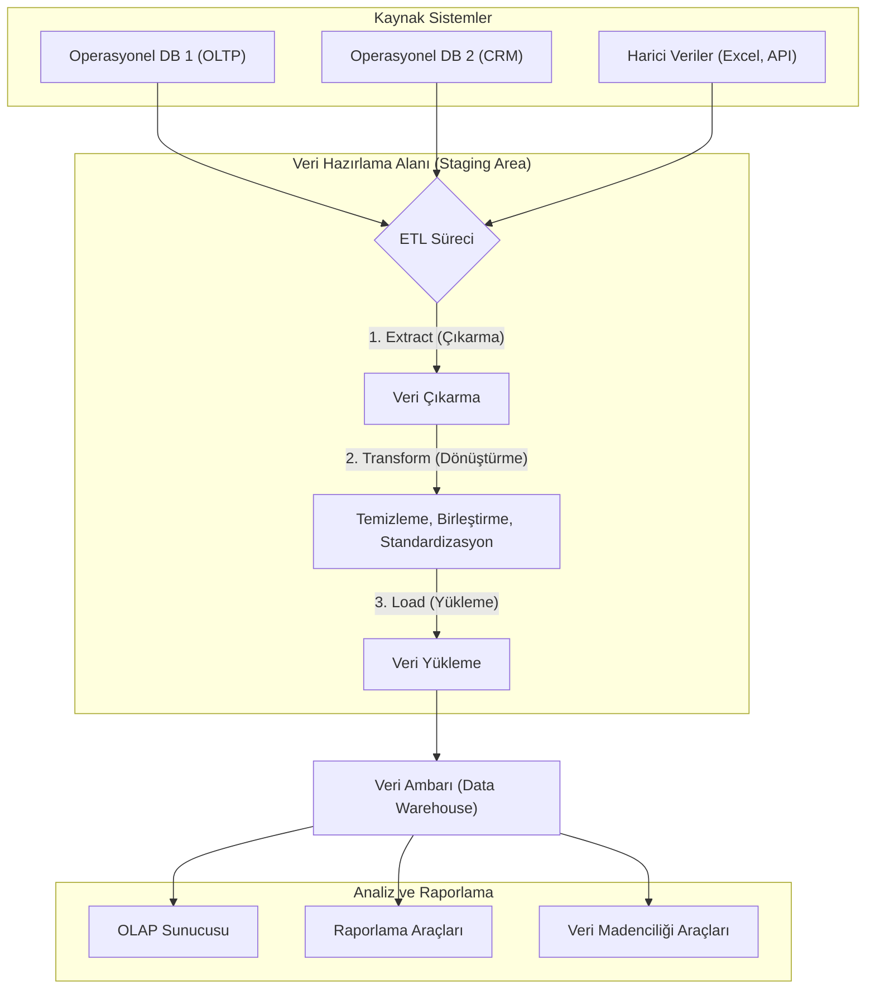
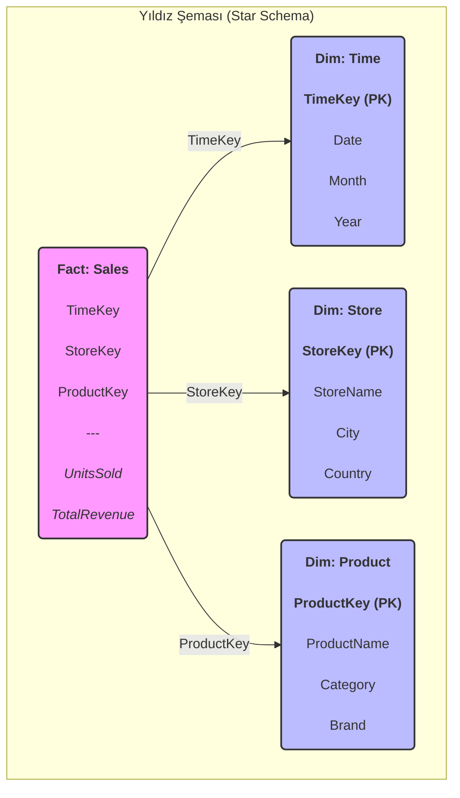
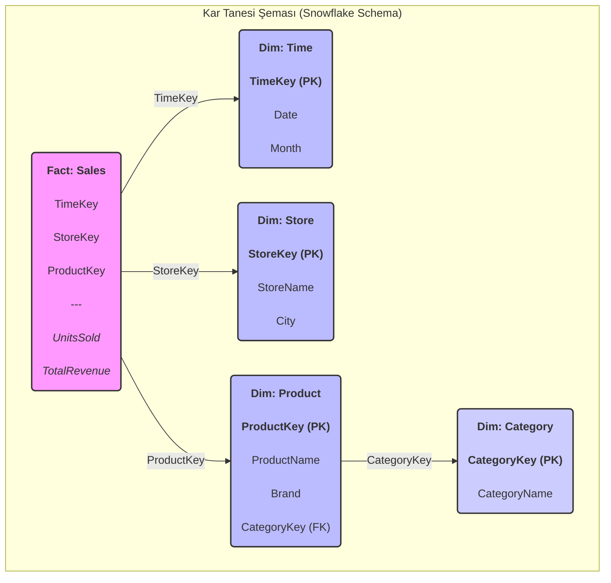
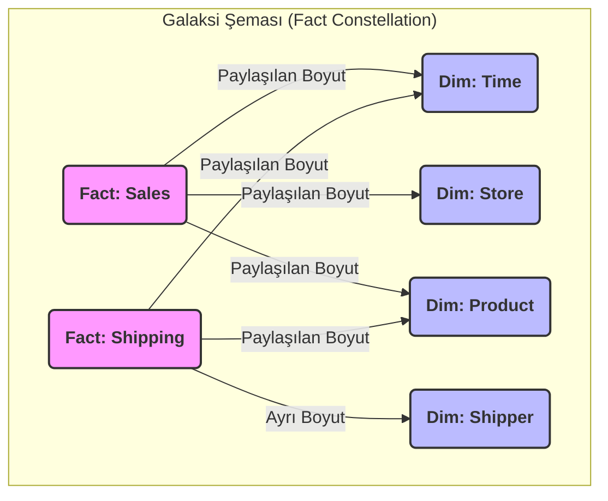
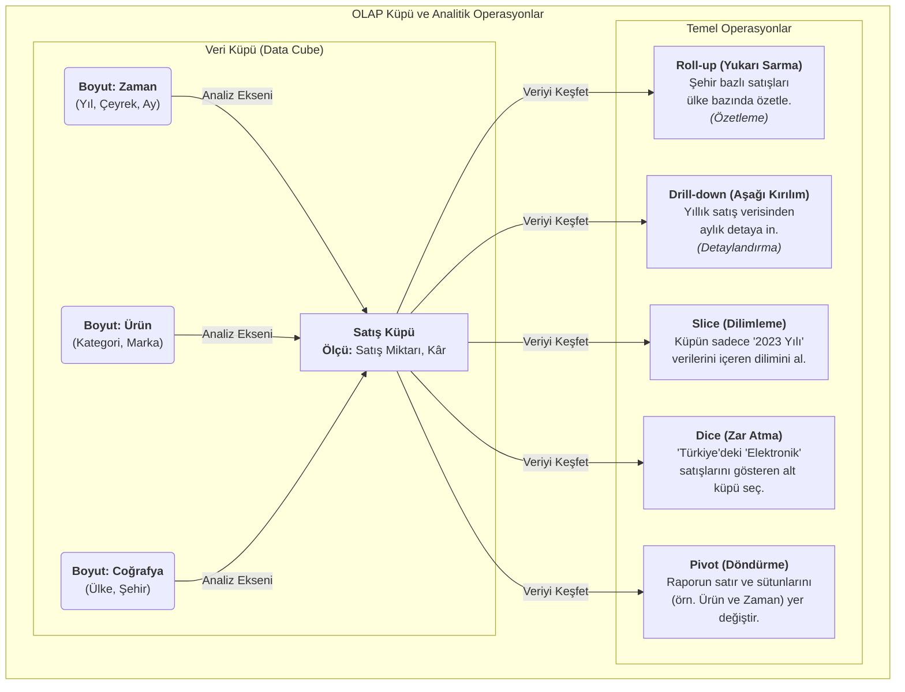

# 10. Operasyonel Veritabanları ve Veri Ambarları

Veri analizi ve karar destek sistemleri bağlamında, operasyonel veritabanları ile veri ambarları arasında temel mimari ve amaç farklılıkları bulunmaktadır.

## 10.1. Operasyonel Veritabanı Sistemleri (OLTP)
Operasyonel sistemler, bir kuruluşun günlük işlemlerini yürütmek için tasarlanmış **Çevrimiçi İşlem Gerçekleştirme (Online Transaction Processing - OLTP)** sistemleridir.

-   **Temel Amaç:** Günlük ticari işlemleri (ekleme, silme, güncelleme) hızlı ve tutarlı bir şekilde kaydetmek ve yönetmektir.
-   **Veri Yapısı:** Veri bütünlüğünü sağlamak ve tekrarı önlemek amacıyla genellikle yüksek derecede normalize edilmiş (Üçüncü Normal Form - 3NF) ilişkisel tablolardan oluşur.
-   **Kullanıcılar:** Genellikle son kullanıcılar, kasiyerler veya veri giriş operatörleridir.
-   **Odak Noktası:** Anlık, güncel veriler üzerindedir. Örneğin, bir bankacılık sistemindeki anlık bakiye veya bir e-ticaret sitesindeki mevcut stok durumu.

## 10.2. Veri Ambarları (Data Warehouses - DW)
Veri ambarı, farklı operasyonel kaynaklardan toplanan verilerin analiz ve karar destek amacıyla bütünleştirildiği merkezi bir depodur. Bu sistemler **Çevrimiçi Analitik İşleme (Online Analytical Processing - OLAP)** için optimize edilmiştir.

**Tanım (W. H. Inmon):** Veri ambarı; stratejik karar almayı desteklemek amacıyla tasarlanmış, **konu odaklı (subject-oriented)**, **bütünleşik (integrated)**, **zamana göre değişen (time-variant)** ve **kalıcı (non-volatile)** bir veri koleksiyonudur.

-   **Konu Odaklı:** Veriler, "müşteri," "ürün," "satış" gibi analitik konular etrafında organize edilir.
-   **Bütünleşik:** Farklı kaynaklardan (örn. satış veritabanı, pazarlama Müşteri İlişkileri Yönetimi (Customer Relationship Management - CRM)) gelen veriler, tutarlı bir formatta birleştirilir ve standartlaştırılır.
-   **Zamana Göre Değişen:** Veriler, tarihsel bir perspektif sunacak şekilde (örn. son 5 yılın satış verileri) saklanır. Bu, trend analizini mümkün kılar.
-   **Kalıcı:** Veri ambarına yüklenen veriler genellikle değiştirilmez veya silinmez. Sadece periyodik olarak yeni veriler eklenir.

## 10.3. OLTP ve Veri Ambarı Karşılaştırması

| Özellik | OLTP Sistemleri (Operasyonel Veritabanı) | Veri Ambarı (OLAP için) |
| :--- | :--- | :--- |
| **Ana Amaç** | Günlük işlemleri yürütme | Stratejik karar verme ve analiz |
| **Veri İçeriği** | Anlık, güncel ve detaylı veri | Tarihsel, özetlenmiş ve birleştirilmiş veri |
| **Veri Yapısı** | Yüksek derecede normalize (örn. 3NF) | Denormalize, çok boyutlu (örn. Yıldız, Kar Tanesi) |
| **Odak** | İşlem (Transaction) odaklı | Analiz (Query) odaklı |
| **Erişim Türü** | Sık okuma/yazma işlemleri | Yoğunlukla okuma, karmaşık sorgular |
| **Kullanıcılar** | Veri giriş operatörleri, son kullanıcılar | Bilgi çalışanları, analistler, yöneticiler |

## 10.4. Veri Ambarı Mimarisi ve ETL Süreci

Veri ambarları, çeşitli kaynaklardan veri toplayan ve bu veriyi analize uygun hale getiren bir **Ayıklama, Dönüştürme, Yükleme (Extract, Transform, Load - ETL)** süreci üzerine kuruludur.

1.  **Çıkarma (Extract):** Farklı operasyonel veritabanları ve harici kaynaklardan (örn. Uygulama Programlama Arayüzü - Application Programming Interface - API) ilgili veriler çekilir.
2.  **Dönüştürme (Transform):** Veriler temizlenir (eksik değerler doldurulur, tutarsızlıklar giderilir), birleştirilir ve veri ambarının standart şemasına uygun hale getirilir.
3.  **Yükleme (Load):** Dönüştürülmüş ve hazır hale getirilmiş veri, analiz edilmek üzere veri ambarına yüklenir.

## 10.5. Meta Veri (Metadata)

**Tanım:** En basit tanımıyla meta veri, **"veri hakkında veri"** demektir. Veri ambarındaki verinin ne anlama geldiğini, nereden geldiğini, nasıl yapılandırıldığını ve nasıl kullanılacağını açıklayan bir tür "veri sözlüğü" veya "kullanım kılavuzu"dur. Ham veriye bağlam ve anlam kazandırır.

Meta veri, aşağıdaki gibi sorulara yanıt verir:
-   Bu verinin adı nedir? (`Satis_Miktari`)
-   Veri türü nedir? (Sayısal, metin, tarih vb.)
-   Hangi tablodan veya sistemden geliyor? (Kaynak)
-   En son ne zaman güncellendi?
-   Hesaplanmış bir alan ise formülü nedir?

**Örnek:**
Bir satış tablosunda `150` şeklinde bir değer olduğunu düşünelim. Bu değer tek başına bir anlam ifade etmez. Ancak meta verisi ile birlikte anlam kazanır:

-   **Veri (Data):** `150`
-   **Meta Veri (Metadata):**
    -   **Öznitelik Adı:** `Satis_Adedi`
    -   **Açıklama:** "Tek bir işlemde satılan ürün sayısı"
    -   **Veri Tipi:** `Tamsayı (Integer)`
    -   **Kaynak Tablo:** `Gunluk_Satislar`
    -   **Geçerli Aralık:** `1 - 500`

Bu meta veri sayesinde `150` değerinin, `Gunluk_Satislar` tablosundaki bir satış işleminde 150 adet ürün satıldığını ifade eden bir tamsayı olduğunu anlarız. Meta veri olmadan, veri yığınları anlamsız sayılardan ibaret kalır.

## 10.6. Veri Ambarı Şemaları: Veriyi Anlamlandırma Sanatı

Veri ambarında veriler, analiz sorgularını hızlı ve verimli bir şekilde çalıştıracak şekilde özel yapılarla organize edilir. Bu yapılara **şema** denir. En yaygın kullanılan üç şema türü Yıldız, Kar Tanesi ve Galaksi (Fact Constellation) şemalarıdır.

### 10.6.1. Yıldız Şeması (Star Schema)

En basit ve en yaygın kullanılan veri ambarı şemasıdır. Adını, yapısının bir yıldıza benzemesinden alır: merkezde bir **olgu (fact) tablosu** ve bu tabloya doğrudan bağlı olan **boyut (dimension) tabloları** bulunur.

-   **Olgu Tablosu (Fact Table):** İşletmenin sayısal ölçümlerini (satış adedi, gelir, maliyet gibi) ve boyut tablolarına ait yabancı anahtarları (foreign keys) içerir. İş süreçlerinden ölçülen nicel verileri (sayısal değerleri, metrikleri) tutan tablodur.
-   **Boyut Tabloları (Dimension Tables):** Olgu tablosundaki verilere bağlam kazandıran tanımlayıcı bilgileri (ürün adı, müşteri bilgisi, tarih detayları gibi) içerir. Boyut tabloları **denormalize** edilmiştir, yani ilgili tüm bilgiler tek bir tabloda toplanır.

**Avantajları:**
-   **Basitlik:** Anlaşılması ve sorgulanması kolaydır.
-   **Performans:** Daha az `JOIN` işlemi gerektirdiği için sorgular genellikle çok hızlı çalışır.

### 10.6.2. Kar Tanesi Şeması (Snowflake Schema)

Yıldız şemasının bir uzantısıdır. Temel fark, boyut tablolarının **normalize** edilmiş olmasıdır. Yani, bir boyut tablosu, veri tekrarını azaltmak için daha küçük ve ilişkili birden fazla tabloya bölünür. Bu yapı, bir kar tanesinin dallanmış kristal yapısına benzediği için bu adı almıştır.

**Avantajları:**
-   **Veri Bütünlüğü:** Normalizasyon sayesinde veri tekrarı azalır ve depolama alanı daha verimli kullanılır.
-   **Bakım Kolaylığı:** Hiyerarşik yapıların yönetimi daha kolaydır (örn. Ürün -> Kategori -> Departman).

**Dezavantajları:**
-   **Sorgu Karmaşıklığı:** Daha fazla tablo olduğu için sorgular daha fazla `JOIN` işlemi gerektirir, bu da performansı düşürebilir.

### 10.6.3. Galaksi Şeması / Fact Constellation Şeması

İki veya daha fazla olgu tablosunun, ortak boyut tablolarını paylaştığı daha karmaşık bir yapıdır. Bu şema, birbiriyle ilişkili farklı iş süreçlerini (örneğin, satış ve sevkiyat) tek bir modelde analiz etmek için kullanılır. Yapı, birden fazla yıldızın bir araya gelerek bir galaksi oluşturmasına benzetilir.

**Avantajları:**
-   **Esneklik:** Farklı iş süreçleri arasında entegre analiz yapma imkânı sunar.
-   **Yeniden Kullanılabilirlik:** Boyut tabloları birden fazla olgu tablosu tarafından paylaşıldığı için tutarlılık ve verimlilik artar.

## 10.7. Şema Karşılaştırması

| Özellik | Yıldız Şeması (Star) | Kar Tanesi Şeması (Snowflake) | Galaksi Şeması (Fact Constellation) |
| :--- | :--- | :--- | :--- |
| **Yapı** | Merkezi bir olgu tablosu, etrafında boyut tabloları | Yıldız şemasının normalize edilmiş hali | Birden fazla olgu tablosu, paylaşılan boyutlar |
| **Normalizasyon** | Boyutlar denormalize (tek tablo) | Boyutlar normalize (çoklu tablo) | Boyutlar genellikle denormalize |
| **Sorgu Performansı** | Yüksek (az `JOIN`) | Daha Düşük (çok `JOIN`) | Değişken (sorguya bağlı) |
| **Veri Bütünlüğü** | Daha düşük (veri tekrarı olabilir) | Yüksek (veri tekrarı az) | Yüksek (paylaşılan boyutlar sayesinde) |
| **Kullanım Alanı** | Çoğu veri ambarı ve veri pazarı (data mart) | Karmaşık hiyerarşilere sahip veri modelleri | Birbiriyle ilişkili birden fazla iş sürecinin analizi |

## 10.8. Veri Pazarı (Data Mart)
Veri pazarı, kurumsal bir veri ambarının belirli bir departmana (örneğin Satış, Pazarlama) veya iş koluna odaklanmış daha küçük bir alt kümesidir. Amacı, belirli bir kullanıcı grubunun ihtiyaç duyduğu veriye daha hızlı ve kolay erişim sağlamaktır. Veri ambarının tamamı yerine sadece ilgili veri setini içerdiği için daha yönetilebilir, daha hızlı kurulabilir ve daha düşük maliyetlidir. Verilerini merkezi bir veri ambarından veya doğrudan operasyonel kaynaklardan alabilir.  

---

# 11. OLAP (Çevrimiçi Analitik İşleme - Online Analytical Processing)

OLAP, büyük veri ambarlarındaki verilerin, iş analistleri ve yöneticiler tarafından hızlı, tutarlı ve etkileşimli bir şekilde çok boyutlu olarak analiz edilmesini sağlayan bir teknolojidir. Geleneksel veritabanı sorguları (OLTP sistemlerinde olduğu gibi) veriyi genellikle iki boyutlu (satırlar ve sütunlar) bir yapıda sunarken, iş dünyasındaki sorular genellikle çok daha fazla boyuta sahiptir ("Geçen çeyrekte, Avrupa bölgesindeki hangi mağazalarda, hangi ürün kategorisi en çok kâr getirdi?"). OLAP, bu tür karmaşık ve çok boyutlu analitik sorguları saniyeler içinde yanıtlamak için tasarlanmıştır.

## 11.1. OLAP Küpü ve Temel Operasyonlar

OLAP'ın temelinde **Veri Küpü (Data Cube)** adı verilen çok boyutlu bir veri yapısı bulunur. Bu küp, analiz edilmek istenen sayısal verileri (**ölçüler - measures**, örn. satış miktarı, kâr) ve bu verilerin analiz edileceği farklı bakış açılarını (**boyutlar - dimensions**, örn. zaman, coğrafya, ürün) bir araya getirir. Kullanıcılar, bu küp üzerinde çeşitli operasyonlar gerçekleştirerek veriyi farklı açılardan inceleyebilir, özetleyebilir veya detaylandırabilir.

-   **Roll-up (Yukarı Sarma):** Veriyi bir boyut hiyerarşisi boyunca yukarı doğru özetler. Örneğin, şehir bazındaki satış verilerini toplayarak ülke bazında bir özet oluşturur.
-   **Drill-down (Aşağı Kırılım):** Özetlenmiş veriden daha detaylı seviyelere inmeyi sağlar. Örneğin, yıllık satış rakamlarından çeyrek veya ay bazındaki detaylara ulaşmak.
-   **Slice (Dilimleme):** Küpten tek bir boyut değeri seçerek iki boyutlu bir "dilim" alır. Örneğin, `Zaman = '2023'` dilimini alarak sadece o yıla ait satışları inceler.
-   **Dice (Zar Atma):** Birden fazla boyut üzerinde seçim yaparak daha küçük bir alt küp oluşturur. Örneğin, `Coğrafya = 'Türkiye'` VE `Ürün Kategorisi = 'Elektronik'` olan verileri seçer.
-   **Pivot (Döndürme):** Veri küpünün eksenlerini döndürerek veriye farklı bir perspektiften bakmayı sağlar. Örneğin, satırlarda ürünleri, sütunlarda zamanı gösteren bir raporu, satırlarda zamanı, sütunlarda ürünleri gösterecek şekilde değiştirir.

## 11.2. OLAP'ın Temel Özellikleri ve Mimarisi

OLAP sistemleri, ham veriyi anlamlı iş bilgisine dönüştürmek için tasarlanmış güçlü analitik motorlardır. Başarıları, aşağıdaki temel özelliklere ve mimari bileşenlere dayanır:

-   **Çok Boyutlu Analiz (Multidimensional Analysis):** OLAP, veriyi geleneksel iki boyutlu (satır/sütun) tablolardan kurtararak, iş dünyasının doğal çok boyutlu yapısını yansıtan küplerde sunar. Bu sayede analistler, veriyi "kim, ne, nerede, ne zaman" gibi farklı iş eksenleri etrafında serbestçe inceleyebilir.
-   **Hızlı Sorgu Performansı:** OLAP sistemleri, karmaşık analitik sorgulara saniyeler içinde yanıt vermek üzere optimize edilmiştir. Bu hızı, verileri önceden hesaplayıp özetleyerek (pre-aggregation), özel indeksleme teknikleri kullanarak ve sonuçları önbelleğe alarak sağlarlar.
-   **Etkileşimli Keşif ve Raporlama:** Kullanıcıların `Roll-up`, `Drill-down` gibi operasyonlarla veri üzerinde etkileşimli olarak gezinmesine olanak tanır. Bu, statik raporlar yerine dinamik bir "keşif" süreci sunar.
-   **İş Odaklı Bakış Açısı:** Teknik veritabanı terminolojisi yerine, "Ürün Kategorisi", "Satış Bölgesi", "Toplam Gelir" gibi anlaşılır iş terimleri kullanır. Bu da teknik olmayan kullanıcıların bile sistemi kolayca kullanabilmesini sağlar.

---

# 12. OLAP Mimarisi: Küpler, Boyutlar ve Ölçüler

OLAP'ın kalbinde, veriyi sezgisel ve analize uygun bir şekilde organize eden üç temel bileşen bulunur:

1.  **Veri Küpü (Data Cube):**
    -   OLAP mimarisinin temel veri yapısıdır. Fiziksel bir küp olmak zorunda değildir; daha çok, verinin çok boyutlu bir mantıksal modelidir.
    -   İşletmenin analiz etmek istediği sayısal metrikleri (ölçüleri), bu metrikleri tanımlayan ve bağlam kazandıran iş kategorileriyle (boyutlarla) birleştirir.

2.  **Boyutlar (Dimensions):**
    -   Bir ölçüye bağlam kazandıran, "kim, ne, nerede, ne zaman" gibi sorulara yanıt veren nitel (kategorik) verilerdir. Boyutlar, veriyi nasıl dilimlemek, filtrelemek ve gruplamak istediğimizi belirler.
    -   **Hiyerarşi (Hierarchy):** Boyutlar genellikle doğal bir hiyerarşiye sahiptir. Bu yapı, kullanıcıların özet veriden detaya (Drill-down) veya detaydan özete (Roll-up) kolayca geçmesini sağlar.
        -   **Örnek Zaman Hiyerarşisi:** `Yıl` → `Çeyrek` → `Ay` → `Gün`
        -   **Örnek Coğrafya Hiyerarşisi:** `Ülke` → `Bölge` → `Şehir`

3.  **Ölçüler (Measures):**
    -   Analiz edilen nicel (sayısal) değerlerdir. Genellikle olgu tablosundaki (fact table) bir sütundan türetilirler ve `SUM`, `COUNT`, `AVERAGE`, `MIN`, `MAX` gibi toplama fonksiyonları ile özetlenirler.
    -   Ölçüler, boyutlar tarafından dilimlendiğinde anlam kazanan iş metrikleridir.
        -   **Örnek Ölçüler:** `Toplam Satış Tutarı`, `Satılan Ürün Adedi`, `Ortalama Kâr Marjı`

| Bileşen | Açıklama | Örnek |
| :--- | :--- | :--- |
| **Boyut (Dimension)** | Veriye bağlam kazandıran **kategorik** bilgiler. "Nasıl bakalım?" sorusunu yanıtlar. | Zaman, Ürün, Müşteri, Coğrafya |
| **Ölçü (Measure)** | Analiz edilen **sayısal** değerler. "Ne kadar?" sorusunu yanıtlar. | Satış Miktarı, Gelir, Maliyet |
 

    

        

        <h2 style="text-align: center;">Karar Ağaçları (Decision Trees)</h2>
        

    

---

[← 1–9. Giriş: Veri, Veri Madenciliği ve KDD](01-giris.md) · [İçindekiler](../Ders_Notu.md) · [13. Karar Ağaçları →](13-karar-agaclari.md)
