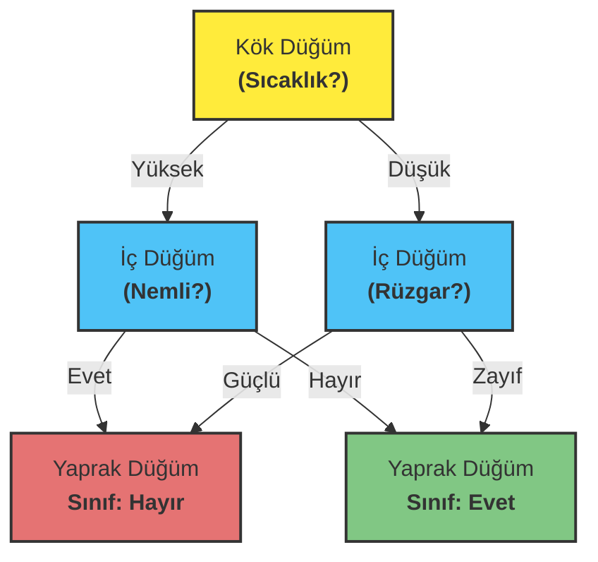
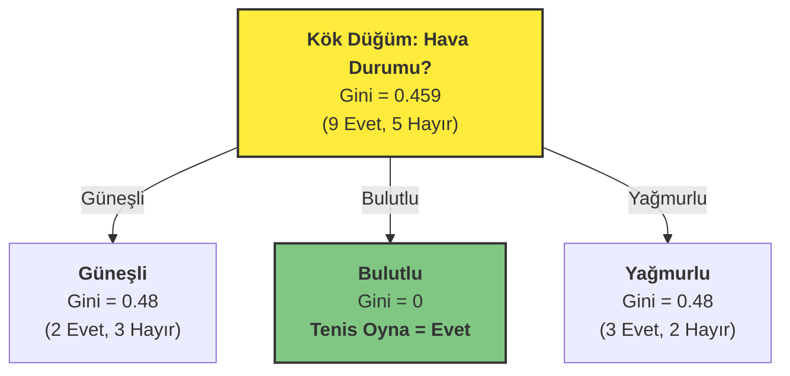
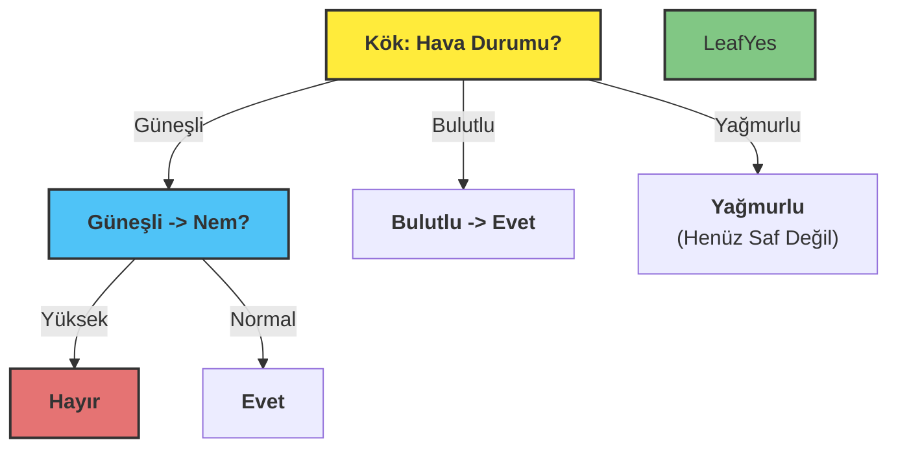
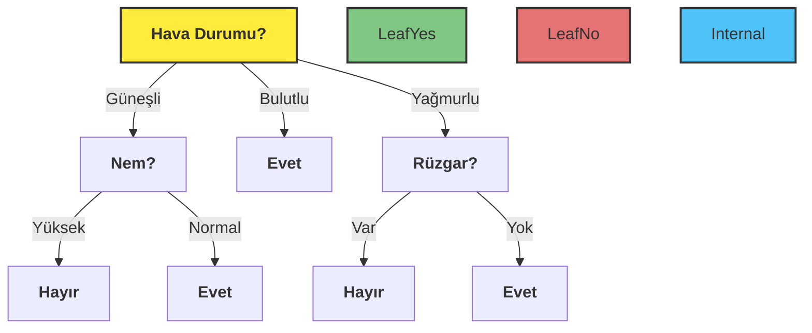
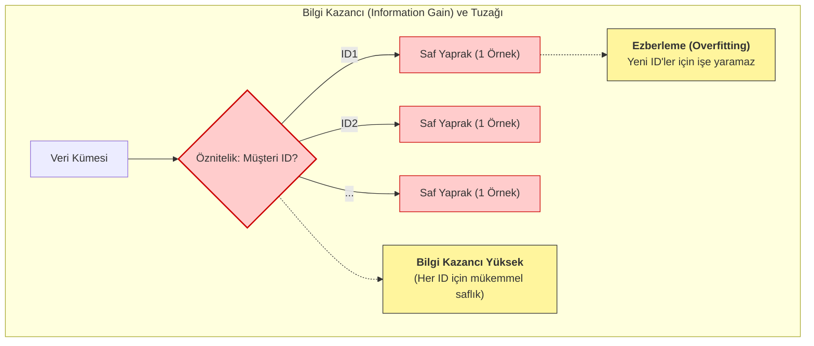
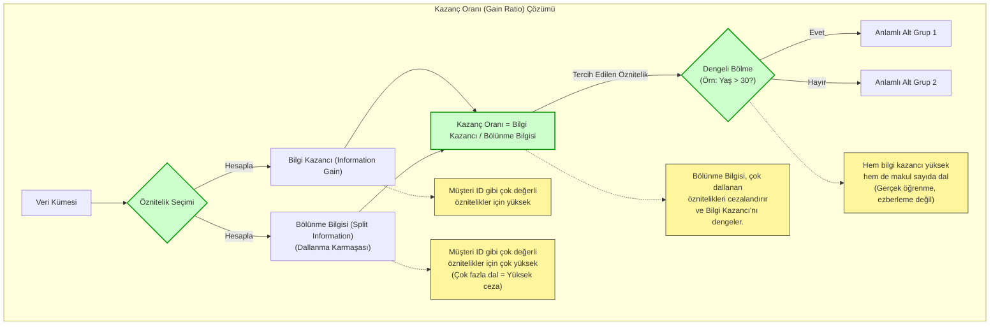
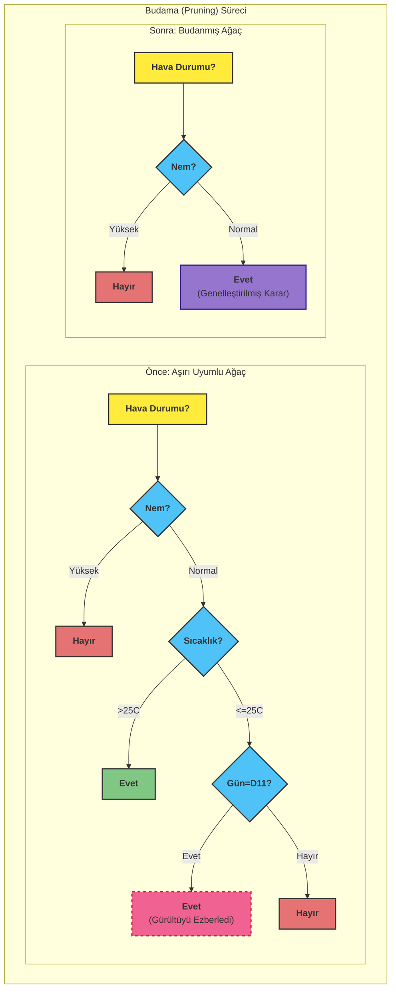

# 13. Karar Ağaçları (Decision Trees)

## 13.1. Karar Ağaçlarına Giriş: Sezgisel Bir Zekâ Formu

Bu bölümde, hem insan sezgisine son derece yakın hem de matematiksel olarak sağlam bir yöntem olan **karar ağaçları** (decision trees) ele alınmaktadır. Bu yöntem, veriye doğru teşhisi koymak için sistematik bir şekilde sorular soran bir uzmana benzetilebilir. Her bir soru, veri setini daha küçük ve daha homojen gruplara ayırır ve bu süreç, her bir grup için net bir sonuca ulaşana kadar devam eder. Bu hiyerarşik karar verme süreci, bir akış şeması (flowchart) formunda görselleştirilebilir, bu da onu en karmaşık modeller arasında bile en yorumlanabilir olanlardan biri yapar. İster bir müşterinin kredi riskini belirlemek (sınıflandırma) ister bir gayrimenkulün piyasa değerini tahmin etmek (regresyon) olsun, karar ağaçları bize şeffaf ve güçlü bir analitik çerçeve sunar.

## 13.2. Parametrik Olmayan Yapının Esnekliği ve Gücü

Karar ağaçlarının temelindeki felsefeyi anlamak için, onları diğer modelleme yaklaşımlarından ayıran en temel özelliğe odaklanmalıyız: **parametrik olmayan (non-parametric)** bir yapıya sahip olmaları. Bu teknik ayrım bir benzetmeyle şöyle somutlaştırılabilir:

-   **Parametrik Modeller (Önceden Belirlenmiş Kalıplar):** Lineer veya lojistik regresyon gibi modeller, veri ile hedef değişken arasındaki ilişkinin belirli bir fonksiyonel forma (örneğin, bir doğruya) uyduğunu varsayar. Bu modellerin sabit sayıda parametresi vardır (`β₀`, `β₁`, vb.) ve modelin karmaşıklığı veri miktarına bağlı değildir. Bu durum, güçlü bir **tümevarımsal önyargı (inductive bias)** yaratır: model, verinin yalnızca varsaydığı kalıba uyması durumunda başarılı olur.

-   **Karar Ağaçları (Veriden Doğan Esnek Yapı):** Karar ağaçları ise verinin altta yatan dağılımı hakkında böyle katı varsayımlarda bulunmaz. Modelin yapısı ve karmaşıklığı, sabit bir denkleme bağlı olmak yerine, doğrudan verinin kendisinden öğrenilir. Veri miktarı ve karmaşıklığı arttıkça, ağaç da bu yeni örüntüleri yakalamak için büyüyebilir ve dallanabilir. Bu esneklik, karar ağaçlarının doğrusal olmayan (non-linear) ve karmaşık etkileşimleri, önceden bir formül belirtmeye gerek kalmadan, doğal bir şekilde modellemesine olanak tanır. Kısacası, veriyi bir kalıba sokmaya çalışmak yerine, kalıbın veriden doğmasına izin verirler.

## 13.3. Karar Ağaçlarını Neden Bir Köşe Taşı Olarak Görüyoruz?

Bu yöntemin, veri bilimcileri ve analistler için neden vazgeçilmez bir araç olduğunu birkaç temel başlıkta özetleyebiliriz:

-   **Yorumlanabilirlik: "Beyaz Kutu" Modeli:** Derin öğrenme gibi birçok modern algoritmanın "kara kutu" (black-box) olarak nitelendirildiği bir çağda, karar ağaçları şeffaflıklarıyla öne çıkar. Modelin verdiği bir kararın arkasındaki mantığı, kök düğümden yaprak düğüme kadar olan yolu takip ederek `EĞER-O HALDE` (IF-THEN) kuralları şeklinde net bir biçimde açıklayabiliriz. Bu özellik, finansal risk modellemesi veya tıbbi teşhis gibi, alınan kararların gerekçelendirilmesinin zorunlu olduğu alanlarda hayati önem taşır.

-   **Minimum Veri Ön İşleme Gereksinimi:** Karar ağaçları, pratik uygulamalarda büyük bir avantaj sunar. Ağaç yapısı, özelliklerin büyüklüğüne değil, sıralamasına dayalı bölme kararları verdiği için, verilerin normalleştirilmesi veya standartlaştırılması gibi adımlara ihtiyaç duymaz. Ayrıca, CART gibi algoritmalar, eksik değerleri yönetmek için **vekil bölmeler (surrogate splits)** gibi dahili mekanizmalara sahip olabilir, bu da veri hazırlama sürecini önemli ölçüde basitleştirir.

-   **Çok Yönlülük ve Hibrit Veri Desteği:** Gerçek dünya veri setleri nadiren tek tiptir. Karar ağaçlarının temelindeki bölme kriterleri (Gini İndeksi, Entropi vb.), hem sürekli (sayısal) hem de kategorik (nominal) özellikleri doğal bir şekilde işleyebilir. Bu, farklı veri türlerini bir arada barındıran zengin veri setleriyle, karmaşık dönüşümlere gerek kalmadan doğrudan çalışabilme imkânı tanır.

## 13.4. Karar Ağacının Yapısal Bileşenleri

Aşağıda, karar ağacının temel yapısını gösteren renkli bir diyagram yer almaktadır:



Bu diyagramda:
- **Sarı**: Kök düğüm (ilk karar noktası)
- **Mavi**: İç düğümler (ara karar noktaları)
- **Yeşil**: Pozitif sınıfı temsil eden yaprak düğüm
- **Kırmızı**: Negatif sınıfı temsil eden yaprak düğüm

### 13.4.1. Karar Ağacının Anatomisi: Düğümler ve Dallar

Bir karar ağacı, veriye teşhis koymak için tasarlanmış organik bir yapı gibi düşünülebilir. Bu yapının her bir parçası, mantıksal bir akış şemasının bir unsurunu temsil eder. Aşağıda bu parçalar sırasıyla incelenmektedir.

**a) Kök Düğüm (Root Node): Yolculuğun Başlangıcı**
Her şeyin başladığı yerdir. Kök düğüm, tüm veri setimizi temsil eden ve analize başlarken sorduğumuz ilk, en güçlü sorudur. Bu düğüm, veri setini en anlamlı şekilde iki veya daha fazla ana dala ayıracak olan en ayırt edici özniteliği içerir.

**b) İç Düğümler (Internal Nodes): Karar Zinciri**
Kök düğümden sonra gelen her bir ara karar noktasıdır. Her iç düğüm, bir önceki adımdan kendisine ulaşan veri alt kümesi için yeni bir soru sorar. Bu düğümler, nihai bir sonuca ulaşana kadar veriyi daha küçük ve daha homojen gruplara ayırma görevini üstlenir.

**c) Yaprak Düğümler (Leaf / Terminal Nodes): Hüküm Anı**
Ağacın en uç noktalarıdır; artık daha fazla soru sorulmayan ve nihai kararın verildiği yerlerdir. Her bir yaprak düğüm, o düğüme ulaşan veri örnekleri için bir sınıf etiketi (sınıflandırma probleminde) veya bir sayısal değer (regresyon probleminde) içerir.

### 13.4.2. Dallar (Branches): Mantığın Patikaları

Dallar, düğümler arasındaki yollardır ve her bir yol, bir karar sürecini temsil eder. Kök düğümden başlayıp bir yaprak düğüme kadar takip edilen her bir patika, aslında `EĞER-O HALDE` (IF-THEN) formatında, insan tarafından kolayca okunabilen bir kural setine karşılık gelir.

**Örnek Kural:** `EĞER` (Sıcaklık > 25°C) `VE` (Nem Oranı < %60) `O HALDE` (Dışarıda Oyna = Evet)

## 13.5. Karar Ağacı Nasıl İnşa Edilir: Özyinelemeli Bölme Sanatı

### 13.5.1. En İyi Bölmeyi Bulmak: Açgözlü (Greedy) Yaklaşım

Bir karar ağacı inşa etmek, temelde bir **"böl ve yönet" (divide and conquer)** stratejisidir. Algoritma, her adımda veri setini daha saf alt kümelere ayıracak en iyi soruyu bulmaya çalışır. Bu sürece **özyinelemeli bölme (recursive partitioning)** adı verilir.

Bu yaklaşım "açgözlü" (greedy) olarak nitelendirilir, çünkü algoritma her bir düğümde, o an için en iyi görünen, yani saflığı en çok artıran bölmeyi seçer. Gelecekteki adımların bu karardan nasıl etkileneceğini hesaba katmaz. Bu, genellikle çok iyi sonuçlar veren verimli bir stratejidir.

**Algoritmanın Adımları:**

1.  **En İyi Özniteliği Seç:** Mevcut düğümdeki veri setini en homojen alt gruplara ayıracak özniteliği ve bölünme noktasını belirle. Bu seçim, saflık ölçütleri (Gini, Entropi vb.) kullanılarak matematiksel olarak yapılır.
2.  **Düğümü Böl:** Seçilen öznitelik ve kurala göre düğümü iki veya daha fazla dala ayırarak yeni çocuk düğümler (child nodes) oluştur.
3.  **Özyinelemeyi Uygula:** Her bir çocuk düğüm için süreci tekrarla. Bu işlem, aşağıdaki durdurma kriterlerinden biri karşılanana kadar devam eder:
    *   Düğümdeki tüm örnekler aynı sınıfa aitse (düğüm tamamen saf ise).
    *   Önceden belirlenmiş bir maksimum ağaç derinliğine ulaşılmışsa.
    *   Düğümdeki örnek sayısı, bölünmek için belirlenen minimum sayının altına düşmüşse.

### 13.5.2. Saflık Ölçütleri: Düzensizliği Ölçme Bilimi

Peki, algoritma "en iyi" bölmenin ne olduğuna nasıl karar veriyor? Cevap, **saflık (purity)** veya onun zıttı olan **kirlilik (impurity)** kavramında yatar. Bir düğüm ne kadar safsa, içindeki örnekler o kadar homojendir (yani çoğunlukla aynı sınıfa aittir). Algoritmanın amacı, her bölme işleminden sonra ortaya çıkan çocuk düğümlerin toplam kirliliğini en aza indirmektir. Bu kirliliği ölçmek için kullandığımız iki temel matematiksel araç vardır: Gini İndeksi ve Entropi.

#### 13.5.2.1. Gini İndeksi (Gini Impurity): Yanlış Sınıflandırma Olasılığı

Gini İndeksi, oldukça sezgisel bir ölçüttür. Bir düğümdeki veri noktalarından rastgele birini seçip, bu düğümdeki sınıf dağılımına göre onu etiketlersek, ne kadar olasılıkla yanlış etiketleme yaparız? Gini İndeksi tam olarak bunu ölçer.

-   **Mükemmel Saflık (Gini = 0):** Bir düğümdeki tüm örnekler aynı sınıfa aitse, yanlış etiketleme olasılığımız sıfırdır.
-   **Maksimum Kirlilik (Gini = 0.5 - İki sınıflı durumda):** Bir düğümde örnekler sınıflara 50/50 oranında dağılmışsa, kirlilik en yüksek seviyededir.

> **Formülleri okuma rehberi.** Bu notta önemli formüllerin hemen altında aynı formülün **açıklamalı** bir kopyası vardır: Üst ve alt parantezler (︷ ︸), formülün hangi parçasının ne anlama geldiğini gösterir. **"Ne anlatıyor?"** satırı ise formülün neyi hesapladığını ve neden o biçimde kurulduğunu sade bir dille açıklar. En sık karşılaşacağınız semboller:
>
> | Sembol | Nasıl okunur? | Anlamı |
> |---|---|---|
> | $\sum_{i=1}^{c} p_i$ | "i eşittir 1'den c'ye kadar p alt i'lerin toplamı" | $p_1 + p_2 + \dots + p_c$ |
> | $\prod_{i=1}^{n} x_i$ | "i eşittir 1'den n'ye kadar x alt i'lerin çarpımı" | $x_1 \cdot x_2 \cdots x_n$ (büyük pi burada 3.14 değil, çarpma işaretidir) |
> | $x_i$, $p_i$ | "x alt i", "p alt i" | i. değer, i. sınıfın oranı (i yalnızca bir sıra numarasıdır) |
> | $P(C \mid X)$ | "X verildiğinde C'nin olasılığı" | X'in gerçekleştiği bilinirken C'nin olasılığı; $P(X \mid C)$ ile aynı şey değildir |
> | $\log_2 p$, $\log_e p$ | "log iki tabanında p", "log e tabanında p" (doğal logaritma, ln) | 2'nin (e'nin) kaçıncı kuvveti p eder? |
> | $\arg\max_{c} f(c)$ | "f(c) değerini en büyük yapan c" | en büyük değerin kendisi değil, onu veren seçenek |
> | $\hat{C}$ | "C şapka" | tahmin edilen değer (şapka = tahmin) |
> | $\lvert a - b \rvert$ | "a eksi b'nin mutlak değeri" | farkın işaretsiz büyüklüğü |
> | $\sqrt{x}$, $x^{1/p}$ | "karekök x", "x'in p'inci dereceden kökü" | kare almanın (p'inci kuvvet almanın) tersi |
> | $\lVert x - \mu \rVert$ | "x eksi mü'nün normu" | x noktası ile $\mu$ merkezi arasındaki uzaklık |
> | $x \in C_i$ | "x, C alt i'nin elemanı" | x noktası i. kümede yer alıyor |
> | $A \rightarrow B$ | "A ise B" | kural: A varsa B de vardır |

Matematiksel olarak, `c` farklı sınıfa sahip bir düğüm için Gini İndeksi şu formülle hesaplanır:

$$
Gini = 1 - \sum_{i=1}^{c} (p_i)^2
$$

```math
\underbrace{Gini}_{\substack{\text{düğümün}\\\text{kirliliği}}} = 1 - \underbrace{\sum_{i=1}^{c} \overbrace{(p_i)^2}^{\substack{\text{i. sınıfın}\\\text{oranının karesi}}}}_{\substack{\text{c sınıfın hepsi için topla:}\\\text{doğru etiketleme olasılığı}}}
```

**Ne anlatıyor?** Düğümden rastgele seçilen bir örneğe, düğümdeki sınıf oranlarına göre rastgele bir etiket verildiğinde etiketin doğru çıkma olasılığı $\sum (p_i)^2$'dir. Bu olasılık 1'den çıkarıldığında **yanlış etiketleme olasılığı**, yani düğümün kirliliği kalır; düğüm ne kadar saf ise Gini değeri o kadar küçüktür. Tenis verisinin kökünde (9 Evet, 5 Hayır): $1 - [(9/14)^2 + (5/14)^2] = 1 - [0.413 + 0.128] = 0.459$. Bu değer aşağıdaki vaka analizinde (Adım 1) yeniden kullanılacaktır.

Burada `p_i`, `i` sınıfına ait örneklerin oranını temsil eder. Algoritma, bölme sonrası oluşacak çocuk düğümlerin ağırlıklı Gini ortalamasını en çok düşüren bölmeyi tercih eder. Bu düşüşe **Gini Kazancı (Gini Gain)** denir.

#### 13.5.2.2. Entropi ve Bilgi Kazancı (Information Gain)

Entropi, bilgi teorisinin babası Claude Shannon'dan ödünç aldığımız bir kavramdır ve bir sistemdeki belirsizliği veya düzensizliği ölçer. Karar ağaçları bağlamında, bir düğümdeki sınıfların ne kadar karışık olduğunun bir ölçüsüdür.

-   **Mükemmel Saflık (Entropi = 0):** Düğüm tamamen homojen ise, sonuç bellidir ve hiçbir belirsizlik yoktur.
-   **Maksimum Kirlilik (Entropi = 1 - İki sınıflı durumda):** Sınıflar eşit dağılmışsa, belirsizlik en üst düzeydedir.

Formülü şöyledir:

$$
Entropy = - \sum_{i=1}^{c} p_i \log_2(p_i)
$$

```math
\underbrace{Entropy}_{\substack{\text{düğümdeki}\\\text{belirsizlik (bit)}}} = \overbrace{-}^{\text{pozitif yapar}} \underbrace{\sum_{i=1}^{c}}_{\substack{\text{c sınıfın}\\\text{hepsi için topla}}} \overbrace{p_i}^{\substack{\text{i. sınıfın oranı}\\\text{(ağırlık)}}} \; \underbrace{\log_2(p_i)}_{\substack{\text{i. sınıfın}\\\text{"sürpriz" değeri}}}
```

**Ne anlatıyor?** Entropi, düğümdeki sınıf karışıklığını bit cinsinden ölçer: Her sınıfın "sürpriz" değeri o sınıfın oranıyla ağırlıklandırılarak toplanır ve düğümden seçilen bir örneğin sınıfı öğrenildiğinde yaşanan ortalama sürpriz elde edilir. Düğüm saf ise entropi 0, iki sınıf eşit dağılmışsa 1'dir.

* $\log_2(p_i)$: $p_i$ 1'den küçük olduğu için bu değer **negatiftir**. Sınıf ne kadar nadirse mutlak değeri o kadar büyüktür: Nadir bir sonuç gerçekleştiğinde daha çok "şaşırırız". Taban 2 olduğu için birim **bit**'tir.
* Baştaki eksi işareti: Negatif logaritmaları pozitife çevirir.
* $\sum p_i \cdot (\dots)$: Her sınıfın sürprizini o sınıfın oranıyla ağırlıklandırıp toplar. Entropi, **ortalama sürprizdir**.
* Hiç örneği olmayan sınıf ($p_i = 0$) için $0 \cdot \log_2 0 = 0$ kabul edilir.

Tenis verisinin kökünde (9 Evet, 5 Hayır) formülün her parçası adım adım:

| Sınıf | $p_i$ | $\log_2 p_i$ (sürpriz, negatif) | $p_i \cdot \log_2 p_i$ |
|---|---|---|---|
| Evet | 9/14 = 0.6429 | −0.6374 | −0.4098 |
| Hayır | 5/14 = 0.3571 | −1.4854 | −0.5305 |
| **Toplam** | | | **−0.9403** |

Baştaki eksi işaretiyle entropi **0.940** olur. Aynı düğümün Gini değeri 0.459'du. İki ölçütün ölçeği farklıdır: İki sınıflı durumda Gini en çok 0.5, entropi en çok 1 olur.

Algoritma, Entropiyi doğrudan minimize etmek yerine, bir bölme işlemiyle ne kadar **belirsizlik azalttığını** ölçer. Bu azalmaya **Bilgi Kazancı (Information Gain)** denir ve ID3 algoritmasının temelini oluşturur. En yüksek Bilgi Kazancını sağlayan öznitelik, bölme için en iyi aday olarak seçilir.

| Özellik | Gini İndeksi | Entropi (Bilgi Kazancı ile) |
| :--- | :--- | :--- |
| **Temel Felsefe** | Yanlış sınıflandırma olasılığını en aza indirme | Belirsizliği en aza indirme (bilgiyi en üst düzeye çıkarma) |
| **Hesaplama** | Daha hızlı (karesel işlem) | Daha yavaş (logaritmik işlem) |
| **Davranış** | Genellikle en büyük sınıfı izole etmeye daha yatkındır | Sınıf dağılımındaki küçük değişikliklere daha duyarlıdır |

Pratikte, her iki metrik de genellikle çok benzer ağaçlar üretir. Gini İndeksi'nin hesaplama verimliliği, onu CART gibi algoritmalarda popüler bir varsayılan seçenek haline getirir.

#### 13.5.2.3. Kazanç Oranı (Gain Ratio): Bilgi Kazancının Tuzağına Karşı Bir Savunma

Bilgi Kazancı'nın zekice bir yaklaşım olmasına rağmen, tehlikeli bir zaafı vardır: **yüksek kardinaliteye sahip** (yani çok sayıda benzersiz değere sahip) özniteliklere karşı bir ön yargı besler. Örneğin, "Müşteri ID" veya "TC Kimlik No" gibi bir özniteliği düşünün. Her bir değer benzersiz olduğu için, bu özniteliğe göre yapılacak bir bölme, her biri tek bir örnek içeren mükemmel derecede saf yapraklar oluşturacaktır. Bilgi Kazancı bu durumu "mükemmel bir bölme" olarak görür, ancak bu aslında öğrenme değil, **ezberlemedir (overfitting)**.

C4.5 algoritmasının getirdiği çözüm olan **Kazanç Oranı (Gain Ratio)** bu noktada devreye girer. Kazanç Oranı, Bilgi Kazancını, bir bölmenin yarattığı dallanma karmaşıklığına bölerek onu cezalandırır.

$$
Gain Ratio = \frac{\text{Information Gain}}{\text{Split Information}}
$$

```math
\underbrace{\text{Gain Ratio}}_{\text{kazanç oranı}} = \frac{\overbrace{\text{Information Gain}}^{\substack{\text{bölmenin azalttığı}\\\text{belirsizlik}}}}{\underbrace{\text{Split Information}}_{\substack{\text{bölmenin kaç parçaya}\\\text{dağıldığı (ceza)}}}}
```

**Ne anlatıyor?** Kazanç oranı, bir bölmenin sağladığı bilgi kazancını, bölmenin veriyi kaç parçaya dağıttığını ölçen bölünme bilgisine bölerek çok dallı bölmeleri cezalandırır. Bilgi kazancı, bölmeden önceki entropi eksi bölmeden sonraki dalların ağırlıklı ortalama entropisidir. Bölünme bilgisi ise dallara düşen örnek oranlarının entropisidir: Dal sayısı arttıkça büyür. Örnek: Tenis verisinde "Müşteri ID" gibi her güne ayrı dal açan bir nitelik ele alınsın. 14 yaprağın hepsi saf olur, bilgi kazancı kökün entropisinin tamamına (0.940) eşit çıkar. Ama 14 eşit dalın bölünme bilgisi $\log_2 14 \approx 3.807$'dir; kazanç oranı 0.940 / 3.807 ≈ **0.247**'ye iner.

-   **Split Information:** Bir özniteliğin veriyi ne kadar çok parçaya böldüğünü ölçen bir metriktir. Çok fazla dala neden olan bir bölme (Müşteri ID gibi) yüksek bir Split Information değerine sahip olacak ve bu da Kazanç Oranını düşürecektir.

Bu sayede Kazanç Oranı, hem yüksek bilgi sağlayan hem de veriyi makul sayıda, anlamlı alt gruplara ayıran **dengeli** bölmeleri tercih eder. Bu, modelin genelleme yeteneğini önemli ölçüde artırır.

#### 13.5.2.4. Sınıflandırma Hatası (Classification Error)

Şimdi gelelim en sezgisel, en doğrudan ölçütümüze: Sınıflandırma Hatası. Bu metrik, son derece pratik bir soru sorar: "Eğer bir düğümdeki en popüler sınıf neyse, o düğüme düşen her veriye o etiketi yapıştırsak, ne kadar yanılırız?"

-   **Örnek:** Bir düğümde 8 "Evet" ve 2 "Hayır" kararımız varsa, en popüler sınıfımız "Evet"tir. Eğer bu düğümdeki herkese "Evet" tahmininde bulunursak, 10'da 2 kez yanılmış oluruz. Yani hata oranımız %20'dir.
-   **Amaç:** Algoritmanın amacı da, bu basit ama etkili hata oranını en aza indirecek bölmeyi bulmaktır.

### 13.5.3. Gini İndeksi ile Adım Adım Karar Ağacı İnşası: Bir Vaka Analizi

Bu alt bölümde teorik bilgiler somut bir örnekle pekiştirilmektedir. "Bugün tenis oynanmalı mı?" sorusuna cevap arayan klasik bir veri seti üzerinde, Gini İndeksi kullanılarak bir karar ağacının adım adım nasıl inşa edildiği gösterilmektedir.

**Örnek Veri Setimiz:**

| Gün | Hava Durumu | Sıcaklık | Nem | Rüzgar | Tenis Oyna |
| :-- | :--- | :--- | :--- | :--- | :--- |
| D1 | Güneşli | Sıcak | Yüksek | Yok | Hayır |
| D2 | Güneşli | Sıcak | Yüksek | Var | Hayır |
| D3 | Bulutlu | Sıcak | Yüksek | Yok | Evet |
| D4 | Yağmurlu | Ilık | Yüksek | Yok | Evet |
| D5 | Yağmurlu | Soğuk | Normal | Yok | Evet |
| D6 | Yağmurlu | Soğuk | Normal | Var | Hayır |
| D7 | Bulutlu | Soğuk | Normal | Var | Evet |
| D8 | Güneşli | Ilık | Yüksek | Yok | Hayır |
| D9 | Güneşli | Soğuk | Normal | Yok | Evet |
| D10 | Yağmurlu | Ilık | Normal | Yok | Evet |
| D11 | Güneşli | Ilık | Normal | Var | Evet |
| D12 | Bulutlu | Ilık | Yüksek | Var | Evet |
| D13 | Bulutlu | Sıcak | Normal | Yok | Evet |
| D14 | Yağmurlu | Ilık | Yüksek | Var | Hayır |

#### 13.5.3.1. Adım 1: Kök Düğümün Kirliliğini Hesaplama (Başlangıç Noktası)

Her şeyden önce, tüm veri setimizin "kirliliğini" ölçmeliyiz. Bu, bizim referans noktamız olacak.
- Toplam Gözlem: 14
- "Evet" (Tenis Oyna): 9
- "Hayır" (Tenis Oyna): 5

Şimdi Gini formülümüzü uygulayalım:
```
Gini(Kök) = 1 - [ (9/14)² + (5/14)² ] = 1 - [ 0.413 + 0.128 ] = 0.459
```
Başlangıç kirliliğimiz 0.459. Amacımız, bu değeri en çok düşüren özniteliği bulmak.

#### 13.5.3.2. Adım 2: Her Bir Öznitelik İçin Gini Kazancını Hesaplama

Şimdi her bir özniteliği ("Hava Durumu", "Sıcaklık", "Nem", "Rüzgar") potansiyel bir bölme noktası olarak değerlendireceğiz.

**A) Öznitelik: Hava Durumu**

1.  **Hava Durumu = Güneşli:** 5 gözlem (2 Evet, 3 Hayır)
    $Gini(\text{Güneşli}) = 1 - [(\frac{2}{5})^2 + (\frac{3}{5})^2] = 0.48$
2.  **Hava Durumu = Bulutlu:** 4 gözlem (4 Evet, 0 Hayır)
    $Gini(\text{Bulutlu}) = 1 - [(\frac{4}{4})^2 + (\frac{0}{4})^2] = 0$  (tam saflık)
3.  **Hava Durumu = Yağmurlu:** 5 gözlem (3 Evet, 2 Hayır)
    $Gini(\text{Yağmurlu}) = 1 - [(\frac{3}{5})^2 + (\frac{2}{5})^2] = 0.48$

Şimdi bu özniteliğin ağırlıklı Gini ortalamasını hesaplayalım:
$Gini_{\text{Ağırlıklı}}(\text{Hava Durumu}) = (\frac{5}{14}) \times 0.48 + (\frac{4}{14}) \times 0 + (\frac{5}{14}) \times 0.48 = 0.343$

Ve son olarak, Gini Kazancı:
$Gain(\text{Hava Durumu}) = Gini(\text{Kök}) - Gini_{\text{Ağırlıklı}}(\text{Hava Durumu}) = 0.459 - 0.343 = \mathbf{0.116}$

**B) Öznitelik: Rüzgar** (Hesaplamaları diğer öznitelikler için de tekrarlıyoruz)

1.  **Rüzgar = Yok:** 8 gözlem (6 Evet, 2 Hayır)
    $Gini(\text{Yok}) = 1 - [(\frac{6}{8})^2 + (\frac{2}{8})^2] = 0.375$
2.  **Rüzgar = Var:** 6 gözlem (3 Evet, 3 Hayır)
    $Gini(\text{Var}) = 1 - [(\frac{3}{6})^2 + (\frac{3}{6})^2] = 0.5$

Ağırlıklı Gini ve Kazanç:
$Gini_{\text{Ağırlıklı}}(\text{Rüzgar}) = (\frac{8}{14}) \times 0.375 + (\frac{6}{14}) \times 0.5 = 0.428$
$Gain(\text{Rüzgar}) = 0.459 - 0.428 = \mathbf{0.031}$

(Aynı hesaplamalar "Sıcaklık" ve "Nem" için yapıldığında kazançlar sırasıyla 0.019 ve 0.092 bulunur; ikisi de Hava Durumu'nun kazancından düşüktür.)

#### 13.5.3.3. Adım 3: En İyi Bölmeyi Seçme ve İlk Dalı Oluşturma

Kazançları karşılaştıralım:
- **Gain(Hava Durumu) = 0.116** (en yüksek)
- Gain(Nem) = 0.092
- Gain(Sıcaklık) = 0.019
- Gain(Rüzgar) = 0.031

En yüksek Gini Kazancını **"Hava Durumu"** özniteliği sağladığı için ağacın kök düğümü bu öznitelik olur.



"Bulutlu" dalının saf bir yaprak düğüme dönüştüğüne dikkat edilmelidir; bu dal için başka bir soru sorulmasına gerek yoktur.

#### 13.5.3.4. Adım 4: Özyinelemeli Süreç: Alt Düğümlerin Bölünmesi

Kök düğüm belirlenmiş ve "Bulutlu" dalının doğrudan "Evet" sonucuna götürdüğü görülmüştür. Algoritmanın özyinelemeli doğası bu noktada devreye girer: Henüz saf olmayan "Güneşli" ve "Yağmurlu" dalları, her biri kendi başına yeni bir veri setiymiş gibi ele alınır. Önce "Güneşli" dalı incelenmektedir.

**Alt Problem: Hava Durumu = Güneşli**

Bu adımda yalnızca aşağıdaki 5 gözlem dikkate alınır:

| Gün | Hava Durumu | Sıcaklık | Nem | Rüzgar | Tenis Oyna |
| :-- | :--- | :--- | :--- | :--- | :--- |
| D1 | Güneşli | Sıcak | Yüksek | Yok | Hayır |
| D2 | Güneşli | Sıcak | Yüksek | Var | Hayır |
| D8 | Güneşli | Ilık | Yüksek | Yok | Hayır |
| D9 | Güneşli | Soğuk | Normal | Yok | Evet |
| D11 | Güneşli | Ilık | Normal | Var | Evet |

Bu 5 gözlemden oluşan alt veri setinin başlangıç kirliliği, daha önce hesaplandığı gibi `Gini(Güneşli) = 0.48`'dir. Amaç, bu kirliliği en çok azaltan soruyu bulmaktır. Kalan öznitelikler: Sıcaklık, Nem ve Rüzgar.

**A) Öznitelik: Nem (Güneşli günlerde)**

1.  **Nem = Yüksek:** 3 gözlem (D1, D2, D8) -> 0 Evet, 3 Hayır
    $Gini(\text{Yüksek}) = 1 - [(\frac{0}{3})^2 + (\frac{3}{3})^2] = 0$ (tam saflık)
2.  **Nem = Normal:** 2 gözlem (D9, D11) -> 2 Evet, 0 Hayır
    $Gini(\text{Normal}) = 1 - [(\frac{2}{2})^2 + (\frac{0}{2})^2] = 0$ (tam saflık)

Ağırlıklı Gini ve Kazanç:
$Gini_{\text{Ağırlıklı}}(\text{Nem}) = (\frac{3}{5}) \times 0 + (\frac{2}{5}) \times 0 = 0$
$Gain(\text{Nem}) = 0.48 - 0 = \mathbf{0.48}$

**B) Öznitelik: Rüzgar (Güneşli günlerde)**

1.  **Rüzgar = Yok:** 3 gözlem (D1, D8, D9) -> 1 Evet, 2 Hayır
    $Gini(\text{Yok}) = 1 - [(\frac{1}{3})^2 + (\frac{2}{3})^2] = 0.444$
2.  **Rüzgar = Var:** 2 gözlem (D2, D11) -> 1 Evet, 1 Hayır
    $Gini(\text{Var}) = 1 - [(\frac{1}{2})^2 + (\frac{1}{2})^2] = 0.5$

Ağırlıklı Gini ve Kazanç:
$Gini_{\text{Ağırlıklı}}(\text{Rüzgar}) = (\frac{3}{5}) \times 0.444 + (\frac{2}{5}) \times 0.5 \approx 0.467$
$Gain(\text{Rüzgar}) = 0.48 - 0.467 = \mathbf{0.013}$

**Karar Anı: "Güneşli" Dalı İçin En İyi Soru**

Kazançları karşılaştıralım:
- **Gain(Nem) = 0.48** (en yüksek)
- Gain(Sıcaklık) = 0.28
- Gain(Rüzgar) = 0.013

Görüldüğü gibi **"Nem"** özniteliği `0.48`'lik kazançla açık farkla öne çıkmaktadır. Bu sonuç, "Güneşli" günlerde tenis oynanıp oynanmayacağını en iyi açıklayan özniteliğin nem olduğunu gösterir. Ayrıca bu bölmeden sonra iki dal da tamamen saf yapraklara dönüşür.

Ağacın güncel hâli:



#### 13.5.3.5. Adım 5: Ağacı Tamamlama

Aynı özyinelemeli süreç "Yağmurlu" dalına (3 Evet, 2 Hayır; Gini = 0.48) uygulandığında Rüzgar özniteliğinin Gini kazancı 0.48, Sıcaklık ve Nem özniteliklerinin kazancı ise 0.013 bulunur. Dal bu nedenle Rüzgar'a göre bölünür ve nihai karar ağacı ortaya çıkar:


Böylece veri setindeki ilişkiler, her adımda en ayırt edici soru sorularak yorumlanabilir bir `EĞER-O HALDE` kurallar bütününe dönüştürülmüştür. Bu örnek, karar ağaçlarının hem sezgisel hem de matematiksel olarak tutarlı bir yöntem olduğunu göstermektedir.





## 13.6. Durdurma Kriterleri (Stopping Criteria)

Karar ağacı inşa edilirken sorulması gereken en kritik sorulardan biri şudur: **Büyüme ne zaman durdurulmalıdır?** Ağacın sınırsız büyümesine izin verilirse ağaç, her bir veri noktasını ezberleyen ancak genelleme yeteneği zayıf olan bir öğrenciye benzer. Bu duruma **aşırı uyum (overfitting)** denir. Tersine, ağaç çok erken durdurulursa verideki önemli örüntüleri kaçıran bir model elde edilir; bu duruma da **eksik uyum (underfitting)** denir.

Bu dengeyi kurmak için ağaca bazı sınırlar, yani durdurma kriterleri konur.

### 13.6.1. Yaygın Durdurma Parametreleri

Bu süreç, hiperparametre (hyperparameter) adı verilen kontrol ayarlarıyla yönetilir. En yaygın olanları şunlardır:

**a) Minimum Yaprak Boyutu (Minimum Leaf Size):** Bir yaprak düğümde en az kaç örnek olmalı? Bu, modelin çok özele inip tekil örnekleri ezberlemesini engeller.

**b) Minimum Bölme Boyutu (Minimum Split Size):** Bir düğümü bölmeye değer bulmamız için içinde en az kaç örnek bulunmalı?

**c) Maksimum Derinlik (Maximum Depth):** Ağaç kökten başlayarak en fazla kaç seviye derinleşebilir? Bu, modelin aşırı karmaşıklaşmasını önleyen en doğrudan yollardan biridir.

**d) Maksimum Yaprak Sayısı (Maximum Leaf Nodes):** Ağaçta en fazla kaç nihai karar noktası (yaprak) bulunabilir?

**e) Minimum Saflık Artışı (Minimum Purity Increase):** Bir bölmenin yapılabilmesi için sağlaması gereken en düşük kazançtır. Kazanç bu eşiğin altındaysa bölme yapılmaz.

### 13.6.2. Ağacı Ne Zaman Durdurmalı

Karar ağacının ne kadar büyüyeceğine karar vermek, bir sınava nasıl çalışacağınıza karar vermeye çok benzer.

-   **Aşırı Ezber (Aşırı Uyum - Overfitting):** Sadece kitaptaki örnek soruları ve cevaplarını harfi harfine ezberlediğinizi düşünün. Sınavda aynı sorular çıkarsa 100 alırsınız. Ama öğretmen biraz farklı bir soru sorduğunda cevap veremezsiniz. Çünkü konunun mantığını öğrenmediniz, sadece ezberlediniz. Bu, ağacın çok fazla dallanıp her bir yaprağında sadece 1-2 örnek bırakması gibidir. Model, veriyi "ezberlemiş" olur.

-   **Yetersiz Çalışma (Eksik Uyum - Underfitting):** Sadece konuların başlıklarını okuduğunuzu düşünün. Konu hakkında genel bir fikriniz olur ama hiçbir detayı bilmezsiniz. Bu da ağacın hiç dallanmaması, çok genel kalması gibidir. Model, hiçbir şey öğrenememiş olur.

**Peki, en iyisi nedir?** Konunun mantığını anlamak ve her konuyla ilgili birkaç farklı örnek çözmektir. **Berry ve Linoff Kuralı** bu "ideal çalışma" seviyesi için pratik bir öneri sunar: Ağacın yapraklarında ne tek bir örnek kalacak kadar ayrıntıya inilmeli ne de yüzlerce örnek kalacak kadar genel kalınmalıdır; veri setinin büyüklüğüne göre makul sayıda örnek bırakılmalıdır. Bu kural, modelin hem öğrenmesini hem de ezberlememesini sağlamak için bir denge noktası sunar.

### 13.6.3. Model Karmaşıklığı ve Genelleme Yeteneği

Karar ağacının büyümesini kontrol eden durdurma kriterleri, modelin **genelleme performansı** ile **karmaşıklığı** arasındaki dengeyi (Bias-Variance Tradeoff) yönetmek için kritik öneme sahiptir. Bu bağlamda, yaprak düğümlerdeki minimum örnek sayısı (`min_samples_leaf`) en etkili hiperparametrelerden biridir.

-   **Aşırı Uyum (Overfitting):** Ağacın çok derinleşmesine izin verildiğinde, yaprak düğümler aşırı saf hale gelir ve eğitim setindeki gürültüyü veya aykırı değerleri modellemeye başlar. Bu durum, modelin eğitim verisinde yüksek başarı gösterip test verisinde (görülmemiş veri) düşük performans sergilemesine neden olur. Yapraklardaki örnek sayısının çok düşük olması (örn. 1) aşırı uyumun en temel göstergelerinden biridir.

-   **Eksik Uyum (Underfitting):** Ağacın büyümesi çok erken durdurulursa, model verideki temel örüntüleri yakalayacak kadar karmaşıklaşamaz. Yaprak düğümlerin çok fazla ve heterojen örnek içermesi, modelin yetersiz öğrendiğini gösterir.

**Berry ve Linoff Kuralı**, bu dengeyi kurmak için ampirik bir başlangıç noktası sunan bir **heuristiktir (sezgisel yöntem)**. Bu kurala göre, bir yaprak düğümdeki hedef kayıt sayısının, toplam eğitim veri setinin **%0.25 ile %1.00**'i arasında olması hedeflenir.

**Örnek: Berry ve Linoff Kuralının Uygulanması**

100.000 müşteriye ait bir veri setini analiz ederek hangi müşterilerin bir ürünü satın alacağını tahmin etmeye çalıştığımızı varsayalım. Modelin ne çok ezberci (aşırı uyum) ne de çok yüzeysel (eksik uyum) olmasını istemiyoruz. Berry ve Linoff kuralını kullanarak `min_samples_leaf` (bir yaprakta olması gereken minimum örnek sayısı) için ideal başlangıç aralığını belirleyebiliriz:

-   **Alt Sınır (Ezberlemeyi Önleme):** Veri setinin %0.25'i. Bu, modelin çok fazla detaya inip gürültüyü ezberlemesini önlemek için bir "fren" görevi görür.
    -   `100.000 * 0.0025 = 250 örnek`
-   **Üst Sınır (Öğrenmeyi Sağlama):** Veri setinin %1.00'i. Bu ise modelin çok genel kalıp önemli örüntüleri kaçırmasını engeller.
    -   `100.000 * 0.01 = 1.000 örnek`

**Sonuç:** Bu durumda, `min_samples_leaf` hiperparametresini **250 ile 1.000 arasında** bir değerle başlatmak, modelin genelleme yeteneği ile öğrenme kapasitesi arasında iyi bir denge kurmak için mantıklı bir başlangıç noktasıdır.

Aşağıdaki tablo, bu parametrenin etkisini özetlemektedir:

| `min_samples_leaf` Değeri | Model Davranışı | Sonuç |
| :--- | :--- | :--- |
| **Düşük (örn. < 250)** | Çok karmaşık, gürültüyü ezberler | **Aşırı Uyum (Overfitting)** |
| **İdeal Aralık (250 - 1000)** | Dengeli, anlamlı örüntüleri öğrenir | **İyi Genelleme** |
| **Yüksek (örn. > 1000)** | Çok basit, önemli detayları kaçırır | **Eksik Uyum (Underfitting)** |

Bu kuralın mutlak bir yasa olmadığını, ancak model optimizasyon sürecinde hangi parametre aralığında arama yapılması gerektiğine dair güçlü bir başlangıç noktası sunduğunu unutmamak önemlidir. Nihai en iyi değer, genellikle çapraz doğrulama (cross-validation) gibi tekniklerle bulunur.

## 13.7. Budama (Pruning): Ağacı Basitleştirme Sanatı

Bir bahçıvanın gül fidanını budaması gibi, karar ağacı **budaması (pruning)** da benzer bir felsefeyle çalışır. Kontrolsüzce büyüyen bir fidan, enerjisini çok sayıda küçük ve zayıf güle dağıtır. Usta bir bahçıvan ise gereksiz dalları keserek fidanın gücünü daha az sayıda, ancak daha gösterişli ve sağlıklı güller yetiştirmeye odaklar.

Benzer şekilde, bir ağacın çok fazla büyümesine ve karmaşıklaşmasına izin verilirse, eğitim verisinin her detayını, hatta anlamsız gürültüleri bile ezberleyen bir "uzman" haline gelir. Bu duruma **aşırı uyum (overfitting)** denir. Bu "aşırı uzmanlaşmış" ağaç, eğitim verisinde mükemmel sonuçlar verse de, daha önce hiç görmediği yeni verilerle karşılaştığında şaşırtıcı derecede kötü performans gösterir.

Budama, ağacın genelleme yeteneğine en az katkı sağlayan, yani çok az örneğe dayanan veya tahmin gücü zayıf olan dalları kesip atma işlemidir. Sonuç, daha basit, daha sağlam ve yeni verilere karşı daha iyi tahminler yapabilen bir ağaçtır.

Bu süreç aşağıdaki diyagramda gösterilmiştir:



Diyagramda görüldüğü gibi:
-   **Aşırı Uyumlu Ağaç:** Model, `Gün=D11?` gibi bir soru sorarak çok fazla detaya inmiş ve sadece tek bir veri noktasına özel bir kural oluşturmuştur. Bu, öğrenme değil, ezberlemedir ve modelin genelleme yeteneğine zarar verir.
-   **Budanmış Ağaç:** Genelleme yeteneğini bozan karmaşık dal (`Sıcaklık?` ve sonrası) budanmış, yerine o dala düşen verilerin çoğunluk sınıfını temsil eden tek bir yaprak düğüm (`Evet`) konulmuştur. Ağaç artık daha basit ve daha güçlüdür.

Teknik açıdan budama, bir karar ağacının karmaşıklığını azaltmak için kullanılan bir **düzenlileştirme (regularization)** tekniğidir. Tamamen büyümüş bir ağaç, eğitim setindeki gürültüyü ve istisnaları modellediği için genellikle **yüksek varyansa (high variance)** sahiptir. Budama, modelin **yanlılığında (bias)** hafif bir artış pahasına, bu varyansı düşürerek daha dengeli bir model oluşturur. Amaç, görülmemiş veriler üzerinde en iyi performansı gösterecek, ne çok basit ne de çok karmaşık olan "altın oran"daki ağacı bulmaktır. Bu karar, genellikle bir doğrulama seti (validation set) üzerindeki performans metrikleri veya istatistiksel anlamlılık testleri ile verilir.

### 13.7.1. Budama Türleri

#### 13.7.1.1. Ön Budama (Pre-pruning / Forward Pruning)

Ağaç oluşturulurken dalların büyümesi kontrol edilir. Belirli kriterlere uymayan bölmeler engellenir.

**Avantajları**:
- Hesaplama açısından daha verimlidir
- Gereksiz dal oluşumunu baştan engeller

**Dezavantajları**:
- Erken durdurma nedeniyle önemli dalların kaçırılması riski (horizon effect)

**Yöntemler**:
- Ki-kare testleri
- Minimum bilgi kazancı eşiği
- Çoklu karşılaştırma düzeltmeleri

#### 13.7.1.2. Son Budama (Post-pruning / Backward Pruning)

Tam bir ağaç oluşturulduktan sonra, performansı iyileştirmeyen dallar geri doğru budanır.

**Avantajları**:
- Daha iyi sonuçlar verebilir
- Horizon effect problemini önler

**Dezavantajları**:
- Hesaplama açısından daha maliyetlidir

### 13.7.2. Budama Yöntemleri

**a) Hatalı Tahmin Oranı Minimizasyonu**: Her alt ağaç için hata oranı hesaplanır ve en düşük orana sahip olan seçilir.

**b) Doğrulama Veri Kümesi Yaklaşımı**: 
- Veri eğitim ve doğrulama kümelerine ayrılır
- Model eğitim verisiyle oluşturulur
- Performans doğrulama verisiyle değerlendirilir
- En iyi performansı gösteren alt ağaç seçilir

**c) K-Katlı Çapraz Doğrulama**:
- Veri k eşit kata (fold) bölünür (tipik olarak k=10)
- Model k-1 kat ile eğitilir, kalan kat ile test edilir
- İşlem her kat bir kez test için kullanılacak şekilde k kez tekrarlanır
- Ortalama hata hesaplanır ve en düşük hataya sahip model seçilir

## 13.8. Popüler Karar Ağacı Algoritmaları

### 13.8.1. ID3 (Iterative Dichotomiser 3, 1986)

- Ross Quinlan tarafından geliştirilmiştir
- Entropi ve bilgi kazancı kullanır
- Sadece kategorik değişkenlerle çalışır
- Budama yapmaz (aşırı uyum riski)

### 13.8.2. C4.5 (1993) ve C5.0

- ID3'ün geliştirilmiş versiyonudur
- Hem kategorik hem sürekli değişkenlerle çalışır
- Kazanç oranı kullanır (çok kategorili değişkenlere karşı ön yargıyı azaltır)
- Budama destekler
- Eksik değerleri işleyebilir
- C5.0, C4.5'in daha hızlı ve verimli versiyonudur

### 13.8.3. CART (Classification and Regression Trees)

- Breiman ve arkadaşları tarafından geliştirilmiştir
- Gini indeksi kullanır
- Hem sınıflandırma hem regresyon için kullanılabilir
- Her düğümde ikili (binary) bölme yapar
- Maliyet-karmaşıklık budama kullanır

### 13.8.4. CHAID (Chi-squared Automatic Interaction Detection)

- Ki-kare testi kullanarak istatistiksel olarak anlamlı bölmeler yapar
- Çoklu yollu bölme yapabilir (ikiden fazla dal)
- Kategorik hedef değişkenler için uygundur
- Pazarlama ve anket araştırmalarında müşteri bölümlemesi (segmentasyon) için yaygın olarak kullanılır

## 13.9. Karar Ağaçlarının Avantajları ve Dezavantajları

### 13.9.1. Avantajlar

1. **Yorumlanabilirlik**: Karar süreçleri kolayca anlaşılabilir ve görselleştirilebilir
2. **Veri ön işleme gereksinimsizliği**: Normalizasyon veya standardizasyon gerektirmez
3. **Eksik değer toleransı**: Eksik verilerle çalışabilir
4. **Hibrit veri desteği**: Hem kategorik hem sayısal değişkenlerle çalışır
5. **Doğrusal olmayan ilişkileri yakalama**: Karmaşık etkileşimleri modelleyebilir
6. **Öznitelik seçimi**: Önemli değişkenleri otomatik olarak belirler

### 13.9.2. Dezavantajlar

1. **Aşırı uyum eğilimi**: Karmaşık ağaçlar eğitim verilerine aşırı uyum sağlayabilir
2. **Kararsızlık**: Verideki küçük değişiklikler farklı ağaç yapılarına yol açabilir
3. **Ölçeklenebilirlik**: Çok büyük veri kümelerinde bellek ve performans sorunları yaşanabilir
4. **Sınıf dengesizliği**: Dengesiz veri kümelerinde dominant sınıfa yanlılık gösterebilir
5. **Optimal çözüm garantisi yok**: Açgözlü (greedy) algoritmalar yerel optimuma takılabilir

## 13.10. Uygulama Alanları

Karar ağaçları çeşitli alanlarda başarıyla uygulanmaktadır:

- **Tıp**: Hastalık teşhisi, risk değerlendirmesi
- **Finans**: Kredi skorlaması, risk analizi, dolandırıcılık tespiti
- **Pazarlama**: Müşteri segmentasyonu, satın alma tahmini
- **Üretim**: Kalite kontrol, hata teşhisi
- **Eğitim**: Öğrenci performans tahmini
- **Meteoroloji**: Hava durumu tahmini
- **Biyoloji**: Tür sınıflandırması, genetik analiz

## 13.11. Model Değerlendirme

Karar ağacı modelinin performansı çeşitli metriklerle değerlendirilir:

- **Doğruluk (Accuracy)**: Doğru sınıflandırılan kayıtların oranı
- **Hassasiyet (Precision)**: Pozitif tahmin edilen kayıtlar arasında gerçekten pozitif olanların oranı
- **Duyarlılık (Recall/Sensitivity)**: Gerçek pozitif kayıtlar arasında doğru tahmin edilenlerin oranı
- **F1-Skoru**: Hassasiyet ve duyarlılığın harmonik ortalaması
- **Karmaşıklık Matrisi (Confusion Matrix)**: Tahminlerin detaylı gösterimi
- **ROC Eğrisi ve AUC**: Model ayırt etme gücünün değerlendirilmesi

### 13.11.1. Karmaşıklık Matrisi ve Temel Ölçütler

İki sınıflı bir problemde ilgilenilen sınıfa **pozitif**, diğerine **negatif** sınıf denir. Her tahmin, gerçek sınıf ile tahmin edilen sınıfın karşılaştırılmasına göre dört gruptan birine düşer:

| | **Tahmin: Pozitif** | **Tahmin: Negatif** |
| :--- | :---: | :---: |
| **Gerçek: Pozitif** | Gerçek Pozitif (GP) | Sahte Negatif (SN) |
| **Gerçek: Negatif** | Sahte Pozitif (SP) | Gerçek Negatif (GN) |

- **Gerçek Pozitif (GP):** Gerçekte pozitif olan ve pozitif tahmin edilen kayıt.
- **Sahte Negatif (SN):** Gerçekte pozitif olduğu hâlde negatif tahmin edilen kayıt (kaçırılan durum).
- **Sahte Pozitif (SP):** Gerçekte negatif olduğu hâlde pozitif tahmin edilen kayıt (yanlış alarm).
- **Gerçek Negatif (GN):** Gerçekte negatif olan ve negatif tahmin edilen kayıt.

Ölçütler bu dört sayıdan hesaplanır:

$$
\text{Doğruluk} = \frac{GP + GN}{GP + SP + SN + GN} \qquad \text{Hassasiyet} = \frac{GP}{GP + SP} \qquad \text{Duyarlılık} = \frac{GP}{GP + SN} \qquad F_1 = \frac{2 \cdot \text{Hassasiyet} \cdot \text{Duyarlılık}}{\text{Hassasiyet} + \text{Duyarlılık}}
$$

```math
\begin{aligned}
\text{Doğruluk} &= \frac{\overbrace{GP + GN}^{\text{doğru tahminler}}}{\underbrace{GP + SP + SN + GN}_{\text{tüm kayıtlar}}} \\[1em]
\text{Hassasiyet} &= \frac{\overbrace{GP}^{\substack{\text{doğru yakalanan}\\\text{pozitifler}}}}{\underbrace{GP + SP}_{\substack{\text{modelin "pozitif"}\\\text{dediği kayıtlar}}}} \\[1em]
\text{Duyarlılık} &= \frac{\overbrace{GP}^{\substack{\text{doğru yakalanan}\\\text{pozitifler}}}}{\underbrace{GP + SN}_{\substack{\text{gerçekte pozitif}\\\text{olan kayıtlar}}}} \\[1em]
F_1 &= \underbrace{\frac{2 \cdot \text{Hassasiyet} \cdot \text{Duyarlılık}}{\text{Hassasiyet} + \text{Duyarlılık}}}_{\substack{\text{hassasiyet ile duyarlılığın harmonik ortalaması:}\\\text{küçük olan değere daha yakındır}}}
\end{aligned}
```

**Ne anlatıyor?** Hassasiyet ile duyarlılığın payı aynıdır (GP); fark paydadadır. Hassasiyet, modelin "pozitif" dediği kayıtlara; duyarlılık ise gerçekte pozitif olan kayıtlara bakar.

**Sayısal örnek:** Bir spam filtresi 100 e-postayı sınıflandırmış olsun. Gerçekte spam olan 60 e-postanın 40'ını yakalamış (GP = 40, SN = 20), spam olmayan 40 e-postanın 10'unu yanlışlıkla spam saymıştır (SP = 10, GN = 30).

| | Tahmin: Spam | Tahmin: Spam değil |
| :--- | :---: | :---: |
| **Gerçek: Spam** | 40 (GP) | 20 (SN) |
| **Gerçek: Spam değil** | 10 (SP) | 30 (GN) |

- Doğruluk = (40 + 30) / 100 = 0.70
- Hassasiyet = 40 / (40 + 10) = 0.80
- Duyarlılık = 40 / (40 + 20) ≈ 0.67
- F1 = 2 · 0.80 · 0.67 / (0.80 + 0.67) ≈ 0.73

Harmonik ortalama küçük olan değere daha yakındır: Ölçütlerden yalnızca birini yükseltip diğerini ihmal eden bir model yüksek F1 değeri alamaz.

## 13.12. Sonuç

Karar ağaçları, makine öğrenmesinde güçlü ve esnek bir yöntemdir. Doğru parametreler ve budama teknikleriyle kullanıldığında, karmaşık sınıflandırma ve regresyon problemlerinde yüksek performans gösterebilir. Ancak, aşırı uyum riski ve kararsızlık gibi sınırlamaları göz önünde bulundurulmalıdır. Bu nedenle pratikte genellikle topluluk (ensemble) yöntemleri (Random Forest, Gradient Boosting gibi) tercih edilir ve bu yöntemler birden fazla karar ağacını birleştirerek daha sağlam ve genellenebilir modeller oluşturur.

---

[← 10–12. Veri Ambarları ve OLAP](10-veri-ambarlari-ve-olap.md) · [İçindekiler](../Ders_Notu.md) · [14. Naive Bayes Sınıflandırıcısı →](14-naive-bayes.md)
