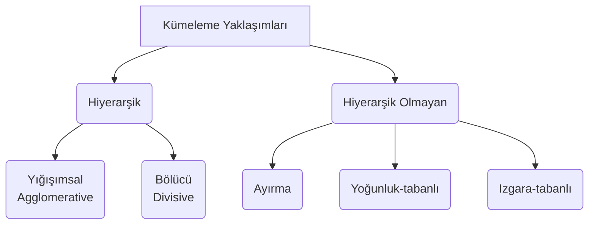
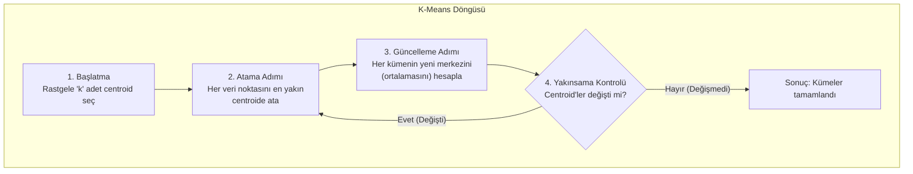

# 15. Kümeleme (Clustering) Analizi

## 15.1. Kümeleme Analizi

Bu bölümde veri madenciliğinin temel yöntemlerinden biri olan kümeleme analizi (clustering analysis) ele alınmaktadır. Konuya basit bir örnekle başlanabilir.

Bir markette çalışan bir analistten binlerce müşterinin alışveriş verilerini incelemesinin istendiği varsayılsın. Bu verilerde kimin hangi ürünü, ne zaman ve ne kadar harcayarak aldığı gibi bilgiler bulunur. Kümeleme analizi, bu karmaşık veriyi benzer özellikteki gruplara ayırmaya yardımcı olur.

### 15.1.1. Kümeleme Nedir?

Kümeleme, eldeki veri noktalarını benzerliklerine göre gruplara ayırma işlemidir. Burada önceden belirlenmiş kategoriler yoktur; algoritma verinin kendi yapısını inceleyerek grupları kendisi bulur. Bu yönüyle sınıflandırmadan ayrılır: Sınıflandırmada hangi grupların bulunduğu önceden bilinir, kümelemede ise gruplar keşfedilir.

Bir örnekle açıklayalım: Sınıfta oturan öğrencileri boy uzunluklarına ve kilolarına göre gruplamak istesek, kümeleme algoritması muhtemelen benzer fiziksel özelliklere sahip öğrencileri aynı gruba koyacaktır. Ama biz önceden "uzun boylu", "kısa boylu" gibi etiketler vermeyiz - algoritma bu grupları kendisi oluşturur.

### 15.1.2. Kümeleme Analizinin Kullanım Amaçları

Kümeleme analizini iki temel amaçla kullanırız:

**1. Keşifsel Amaçlar:** Verinin bize ne anlattığını anlamaya çalışırız. Örneğin, bir bankanın müşteri verilerini analiz ettiğimizde ortaya çıkan kümeler bize farklı müşteri tiplerini gösterebilir - emekliler, öğrenciler, çalışan profesyoneller gibi. Bu grupları önceden tahmin etmemiş olabiliriz ama veri bize bunları gösterir.

**2. Doğrulayıcı Amaçlar:** Bir hipotezimiz varsa, bunu test etmek için kullanırız. Mesela "müşterilerimiz üç ana gruba ayrılıyor" diye düşünüyorsak, kümeleme ile bunun doğru olup olmadığını kontrol edebiliriz.

### 15.1.3. Kümeleme Analizine Başlamadan Önce Cevaplanması Gereken Sorular

Kümeleme yapmadan önce bazı kritik kararlar vermemiz gerekiyor. Bu kararlar sonuçlarımızı doğrudan etkiler.

**1. Ne Aradığımızı Biliyor muyuz?**

Veri analizi tamamen körlemesine yapılmaz. Hangi özelliklerin önemli olabileceğine dair bir fikrimiz olmalı. Müşteri segmentasyonu yapıyorsak, yaş ve gelir mi önemli yoksa alışveriş sıklığı mı? Bu sorunun cevabı hangi verilere odaklanacağımızı belirler.

Basit bir mantıkla düşünelim: Okuldaki öğrencileri gruplamak istiyorsak, boy ve kiloyu mu kullanacağız yoksa ders notlarını mı? Amacımız spor takımları oluşturmaksa ilki, akademik başarı grupları oluşturmaksa ikincisi mantıklı olur.

**2. Benzerliği Nasıl Ölçeceğiz?**

İki şeyin birbirine ne kadar benzediğini sayısal olarak ifade etmemiz gerekiyor. En basit yöntem Öklid uzaklığıdır - iki nokta arasındaki düz çizgi mesafesi. Ancak her durumda bu yöntem işe yaramaz.

Düşünün ki iki öğrencinin matematik ve fen notlarını karşılaştırıyorsunuz. Birinin notları (80, 85), diğerinin (75, 80). Öklid uzaklığı bu iki öğrenci arasındaki farkı hesaplar. Ama eğer metin verileriyle çalışıyorsak, mesela öğrencilerin yazdığı kompozisyonları gruplamak istiyorsak, farklı yöntemler kullanmamız gerekir.

**3. Verileri Standartlaştıracak mıyız?**

Bu, çok önemli bir noktadır. Veride yaş (0-100 arası) ve maaş (3000-50000 arası) değişkenlerinin bulunduğu varsayılsın. Matematiksel olarak maaştaki 1000 liralık bir fark, yaştaki 10 yıllık farktan çok daha büyük görünür. Bu da maaşın kümeleme üzerinde haksız bir ağırlığa sahip olmasına neden olur.

Bunu önlemek için verileri aynı ölçeğe getiririz. Mesela hepsini 0 ile 1 arasına sıkıştırırız. Böylece yaştaki 10 yıllık fark ile maaştaki 5000 liralık fark eşit ağırlıkta değerlendirilir.

**4. Kaç Küme Oluşturacağız?**

İşin belki de en zor kısmı budur. Veriyi 2'ye mi, 3'e mi, 10'a mı böleceğiz? Bunun için çeşitli istatistiksel yöntemler var.

Dirsek yöntemi (elbow method) bunlardan biridir. Farklı küme sayıları denenir ve her birinde verinin ne kadar iyi gruplandığına bakılır. Genellikle belli bir noktadan sonra iyileşme azalır; grafikte dirseğe benzeyen bu kırılma noktası uygun küme sayısı olarak seçilir (bkz. 15.5.3.3).

Ancak istatistiksel olarak "en iyi" olan her zaman pratik olarak en anlamlı olan değildir. Bazen 7 küme matematiksel olarak optimal olabilir ama iş dünyasında 3-4 küme çok daha yönetilebilir ve anlamlı olabilir.

### 15.1.4. Başarılı Bir Kümelemenin Özellikleri

İyi bir kümeleme sonucunda:
- Aynı kümedeki elemanlar birbirine çok benzemelidir (homojenlik)
- Farklı kümelerdeki elemanlar birbirinden belirgin şekilde farklı olmalıdır (heterojenlik)

Bunu şöyle düşünebilirsiniz: Sınıftaki öğrencileri grupladığınızda, aynı gruptakiler birbirine benzemeli, farklı gruptakiler ise birbirinden ayırt edilebilir olmalı. Eğer gruplar arasında çok fazla benzerlik varsa veya grup içinde çok fazla farklılık varsa, kümelememiz başarısız demektir.

Kümeleme analizi, veri madenciliğinin temel taşlarından biridir. Doğru uygulandığında büyük veri yığınlarındaki gizli yapıları ortaya çıkarır ve değerli içgörüler sunar. Ancak kümeleme bir araçtır ve her araç gibi doğru kullanıldığında faydalıdır.

## 15.2. Benzerlik ve Uzaklık Ölçütleri (Similarity and Distance Measures)

Kümeleme analizinde (clustering analysis) en temel soru şudur: İki veri noktasının birbirine ne kadar benzediğini nasıl ölçeriz? Bu sorunun cevabı, tüm kümeleme sürecinin temelini oluşturur.

### 15.2.1. Benzerlik ve Uzaklık Kavramları

Önce basit bir örnekle başlayalım. Sınıftaki iki arkadaşınızın birbirine ne kadar benzediğini düşünün. Neye göre karşılaştırırsınız? Boy, kilo, saç rengi, hobiler, ders notları... Her özellik için farklı bir karşılaştırma yöntemi kullanmanız gerekir. İşte veri analizinde de durum böyledir.

Kümeleme algoritmaları, veri noktalarını (data points) gruplarken aralarındaki **benzerlikleri (similarities)** veya **uzaklıkları (distances)** hesaplar. Benzerlik yüksekse aynı kümeye (cluster), düşükse farklı kümelere koyar. Ama "benzerlik" dediğimiz şey, duruma göre değişir. İki müşterinin benzer olması başka, iki kelimenin benzer olması başkadır.

### 15.2.2. Veri Türlerine Göre Ölçüm Yöntemleri

#### 15.2.2.1. Kategorik Veriler İçin Ölçütler (Categorical Data Measures)

Kategorik veriler (categorical/nominal data), sayısal olmayan değerlerdir. Renk, cinsiyet, meslek gibi. Bunlarda büyüklük-küçüklük yoktur, sadece farklılık vardır.

**Basit Eşleşme Katsayısı (Simple Matching Coefficient - SMC):** İki kişinin kaç özelliğinin (attribute) aynı olduğuna bakarız. Mesela Ali ve Ayşe'yi karşılaştıralım:
- Şehir: İkisi de İstanbul (eşleşme var)
- Meslek: Ali öğretmen, Ayşe mühendis (eşleşme yok)
- Hobiler: İkisi de kitap okuyor (eşleşme var)

3 özellikten 2'si eşleşiyor, benzerlik = 2/3 = 0.67

**Jaccard Katsayısı (Jaccard Coefficient/Index):** Özellikle ikili veriler (binary data) veya seyrek veri setleri (sparse datasets) için kullanılır. Market sepeti analizi (market basket analysis) bunun klasik örneğidir:
- Ali: Ekmek, süt, yumurta aldı
- Ayşe: Ekmek, süt, peynir aldı

Ortak ürünler (intersection): Ekmek, süt (2 ürün)
Toplam farklı ürün (union): Ekmek, süt, yumurta, peynir (4 ürün)
Jaccard benzerliği = 2/4 = 0.5

Bu yöntem, özellikle öneri sistemlerinde (recommendation systems) kullanılır. "Bu ürünü alanlar bunları da aldı" mantığının arkasında bu hesaplamalar vardır.

### 15.2.3. Kümeleme Analizi: Benzerliklerin Hesaplanması

Kümeleme analizinin temel adımlarından biri, veri setindeki gözlemlerin (bu örnekte müşterilerin) birbirlerine ne kadar benzediğini veya ne kadar uzak olduğunu ölçmektir. Elimizdeki veri seti, kategorik değişkenler içerdiğinden, benzerliği tespit etmek için özel bir yöntem kullanmamız gerekir. Bu derste, eşleşen özelliklerin sayılmasına dayalı basit bir yöntemi inceleyeceğiz.

Yöntemin temel prensibi şudur: İki müşteri karşılaştırılırken, her bir özellik (değişken) için tercihleri kontrol edilir. Eğer iki müşterinin bir özellik için tercihi **aynı ise 1**, **farklı ise 0** puanı verilir. İki müşteri arasındaki toplam benzerlik skoru, tüm özelliklerden aldıkları puanların toplanmasıyla bulunur. En yüksek toplam puana sahip olan çift, birbirine en çok benzeyen çift olarak kabul edilir.

#### 15.2.3.1. İncelenecek Veri Seti

Analizde, 5 müşterinin otomobil tercihlerini içeren aşağıdaki tablo kullanılmaktadır. Her hücredeki sayı ilgili seçeneğin kodudur (Model: 3 seçenek, Ülke: 2 seçenek, Renk: 4 seçenek). Kodlar yalnızca etikettir; sayısal büyüklükleri bir anlam taşımaz.

| Kişiler (Müşteri) | Model | Ülke | Renk |
| :--- | :---: | :--: | :--: |
| **1** | 2 | 2 | 3 |
| **2** | 2 | 1 | 4 |
| **3** | 1 | 1 | 2 |
| **4** | 3 | 1 | 1 |
| **5** | 3 | 2 | 3 |

Bu tabloda 5 müşteri olduğundan, ikili olarak toplam C(5,2) = 10 farklı müşteri çifti ilişkisi bulunmaktadır. Şimdi her bir çift için benzerlik skorlarını hesaplayalım.

#### 15.2.3.2. Benzerlik Skorlarının Hesaplanması (S)

Her bir `S_ij` değeri, i numaralı müşteri ile j numaralı müşteri arasındaki benzerlik skorunu ifade etmektedir.

*   **Müşteri 1 ve 2 (S₁₂):**
    *   Model: 2 vs 2 → **1** (Aynı)
    *   Ülke: 2 vs 1 → **0** (Farklı)
    *   Renk: 3 vs 4 → **0** (Farklı)
    *   **S₁₂ = 1 + 0 + 0 = 1**

*   **Müşteri 1 ve 3 (S₁₃):**
    *   Model: 2 vs 1 → **0** (Farklı)
    *   Ülke: 2 vs 1 → **0** (Farklı)
    *   Renk: 3 vs 2 → **0** (Farklı)
    *   **S₁₃ = 0 + 0 + 0 = 0**

*   **Müşteri 1 ve 4 (S₁₄):**
    *   Model: 2 vs 3 → **0** (Farklı)
    *   Ülke: 2 vs 1 → **0** (Farklı)
    *   Renk: 3 vs 1 → **0** (Farklı)
    *   **S₁₄ = 0 + 0 + 0 = 0**

*   **Müşteri 1 ve 5 (S₁₅):**
    *   Model: 2 vs 3 → **0** (Farklı)
    *   Ülke: 2 vs 2 → **1** (Aynı)
    *   Renk: 3 vs 3 → **1** (Aynı)
    *   **S₁₅ = 0 + 1 + 1 = 2**

*   **Müşteri 2 ve 3 (S₂₃):**
    *   Model: 2 vs 1 → **0** (Farklı)
    *   Ülke: 1 vs 1 → **1** (Aynı)
    *   Renk: 4 vs 2 → **0** (Farklı)
    *   **S₂₃ = 0 + 1 + 0 = 1**

*   **Müşteri 2 ve 4 (S₂₄):**
    *   Model: 2 vs 3 → **0** (Farklı)
    *   Ülke: 1 vs 1 → **1** (Aynı)
    *   Renk: 4 vs 1 → **0** (Farklı)
    *   **S₂₄ = 0 + 1 + 0 = 1**

*   **Müşteri 2 ve 5 (S₂₅):**
    *   Model: 2 vs 3 → **0** (Farklı)
    *   Ülke: 1 vs 2 → **0** (Farklı)
    *   Renk: 4 vs 3 → **0** (Farklı)
    *   **S₂₅ = 0 + 0 + 0 = 0**

*   **Müşteri 3 ve 4 (S₃₄):**
    *   Model: 1 vs 3 → **0** (Farklı)
    *   Ülke: 1 vs 1 → **1** (Aynı)
    *   Renk: 2 vs 1 → **0** (Farklı)
    *   **S₃₄ = 0 + 1 + 0 = 1**

*   **Müşteri 3 ve 5 (S₃₅):**
    *   Model: 1 vs 3 → **0** (Farklı)
    *   Ülke: 1 vs 2 → **0** (Farklı)
    *   Renk: 2 vs 3 → **0** (Farklı)
    *   **S₃₅ = 0 + 0 + 0 = 0**

*   **Müşteri 4 ve 5 (S₄₅):**
    *   Model: 3 vs 3 → **1** (Aynı)
    *   Ülke: 1 vs 2 → **0** (Farklı)
    *   Renk: 1 vs 3 → **0** (Farklı)
    *   **S₄₅ = 1 + 0 + 0 = 1**

---

Hesaplamalar sonucunda en yüksek benzerlik skorunun **S₁₅ = 2** olduğunu görüyoruz. Bu, veri setimizdeki birbirine en çok benzeyen çiftin **1. ve 5. müşteriler** olduğu anlamına gelir. Bu iki müşteri, 3 özellikten 2'sinde aynı tercihi yapmıştır.

Diğer yandan, skoru 1 olan (S₁₂, S₂₃, S₂₄, S₃₄, S₄₅) ve skoru 0 olan (S₁₃, S₁₄, S₂₅, S₃₅) çiftler de bulunmaktadır.

Bu yöntem, en benzer çifti net bir şekilde ortaya koyar. Ancak, bu skorların mutlak eşleşme sayılarını göstermesi nedeniyle bir zayıflığı vardır. Örneğin, skoru "1" olan tüm çiftler aynı derecede mi benzerdir? Bu skor, toplam özellik sayısına oranlanmadığı için (yani 1/3 gibi bir değere dönüştürülmediği için) farklı veri setleri arasında veya farklı sayıda özelliğe sahip durumlarda karşılaştırma yapmayı zorlaştırır. Bu yüzden, en çok benzeyen çifti bulmak için etkili olsa da, diğer benzerlikler hakkında derinlemesine ve göreceli yorumlar yapmak daha güçtür.

Şimdi de ağırlıklandırma yöntemini kullanarak analizi derinleştirelim.

***

### 15.2.4. Kümeleme Analizi: Ağırlıklandırılmış Benzerlik Hesabı

Önceki yöntemde her bir özelliğe (Model, Ülke, Renk) eşit önem vermiştik. Ancak, bazı durumlarda bu yaklaşım yeterli olmayabilir. Örneğin, daha fazla seçeneği olan bir değişkendeki eşleşme, daha az seçeneği olan bir değişkendeki eşleşmeden daha anlamlı veya daha nadir bir durumu ifade ediyor olabilir.

Gözlemler arasındaki benzerliği daha net ve hassas bir şekilde ifade edebilmek için her bir özelliğe bir "ağırlık" atayabiliriz. Bu örnekte, her bir değişkenin sahip olduğu kategori (ölçek) sayısını o değişkenin ağırlığı olarak kabul edeceğiz. Bu yaklaşım, daha fazla alternatife sahip bir özellikteki eşleşmenin, benzerlik skoruna daha fazla katkı yapmasını sağlar.

#### 15.2.4.1. Ağırlıkların Belirlenmesi

*   **Model Değişkeni:** 3 farklı seçeneği var (Klasik, Spor, Aile). **Ağırlık = 3**
*   **Ülke Değişkeni:** 2 farklı seçeneği var (Japonya, Fransa). **Ağırlık = 2**
*   **Renk Değişkeni:** 4 farklı seçeneği var (Mavi, Beyaz, Kırmızı, Siyah). **Ağırlık = 4**

Hesaplama yöntemi aynı kalacak (eşleşme için 1, farklılık için 0), ancak bu sefer bulunan 0 veya 1 değerleri, ilgili değişkenin ağırlık değeri ile çarpılacaktır.

**Formül:** `Ağırlıklı Skor = (Eşleşme_Model * 3) + (Eşleşme_Ülke * 2) + (Eşleşme_Renk * 4)`

```math
\text{Ağırlıklı Skor} = \underbrace{\text{Eşleşme}_{\text{Model}}}_{\text{1 ya da 0}} \times \overbrace{3}^{\substack{\text{Model'in}\\\text{seçenek sayısı}}} + \underbrace{\text{Eşleşme}_{\text{Ülke}}}_{\text{1 ya da 0}} \times \overbrace{2}^{\substack{\text{Ülke'nin}\\\text{seçenek sayısı}}} + \underbrace{\text{Eşleşme}_{\text{Renk}}}_{\text{1 ya da 0}} \times \overbrace{4}^{\substack{\text{Renk'in}\\\text{seçenek sayısı}}}
```

**Ne anlatıyor?** İki müşterinin benzerliği, eşleşen özelliklerin ağırlıkları toplanarak bulunur: Eşleşen her özellik kendi ağırlığı (seçenek sayısı) kadar puan getirir, eşleşmeyen özellik 0 getirir. Böylece seçeneği çok olan bir özellikteki eşleşme, benzerlik skoruna daha fazla katkı yapar. Örnek: 1. ve 5. müşteriler ülkede ve renkte eşleşir: $0 \times 3 + 1 \times 2 + 1 \times 4 = 6$.

#### 15.2.4.2. Ağırlıklandırılmış Benzerlik Skorlarının Hesaplanması

Şimdi tüm müşteri çiftleri için bu yeni yönteme göre skorları tekrar hesaplayalım.

*   **S₁₂:** (1 × 3) + (0 × 2) + (0 × 4) = 3 + 0 + 0 = **3**
*   **S₁₃:** (0 × 3) + (0 × 2) + (0 × 4) = 0 + 0 + 0 = **0**
*   **S₁₄:** (0 × 3) + (0 × 2) + (0 × 4) = 0 + 0 + 0 = **0**
*   **S₁₅:** (0 × 3) + (1 × 2) + (1 × 4) = 0 + 2 + 4 = **6**
*   **S₂₃:** (0 × 3) + (1 × 2) + (0 × 4) = 0 + 2 + 0 = **2**
*   **S₂₄:** (0 × 3) + (1 × 2) + (0 × 4) = 0 + 2 + 0 = **2**
*   **S₂₅:** (0 × 3) + (0 × 2) + (0 × 4) = 0 + 0 + 0 = **0**
*   **S₃₄:** (0 × 3) + (1 × 2) + (0 × 4) = 0 + 2 + 0 = **2**
*   **S₃₅:** (0 × 3) + (0 × 2) + (0 × 4) = 0 + 0 + 0 = **0**
*   **S₄₅:** (1 × 3) + (0 × 2) + (0 × 4) = 3 + 0 + 0 = **3**

---

#### 15.2.4.3. Sonuçların Değerlendirilmesi ve Karşılaştırılması

Yeni hesaplamalarımıza göre, **en yüksek skoru (6) alan 1. ve 5. müşteriler**, yine en çok benzeyen çift olarak öne çıkmaktadır. Ağırlıklandırma, bu çiftin benzerliğinin ne kadar güçlü olduğunu daha da belirginleştirmiştir.

Ancak daha önemli bir sonuç, önceki yöntemde ortaya çıkan belirsizliğin giderilmesidir:

*   **Ağırlıksız Yöntemde:** S₁₂, S₂₃, S₂₄, S₃₄ ve S₄₅ çiftlerinin hepsi **1** skorunu almıştı. Bu durum, bu beş çiftin hepsinin eşit derecede benzer olduğu gibi bir izlenim yaratıyordu ve aralarında bir önceliklendirme yapmak mümkün değildi.
*   **Ağırlıklı Yöntemde:** Bu durum netleşmiştir.
    *   **S₁₂** ve **S₄₅** çiftleri **3** puan almıştır. Bu çiftler, 3 seçenekli "Model" değişkeninde eşleşmiştir.
    *   **S₂₃**, **S₂₄** ve **S₃₄** çiftleri ise **2** puan almıştır. Bu çiftler ise sadece 2 seçenekli "Ülke" değişkeninde eşleşmiştir.

Bu yeni sonuçlara göre, **1. ve 2. müşteriler** ile **4. ve 5. müşterilerin** benzerliklerinin, diğer üç çifte göre daha anlamlı olduğu söylenebilir. Çünkü eşleşme sağladıkları "Model" değişkeni, "Ülke" değişkenine göre daha fazla kategori içerdiğinden, bu eşleşme daha ayırt edici kabul edilmiştir.

Kısacası, ağırlıklandırma yapmak, benzerlik ölçümlerine daha hassas bir bakış açısı kazandırmış ve gruplar arasındaki benzerlik derecelerini daha net bir şekilde ayrıştırmamızı sağlamıştır.


Önceki alt bölümde, tamamen kategorik değişkenlerden oluşan bir veri setinde gözlemler arasındaki benzerliği, basit eşleşme katsayısı gibi yöntemlerle nasıl ölçebileceğimizi incelemiştik. Bu yaklaşım, iki gözlemin belirli bir özellik için aynı kategoriye sahip olup olmadığını sayarak bir benzerlik skoru elde etmemizi sağlıyordu. Ancak, gerçek dünya veri setleri nadiren bu kadar homojen olur. Çoğu zaman **hem kategorik hem de sayısal (metrik) değişkenleri bir arada barındıran** karmaşık yapılarla karşılaşılır.

Şimdi düşünelim ki, otomobil tercihleri tablomuzdaki 'Model', 'Ülke' ve 'Renk' gibi kategorik özelliklerin yanına, 'Yıllık Gelir' veya 'Yaş' gibi sayısal bir değişken ekledik. Bu durumda, basit eşleşme katsayısı yöntemimiz yetersiz kalır. Çünkü 'Gelir' gibi sürekli bir değişken için 'aynı' veya 'farklı' demenin ötesinde, 'ne kadar farklı' olduklarını ölçmemiz gerekir. İki kişinin gelirinin 50.000 TL ile 51.000 TL olması ile 50.000 TL ile 500.000 TL olması arasındaki farkı, sadece 'farklı' diyerek göz ardı edemeyiz. Bu, benzerlik ölçümümüzün hassasiyetini ve anlamlılığını ciddi şekilde düşürür.

Bu tür karmaşık veri yapıları için, özellikle sayısal değişkenlerin farklılıklarını daha anlamlı bir şekilde değerlendirebilmek adına yeni yaklaşımlara ihtiyacımız doğar. Bu noktada, gözlemler arasındaki 'uzaklığı' veya 'farklılığı' ölçmeye odaklanan iki temel yöntem devreye girer: **Mutlak Sapmalar Yöntemi** ve **Farklar Karesi Toplamı Yöntemi**.


### 15.2.5. Mutlak Sapmalar Yöntemi

**Mutlak Sapmalar Yöntemi**, adından da anlaşılacağı gibi, iki gözlem arasındaki her bir sayısal özelliğin farkının mutlak değerini alarak bu farkları toplar. Yani, 'A' ve 'B' gibi iki gözlemimiz ve 'X', 'Y', 'Z' gibi sayısal özelliklerimiz varsa, her bir özellik için `|A_X - B_X|`, `|A_Y - B_Y|`, `|A_Z - B_Z|` gibi mutlak farkları hesaplarız. Ardından bu mutlak farkları toplayarak iki gözlem arasındaki toplam sapmayı elde ederiz. Bu yöntem, her bir özelliğin farkını doğrudan yansıtır ve büyük farkların etkisini doğrusal bir şekilde hesaba katar. Örneğin, bir kişinin geliri 50.000, diğerinin 60.000 ise fark 10.000'dir. Başka bir çiftte 100.000 ve 110.000 ise yine fark 10.000'dir. Her iki durumda da bu 10.000'lik fark, toplam sapma skoruna eşit ağırlıkta katkıda bulunur. Bu yöntem, özellikle aykırı değerlerin (outlier) etkisini daha az hissettirmek istediğimiz durumlarda tercih edilebilir, çünkü farkları karelemek gibi bir amplifikasyon yapmaz.

### 15.2.6. Farklar Karesi Toplamı Yöntemi

Diğer bir önemli yaklaşım ise **Farklar Karesi Toplamı Yöntemi**'dir. Bu yöntemde, her bir sayısal özelliğin farkı alındıktan sonra, bu farkın karesi hesaplanır ve ardından tüm özellikler için bu kareler toplanır. Yani, `(A_X - B_X)² + (A_Y - B_Y)² + (A_Z - B_Z)²` şeklinde bir hesaplama yaparız. Bu yöntem, aslında **Öklid uzaklığının karesi** olarak da bilinen bir ölçümdür. Kare alma işlemi, 1'den küçük farkları daha da küçültür, büyük farkları ise orantısız biçimde büyütür. Örneğin, 1 birimlik bir farkın karesi 1 iken, 10 birimlik bir farkın karesi 100 olur. Bu durum, büyük sapmaların toplam uzaklık skoruna çok daha baskın bir şekilde etki etmesine neden olur. Dolayısıyla, bu yöntem, gözlemler arasındaki belirgin farklılıkları vurgulamak istediğimizde veya aykırı değerlerin kümeleme üzerindeki etkisini artırmak istediğimizde daha uygun olabilir.

Her iki yöntem de sayısal değişkenler için uzaklık ölçümü sunar. Seçimimiz, veri setimizin özelliklerine ve analizden beklentilerimize bağlıdır. Mutlak sapmalar, farkları doğrusal olarak ele alırken, farklar karesi toplamı, büyük farklara daha fazla ağırlık vererek onları daha belirgin hale getirir. Bu yöntemler, kümeleme analizinde gözlemler arasındaki gerçek farklılıkları daha doğru bir şekilde yansıtmamızı sağlayarak, daha anlamlı küme yapıları elde etmemize olanak tanır.

### 15.2.7. Neden farklar karesi alırız? Sadece farkları toplasak yetmez mi?

Veri analizinde, özellikle iki veri seti arasındaki "uzaklığı" veya "hatayı" ölçerken, farkların karesini almak standart bir yaklaşımdır. Peki, neden farkların mutlak değerlerini toplamakla yetinmeyip, karesini alma zahmetine giriyoruz? Bu sorunun cevabı, ölçümün hassasiyeti ve büyük hatalara verdiği önemde yatmaktadır.

Bu durumu, sunulan iki örnek üzerinden inceleyelim.

---

#### 15.2.7.1. Örnek 1

*   **Veri Setleri:** `(5, 7, 9)` ve `(1, 4, 3)`
*   **Mutlak Farklar:**
    *   `|5 - 1| = 4`
    *   `|7 - 4| = 3`
    *   `|9 - 3| = 6`
*   **Farkların Toplamı:** `4 + 3 + 6 = 13`
*   **Farkların Kareleri Toplamı:** `4² + 3² + 6² = 16 + 9 + 36 = 61`

#### 15.2.7.2. Örnek 2

*   **Veri Setleri:** `(12, 2, 4)` ve `(1, 1, 3)`
*   **Mutlak Farklar:**
    *   `|12 - 1| = 11`
    *   `|2 - 1| = 1`
    *   `|4 - 3| = 1`
*   **Farkların Toplamı:** `11 + 1 + 1 = 13`
*   **Farkların Kareleri Toplamı:** `11² + 1² + 1² = 121 + 1 + 1 = 123`

---

#### 15.2.7.3. Sonuç

Dikkat edilmesi gereken en önemli nokta, her iki örnekte de **Farkların Toplamı**'nın `13` olmasıdır. Eğer ölçütümüz sadece bu toplam olsaydı, iki durumdaki veri setlerinin birbirinden "eşit uzaklıkta" olduğu gibi yanıltıcı bir sonuca varırdık.

Ancak **Farkların Kareleri Toplamı**'na baktığımızda gerçek durum ortaya çıkar:

1.  **Birinci Örnekte Sonuç: 61**
2.  **İkinci Örnekte Sonuç: 123**

Bu sonuçlar, ikinci durumdaki veri setleri arasındaki toplam farkın, birinciye göre çok daha anlamlı ve büyük olduğunu gösterir.

#### 15.2.7.4. Neden Bu Fark Oluşuyor?

Farkların karesini almanın temel işlevi, **büyük farkları orantısal olarak daha fazla cezalandırmaktır.**

*   İkinci örnekteki `11` birimlik tek bir büyük sapma, karesi alındığında (`121`) toplam skoru neredeyse tek başına belirler. Bu, sistemin bu büyük hatayı ne kadar ciddiye aldığını gösterir.
*   Birinci örnekteki daha dengeli ve küçük farklar (`4, 3, 6`), kareleri alındığında toplam skoru daha makul bir seviyede tutar.

Kısacası, farkların karesini almak;
*   **Büyük hatalara ve aykırı değerlere karşı duyarlılığı artırır.** Birçok analizde, tek bir büyük hata, çok sayıda küçük hatadan daha sorunludur.
*   **Farkların dağılımı hakkında daha fazla bilgi sunar.** Sadece mutlak toplam, farkların nasıl dağıldığını gizlerken; kareler toplamı, büyük sapmaların varlığını hemen belli eder.
*   Negatif ve pozitif farkların birbirini götürmesini engeller ve tüm hataları pozitif bir değer olarak hesaba katar (bu özellik mutlak değer alındığında da sağlanır).

Bu sebeplerle, Öklid mesafesi, en küçük kareler yöntemi gibi istatistik ve makine öğrenmesinin temelini oluşturan birçok yöntemde, farkların karesi kullanılır.
Yukarıda tartışılan "farkların karesini almak" meselesi, aslında şimdi ele alacağımız sayısal uzaklık ölçümlerinin tam kalbinde yer alıyor. Kümeleme analizi, özünde, veri noktalarını "benzerliklerine" göre gruplama sanatıdır ve bu benzerliğin matematiksel ifadesi de genellikle "mesafe" veya "uzaklık" kavramıyla ölçülür. İki nokta birbirine ne kadar "yakınsa", o kadar benzer kabul edilir.

Bu yakınlığın ölçülmesinde, amaca ve verinin yapısına göre seçilebilecek farklı ölçütler kullanılır.

***

### 15.2.8. Sayısal Verilerde Uzaklık Ölçümleri (Numerical/Metric Data Measures)

Kümeleme algoritmaları, veri noktaları (gözlemler) arasındaki mesafeleri hesaplayarak işe başlar. En yakın olanları aynı kümeye dahil etme eğilimindedirler. Sayısal veriler için geometrik uzaklık kavramlarını kullanırız. Bu süreçte en yaygın olarak kullanılan üç temel uzaklık ölçüsünü inceleyelim.

#### 15.2.8.1. Öklid Uzaklığı (Euclidean Distance)

Bu, hepimizin sezgisel olarak bildiği, en temel ve en yaygın kullanılan uzaklık ölçüsüdür. İki nokta arasındaki **"kuş uçuşu"** mesafeyi ifade eder. Düz bir çizgi çektiğinizde o çizginin uzunluğu ne ise, Öklid uzaklığı da odur.

Geometriden hatırlayacağınız Pisagor teoremine dayanır. İki boyutlu bir düzlemde A(x₁, y₁) ve B(x₂, y₂) noktaları arasındaki mesafe şu şekilde hesaplanır:

`Mesafe = √[(x₂ - x₁)² + (y₂ - y₁)²]`

Bu formülü, veri setimizdeki 'p' adet özelliğe (boyuta) genelleyebiliriz. A ve B gibi iki müşteri ve onların 'p' adet özelliği (örneğin yaş, gelir, harcama miktarı...) olduğunu düşünelim:

**`Öklid(A, B) = √[ (a₁ - b₁)² + (a₂ - b₂)² + ... + (aₚ - bₚ)² ]`**

```math
\underbrace{\text{Öklid}(A, B)}_{\substack{\text{A ile B arasındaki}\\\text{kuş uçuşu uzaklık}}} = \sqrt{\underbrace{(a_1 - b_1)^2}_{\substack{\text{1. özellikteki}\\\text{farkın karesi}}} + \dots + \overbrace{(a_p - b_p)^2}^{\substack{\text{p. özellikteki}\\\text{farkın karesi}}}} = \sqrt{\underbrace{\sum_{i=1}^{p}}_{\substack{\text{p özelliğin}\\\text{hepsi için topla}}} (a_i - b_i)^2}
```

**Ne anlatıyor?** İki nokta arasındaki kuş uçuşu uzaklık, Pisagor teoreminin çok boyutlu genellemesiyle hesaplanır: Her özellikteki farkın karesi alınır, bu kareler toplanır ve toplamın karekökü alınır. Sağdaki $\Sigma$'lı yazım, üç noktalı uzun yazımın kısaltmasıdır. Karekök, kare almayla değişen birimi geri getirir (not² → not).

Bu noktada önceki alt bölümle bağlantı kurulabilir. Formülün içindeki `(a - b)²` ifadesi, tam olarak **farkların karesidir**.

**Sayısal Örnekler:**

*   **Öğrenci Notları Örneği:** İki öğrencinin matematik ve fen notları var.
    *   Öğrenci A: Matematik 80, Fen 70
    *   Öğrenci B: Matematik 85, Fen 75
    Bu iki öğrenciyi bir koordinat sisteminde düşünün. X ekseni matematik, Y ekseni fen notu. Aralarındaki mesafeyi cetvel koyup ölçsek, Öklid uzaklığını bulmuş oluruz. Matematiksel olarak:
    `Öklid(A, B) = √[(85-80)² + (75-70)²] = √(25+25) = 7.07`

*   **2 Boyutlu Örnek:** A(1, 2) ve B(4, 6) noktaları arasındaki Öklid uzaklığı:
    `Öklid(A, B) = √[ (4 - 1)² + (6 - 2)² ]`
    `= √[ (3)² + (4)² ]`
    `= √[ 9 + 16 ]`
    `= √25 = 5`

*   **3 Boyutlu Örnek:** A(1, 2, 3) ve B(4, 6, 7) noktaları arasındaki Öklid uzaklığı:
    `Öklid(A, B) = √[ (4 - 1)² + (6 - 2)² + (7 - 3)² ]`
    `= √[ (3)² + (4)² + (4)² ]`
    `= √[ 9 + 16 + 16 ]`
    `= √41 ≈ 6.40`

*   **Neden Önemli?** Öklid uzaklığı, büyük farklara karşı oldukça hassastır. Bir özellikteki büyük bir fark, karesi alındığı için toplam mesafeyi ciddi şekilde artırır. Bu, aykırı değerlerin (outlier) kümeleme sonuçlarını önemli ölçüde etkileyebileceği anlamına gelir. Verileriniz yoğun ve küresel bir dağılıma sahipse genellikle çok iyi sonuçlar verir.

#### 15.2.8.2. Manhattan veya City-Block Uzaklığı (Manhattan Distance / City Block Distance)

İsmini, Manhattan gibi ızgara planlı bir şehirde bir yerden bir yere gitme probleminden alır. Binaların içinden geçemeyeceğiniz için, caddeler ve sokaklar boyunca yatay ve dikey olarak hareket etmek zorundasınızdır. Bu yüzden "şehir bloku" veya "taksimetre" uzaklığı olarak da bilinir.

Bu metrik, iki nokta arasındaki farkların **mutlak değerlerini** toplar.

İki boyutlu bir düzlemde A(x₁, y₁) ve B(x₂, y₂) noktaları için:

`Mesafe = |x₂ - x₁| + |y₂ - y₁|`

'p' adet özelliğe sahip A ve B müşterileri için formül şöyledir:

**`Manhattan(A, B) = |a₁ - b₁| + |a₂ - b₂| + ... + |aₚ - bₚ|`**

```math
\underbrace{\text{Manhattan}(A, B)}_{\substack{\text{sokaklar boyunca}\\\text{gidilen uzaklık}}} = \overbrace{\lvert a_1 - b_1 \rvert}^{\substack{\text{1. özellikteki}\\\text{fark (işaretsiz)}}} + \dots + \overbrace{\lvert a_p - b_p \rvert}^{\substack{\text{p. özellikteki}\\\text{fark (işaretsiz)}}} = \underbrace{\sum_{i=1}^{p} \lvert a_i - b_i \rvert}_{\substack{\text{mutlak farkların}\\\text{toplamı}}}
```

**Ne anlatıyor?** Manhattan uzaklığı, her özellikteki farkın işaretsiz büyüklüğünü toplar; iki nokta arasında eksenlere paralel hareket edilerek, yani sokaklar boyunca gidilen toplam yolu verir. Buradaki dikey çizgiler **mutlak değerdir**: $\lvert 3 - 7 \rvert = \lvert 7 - 3 \rvert = 4$. Mutlak değer alınmasaydı pozitif ve negatif farklar birbirini götürürdü.

**Sayısal Örnekler:**

*   **Öğrenci Notları Örneği:** Aynı öğrenci örneğinde:
    *   Matematik farkı: |85-80| = 5
    *   Fen farkı: |75-70| = 5
    *   Manhattan uzaklığı = 5 + 5 = 10
    Bu iki yöntem arasındaki fark şöyle özetlenebilir: Öklid uzaklığı kuş uçuşu mesafe (as the crow flies), Manhattan uzaklığı ise sokakları takip ederek gidilen mesafedir.

*   **2 Boyutlu Örnek:** A(1, 2) ve B(4, 6) noktaları arasındaki Manhattan uzaklığı:
    `Manhattan(A, B) = |4 - 1| + |6 - 2|`
    `= 3 + 4 = 7`

*   **3 Boyutlu Örnek:** A(1, 2, 3) ve B(4, 6, 7) noktaları arasındaki Manhattan uzaklığı:
    `Manhattan(A, B) = |4 - 1| + |6 - 2| + |7 - 3|`
    `= 3 + 4 + 4 = 11`

*   **Neden Önemli?** Bu yöntem, farkların karesini almadığı için Öklid uzaklığına göre aykırı değerlere karşı **daha dayanıklıdır (robust)**. Bir özellikteki büyük bir fark, toplam mesafeyi Öklid'deki kadar dramatik bir şekilde artırmaz. Özellikle, özellikler arasındaki "köşegen" bir hareketin anlamlı olmadığı durumlarda (örneğin, bir eksen yaş, diğer eksen alışveriş adedi ise bu ikisi arasında doğrudan bir geçiş anlamsızdır) veya çok yüksek boyutlu veri setlerinde tercih edilebilir.

#### 15.2.8.3. Minkowski Uzaklığı (Minkowski Distance)

Minkowski uzaklığı, aslında bir "üst metrik" veya "genelleştirilmiş" bir formüldür. Öklid ve Manhattan uzaklıklarını özel durumlar olarak içinde barındırır.

Formülü şu şekildedir:

**`Minkowski(A, B) = [ (|a₁ - b₁|)ᵖ + (|a₂ - b₂|)ᵖ + ... + (|aₚ - bₚ|)ᵖ ]¹/ᵖ`**

```math
\underbrace{\text{Minkowski}(A, B)}_{\substack{\text{genelleştirilmiş}\\\text{uzaklık}}} = \Bigg( \underbrace{\sum_{i=1}^{n}}_{\substack{\text{n özelliğin}\\\text{hepsi için topla}}} \overbrace{\lvert a_i - b_i \rvert}^{\substack{\text{i. özellikteki fark}\\\text{(işaretsiz)}}}{}^{\,p} \Bigg)^{1/p}
```

**Ne anlatıyor?** Minkowski uzaklığı, özelliklerdeki mutlak farkların p'inci kuvvetlerini toplar ve toplamın p'inci dereceden kökünü alır; p parametresi değiştirilerek tek bir formülden farklı uzaklık ölçüleri elde edilir. **Dikkat:** Yukarıdaki formülde p iki ayrı iş görür: $a_p$'deki p özellik sayısı, üsteki p ise Minkowski parametresidir. Karışıklığı önlemek için açıklamalı sürümde özellik sayısı n ile gösterilmiştir. p = 1 için Manhattan, p = 2 için Öklid uzaklığı elde edilir.

Buradaki **'p'** parametresi, metriğin davranışını kontrol eden kilit noktadır.

*   **Eğer p = 1 ise:**
    `[ |a₁ - b₁|¹ + ... ]¹/¹ = |a₁ - b₁| + ...`
    Formül, **Manhattan Uzaklığı**'na dönüşür.

*   **Eğer p = 2 ise:**
    `[ |a₁ - b₁|² + ... ]¹/² = √[ (a₁ - b₁)² + ... ]`
    Formül, **Öklid Uzaklığı**'na dönüşür.

*   **Eğer p = ∞ ise:**
    Chebyshev uzaklığı elde edilir.

Daha ileri düzey analizlerde, probleme özgü uzaklık tanımları yapmak için kullanılır.

**Sayısal Örnek (p=3 için):**

*   **2 Boyutlu Örnek (p=3):** A(1, 2) ve B(4, 6) noktaları arasındaki Minkowski uzaklığı (p=3):
    `Minkowski(A, B) = [ (|4 - 1|)³ + (|6 - 2|)³ ]¹/³`
    `= [ (3)³ + (4)³ ]¹/³`
    `= [ 27 + 64 ]¹/³`
    `= [ 91 ]¹/³ ≈ 4.50`

*   **Neden Önemli?** Minkowski uzaklığı, bize esneklik kazandırır. `p` parametresini değiştirerek, büyük farklara ne kadar önem vereceğimizi ayarlayabiliriz. `p` değeri arttıkça, en büyük farkın toplam mesafe üzerindeki etkisi de o kadar artar. Bu, analizcinin problemine en uygun uzaklık ölçüsünü deneyerek bulmasına olanak tanır.

#### 15.2.8.4. Karma Veriler İçin Yaklaşımlar (Mixed Data Approaches)

Gerçek hayatta veriler genelde karışık tipte (mixed-type) olur. Bir müşteri verisinde hem yaş (sayısal/numerical) hem meslek (kategorik/categorical) olabilir. Bu durumda ne yapacağız?

Her öznitelik türü (attribute type) için ayrı uzaklık hesaplarız, sonra bunları birleştiririz:

*   Yaş farkı için Öklid uzaklığı kullan, normalize et (normalization) - 0-1 arası yap
*   Meslek için eşleşme var mı yok mu bak (0 veya 1)
*   İkisinin ağırlıklı ortalamasını (weighted average) al

Bu birleştirme işleminde dikkatli olmak gerekir. Bazı özellikler diğerlerinden daha önemli olabilir. Mesela kredi risk analizinde (credit risk analysis) gelir, hobilerden daha önemlidir. Bu durumda özellik ağırlıklandırması (feature weighting) yaparız.

#### 15.2.8.5. Uzaklık Ölçütü Seçiminin Önemi

Yanlış uzaklık ölçütü seçmek, tamamen yanlış sonuçlara yol açabilir. Örneğin:

*   Metin madenciliğinde (text mining) Öklid uzaklığı yerine kosinüs benzerliği (cosine similarity) kullanmak daha mantıklıdır (bkz. [17.1.3](17-metin-madenciligi.md#kosinus)).
*   Yüksek boyutlu verilerde (high-dimensional data) Manhattan uzaklığı bazen daha iyi sonuç verir.
*   Değişkenler birbiriyle ilişkiliyse (korelasyon varsa) veya ölçekleri farklıysa Mahalanobis uzaklığı tercih edilebilir. Bu uzaklık, değişkenlerin kovaryans yapısını hesaba katar ve aykırı değer (outlier) tespitinde de kullanılır; ancak aykırı değerlere karşı dayanıklı (robust) bir ölçüt değildir.

#### 15.2.8.6. Pratik Uygulamalar

Farklı uzaklık ölçütlerini çeşitli platformlarda uygulayabiliriz:

*   **R'da uygulama:**
    ```R
    dist(data, method = "euclidean")  # Öklid uzaklığı
    dist(data, method = "manhattan")  # Manhattan uzaklığı
    ```
*   **Python'da uygulama:**
    ```python
    from sklearn.metrics import pairwise_distances
    distances = pairwise_distances(data, metric='euclidean')
    ```
*   **WEKA'da:** Örneğin `SimpleKMeans` algoritmasının `distanceFunction` parametresinden `EuclideanDistance` veya `ManhattanDistance` seçilebilir.
*   **Java'da:** Kendi uzaklık fonksiyonunuzu (custom distance function) yazabilir veya Apache Commons Math kütüphanesini kullanabilirsiniz.

Pratikte, farklı uzaklık ölçütlerini deneyip sonuçları karşılaştırmak iyi bir yaklaşımdır. Hangi ölçüt daha anlamlı kümeler veriyorsa, o sizin probleminiz için daha uygundur. Veri ön işleme (data preprocessing) ve ölçeklendirme (scaling) adımlarının da uzaklık hesaplamalarını doğrudan etkilediği unutulmamalıdır.

Kümeleme analizinin kalitesi, bu temel kararlarla başlar. Verinizin yapısını anlayın, amacınızı belirleyin, sonra uygun ölçütü seçin. Varsayılan ayarları (default settings) körü körüne kullanmayın.

### 15.2.9. Özetle

*   **Öklid (p=2):** En yaygın, sezgisel "düz çizgi" mesafesi. Aykırı değerlere duyarlıdır.
*   **Manhattan (p=1):** "Şehir blokları" mesafesi. Aykırı değerlere daha dayanıklıdır.
*   **Minkowski:** Diğer ikisini de içeren genel bir çerçeve. `p` parametresi ile esneklik sağlar.

Doğru uzaklık metriğini seçmek, kümeleme analizinin kalitesini doğrudan etkileyen kritik bir karardır ve verinin doğasına bağlıdır.




## 15.3. Veri Madenciliği ve Kümeleme Analizi: Kümeleme Yöntemleri

Kümeleme algoritmaları, temel çalışma prensiplerine göre iki ana sınıfa ayrılır: **Hiyerarşik** ve **Hiyerarşik Olmayan** yöntemler. Bu ayrım, kümeleme sürecine nasıl yaklaştıklarının en temel farklılığını yansıtır.

Aşağıdaki şema, bu sınıflandırmayı ve alt dallarını göstermektedir:


---

### 15.3.1. Hiyerarşik Kümeleme

Bu yaklaşımın ana fikri, tek bir kümeleme sonucu üretmek yerine, bir dizi iç içe geçmiş kümeden oluşan bir **hiyerarşi** veya bir **ağaç yapısı (dendrogram)** oluşturmaktır. Başlangıçta kaç küme olması gerektiğini belirtmenize gerek yoktur. Algoritma size tüm olası küme birleşimlerini bir ağaç olarak sunar, siz de bu ağacı istediğiniz seviyeden "keserek" küme sayısını belirlersiniz.

Bu yaklaşımın iki temel stratejisi vardır:

*   **a) Yığışımsal (Agglomerative) / Birleştirici:** Bu, "aşağıdan yukarıya" (bottom-up) bir yaklaşımdır.
    1.  **Başlangıç:** Her bir veri noktası tek başına bir küme olarak kabul edilir. (N veri noktası varsa, N küme vardır.)
    2.  **İterasyon:** Her adımda, birbirine en yakın olan iki küme bulunur ve birleştirilir.
    3.  **Bitiş:** Tüm veri noktaları tek bir büyük kümede birleşene kadar bu birleştirme işlemi devam eder.

*   **b) Bölücü (Divisive):** Bu, "yukarıdan aşağıya" (top-down) bir yaklaşımdır ve daha nadir kullanılır.
    1.  **Başlangıç:** Tüm veri noktaları tek bir kümenin içindedir.
    2.  **İterasyon:** Her adımda, mevcut bir küme, içindeki noktalar birbirine en az benzeyecek şekilde ikiye bölünür.
    3.  **Bitiş:** Her veri noktası tek başına bir küme olana kadar bu bölme işlemi devam eder.

Hiyerarşik yöntemler, verinin yapısı hakkında zengin bir görsel bilgi sunar ancak büyük veri setlerinde hesaplama maliyetleri yüksek olabilir.

#### 15.3.1.1. Kümeler Arası Uzaklık: Bağlantı (Linkage) Yöntemleri

Yığışımsal algoritmanın her adımında "birbirine en yakın iki küme" birleştirilir. İki nokta arasındaki uzaklık 15.2'deki ölçütlerle hesaplanır; ancak birden fazla nokta içeren iki kümenin uzaklığı için ayrıca bir kural gerekir. Bu kurala **bağlantı (linkage)** yöntemi denir:

| Yöntem | İki küme arasındaki uzaklık | Davranış |
| :--- | :--- | :--- |
| **Tek bağlantı (single linkage)** | İki kümenin birbirine **en yakın** iki noktası arasındaki uzaklık | Zincir biçimli, uzun kümeler oluşturmaya eğilimlidir. |
| **Tam bağlantı (complete linkage)** | İki kümenin birbirine **en uzak** iki noktası arasındaki uzaklık | Küçük çaplı, toplu kümeler oluşturur. |
| **Ortalama bağlantı (average linkage)** | İki kümedeki tüm nokta çiftleri arasındaki uzaklıkların **ortalaması** | Tek ve tam bağlantı arasında bir davranış gösterir. |
| **Ward yöntemi (Ward's method)** | Birleştirmenin küme içi kareler toplamında (WCSS, bkz. 15.4.2) yol açacağı **artış** | Benzer büyüklükte, küresel kümeler oluşturur. |

**Sayısal örnek:** Bir doğru üzerindeki beş nokta A = 1, B = 2, C = 4, D = 8, E = 9 olsun (uzaklık = farkın mutlak değeri). Birleştirme sırası ve birleştirme anındaki uzaklıklar:

| Adım | Birleşen kümeler | Tek bağlantı | Tam bağlantı | Ortalama bağlantı |
| :---: | :--- | :---: | :---: | :---: |
| 1 | {A} + {B} | 1 | 1 | 1 |
| 2 | {D} + {E} | 1 | 1 | 1 |
| 3 | {A, B} + {C} | 2 (B–C) | 3 (A–C) | 2.5 ((3 + 2) / 2) |
| 4 | {A, B, C} + {D, E} | 4 (C–D) | 8 (A–E) | 6.167 (6 çiftin ortalaması: 37 / 6) |

Üç yöntemde de birleştirme sırası aynıdır, ancak birleştirme yükseklikleri farklıdır. Tek bağlantıya göre çizilen dendrogram aşağıdadır:

```
Uzaklık
   4 ┤        ┌────┴─────┐
   3 ┤        │          │
   2 ┤     ┌──┴──┐       │
   1 ┤   ┌─┴─┐   │     ┌─┴─┐
     └───────────────────────
         A   B   C     D   E
```

Dendrogram 3 yüksekliğinden yatay bir çizgiyle "kesilirse" iki küme ({A, B, C} ve {D, E}), 1.5 yüksekliğinden kesilirse üç küme ({A, B}, {C} ve {D, E}) elde edilir. Küme sayısının önceden belirtilmesi gerekmemesinin nedeni budur.

---

### 15.3.2. Hiyerarşik Olmayan Kümeleme

Bu yaklaşımda amaç, veri setini önceden belirlenmiş **'K' adet** kümeye doğrudan bölmektir. Bir hiyerarşi oluşturulmaz; bunun yerine, veri noktaları belirli bir optimizasyon kriterine göre en uygun kümelere atanır. Genellikle hiyerarşik yöntemlerden daha hızlıdırlar ve bu nedenle büyük veri setleri için daha uygundurlar.

Bu sınıftaki bazı önemli alt başlıklar şunlardır:

*   **a) Ayırma (Partitioning) Yöntemleri:** En yaygın kullanılan yaklaşımdır. Amaç, veri setini K adet, kesişmeyen kümeye ayırmaktır. Analizcinin küme sayısı olan 'K' değerini en başta belirtmesi gerekir. En bilinen örneği **K-Means** algoritmasıdır. Bu algoritma, her kümenin bir merkez noktası (centroid) etrafında toplandığını varsayar.

*   **b) Yoğunluk Tabanlı (Density-based) Yöntemler:** Bu algoritmalar kümeleri, veri uzayında yoğun olarak bulunan bölgeler olarak tanımlar. Düşük yoğunluklu bölgeler ise bu kümeleri birbirinden ayıran sınırlar olarak görülür. Kümelerin küresel olmak zorunda olmadığını varsaydıkları için **farklı geometrik şekillerdeki kümeleri** bulabilirler. Ayrıca, herhangi bir kümeye ait olmayan "gürültü" (noise) veya "aykırı" (outlier) noktaları tespit etmede de oldukça başarılıdırlar. **DBSCAN** bu kategorinin popüler bir örneğidir.

*   **c) Izgara Tabanlı (Grid-based) Yöntemler:** Bu yöntemler, veri uzayını ızgara benzeri hücrelere böler ve tüm kümeleme işlemlerini bu hücreler üzerinde gerçekleştirir. Avantajı, işlem hızının veri noktası sayısına değil, ızgara hücrelerinin sayısına bağlı olmasıdır. Bu da onu çok büyük veri setleri için oldukça verimli kılar.

Sonuç olarak, hangi kümeleme yönteminin seçileceği; verinin yapısına, boyutuna, veri setinde gürültü olup olmamasına ve analizin nihai hedefine bağlıdır. Tek bir "en iyi" yöntem yoktur; her problemin doğası, en uygun yaklaşımın seçilmesini gerektirir.


## 15.4. Hiyerarşik Olmayan Kümeleme: K-Means Algoritması

Bu alt bölümde hiyerarşik olmayan yöntemlerin en yaygın kullanılanı olan **K-Means** algoritması incelenmektedir. Algoritmanın gücü, karmaşık bir problemi basit ve sezgisel adımlarla çözmesinden gelir.

Temel fikir şudur: Veri seti, önceden belirlenen 'k' adet kümeye ayrılmak istenmektedir. K-Means, her kümenin bir "ağırlık merkezi" veya geometrik merkezi olduğunu varsayar. Bu merkeze literatürde **centroid** denir. Bir veri noktasının kaderi basittir: Hangi centroid'e daha yakınsa, o centroid'in kümesine aittir.

Algoritmayı, bir odaya dağılmış insanları 'k' adet gruba ayırmaya çalışan bir organizatöre benzetebiliriz. Organizatörün görevi, her grubun kendi içinde mümkün olduğunca sıkı ve birbirine yakın olmasını sağlamaktır.

### 15.4.1. Algoritmanın Çalışma Prensibi

K-Means, bu en iyi gruplamayı bulmak için yinelemeli (iterative) bir yaklaşım kullanır. Süreç, belirli bir denge durumuna ulaşana kadar kendini tekrar eden adımlardan oluşur.

1.  **Başlatma (Initialization):**
    *   İlk olarak, veriyi kaç kümeye ayırmak istediğimize karar veririz. Bu sayı 'k'dır.
    *   Ardından, veri uzayında rastgele 'k' adet nokta, başlangıç merkezleri (centroid'ler) olarak seçilir. Bu ilk merkezler, genellikle veri setinden rastgele seçilen 'k' adet noktanın kendisi olabilir. Bu, organizatörün odada rastgele 'k' noktayı "grup toplanma merkezi" olarak ilan etmesi gibidir.

2.  **Atama (Assignment):**
    *   Veri setindeki her bir nokta (odadaki her bir kişi) tek tek ele alınır.
    *   Her nokta için, kendisine en yakın olan centroid hesaplanır. "Yakınlık" ölçümü için standart olarak **Öklid uzaklığı** kullanılır.
    *   Her nokta, en yakın olduğu centroid'in kümesine dahil edilir. Bu adımın sonunda, herkes en yakın bulduğu toplanma merkezine gitmiş ve 'k' adet başlangıç kümesi oluşmuş olur.

3.  **Güncelleme (Update):**
    *   Atama adımı tamamlandıktan sonra, oluşan her bir kümenin yeni centroid'i, yani yeni ağırlık merkezi hesaplanır.
    *   Bu, o kümeye atanmış olan tüm veri noktalarının koordinatlarının aritmetik ortalaması alınarak yapılır. Algoritmanın ismindeki **"Means" (Ortalamalar)** kelimesi bu adımdan gelmektedir.
    *   Yani organizatör, her grubun tam ortasına giderek "Yeni toplanma merkezi burasıdır!" der.

4.  **Yineleme ve Yakınsama (Iteration & Convergence):**
    *   2. (Atama) ve 3. (Güncelleme) adımları, sistem bir denge durumuna ulaşana kadar tekrar edilir. İnsanlar yeni merkezlere göre tekrar en yakın grubu seçer, merkezler tekrar hesaplanır.
    *   Bu döngü ne zaman durur? Genellikle iki koşuldan biri sağlandığında:
        *   Centroid'lerin konumları bir önceki adıma göre artık hiç değişmez veya çok az değişir.
        *   Noktaların küme üyelikleri artık değişmez (kimse grup değiştirmez).
    *   Bu denge durumuna ulaşıldığında (buna **yakınsama** denir), küme merkezleri ve üyelikleri sabitlenir ve algoritma sonlanır.

Aşağıdaki diyagram, bu yinelemeli süreci görselleştirmektedir:



### 15.4.2. K-Means'in Matematiksel Hedefi: WCSS'yi Minimize Etmek

K-Means'in adımları gelişigüzel değildir; algoritma net bir matematiksel hedefi izler. Algoritmanın temel amacı, oluşturduğu kümeleri kendi içlerinde olabildiğince yoğun ve birbirine yakın tutmaktır. Her bir kümenin ne kadar "dağınık" olduğunu ölçen bir maliyet fonksiyonu düşünün. K-Means, her adımda bu toplam dağınıklığı, yani hatayı azaltmaya çalışır.

Bu toplam hatanın teknik adı **Küme İçi Hata Kareleri Toplamı (Within-Cluster Sum of Squares - WCSS)**'dır. WCSS, her bir veri noktasının, ait olduğu kümenin merkezine (centroid'e) olan uzaklıklarının karesinin toplanmasıyla hesaplanır.

<p align="center">
    WCSS = &sum;<sub>i=1</sub><sup>k</sup> &sum;<sub>x &isin; C<sub>i</sub></sub> ||x - &mu;<sub>i</sub>||<sup>2</sup>
</p>

```math
\text{WCSS} = \underbrace{\sum_{i=1}^{k}}_{\substack{\text{k kümenin}\\\text{hepsi için}}} \; \underbrace{\sum_{x \in C_i}}_{\substack{\text{i. kümedeki}\\\text{her x noktası için}}} \overbrace{\lVert x - \mu_i \rVert^2}^{\substack{\text{noktanın kendi merkezine}\\\text{uzaklığının karesi}}}
```

**Ne anlatıyor?** WCSS, her noktanın kendi kümesinin merkezine olan uzaklığının karesini alır ve bu kareleri tüm noktalar ve tüm kümeler üzerinden toplar; değer ne kadar küçükse kümeler o kadar sıkıdır. K-Means, her adımda bu toplamı azaltmaya çalışır. İç içe iki toplam vardır: İçteki toplam bir kümenin içini, dıştaki toplam ise bütün kümeleri toplar. Çift dikey çizgi (norm), iki nokta arasındaki Öklid uzaklığıdır.

Bu formüldeki bileşenleri inceleyelim:
*   $k$: Toplam küme sayısı.
*   $C_i$: $i$ numaralı küme.
*   $x$: $C_i$ kümesine ait bir veri noktası.
*   $\mu_i$: $C_i$ kümesinin centroid'i (merkezi).
*   $||x - \mu_i||^2$: $x$ noktası ile centroid $\mu_i$ arasındaki Öklid uzaklığının karesi. Bu kare alma işlemi, merkeze uzak olan noktaların hatasını daha fazla vurgular.

K-Means'in yaptığı her bir "Atama" ve "Güncelleme" adımı, bu WCSS değerini sistematik olarak düşürmeye yönelik bir hamledir. Atama adımında her nokta, kendisini WCSS'yi en çok azaltacak merkeze atar. Güncelleme adımında ise her bir centroid, kendi kümesinin yeni kütle merkezine taşınır ki bu da o küme için WCSS'yi minimize eden noktadır.

Algoritma, bu değeri daha fazla düşüremediği bir denge noktasına ulaştığında durur. Bu noktaya **yerel minimum (local minimum)** denir. Bu, algoritmanın mümkün olan en iyi çözümü bulduğunu garanti etmez; çünkü sonuç, başlangıçta centroid'lerin nereye yerleştirildiğine bağlıdır. Bu nedenle pratikte, algoritma farklı başlangıç noktalarıyla birkaç kez çalıştırılır ve en düşük WCSS değerini veren sonuç en iyi kümeleme olarak kabul edilir.

### 15.4.3. Elle Çözülmüş Bir Örnek

Altı noktalı bir veri seti k = 2 küme ile kümelenmektedir: A(1, 1), B(2, 1), C(1, 2), D(5, 4), E(6, 5), F(4, 5). Gözle bakıldığında {A, B, C} ve {D, E, F} gruplarının oluşması beklenir. Algoritmanın kötü bir başlangıçtan nasıl toparlandığını göstermek için başlangıç merkezleri bilerek birbirine yakın seçilmiştir: m₁ = A(1, 1), m₂ = B(2, 1). Uzaklıklar Öklid uzaklığıdır.

**Tur 1, atama adımı:**

| Nokta | m₁ = (1, 1) uzaklığı | m₂ = (2, 1) uzaklığı | Atandığı küme |
| :---: | :---: | :---: | :---: |
| A(1, 1) | 0.000 | 1.000 | K₁ |
| B(2, 1) | 1.000 | 0.000 | K₂ |
| C(1, 2) | 1.000 | 1.414 | K₁ |
| D(5, 4) | 5.000 | 4.243 | K₂ |
| E(6, 5) | 6.403 | 5.657 | K₂ |
| F(4, 5) | 5.000 | 4.472 | K₂ |

**Tur 1, güncelleme adımı:** K₁ = {A, C} için m₁ = ((1 + 1)/2, (1 + 2)/2) = (1, 1.5); K₂ = {B, D, E, F} için m₂ = ((2 + 5 + 6 + 4)/4, (1 + 4 + 5 + 5)/4) = (4.25, 3.75). Başlangıç merkezleriyle WCSS = 71 iken yeni merkezlerle WCSS = 20'dir.

**Tur 2, atama adımı:**

| Nokta | m₁ = (1, 1.5) uzaklığı | m₂ = (4.25, 3.75) uzaklığı | Atandığı küme |
| :---: | :---: | :---: | :---: |
| A(1, 1) | 0.500 | 4.257 | K₁ |
| B(2, 1) | 1.118 | 3.553 | **K₁** (küme değiştirdi) |
| C(1, 2) | 0.500 | 3.691 | K₁ |
| D(5, 4) | 4.717 | 0.791 | K₂ |
| E(6, 5) | 6.103 | 2.151 | K₂ |
| F(4, 5) | 4.610 | 1.275 | K₂ |

**Tur 2, güncelleme adımı:** K₁ = {A, B, C} için m₁ = (4/3, 4/3) ≈ (1.333, 1.333); K₂ = {D, E, F} için m₂ = (5, 14/3) ≈ (5, 4.667). WCSS = 4'e düşer.

**Tur 3:** Yeni merkezlere göre hiçbir nokta küme değiştirmez; merkezler de değişmez. Algoritma yakınsamıştır. Sonuç kümeler {A, B, C} ve {D, E, F}'dir ve WCSS değeri turlar boyunca 71 → 20 → 4 biçiminde azalmıştır.


***

## 15.5. Uygulama: WEKA ile "insanlar.csv" Veri Seti Üzerinde Analiz

Bu uygulamanın amacı, kişilerin fiziksel özelliklerine (`yas`, `boy`, `kilo`, `ayak_no`) bakarak aralarında doğal gruplar olup olmadığını keşfetmek ve ardından bu grupları tanımlayan kuralları ortaya çıkarmaktır. Aşağıdaki çıktılar WEKA 3.8.6 ile alınmıştır. Veri dosyası: [`datasets/insanlar.csv`](https://github.com/erkanozhan/datamining/blob/main/datasets/insanlar.csv)

### 15.5.1. k-Means ile Kümeleme

#### 15.5.1.1. Adım 1: Veri Setini WEKA'ya Yükleme

WEKA, yerel dosyaların yanı sıra doğrudan internet üzerindeki verilere de erişebilir.

1.  WEKA Explorer'ı başlatın.
2.  "Preprocess" sekmesinde "Open file..." yerine **"Open URL..."** düğmesine tıklayın.
3.  Açılan pencereye aşağıdaki adresi yapıştırın ve "OK" düğmesine basın:
    `https://raw.githubusercontent.com/erkanozhan/datamining/main/datasets/insanlar.csv`
4.  Veri yüklendiğinde "Current relation" bölümünde 47 kayıt (Instances: 47), "Attributes" panelinde ise `ad`, `yas`, `boy`, `kilo` ve `ayak_no` öznitelikleri görünür.

#### 15.5.1.2. Adım 2: k-Means Algoritmasını Yapılandırma ve Çalıştırma

Kümeleme, nesneler arasındaki sayısal uzaklıklara dayalı bir analizdir. `ad` özniteliği her kişi için benzersiz bir tanımlayıcı olduğundan iki kişi arasındaki uzaklığa anlamlı bir katkı sağlamaz. Bu tür tanımlayıcı öznitelikler analizden çıkarılmalıdır. WEKA'da bir özniteliği silmek yerine kümeleme algoritmasının onu **göz ardı etmesi (ignore)** sağlanabilir.

1.  "Cluster" sekmesine geçin.
2.  "Choose" düğmesiyle `weka.clusterers.SimpleKMeans` algoritmasını seçin.
3.  Algoritma adına tıklayarak ayarlarını açın ve `numClusters` değerini **3** yapın. "OK" ile kapatın.
4.  "Cluster mode" bölümünün altındaki **"Ignore attributes"** düğmesine tıklayın ve açılan pencerede `ad` özniteliğini seçin.
5.  "Start" düğmesine basın.

#### 15.5.1.3. Adım 3: Sonuçları Yorumlama

"Clusterer output" panelindeki çıktı şöyledir:

```
kMeans
======

Number of iterations: 10
Within cluster sum of squared errors: 3.7783039939072314

Initial starting points (random):

Cluster 0: 19,1.68,55,37
Cluster 1: 44,1.98,85,44
Cluster 2: 25,1.66,59,38

Missing values globally replaced with mean/mode

Final cluster centroids:
                         Cluster#
Attribute    Full Data          0          1          2
                (47.0)     (16.0)     (12.0)     (19.0)
=======================================================
yas            26.4468     28.875    30.3333    21.9474
boy             1.7498     1.6837     1.8325     1.7532
kilo           70.8085     60.625    87.4167    68.8947
ayak_no        41.2766    38.1875    44.0833    42.1053

Clustered Instances

0      16 ( 34%)
1      12 ( 26%)
2      19 ( 40%)
```

*   **Normalizasyon:** `SimpleKMeans` varsayılan olarak `EuclideanDistance` kullanır ve bu uzaklık fonksiyonu öznitelikleri hesaplamadan önce [0, 1] aralığına ölçekler. Bu sayede kilo (kg) gibi büyük değerli bir öznitelik, boy (m) gibi küçük değerli bir özniteliği bastıramaz. Çıktıdaki küçük WCSS değeri (3.778) de bu ölçeklenmiş uzaklıklarla hesaplanmıştır. Merkezler ise özgün birimlerle gösterilir.
*   **Rastgele başlangıç:** Başlangıç merkezleri (Initial starting points) rastgele seçilir. Varsayılan rastgelelik tohumu (`seed`) 10 olduğundan aynı ayarlarla her çalıştırmada aynı sonuç elde edilir; tohum değiştirildiğinde sonuç değişebilir.
*   **Küme Merkezleri (Final cluster centroids):** Her sütun bir kümenin "ortalama insan profilini" gösterir:
    *   **Küme 0 (16 kişi):** En kısa boylu (1.68 m), en hafif (60.6 kg) ve en küçük ayak numaralı (38.2) grup.
    *   **Küme 1 (12 kişi):** En uzun boylu (1.83 m), en kilolu (87.4 kg) ve en büyük ayak numaralı (44.1) grup; yaş ortalaması da en yüksektir (30.3).
    *   **Küme 2 (19 kişi):** En genç grup (21.9 yaş); boy (1.75 m) ve kilo (68.9 kg) bakımından diğer iki grubun arasındadır.

    Veri setinde cinsiyet bilgisi bulunmadığından, kümelerin cinsiyete karşılık geldiği gibi bir yorum bu veriyle doğrulanamaz.
*   **Kümelenmiş Örnekler (Clustered Instances):** En kalabalık küme, kişilerin %40'ını içeren Küme 2'dir.

### 15.5.2. Küme Etiketlerinden Anlam Çıkarma

Kümeleme soyut "Küme 0", "Küme 1" etiketleri üretir. Bu etiketlerin hangi somut kurallarla tanımlandığını bulmak için küme etiketleri veriye eklenip bir sınıflandırma algoritmasıyla incelenebilir.

#### 15.5.2.1. Adım 1: Küme Etiketlerini Veriye Ekleme (`AddCluster`)

WEKA'daki `AddCluster` filtresi kümeleme algoritmasını çalıştırır ve her kaydın hangi kümeye atandığını gösteren **yeni bir sütunu** veri setine ekler.

1.  "Preprocess" sekmesine dönün.
2.  "Filter" bölümünde "Choose" düğmesine tıklayıp `weka.filters.unsupervised.attribute.AddCluster` filtresini seçin.
3.  Filtre adına tıklayarak ayarlarını açın: `clusterer` olarak `SimpleKMeans` seçip `numClusters` değerini **3** yapın; `ignoredAttributeIndices` alanına `ad` özniteliğinin sırası olan **1** yazın.
4.  "Apply" düğmesine basın. Veri setinin sonuna `cluster` adlı yeni bir nominal öznitelik eklenir.

**Dikkat:** `AddCluster` küme adlarını **1'den** başlatır: `cluster1`, `cluster2`, `cluster3`. "Cluster" sekmesindeki numaralandırma ise 0'dan başlar. Bu veride `cluster1` 16, `cluster2` 12, `cluster3` 19 kayıt içerir; yani `cluster1` = Küme 0, `cluster2` = Küme 1, `cluster3` = Küme 2'dir.

#### 15.5.2.2. Adım 2: Görsel Analiz

"Visualize" sekmesinde X ekseni için `boy`, Y ekseni için `kilo` seçilip noktalar `cluster` sütununa göre renklendirildiğinde, küme merkezlerine göre şu dağılım beklenir:

*   **cluster1** etiketli noktalar grafiğin sol alt bölgesinde (kısa boy, düşük kilo) toplanır.
*   **cluster2** etiketli noktalar sağ üst bölgede (uzun boy, yüksek kilo) toplanır.
*   **cluster3** etiketli noktalar bu iki grubun arasında yer alır.

Bu görsel analize dayanarak gruplar şöyle adlandırılabilir: **cluster1:** minyon yapılı bireyler; **cluster2:** iri yapılı bireyler; **cluster3:** genç ve orta ölçülerde bireyler.

#### 15.5.2.3. Adım 3: Karar Ağacı ile Kuralları Görselleştirme

1.  "Classify" sekmesine geçin.
2.  Sınıf özniteliği olarak yeni eklenen `(Nom) cluster` özniteliğinin seçili olduğundan emin olun.
3.  "Choose" düğmesiyle `weka.classifiers.trees.J48` algoritmasını seçin ve "Start" düğmesine basın.

Çıktıdaki ağaç şöyledir (ağacı grafik olarak görmek için "Result list" panelinde sonuca sağ tıklayıp **"Visualize tree"** seçilebilir):

```
J48 pruned tree
------------------

kilo <= 78
|   ayak_no <= 40: cluster1 (17.0/1.0)
|   ayak_no > 40: cluster3 (18.0)
kilo > 78: cluster2 (12.0)

Number of Leaves  : 	3

Size of the tree : 	5
```

*   **Yorum:** Kümeleri ayıran en önemli öznitelik **kilo**, ikincisi ise **ayak numarasıdır**. 78 kg'dan ağır olan 12 kişinin tamamı `cluster2`'dedir. 78 kg ve altındaki kişiler ayak numarasına göre ayrılır: Ayak numarası 40 ve altında olanlar `cluster1`'e (17 kişiden 1'i hatalı), 40'ın üzerinde olanlar `cluster3`'e atanır. Parantez içindeki (17.0/1.0) gösterimi, yaprağa düşen kayıt sayısını ve bunlardan kaçının hatalı sınıflandırıldığını belirtir. Ağaç eğitim verisindeki 47 kaydın 46'sını (%97.87) doğru sınıflandırır. Böylece kümeleme ile bulunan soyut gruplara, insan tarafından okunabilir somut tanımlar getirilmiş olur.

#### 15.5.2.4. Adım 4: Kural Tabanlı Algoritma ile Kuralları Listeleme

"Choose" ile `weka.classifiers.rules.JRip` algoritması seçilip "Start" düğmesine basıldığında aşağıdaki kural listesi elde edilir:

```
JRIP rules:
===========

(kilo >= 79) => cluster=cluster2 (12.0/0.0)
(ayak_no <= 39) => cluster=cluster1 (15.0/0.0)
 => cluster=cluster3 (20.0/1.0)

Number of Rules : 3
```

*   **Yorum:** Kurallar aynı tabloyu doğrular: 79 kg ve üzeri kişiler `cluster2`, ayak numarası 39 ve altındaki kişiler `cluster1`, geri kalan herkes `cluster3`'tür. Bu tür net kurallar, müşteri segmentasyonu gibi alanlarda doğrudan kullanılabilir.

#### 15.5.2.5. Bu Yaklaşım Ne Kazandırır?

Bu yaklaşım, **keşiften kural çıkarmaya** geçişi sağlar:

1.  **Keşif aşaması (gözetimsiz öğrenme):** K-Means ile verideki doğal gruplar bulunur.
2.  **Kural çıkarma aşaması (gözetimli öğrenme):** Küme etiketleri "doğru cevaplar" gibi kabul edilir ve bir sınıflandırma algoritması (J48, JRip) bu etiketleri tahmin edecek biçimde eğitilir.

*   **Yorumlanabilirlik:** Kümeleme grupları verir; sınıflandırma ise bu grupların **neden** oluştuğunu açıklayan net kurallar üretir.
*   **Verimlilik:** Yeni bir kayıt geldiğinde kümeleme baştan çalıştırılmadan, eğitilen sınıflandırıcıyla kaydın hangi kümeye ait olduğu tahmin edilebilir.
*   **Segmentasyon ve profilleme:** Müşteriler davranışlarına göre kümelenir, ardından her segmentin profilini (örneğin "30 yaş altı ve ayda 5'ten fazla alışveriş yapıyorsa 'sadık müşteri'dir") tanımlayan kurallar elde edilir.

> Özetle, kümeleme ile **keşfedilen** gruplar, sınıflandırma ile **tanımlanabilir ve uygulanabilir kurallara** dönüştürülür.

### 15.5.3. Kümeleme Sonuçlarını Değerlendirme

Sınıflandırma problemlerinde elde "doğru cevaplar", yani etiketler bulunur; modelin tahminleri bu etiketlerle karşılaştırılarak doğruluk hesaplanır. Kümeleme ise **gözetimsiz öğrenme (unsupervised learning)** alanına girer; önceden tanımlanmış doğru cevaplar yoktur. Kümelemenin kalitesi iki yolla ölçülebilir: Varsa harici bir etiketle karşılaştırarak veya yalnızca kümelerin iç yapısına bakan ölçütlerle.

#### 15.5.3.1. WEKA ile Harici Etikete Göre Değerlendirme: "Classes to clusters evaluation"

Bu yöntemde kümeleme algoritması sınıf etiketini kullanmadan çalıştırılır; değerlendirme aşamasında ise oluşan kümeler sınıf etiketiyle karşılaştırılır. Kümeler etikete göre anlamlı biçimde ayrışıyorsa, kümelemenin veri içindeki gerçek bir yapıyı yakaladığı söylenebilir. `insanlar.csv` veri setinde böyle bir etiket olmadığından örnek, WEKA'nın `data` klasöründeki `iris.arff` veri setiyle verilmiştir:

1.  `iris.arff` dosyasını açın; "Cluster" sekmesinde `SimpleKMeans` algoritmasını `numClusters` = 3 ile seçin.
2.  "Cluster mode" bölümünde **"Classes to clusters evaluation"** seçeneğini işaretleyin ve listeden `(Nom) class` özniteliğini seçin. Bu modda sınıf özniteliği kümelemeye otomatik olarak dahil edilmez.
3.  "Start" düğmesine basın.

```
Final cluster centroids:
                           Cluster#
Attribute      Full Data          0          1          2
                 (150.0)     (61.0)     (50.0)     (39.0)
=========================================================
sepallength       5.8433     5.8885      5.006     6.8462
sepalwidth         3.054     2.7377      3.418     3.0821
petallength       3.7587     4.3967      1.464     5.7026
petalwidth        1.1987      1.418      0.244     2.0795

Clustered Instances

0       61 ( 41%)
1       50 ( 33%)
2       39 ( 26%)

Class attribute: class
Classes to Clusters:

  0  1  2  <-- assigned to cluster
  0 50  0 | Iris-setosa
 47  0  3 | Iris-versicolor
 14  0 36 | Iris-virginica

Cluster 0 <-- Iris-versicolor
Cluster 1 <-- Iris-setosa
Cluster 2 <-- Iris-virginica

Incorrectly clustered instances :	17.0	 11.3333 %
```

*   **Yorum:** Iris-setosa türünün 50 çiçeğinin tamamı tek bir kümede (Küme 1) toplanmıştır. Versicolor ve virginica türleri birbirine daha yakın olduğundan karışma bu iki tür arasındadır: 14 virginica çiçeği versicolor kümesine (Küme 0), 3 versicolor çiçeği virginica kümesine (Küme 2) düşmüştür. Toplam 150 çiçeğin 17'si (%11.33) "yanlış kümede" yer alır.

#### 15.5.3.2. R ile Küme Sayısının Belirlenmesi: Hazırlık

Harici bir etiket yoksa küme sayısı, kümelerin iç yapısına bakan ölçütlerle belirlenir. Aşağıdaki R kodları `factoextra`, `NbClust` ve `cluster` paketlerini kullanır (kurulum: `install.packages(c("factoextra", "NbClust"))`). Benzer kodlar [`codes/clustering.Rmd`](https://github.com/erkanozhan/datamining/blob/main/codes/clustering.Rmd) ve [`codes/Clustering_MarkDown-v3.Rmd`](https://github.com/erkanozhan/datamining/blob/main/codes/Clustering_MarkDown-v3.Rmd) dosyalarında bulunmaktadır.

```r
# Gerekli kütüphanelerin yüklenmesi
library(factoextra)
library(NbClust)
library(ggplot2)
library(cluster)

# Veri yükleme
data(iris)

# Veri ön işleme: 5. sütun olan 'Species' kategorik değişkeni çıkarılır
df <- iris[, -5]

# Standardizasyon (ortalama = 0, standart sapma = 1)
df_scaled <- scale(df)

# İlk satırların kontrolü
head(df_scaled)
```

**Analiz:** İris verisinde ölçüm birimleri aynı (cm) olsa da, varyansları eşitlemek için ölçeklendirme yapılmıştır. Bu, Öklid uzaklığının varyansı büyük olan değişken (Petal.Length) tarafından baskılanmasını engeller.

#### 15.5.3.3. Dirsek (Elbow) Yöntemi

`fviz_nbclust` fonksiyonu `method = "wss"` argümanı ile çalıştırılır:

```r
set.seed(123) # Tekrarlanabilirlik için
fviz_nbclust(df_scaled, kmeans, method = "wss") +
    geom_vline(xintercept = 3, linetype = 2) +
    labs(title = "Elbow Yöntemi (İris Veri Seti)",
         subtitle = "Toplam WCSS'in Küme Sayısına Göre Değişimi",
         x = "Küme Sayısı (k)", y = "Toplam WCSS")
```

**Bulgular ve yorum:** Grafikteki toplam WCSS değerleri k = 1, 2, 3, 4, 5 için sırasıyla 596.0, 220.9, 138.9, 113.6 ve 90.2'dir (R 4.5.1 ile alınmıştır).

*   **k = 1'den k = 2'ye geçiş:** WCSS çok keskin biçimde düşer (596.0 → 220.9). Bu düşüş, setosa türünün diğerlerinden ayrılmasından kaynaklanır.
*   **k = 3:** İkinci, daha yumuşak bir kırılma (220.9 → 138.9) görülür. Bu kırılma versicolor ve virginica ayrımına karşılık gelir.
*   **Sonuç:** Dirsek yöntemi iris verisinde kesin bir cevap vermez. En büyük kazanç k = 2'de olsa da k = 3'teki dirsek de göz ardı edilemez; her iki değer de aday olarak yorumlanır.

#### 15.5.3.4. Silhouette Yöntemi

`fviz_nbclust` fonksiyonu `method = "silhouette"` argümanı ile çalıştırılır:

```r
fviz_nbclust(df_scaled, kmeans, method = "silhouette") +
    labs(title = "Silhouette Analizi",
         subtitle = "Ortalama Silhouette Genişliği",
         x = "Küme Sayısı (k)", y = "Ortalama Silhouette Genişliği")
```

**Bulgular ve yorum:** Ortalama silhouette genişliği (average silhouette width, ASW) k = 2 için 0.582 ile en yüksek değerine ulaşır; k = 3 için 0.460, k = 4 için 0.419'dur.

Silhouette indeksi, kümelerin birbirinden ne kadar ayrık olduğunu ödüllendirir. Setosa kümesi çok ayrıktır; bu kümedeki noktaların $s(i)$ değerleri 1'e yakındır. k = 3 yapıldığında versicolor ve virginica kümeleri birbirine çok yakın olduğundan sınırdaki noktaların $s(i)$ değerleri düşer (sıfıra yaklaşır veya negatif olur) ve genel ortalama azalır. Bu nedenle silhouette yöntemi, matematiksel olarak en iyi ayrışmanın 2 küme ile (setosa ve diğerleri) sağlandığını gösterir.

#### 15.5.3.5. NbClust ile Çoğunluk Kuralı

`NbClust` fonksiyonu çok sayıda indeksi hesaplar ve her indeksin önerdiği küme sayısını oylamaya sunar. İris verisi için k aralığı 2 ile 10 arasında belirlenmiştir:

```r
set.seed(123)
nb_res <- NbClust(data = df_scaled,
                  distance = "euclidean",
                  min.nc = 2, max.nc = 10,
                  method = "kmeans",
                  index = "all")

# Sonuçların görselleştirilmesi: her küme sayısını kaç indeksin önerdiği
# (grafiksel indeksler Hubert ve D indeksi 0 olarak kodlanır)
barplot(table(nb_res$Best.nc[1, ]),
        xlab = "Önerilen küme sayısı (k)", ylab = "İndeks sayısı",
        main = "NbClust Çoğunluk Kuralı Sonuçları")
```

**Not:** Birçok kaynakta bu grafik için `fviz_nbclust(nb_res)` kullanılır. Ancak bu çağrı R 4.5.1 ve factoextra 1.0.7 ile "the condition has length > 1" hatası verir; bu nedenle yukarıda temel R'daki `barplot()` fonksiyonu kullanılmıştır.

**Bulgular ve yorum:** NbClust paketinde toplam 30 indeks bulunur; `index = "all"` seçeneği bunlardan hesaplama maliyeti yüksek dördünü (Gap, Gamma, Gplus, Tau) dışarıda bırakır ve 26 indeks hesaplar (30 indeksin tamamı için `index = "alllong"` kullanılır). Hubert ve D indeksleri grafiksel yöntemler olduğundan oylamaya katılmaz; oylama kalan 24 indeksle yapılır. Konsol çıktısının sonu şöyledir:

```
* Among all indices:
* 11 proposed 2 as the best number of clusters
* 10 proposed 3 as the best number of clusters
* 1 proposed 4 as the best number of clusters
* 1 proposed 6 as the best number of clusters
* 1 proposed 10 as the best number of clusters

                   ***** Conclusion *****

* According to the majority rule, the best number of clusters is  2
```

*   **k = 2 öneren 11 indeks:** CH, DB, Silhouette, Duda, PseudoT2, Beale, Ratkowsky, PtBiserial, McClain, Dunn, SDindex.
*   **k = 3 öneren 10 indeks:** KL, Hartigan, CCC, Scott, Marriot, TraceW, Rubin, Cindex, Ball, Frey.
*   **Diğerleri:** TrCovW k = 4, Friedman k = 6, SDbw k = 10 önermiştir.

Çoğunluk kuralına göre en iyi küme sayısı 2'dir, ancak k = 3 yalnızca bir oy farkla ikinci sıradadır. İris verisinde gerçekte üç tür bulunduğu hatırlanırsa, istatistiksel ölçütlerin yanında alan bilgisinin de küme sayısı seçiminde dikkate alınması gerektiği görülür.

---

[← 14. Naive Bayes Sınıflandırıcısı](14-naive-bayes.md) · [İçindekiler](../Ders_Notu.md) · [16. WEKA ile Birliktelik Kuralı Madenciliği →](16-birliktelik-kurallari.md)
